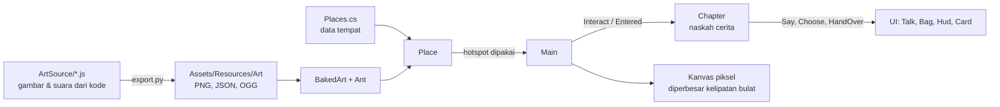
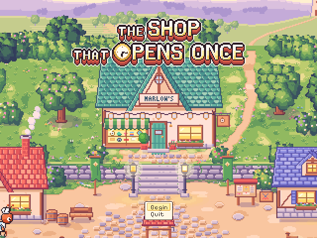
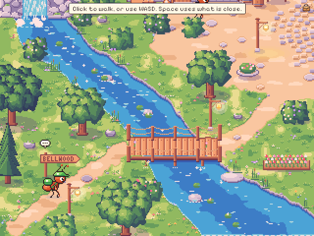
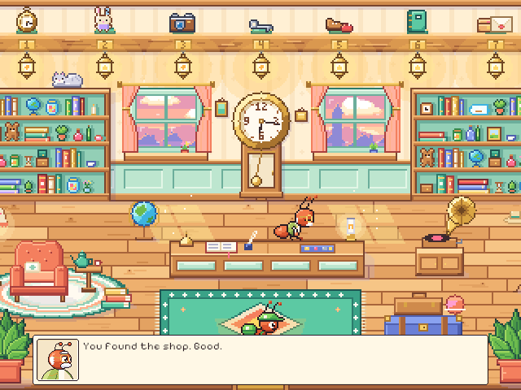
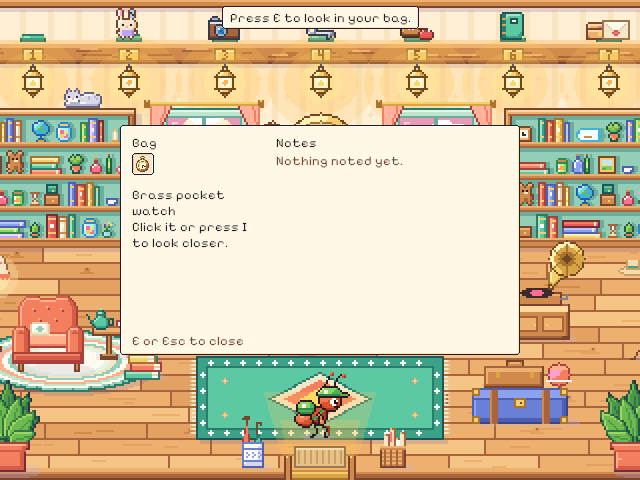
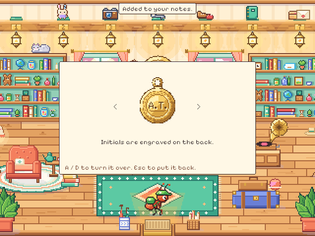
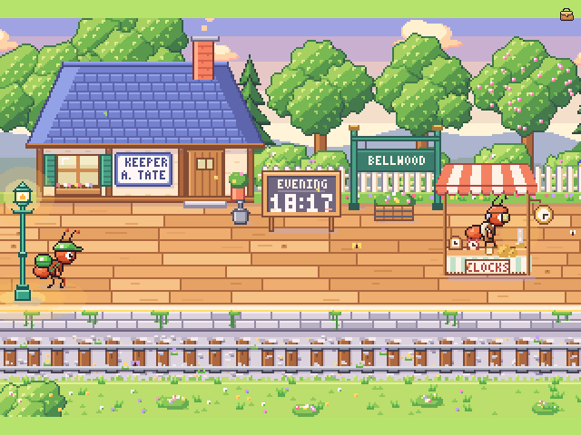

# 03. Pipeline art dan fondasi sistem game

**Tanggal:** 2026-10-18 · **Tag:** `m1-foundation`

## Tujuan

Membangun fondasi yang akan dipakai semua chapter, dari Prolog sampai Epilog:

- pipeline art buatan sendiri
- tempat yang bisa dijelajahi
- berjalan dengan klik atau keyboard
- dialog dan pilihan
- tas dan keepsake
- pergantian tempat
- simpan progres
- suara

Ceritanya sendiri belum dibuat di langkah ini.

## Yang dikerjakan

### Pipeline art (`game/ArtSource/`)

- Kode gambar dan suara dari presentasi disalin sebagai titik awal. Isinya toolkit pixel art `px.js`, para semut
  `chars.js`, desa Bellwood `world.js`, interior, logo judul, dan suara `audio.js`.
- Exporter dari versi Godot disesuaikan untuk Unity. Satu perintah, `python3 ArtSource/export.py`, menggambar
  semuanya di Chrome headless lalu menulis 134 file (PNG, JSON, OGG) ke `Assets/Resources/Art/` dalam sekitar 24 detik.
- Hasil PNG dan JSON-nya **sama persis byte demi byte** dengan art versi Godot. Artinya pipeline ini tidak bergantung
  pada engine.
- Font Pixelify Sans dan DM Sans dikonversi ke TTF agar bisa dipakai Unity.

### Fondasi sistem (`game/Assets/Scripts/`)

Inti game Godot di-*port* ke C#:

| Bagian | File | Isi |
|---|---|---|
| Art | `Core/Art.cs`, `Core/BakedArt.cs`, `Pixel.shader` | Memuat art hasil ekspor. Setiap tempat digambar sebagai satu mesh per lapisan, dan animasinya cukup mengganti UV. |
| Tempat | `Core/PlaceDef.cs`, `Core/Places.cs`, `Core/Place.cs` | Data tempat (orang, hotspot, pintu keluar, titik muncul), hover, dan interaksi |
| Berjalan | `Core/WalkMap.cs`, `Actors/Ant.cs` | Mask area jalan dari `walk.png`, pencarian jalur A*, serta animasi semut berjalan, berbicara, dan memberi atau menerima barang |
| Input | `Core/Controls.cs` | Mouse dan keyboard dengan Input System (klik, WASD/panah, Space/Enter, E, I, Esc, R) |
| UI | `UI/Talk.cs`, `UI/Hud.cs`, `UI/Bag.cs`, `UI/Card.cs`, `UI/Look.cs` | Kotak dialog dengan efek mengetik dan potret, pilihan, nama hotspot, gelembung interaksi, notifikasi, tas dan catatan, kartu judul, serta kursor piksel |
| Cerita | `Core/Chapter.cs`, `Core/Game.cs`, `Core/Keepsakes.cs` | Setiap chapter adalah kelas C# yang ditulis seperti naskah (`await Say(...)`, `await Choose(...)`, `await HandOver(...)`), ditambah keadaan cerita dan penyimpanan |
| Suara | `Core/Sound.cs` | Musik yang *cross-fade* antar suasana, angin, langkah kaki, dan efek |
| Layar | `Core/Main.cs` | Judul, alur chapter, pergantian tempat dengan fade, kamera, dan kanvas pixel-perfect |



**Chapter uji sistem** (`Chapters/DevChapter.cs`). Ini bukan bagian dari cerita. Isinya alur singkat yang
menguji semua sistem: dari desa masuk ke toko Marlow, menerima jam saku, membuka tas, pergi ke stasiun, menyerahkan jam
ke Helen, sebuah lentera padam, lalu progres disimpan. Chapter ini akan diganti oleh Prolog.

## Keputusan

| Keputusan | Alasan |
|---|---|
| Art: bagian yang sudah ada dipakai ulang, peta digambar ulang | Semut, potret, keepsake, UI, suara, dan toolkit sudah sesuai gaya. Peta GDD (4 zona, 9 interior) berbeda dari desa lama, jadi peta digambar ulang lewat kode. Tiga karakter baru dari GDD juga digambar. |
| Peta GDD hanya panduan tata letak | Peta GDD dipakai untuk mengetahui apa ada di mana dan bagaimana tempat terhubung. Gambarnya dibuat ulang dengan gaya kita sendiri. |
| Kanvas piksel dengan skala kelipatan bulat | Dunia dan UI digambar ke kanvas kecil (minimal 640x360), lalu diperbesar 1x, 2x, 3x, dan seterusnya agar piksel tetap tajam dan persegi |
| Shader sendiri yang *unlit* (`Shop/Pixel`) | Sprite bawaan URP 2D membutuhkan cahaya 2D. Tanpa cahaya, sprite tampil hitam. Art kita sudah membawa pencahayaannya sendiri. |
| Dev log dalam Bahasa Indonesia, satu entri per langkah | Untuk merekam progres tugas |

## Masalah dan solusinya

- **Animasi tempat sangat banyak.** Desa punya sekitar 1.769 potongan animasi dengan 54 ribu frame. Kalau dibuat satu
  sprite per potongan, game akan berat. Solusinya, satu mesh per lapisan, dan setiap frame hanya UV potongan yang
  berubah yang diperbarui.
- **UI Godot tidak bisa dipindah begitu saja.** Godot memakai node Control, sedangkan Unity memakai uGUI. Semua UI
  dibangun ulang lewat kode dengan posisi piksel dari kiri atas, sama seperti di Godot. Klik dicek langsung tanpa
  EventSystem karena UI berada di kanvas piksel.
- **Efek mengetik di teks Unity.** Komponen `Text` tidak punya fitur "tampilkan N huruf". Bagian yang belum terketik
  dibuat transparan, sehingga kata tidak meloncat ke baris berikutnya di tengah kalimat.
- **Input tidak terbaca saat menjalankan tes otomatis.** Input System mengabaikan keyboard ketika jendela Unity tidak
  aktif, yang selalu terjadi dalam mode batch. Pengaturan ini hanya diubah di dalam tes yang mengambil tangkapan layar.
- **Bentrok nama dan tipe di C#.** Misalnya method `Look()` bertabrakan dengan kelas `Look`, dan `Awaitable<bool>`
  tidak bisa dipakai di tempat yang meminta `Awaitable`. Semuanya diperbaiki sebelum tes dijalankan.

## Tangkapan layar

Diambil dari kanvas game (640x480, skala 1x). Art yang tampil masih set lama dari Godot, karena peta belum digambar
ulang. Jam 18:17, papan "KEEPER A. TATE", dan inisial A.T. di jam berasal dari cerita lama dan akan diganti.

| | |
|---|---|
|  Layar judul |  Menjelajah desa: notifikasi, gelembung interaksi di papan nama, ikon tas |
|  Kotak dialog dengan potret Marlow |  Tas berisi jam saku |
|  Membalik jam: sisi belakang menambah catatan |  Stasiun |

## Cara dicek

- **Kompilasi:** proyek dikompilasi tanpa error dan tanpa warning.
- **Tes otomatis** (`Assets/Tests/PlayMode/PlaythroughTest.cs`): memainkan chapter uji dari layar judul sampai selesai
  tanpa pemain. Tes memakai mask jalan dan tempat yang asli, lalu memeriksa bahwa:
  - Marlow memberi jam,
  - membalik jam menambah catatan,
  - Helen menerima jam,
  - satu lentera padam,
  - progres tersimpan ke chapter berikutnya.

  Hasilnya **lulus** (1/1) dalam 5,3 detik dengan waktu dipercepat 8x.
- **Pemeriksaan visual:** enam tangkapan layar di atas menunjukkan piksel tetap tajam, teks terbaca, dan UI berada di
  posisi yang benar.

Cara menjalankan tes sendiri (editor Unity untuk proyek ini harus ditutup dulu):

```sh
/Applications/Unity/Hub/Editor/6000.6.6f1/Unity.app/Contents/MacOS/Unity -batchmode -projectPath game \
  -runTests -testPlatform PlayMode -testResults results.xml
```

Atau dari editor: **Window → General → Test Runner → PlayMode → Run All**.

## Commit

- `7a4195b` feat(art): bring the art pipeline into game/ArtSource
- `4e37130` feat(game): port the core systems to C#
- Dev log dan pembaruan `GAME-CONTEXT.md`: commit `docs` setelah keduanya

## Langkah berikutnya

1. Menggambar ulang dunia sesuai GDD: 4 zona (Barat, Tengah, Timur, Selatan) dan 9 interior, beserta varian fase hari.
2. Menggambar 3 karakter baru dari GDD.
3. Prolog: Satria pulang ke Bellwood, sampai menemukan toko Marlow.
