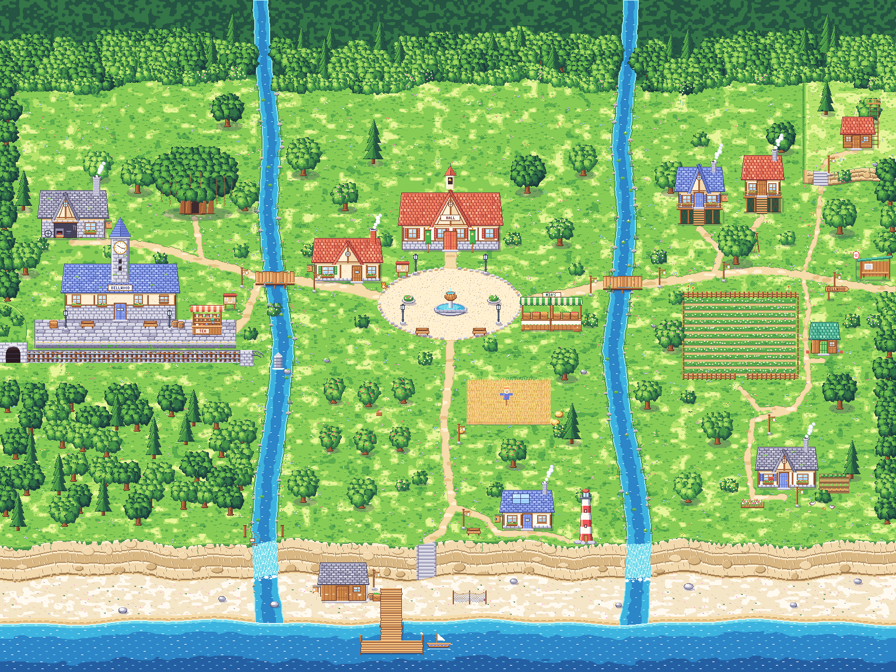
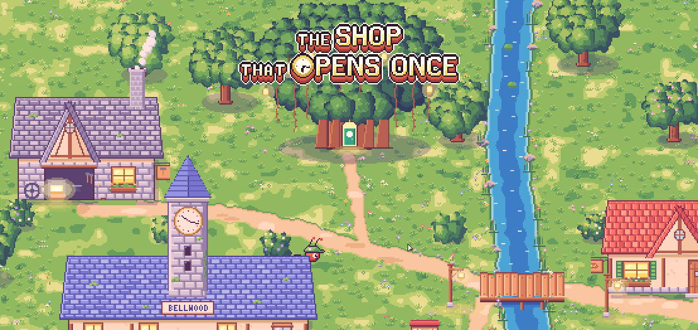
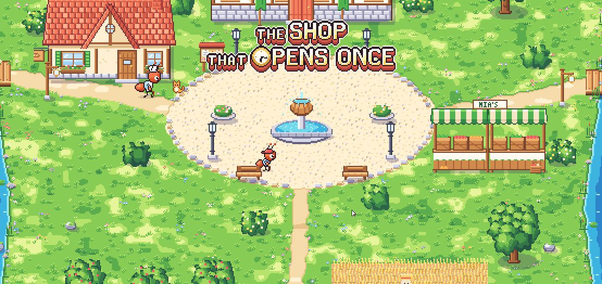
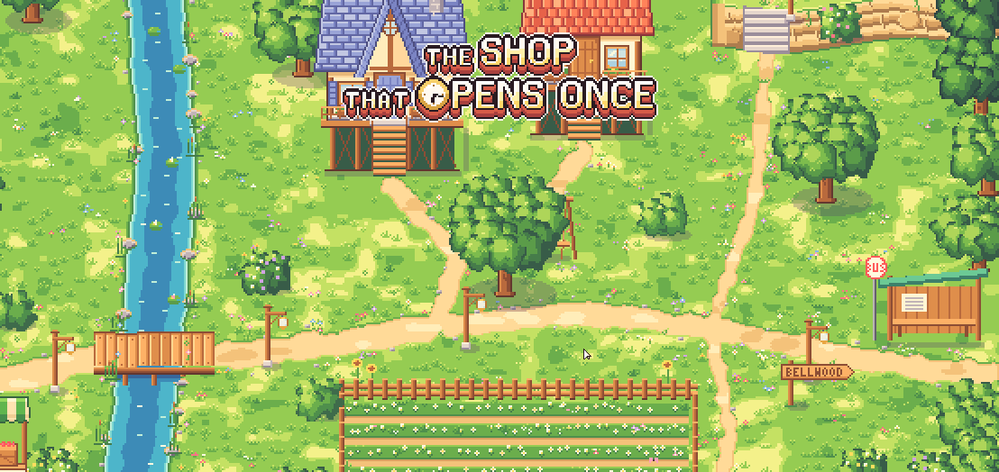
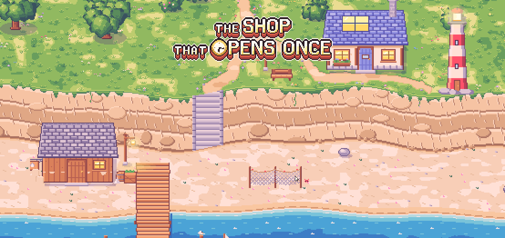
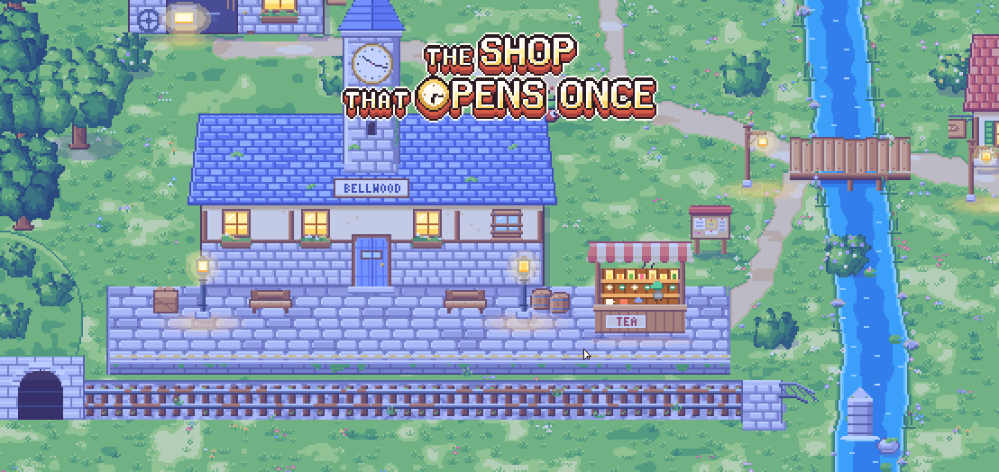
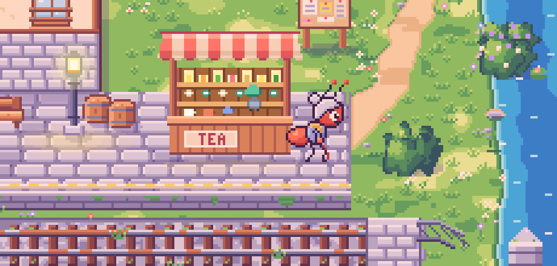
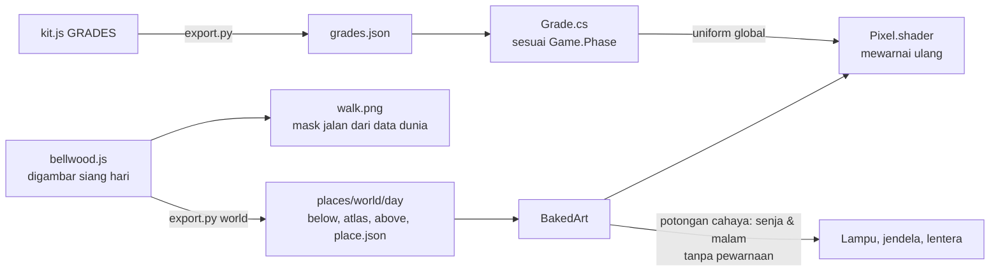

# 04. Dunia Bellwood: empat zona dalam satu peta

**Tanggal:** 2026-10-18 · **Tag:** `m2-world`

## Tujuan

Menggambar ulang dunia luar Bellwood sesuai GDD dan memasangnya di game. GDD (bagian 8.1) menyebut dunianya
*seamless connected world*, jadi keempat zona digambar sebagai **satu peta yang menyambung**, bukan empat scene
terpisah. Pemain bisa berjalan dari stasiun sampai ke pantai tanpa layar loading.

## Yang dikerjakan

### Peta dunia (`game/ArtSource/bellwood.js`)

Satu peta berukuran 1536x1152 piksel art, digambar seluruhnya lewat kode dengan gaya yang sama seperti presentasi.



| Zona | Isi |
|---|---|
| **Barat** | Stasiun tua dengan jam yang berhenti di 10:17, kios teh Helen di peron, bengkel pandai besi, terowongan dan rel kereta, serta toko Marlow di akar pohon beringin besar dengan tujuh lentera di dahannya |
| **Tengah** | Alun-alun dengan air mancur berbentuk kenari, balai desa, toko roti, lapak Mia, ladang gandum dengan orang-orangan sawah, dan kebun apel, diapit dua sungai |
| **Timur** | Rumah Nora dan rumah panggung, kebun kamomil, rumah Satria, halte bus, dan pondok pengintai Leo di atas bukit |
| **Selatan** | Studio Theo dan mercusuar di atas tebing, tangga turun ke pantai, gudang garam, jaring yang dijemur, dan dermaga |

Zona-zona tersambung lewat jembatan kayu di atas kedua sungai dan tangga di tebing. Air terjun mengalir di tempat
sungai jatuh dari tebing ke laut.

**Dunia yang hidup.** Air sungai dan laut berkilau, ombak memecah di pantai, rumput dan bunga bergoyang, asap keluar
dari cerobong, burung terbang melintas, ayam, kucing, dan kepiting berkeliaran, kupu-kupu muncul di pagi dan siang
hari, dan kunang-kunang muncul di malam hari.

### Fase hari lewat shader

Dunia digambar **sekali saja, pada siang hari**. Game lalu mewarnai ulang gambar itu sesuai fase hari (pagi, siang,
senja, malam) di dalam shader `Pixel.shader`:

```
hasil = warna * mul + add + shade * (1 - kecerahan)     (sRGB, 0-255)
```

Nilai `mul`, `add`, dan `shade` untuk setiap fase ada di `ArtSource/kit.js` dan diekspor ke `grades.json`, sehingga
preview di browser dan game memakai rumus yang persis sama.

Cahaya (jendela yang menyala, lampu jalan, lentera, nyala tungku, kunang-kunang) adalah potongan terpisah yang
**tidak pernah diwarnai ulang** dan hanya muncul saat senja dan malam. Kupu-kupu hanya muncul pagi dan siang.

| | |
|---|---|
|  Layar judul: toko Marlow di akar beringin, senja |  Zona Tengah, siang |
|  Zona Timur, pagi |  Zona Selatan, senja |
|  Zona Barat, malam |  Helen di samping kios tehnya |

### Di dalam game (`game/Assets/Scripts/`)

| File | Perubahan |
|---|---|
| `Pixel.shader`, `Core/Grade.cs` | Pewarnaan fase hari di luar ruangan. Di dalam ruangan gambar tampil apa adanya. |
| `Core/BakedArt.cs`, `Core/Art.cs` | Potongan cahaya dibuat hanya saat senja dan malam, memakai material yang tidak diwarnai ulang, dan digambar tepat di atas dinding pemiliknya. Kupu-kupu hanya dibuat pagi dan siang. |
| `Core/Places.cs` | Tempat `world` menggantikan `village` dan `station`: Helen, tukang roti, anak desa, pintu toko Marlow, jam stasiun, dan dua papan pengumuman |
| `Core/Main.cs` | Layar judul menghadap toko Marlow |
| `Chapters/DevChapter.cs`, `Tests/PlayMode/PlaythroughTest.cs` | Alur uji sistem: dunia → toko → dunia → Helen |



## Keputusan

Semua keputusan ini juga dicatat di `GAME-CONTEXT.md`.

| Keputusan | Alasan |
|---|---|
| Dunia luar adalah satu peta yang menyambung | GDD 8.1 menyebut *seamless connected world*. Jalan kaki dari zona ke zona terasa seperti satu desa kecil, dan tidak ada layar loading di tengah. Interior tetap tempat terpisah di balik pintu. |
| Fase hari diwarnai di shader, bukan digambar ulang per fase | Menggambar setiap tempat empat kali berarti empat kali ukuran file dan empat kali waktu ekspor. Dengan shader, satu gambar cukup dan rumusnya sama dengan preview. Ini merevisi keputusan lama "digambar per fase". |
| Cahaya adalah potongan terpisah yang tidak diwarnai | Lampu harus tetap terang dan hangat di malam hari. Kalau ikut diwarnai, lampu ikut menjadi biru. |
| Kios teh Helen di peron stasiun | Sebagian besar GDD menempatkannya di sana. Hanya bagian 5.2 yang menyebut toko kelontong di zona Tengah. |
| Toko Marlow di akar beringin dekat stasiun | Sesuai teks GDD. Legenda peta zona Tengah yang menyebut "Toko Marlow" dianggap keliru. |
| Bukit Leo di timur laut zona Timur | GDD menyebut Leo tinggal di puncak bukit, tetapi peta zonanya tidak punya bukit. Bukit ditambahkan di atas kebun. |
| MCP Unity tersambung lewat HTTP | Server MCP sekarang dijalankan oleh paket Unity sendiri, jadi `.mcp.json` cukup menunjuk ke `http://127.0.0.1:8080/mcp`. |

## Masalah dan solusinya

- **Mask jalan.** Awalnya beberapa jalan setapak berakhir di dalam bangunan atau terhalang lampu dan pohon. Mask
  sekarang dihitung dari data dunia, yaitu air, tebing, rel, dinding bangunan, dan jejak setiap properti, lalu
  diperlebar sesuai ukuran semut. Ekspor **gagal** jika ada jalan setapak atau titik penting yang tidak bisa dicapai
  dari titik awal. Dengan begitu, kesalahan ketahuan saat ekspor, bukan saat bermain.
- **Papan nama ikut menutup jalan.** Jejak bangunan awalnya diambil dari piksel terbawahnya, sehingga papan yang
  tergantung di dinding ikut dihitung. Untuk bangunan, jejak sekarang diambil dari bentang dindingnya saja.
- **Ukuran atlas.** Setiap potongan yang bergerak punya banyak frame. Semua animasi tanah disamakan iramanya menjadi
  2 detik dan kilau air diletakkan pada kisi tetap, sehingga frame yang sama bisa dipakai bersama. Hasilnya, 309
  potongan muat di satu atlas 2047x1000.
- **Tebing tampak seperti tembok batu.** Tebing digambar ulang sebagai lapisan batu kapur yang berlapis-lapis.
  Bukit Leo diberi dataran yang lebih terang, sisi tanah, dan tepi berumput agar terlihat lebih tinggi.
- **Jendela tidak menyala.** Potongan cahaya punya baris kaki yang sama dengan bangunannya, sehingga urutan gambarnya
  seri dan cahaya tertutup dinding. Potongan cahaya sekarang digambar tepat setelah semua yang berada di baris yang
  sama.
- **Helen tidak terlihat.** Helen awalnya berdiri di belakang konter, tetapi rak di belakang kios menutupinya
  seluruhnya. Helen dipindah ke ujung kiosnya, menghadap kios.
- **Nama perahu.** Perahu sempat diberi nama yang tidak ada di GDD. Nama itu dihapus karena isi cerita tidak boleh
  dikarang.

## Cara dicek

- **Ekspor:** `python3 ArtSource/export.py world` selesai dalam sekitar 22 detik. Pemeriksaan mask jalan lulus:
  19 jalan setapak dan 30 titik penting semuanya bisa dicapai.
- **Kompilasi:** dicek lewat MCP (`refresh_unity` lalu `read_console`), tanpa error.
- **Tes otomatis:** `PlaythroughTest` dijalankan lewat MCP (`run_tests`, PlayMode) dan **lulus** (1/1) dalam 3,9
  detik dengan waktu dipercepat 8x. Alurnya: dunia → pintu toko di akar beringin → toko (Marlow memberi jam) →
  kembali ke dunia → berjalan ke Helen di peron → jam diserahkan → lentera padam → progres tersimpan.
- **Pemeriksaan visual:** tangkapan layar di atas diambil dari kanvas game di play mode untuk keempat fase.
  Pewarnaannya cocok dengan rumus di `kit.js`. Jendela, lampu, dan lentera menyala saat senja dan malam, dan
  kupu-kupu muncul pagi dan siang.

## Commit

- `d1fed1a` build: connect the Unity MCP over HTTP
- `df0e330` feat(art): redraw Bellwood as one seamless world of the four zones
- `07b5378` feat(game): play the new world, graded for the time of day
- Dev log dan pembaruan `GAME-CONTEXT.md`: commit `docs` setelahnya

## Langkah berikutnya

1. Menggambar ulang sembilan interior sesuai GDD, termasuk toko Marlow tanpa motif 18:17, beserta pintu masuknya
   dari dunia.
2. Menggambar tiga karakter baru dari GDD.
3. Prolog: Satria pulang ke Bellwood, sampai menemukan toko Marlow.
