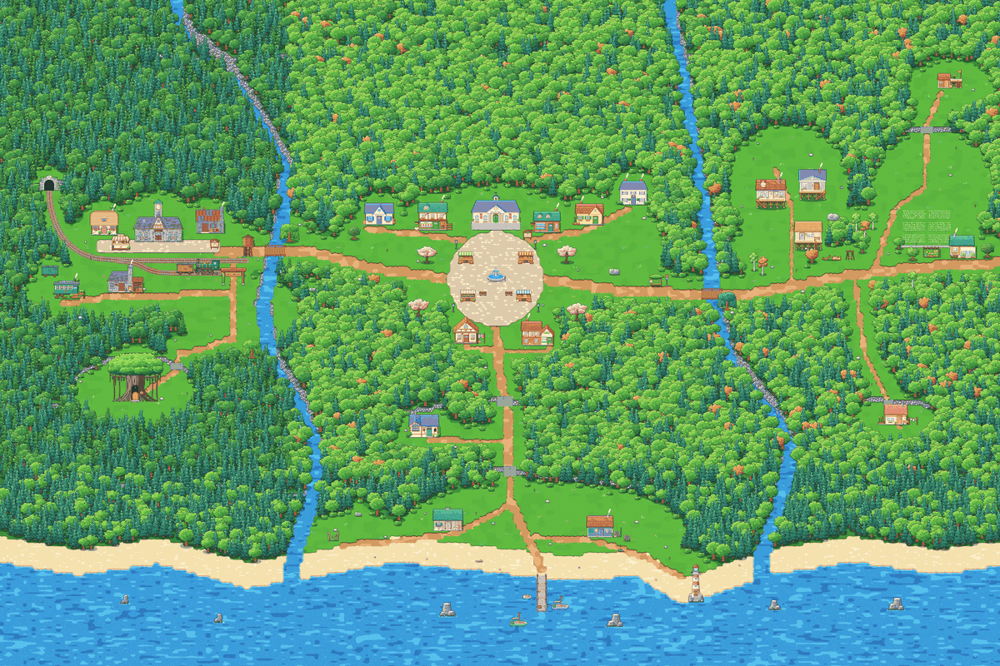
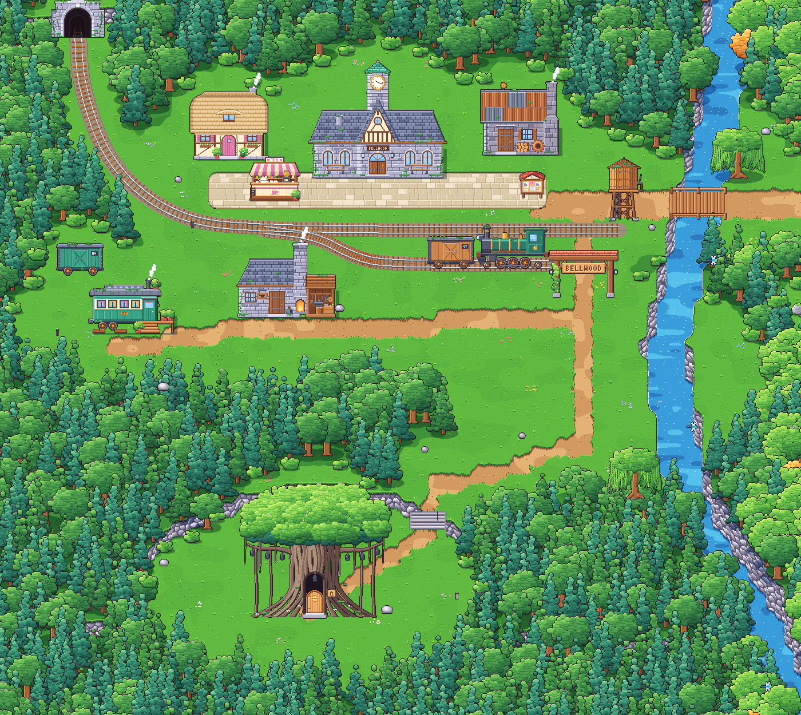
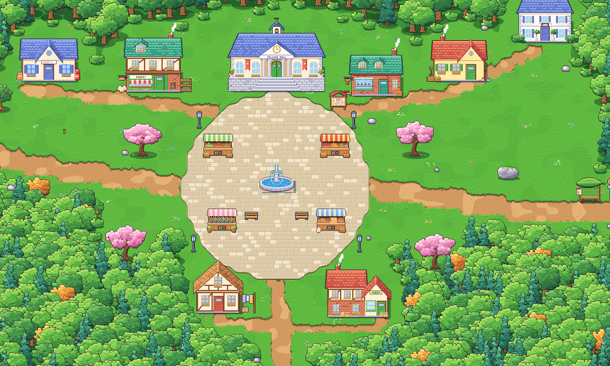
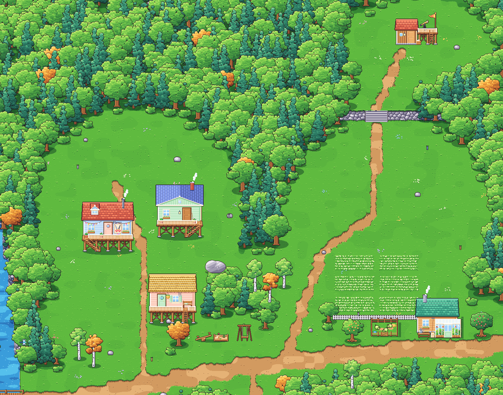
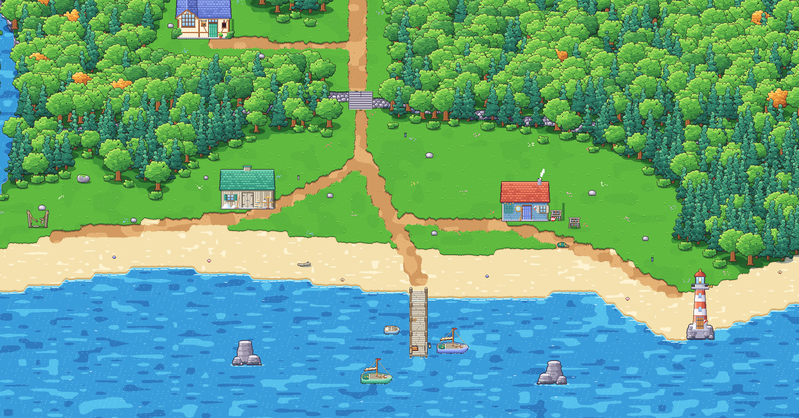
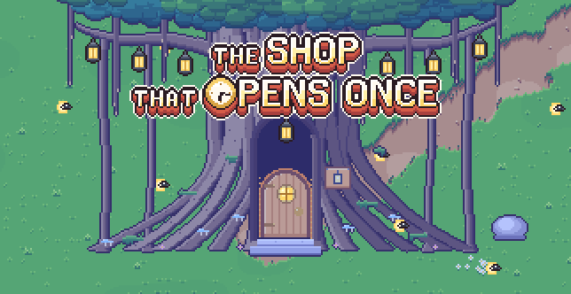

# 05. Bellwood digambar ulang: desa gaya RPG yang hidup

**Tanggal:** 2026-10-18

## Tujuan

Mengganti tampilan dunia luar Bellwood. Tampilan "fabel" sebelumnya (rumah dari kulit kenari dan biji ek, semanggi
raksasa, warna yang diredam) terasa datar dan seperti dua hal yang ditempel: semutnya di satu sisi, dunianya di sisi
lain. Arah barunya adalah **desa RPG top-down yang nyaman** seperti di Harvest Moon dan paket aset desa di itch.io:
atap besar, dinding pendek, tebing batu abu-abu, sungai biru cerah, dan hutan yang lebat. Semutnya tetap satu-satunya
penduduk, dan serangga tetap satu-satunya hewan.

Urutan kerjanya: **seluruh peta luar dulu**, interior dan detail kecil belakangan. Dunianya juga harus terasa hidup:
pohon bergoyang ditiup angin, bayangan awan lewat, serangga beterbangan.

## Yang dikerjakan

### Belajar dari paket aset, tanpa menyalin

Lisensi paket aset (zedpxl, LimeZu, Maeve, Kenmi, anokolisa) tidak bisa dibeli, jadi paket-paket itu hanya
**dipelajari tekniknya**. Tidak ada satu piksel pun yang disalin, dijiplak, diunduh, atau diambil sampelnya. Semua
digambar dengan kode kami sendiri. Tekniknya:

- bidang warna rata dengan sedikit goresan yang disengaja;
- garis tepi gelap di semua benda yang berdiri;
- daun berbentuk gumpalan dengan sisi atas terang dan bawah gelap;
- ketebalan di mana-mana (dinding tebing, tepi jalan, lis atap, fondasi);
- bayangan tegas satu tingkat lebih gelap.

Catatannya ada di `game/ArtSource/ART.md`.

### Peta dunia (`game/ArtSource/world.js`)

Satu peta 4800x3200 piksel art (300x200 petak), mengikuti peta dunia di GDD: dua sungai berkelok ke laut di bawah
jembatan, kota di atas dataran tinggi, punggung bukit di utara, teras dan pantai di bawah, hutan lebat di antara
tempat-tempat, dan jalan utama yang melewati setiap zona.

| Zona | Isi |
|---|---|
| **Barat** | Stasiun dengan jam yang berhenti di 10:17, peron dengan kios teh Helen dan papan pengumuman, rumah Helen dan rumah Mender, rel dari terowongan, lokomotif dan gerbong di jalur samping, menara air, bengkel pandai besi, gerbong rumah Kapten Bram, gerbang BELLWOOD, dan beringin besar dengan toko Marlow di cekungan |
| **Tengah** | Alun-alun bundar dengan air mancur, balai desa, empat lapak pasar, toko roti, kantor pos, rumah Mia dan Pip, rumah Sam, tukang sepatu, penenun, dan penjual benih |
| **Timur** | Tiga rumah panggung (termasuk rumah Nora), halte, taman bermain, rumah tukang kebun dengan kandang kutu daun, ladang kamomil, pondok Leo di bukit, dan rumah Satria di teras |
| **Selatan** | Studio Theo di tebing, gudang garam, rumah Arlo, sisa jembatan tali, dermaga dengan perahu, mercusuar, dan batu karang di laut |

| | |
|---|---|
|  Zona Barat |  Zona Tengah |
|  Zona Timur |  Zona Selatan |

### Kit gambar (`village.js` dan `village-*.js`)

| File | Isi |
|---|---|
| `village.js` | Pelukis tanah: level teras dengan dinding tebing, tangga, sungai, laut, pasir, jalan tanah, paving, dan rumput. Juga daun, pohon, cemara, semak, dan properti kecil |
| `village-west.js` | Stasiun, peron, kios teh, lokomotif, gerbong, menara air, terowongan, bengkel, beringin, lentera, rumah Helen, Mender, dan Bram |
| `village-centre.js` | Air mancur, balai desa, toko roti, kantor pos, lapak, papan pengumuman, bangku, lampu, dan lima rumah warga |
| `village-south.js` | Dermaga, perahu, mercusuar, gudang garam, rumah Arlo, studio Theo, batu karang, dan barang-barang pantai |
| `village-east.js` | Rumah panggung, rumah Satria, rumah tukang kebun, pondok Leo, halte, ayunan, taman bermain, kamomil, pagar, dan kandang kutu daun |
| `village-nature.js` | Pohon ek, birch, sakura, pohon buah, dedalu, batu, kayu, properti halaman, dan serangga |

Bangunan cerita utama digambar unik dan kaya detail. Rumah warga latar boleh lebih sederhana.

### Dunia yang hidup

- **Angin** (`Pixel.shader`, `BakedArt.cs`): setiap baris tekstur pohon dan semak digeser utuh per texel, makin ke atas
  makin jauh, dengan dua gelombang lambat supaya hembusannya tidak seragam. Pikselnya tetap tajam.
- **Bayangan awan** (`Pixel.shader`, `Grade.cs`): bayangan awan bergerak di atas tanah dengan tepi mengikuti grid
  piksel. Bayangannya paling kuat siang hari, lebih tipis pagi dan senja, tidak ada di malam hari dan di dalam ruangan.
- **Serangga dan lainnya:** kupu-kupu dan capung siang hari, kunang-kunang malam hari, asap cerobong, kilau air, ombak
  di pantai, perahu yang terayun, dan air mancur.
- **Malam:** jendela, lampu jalan, dan tujuh lentera beringin menyala.

## Keputusan

Semua keputusan dicatat di `GAME-CONTEXT.md` (2026-10-18):

- Tampilan desa RPG menggantikan tampilan fabel.
- Paket aset hanya dipelajari tekniknya.
- Peta luar dikerjakan dulu, interior belakangan.
- Ukuran dan tata letak peta mengikuti GDD.
- Dunia dihidupkan lewat shader angin dan awan.
- Grade warna "look" seluruh dunia dihapus; hanya grade fase hari yang tersisa.
- Pohon hutan tidak bisa dilewati dari belakang.

**Pohon hutan sebagai decal.** Hutan berisi sekitar 9.000 pohon. Kalau setiap pohon menjadi objek yang diurutkan
dengan pemain, jumlahnya lebih dari 7.000 objek di Unity. Jadi pohon hutan digambar di bawah semua objek, dan tanah di
bawah mahkotanya dibuat padat. Pemain hanya bisa berjalan sampai tepi hutan dan di depan pohon, tidak pernah di
belakangnya, sehingga mahkota pohon tidak perlu digambar di atas pemain. Mahkota yang akan menutupi jalan diganti
semak. Hasilnya dunia hanya punya sekitar 500 objek, lebih sedikit dari peta lama (604).

## Masalah dan solusinya

| Masalah | Solusi |
|---|---|
| Sungai dan tebing tampak bertangga mengikuti petak | Nilai tiap petak diburamkan dua kali menjadi bidang per piksel, sehingga deretan petak terbaca sebagai satu bentuk bulat |
| Mahkota pohon terlihat seperti arsiran atau bata | Gumpalan daun dibuat lebih besar dengan tiga ukuran, ada lapisan gelap di bawahnya, dan gumpalan atas menimpa yang bawah |
| Pantai punya serpihan rumput di antara jalan, pasir, dan laut | Aturan baru antara jalan dan pasir, serta petak laut tersendiri yang ikut menghitung pasir |
| Ujung barat jembatan terhalang tepi sungai, sehingga zona Tengah tidak terjangkau | Dek jembatan selalu bisa dilewati, termasuk di atas tepi sungai |
| Garis bibir tebing di puncak tangga menutup jalan ke rumah Satria | Bibir tebing tepat di atas dan di bawah anak tangga dihitung sebagai tangga |
| `_MainTex_TexelSize` mematikan SRP batcher | Ukuran atlas dibaca langsung dari tekstur (`GetDimensions`) |

## Cara dicek

- `python3 ArtSource/export.py world --force`: ekspor berhasil, dan masker jalan memastikan setiap pintu, titik
  muncul, dan tempat cerita bisa dijangkau dari stasiun.
- `python3 ArtSource/export.py rooms --force`: ruangan diekspor ulang tanpa grade "look" lama.
- Unity 6.6 mengompilasi tanpa error dan tanpa peringatan shader.
- PlayMode test: `PlaythroughTest` (berjalan ke toko Marlow, masuk, keluar, lalu ke Helen) dan `RunTest` (Shift untuk
  berlari) lulus, 2 dari 2.
- Game dijalankan di editor dan diperiksa pada pagi, siang, senja, dan malam.

## Commit

`dc3cfb3` feat(world): redraw Bellwood as a living pack-style RPG village

## Langkah berikutnya

- Penduduk desa yang hidup: rumah, pekerjaan, dan rutinitas mereka di setiap fase hari.
- Interior sembilan ruangan dengan gaya yang sama.
- Detail kecil di peta: lebih banyak properti halaman, jalan setapak, dan papan nama.
