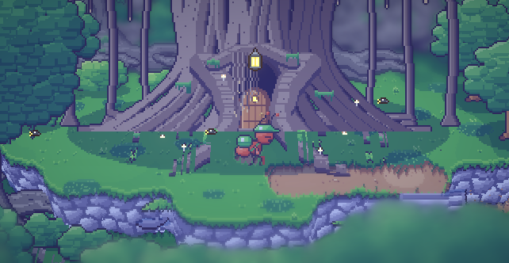
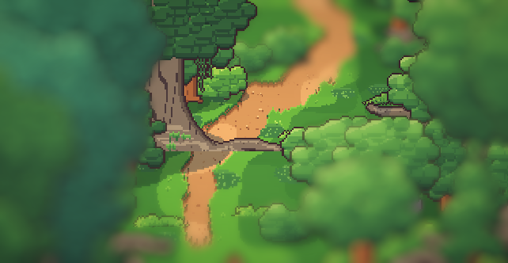
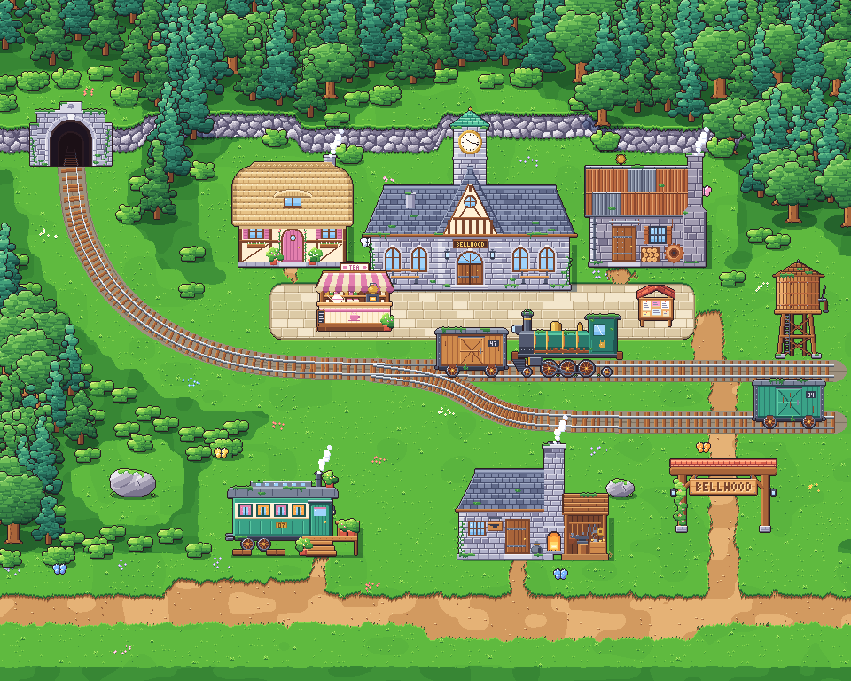
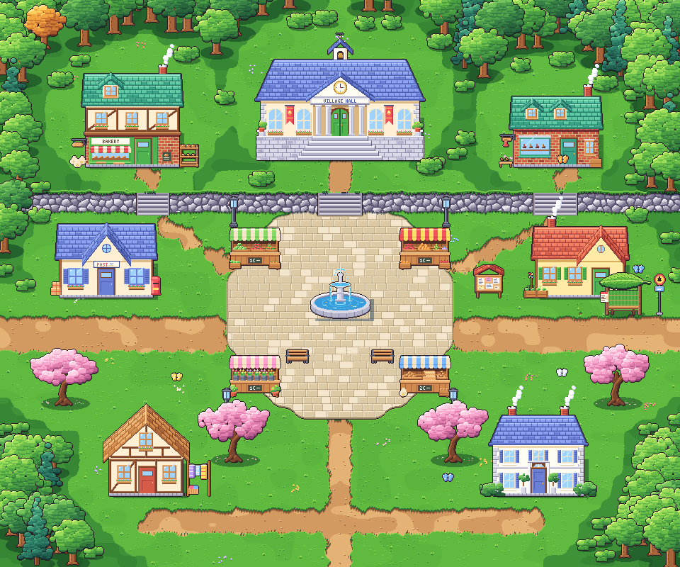
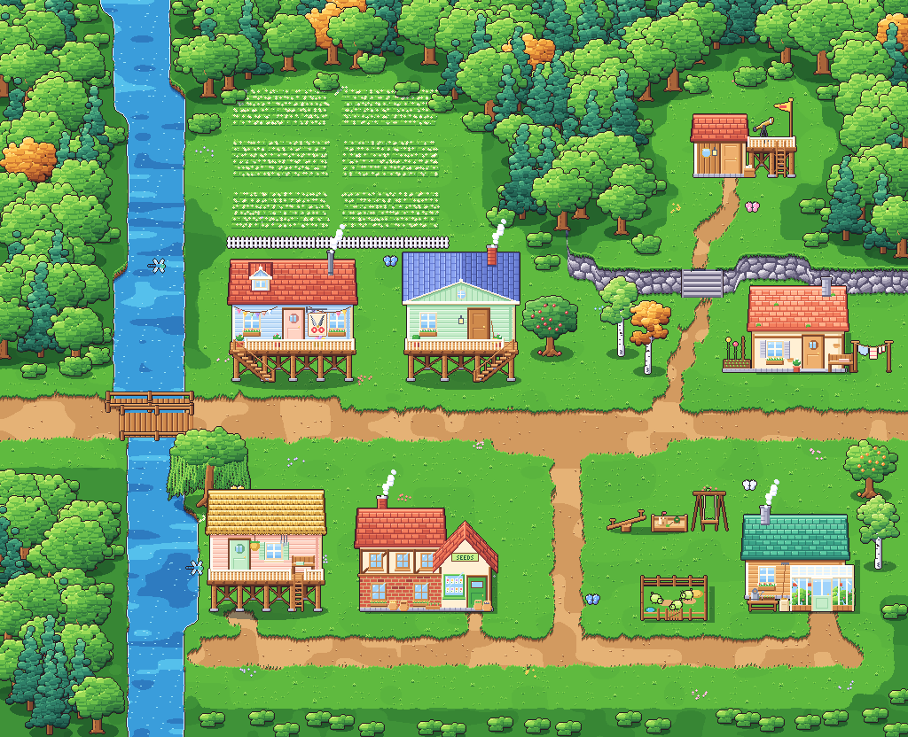
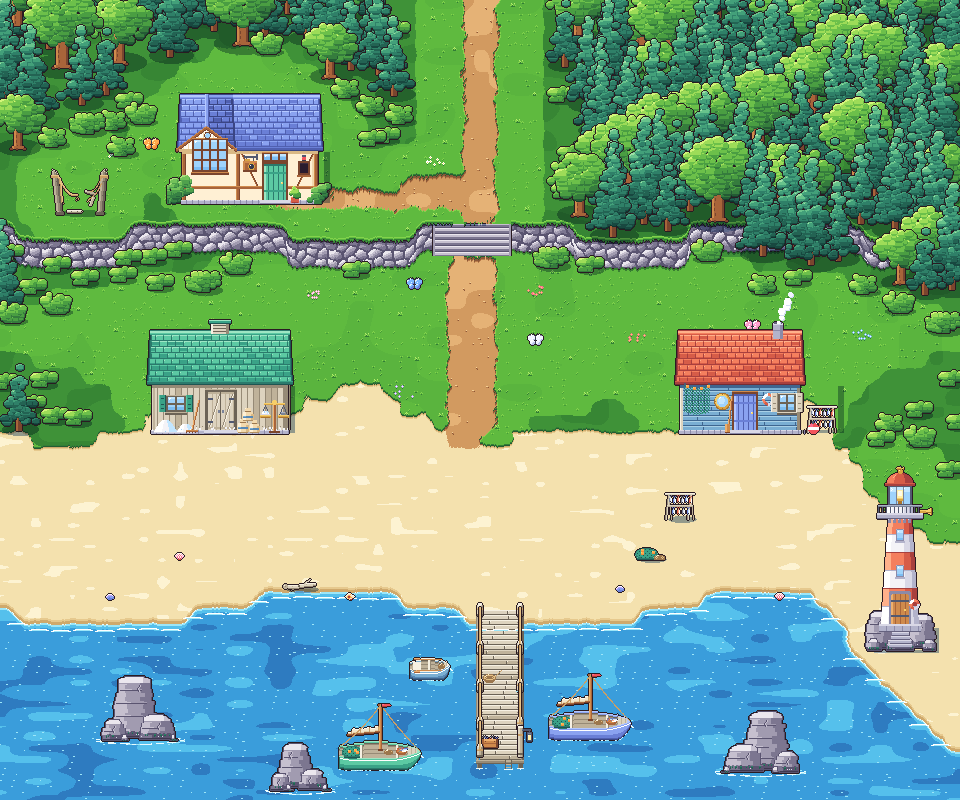
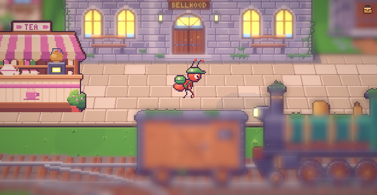
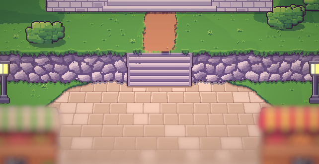
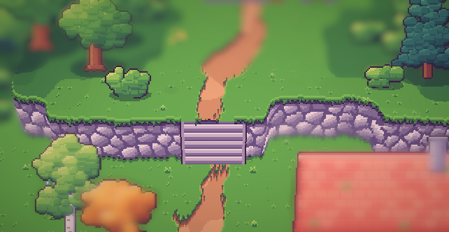

# 06. Tampilan HD-2D, hutan beringin tersembunyi, dan lima area kecil

**Tanggal:** 2026-10-18

## Tujuan

Setelah melihat peta Bellwood yang baru, ada tiga masukan:

1. **Petanya terlalu besar.** Satu peta tanpa jeda 4800x3200 piksel membuat berjalan terasa lama dan kosong. Kami
   meneliti cara game top-down terkenal membangun kota: kota dibagi menjadi beberapa peta kecil, satu peta untuk
   satu bagian kota, dengan perpindahan singkat di tepinya.
2. **Kameranya dibuat seperti Octopath Traveler**, yaitu gaya "HD-2D" atau 2.5D: dunia piksel yang berdiri di ruang
   3D, dengan tebing yang benar-benar tinggi, efek miniatur (tilt-shift), dan cahaya yang berpendar.
3. **Toko Marlow salah arah.** Toko itu harus tersembunyi di dalam hutan. Pemain menyusuri jalan setapak yang sempit
   dan berkelok di antara pohon-pohon raksasa yang akarnya kusut, semak lebat, dan lumut. Di ujungnya ada pohon
   beringin besar dengan pintu kayu kecil di celah akarnya. Pintunya tersembunyi tetapi tetap bisa dikenali, bukan
   rumah yang berdiri sendiri dan bukan pintu yang melayang. Jalannya juga tidak boleh membuat pemain tersangkut.

Urutan kerjanya: (1) satu contoh hutan beringin dalam HD-2D untuk dinilai, (2) membagi dunia menjadi lima area,
(3) memastikan semua area tampil benar dalam HD-2D.

## Yang dikerjakan

### Tampilan HD-2D

Art tetap digambar dari atas dengan kode, seperti sebelumnya. Yang berubah adalah cara game menampilkannya:

- **Tanah bertinggi.** Setiap area mengekspor `height.png`. Kanal merahnya menyimpan tinggi tiap piksel, dan kanal
  hijaunya menandai piksel dinding tebing yang berdiri tegak. `Relief.cs` membangun mesh tanah dari peta itu,
  sehingga tebing, tepi sungai, dan tangga benar-benar naik.
- **Benda berdiri sebagai kartu.** Bangunan, pohon, dan semut berdiri tegak lalu dimiringkan ke belakang agar
  menghadap kamera.
- **Kamera perspektif** menunduk 45 derajat dengan sudut pandang sempit, jadi setiap piksel jatuh tepat di tempat
  ia digambar dan pikselnya tetap persegi.
- **Efek:** depth of field bokeh untuk kesan miniatur, bloom untuk jendela, lampu, lentera, dan kunang-kunang, serta
  vignette tipis.
- **Renderer:** URP sekarang memakai Universal Renderer, bukan Renderer 2D. UI digambar oleh kamera ortografis
  terpisah ke kanvasnya sendiri, lalu ditumpuk di atas dunia.

### Hutan beringin tersembunyi (`game/ArtSource/village-grove.js`)

Gambar baru yang dibuat dengan kode:

- `grandTree`: pohon kuno dengan akar banir yang kusut, batang yang melebar, dan tajuk gelap;
- `hiddenBanyan`: beringin raksasa dengan akar gantung, batang berpilin, dan pintu kayu kecil di celah akarnya.
  Pintunya punya jendela yang menyala, gelang kuningan, anak tangga dari akar, tirai akar, lumut, jamur yang
  berpendar, dan tujuh kait lentera;
- pakis, batang kayu tumbang, dan batu berlumut.

Jalan setapaknya berkelok dari sisi stasiun, naik undakan akar ke sebuah bukit kecil, dan berakhir di depan pintu.
Pohon kuno hanya ditanam di belakang atau di samping jalan, tidak pernah di depannya, karena dalam tampilan 3D tajuk
di antara kamera dan jalan akan menutupi jalan itu.

### Lima area kecil (`game/ArtSource/areas.js`)

Satu peta besar diganti dengan lima area. Masing-masing bisa dilintasi dalam sekitar 15 detik dan ukurannya paling
besar sekitar 1024x832 piksel art. Pintu keluar ada di tepi area, dan perpindahannya memakai fade singkat.

| Area | Isi | Keluar ke |
|---|---|---|
| Stasiun | Stasiun dengan jam yang berhenti di 10:17, kios teh Helen di peron, kereta yang menunggu, terowongan di tebing, menara air, bengkel pandai besi, gerbong rumah Bram, rumah Helen dan Mender, gerbang BELLWOOD | Barat: hutan beringin. Timur: alun-alun. |
| Hutan beringin | Jalan setapak ke toko Marlow | Timur: stasiun |
| Alun-alun | Balai desa, toko roti, dan rumah bata di atas teras berundak; air mancur, kios Mia, bangku, dan lampu; kantor pos, rumah Mia, Sam, dan penenun; halte bus | Barat: stasiun. Timur: timur desa. Selatan: pantai. |
| Timur desa | Jembatan di atas sungai, rumah panggung Nora, ladang kamomil, taman bermain, kandang aphid, rumah tukang kebun, toko benih, rumah Satria, pondok Leo di atas bukit | Barat: alun-alun |
| Pantai | Studio Theo di atas tebing, sisa jembatan tali, tangga turun ke pantai, gudang garam, rumah Arlo, dermaga, perahu, batu laut, mercusuar | Utara: alun-alun |

Pembangun area dibuat berbasis data. Setiap area cukup menuliskan level tanahnya, air, pasir, paving, jalan, rel,
tempat terbuka, jenis pohon, dan letak bangunannya. Pembangun lalu mengisi sisanya: hutan di tepi, tangga di mana
jalan melewati tebing, jembatan di mana jalan melewati sungai, ombak di tepi pantai, serangga, dan bayangan. Fitur rel,
jembatan, air, dermaga, dan ladang dipindahkan dari `world.js` lama, dan `world.js` dihapus.

Dalam HD-2D:

## Keputusan

Semua keputusan ini juga dicatat di `GAME-CONTEXT.md`.

- **Lima area kecil, bukan satu peta tanpa jeda.** Keputusan ini menggantikan "seamless connected world" di GDD 8.1.
  Area kecil lebih padat, lebih cepat dilintasi, dan setiap bagian kota punya suasananya sendiri.
- **Tampilan HD-2D seperti Octopath Traveler.** Art tetap digambar 2D dengan kode. Hanya cara menampilkannya yang
  menjadi 3D.
- **Toko Marlow tersembunyi di hutan beringin di barat stasiun**, di celah akar beringin, dan bukan bangunan sendiri.

## Masalah dan solusinya

- **Tanah tidak terlihat.** Shader membaca kanal UV kedua dan ketiga, sedangkan mesh tanah tidak memilikinya. Mesh
  sekarang diberi kanal UV kosong.
- **Pohon rebah ke tanah.** Rumus titik atas kartu menambahkan kedalaman yang salah. Setelah diperbaiki, setiap baris
  kartu memakai barisnya sendiri.
- **Celah di sisi tebing terlihat dalam perspektif.** Mesh sekarang menambahkan dinding samping di antara kolom yang
  tingginya berbeda.
- **Pohon kuno di depan jalan menjadi gumpalan buram raksasa.** Pohon dipindah ke belakang dan ke samping jalan, dan
  tajuk hutan tidak boleh menutupi tanah terbuka.
- **Kamera fokus di ketinggian yang salah.** Saat kamera diarahkan ke tempat lain, misalnya dari atas tebing ke
  pantai, fokusnya tetap di ketinggian tanah tempat kurir berdiri, sehingga pantainya buram. Fokus sekarang mengikuti
  ketinggian tanah di titik yang dilihat.
- **Tangga ke bukit Leo bergeser dari jalannya.** Jalannya memotong tebing secara miring. Sekarang jalan itu memotong
  tebing lurus ke bawah.

## Cara dicek

- Ekspor semua area dengan `python3 game/ArtSource/export.py --force areas`. Ekspor gagal kalau ada pintu, titik
  datang, atau jalan yang tidak bisa dicapai dari titik awal area.
- Tangkapan layar setiap area di editor Unity, dalam tampilan HD-2D dan sebagai peta datar.
- Tes PlayMode lulus 2 dari 2:
  - `PlaythroughTest` berjalan dari stasiun ke hutan beringin, masuk toko Marlow, kembali, lalu melewati setiap pintu
    keluar area (stasiun, alun-alun, timur, alun-alun, pantai, alun-alun, stasiun) sebelum menemui Helen;
  - `RunTest` memastikan kurir bisa berlari di stasiun.

## Commit

- `411fbcd` feat(view): show Bellwood in an HD-2D 3D view and add the banyan grove
- `a2f6227` feat(world): split Bellwood into five small areas joined by edge exits

## Langkah berikutnya

- Pertanyaan terbuka: pada siang hari, apakah celah akar beringin memperlihatkan pintu yang tertutup, atau tidak ada
  apa-apa? Toko hanya buka pukul 00.00–00.30.
- Penduduk desa yang hidup: rumah, pekerjaan, dan rutinitas mereka di setiap fase hari.
- Sembilan interior.
