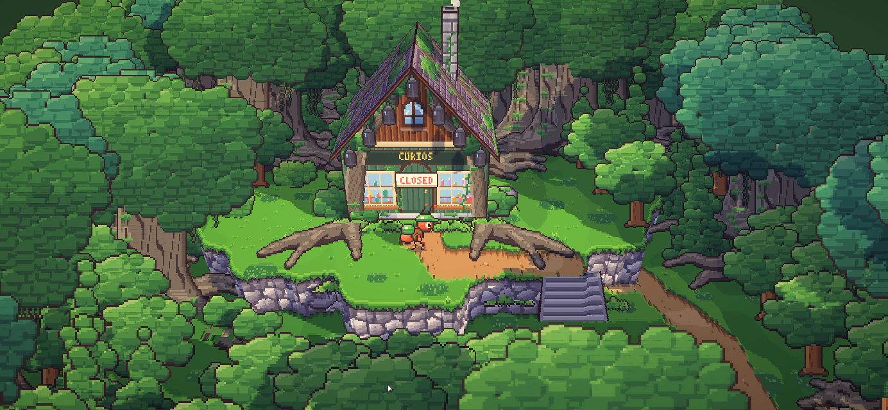
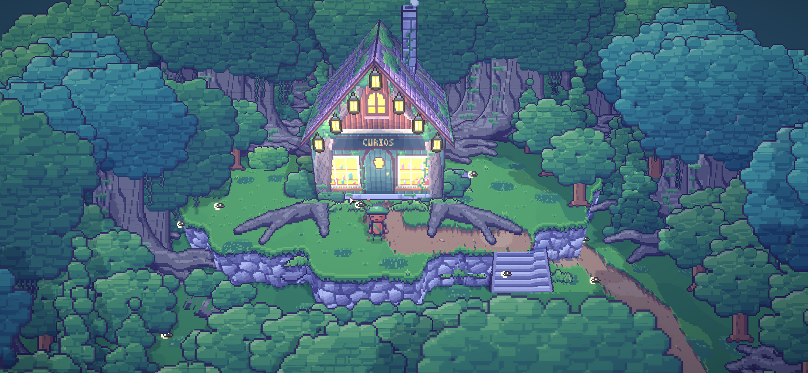
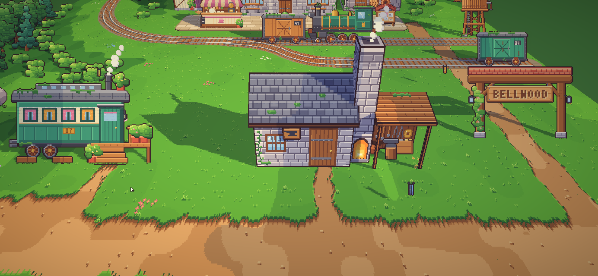
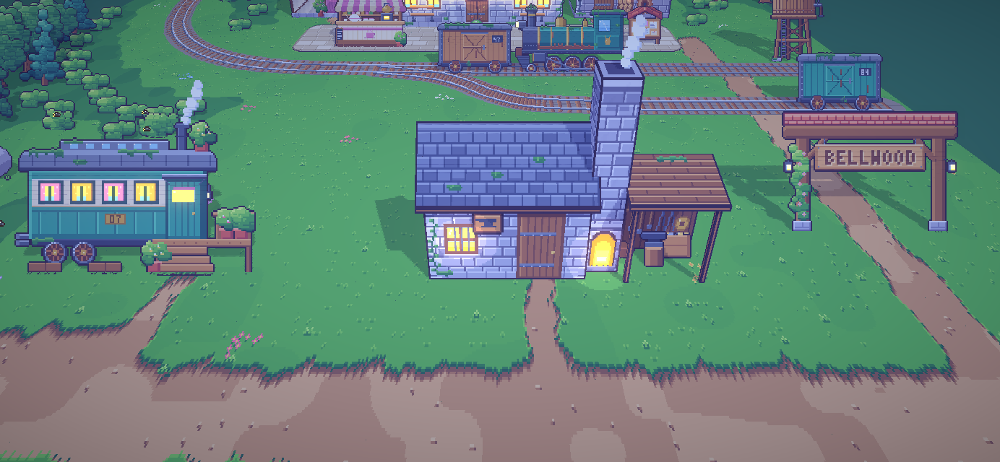
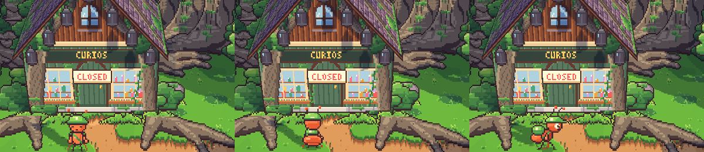
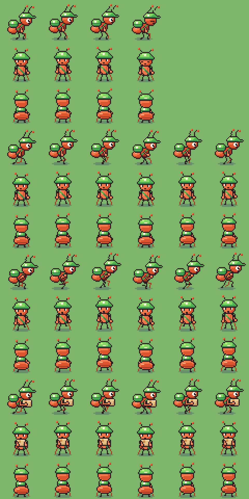
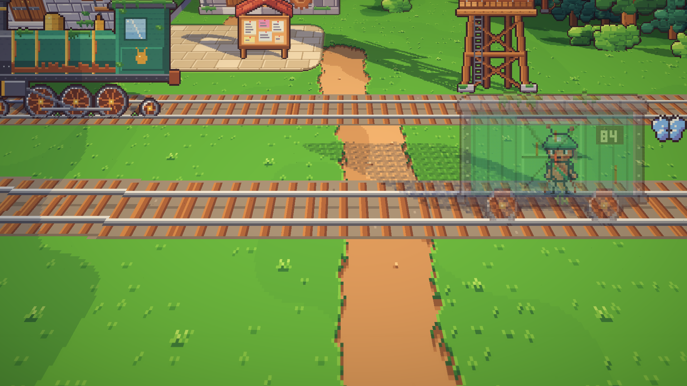
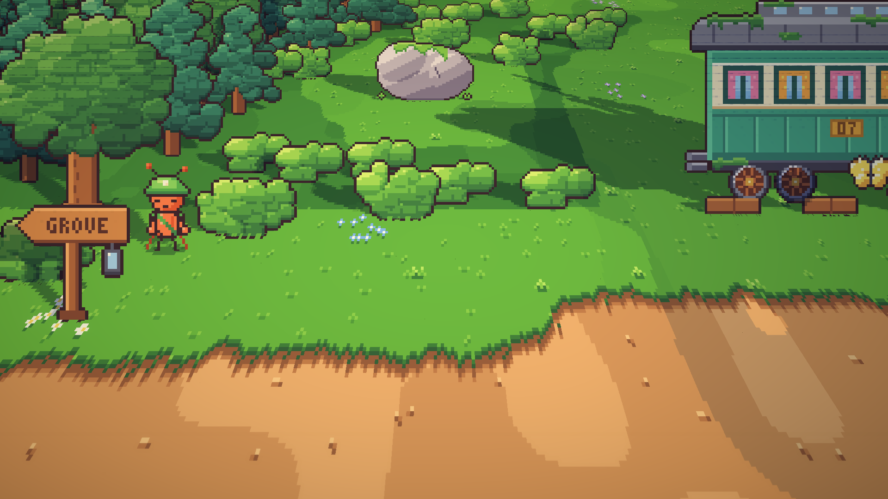
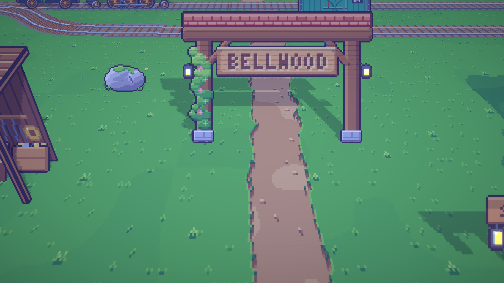
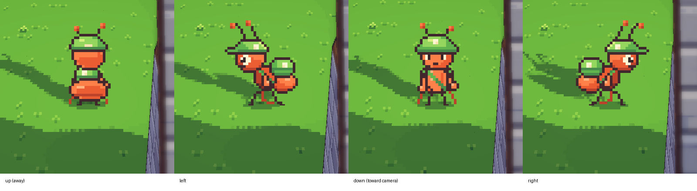

# 07. Bangunan 3D, toko yang ditelan akar, dan kurir yang berbalik

**Tanggal:** 2026-10-18

## Tujuan

Setelah melihat contoh pertama tampilan HD-2D, ada tiga masukan:

1. **Bangunan harus seperti Octopath Traveler.** Atap yang menghadap kamera secara datar terlihat salah, dan dinding samping bengkel yang
   ditarik memanjang terlihat jelek. Di Octopath, bangunan adalah bentuk 3D sungguhan: dinding, atap miring dengan
   emperan, sisi pelana, cerobong, dan teras, dengan seni piksel di setiap sisinya.
2. **Toko Marlow harus tertutup akar tua atau dedaunan.**
3. **Semut terasa datar.** Kurir hanya bisa menghadap ke kiri atau kanan, padahal pemain berjalan ke atas, bawah, kiri,
   dan kanan.

Semua ini dikerjakan dulu sebagai satu layar contoh, yaitu bengkel 3D, toko yang ditelan akar, dan kurir di dalamnya, untuk
dinilai sebelum seluruh dunia dibangun ulang.

## Yang dikerjakan

### Bangunan dari sisi-sisi 3D (`game/ArtSource/model.js`)

Bangunan sekarang adalah model 3D kecil. Setiap sisinya berupa gambar yang dilukis dengan kode lalu dipasang pada persegi di ruang
3D: dinding depan, sisi pelana, dua bidang atap, papan emperan, cerobong, dan tiang.

- `MODEL.make()` menyediakan `front`, `side`, `top`, `quad`, dan `box` untuk menambah sisi.
- `MODEL.gable()` membangun rumah beratap pelana lengkap. Bubungannya bisa sejajar dengan jalan (`'x'`, emperan
  menghadap kamera) atau menjauh dari kamera (`'back'`, pelana menghadap kamera).
- `MODEL.item()` mengemas semua gambar ke satu lembar atlas. `BakedArt.cs` membangun mesh dari sudut-sudutnya.
- Setiap sisi diberi bayangan sesuai arah datangnya matahari, dalam empat tingkat. Bangunan juga menjatuhkan bayangan
  matahari yang sungguhan.
- Jendela yang menyala menjadi model cahaya tersendiri, sedikit di depan dindingnya, sehingga hanya menyala pada senja
  dan malam hari.

### Kamera

- Kamera sekarang menunduk 35 derajat (sebelumnya 45) dengan sudut pandang 42 derajat (sebelumnya 30). Dengan begitu,
  sisi dan atap bangunan lebih terlihat.
- `Place.Scale` meregangkan tinggi sebesar 1/cos dan kedalaman sebesar 1/sin dari sudut kamera, sehingga piksel tetap
  persegi.
- Karena kamera kini lebih dekat, blur depth of field menjadi dua kali lipat. Bukaan lensanya disesuaikan
  (`Aperture` 9 → 18,5) agar blurnya tetap setipis yang sudah disetujui.

### Cahaya

- **Lampu menerangi sekitarnya** pada senja dan malam hari. Lentera, jendela, dan perapian menerangi dinding dan tanah di
  dekatnya dalam empat tingkat. Kekuatannya dikurangi setelah dinding toko terlihat pudar karena tujuh lentera
  sekaligus.
- **Semut mendapat cahaya tepi** (rim light) di bagian atas tubuhnya pada senja dan malam hari.
- **Bercak bayangan di bawah kaki.** Setiap semut yang terlihat menaruh bercak gelap kecil di tanah tempat ia berdiri,
  sehingga kakinya benar-benar menapak.

### Toko Marlow yang ditelan hutan

Toko dibangun ulang dalam 3D dengan pelana menghadap jalan setapak:

- etalase hijau botol tua di bawah atap sirap ungu yang curam;
- dua jendela curio berisi jam, botol, dan mainan;
- papan CURIOS, jendela loteng bundar, dan cerobong miring.

Toko itu tumbuh menyatu dengan pohon kuno di belakangnya:

- akar tebal melintasi bubungan dan menuruni kedua bidang atap;
- akar menuruni sudut depan lalu menjalar di tanah ke kiri dan kanan pintu;
- tirai sulur tergantung dari tepi atap;
- dedaunan jatuh di atap;
- lumut ada di mana-mana;
- semak dan pakis tumbuh di kaki dinding.

Tujuh lentera tergantung dari papan tepi atap depan. Lentera-lentera itu tetap padam satu per satu sesuai cerita
(`shop_lantern_i`). Pada siang hari, pintunya tertutup dengan kartu CLOSED tergantung di daun pintu.

### Bengkel pandai besi dalam 3D

Bengkel Mender sekarang punya:

- dinding batu di bawah atap pelana slate;
- cerobong batu tinggi dengan perapian yang menyala di kakinya;
- emperan papan dengan perkakas tergantung, landasan, bellow, dan peti besi tua.

### Kurir yang berbalik (`chars.js`, `Ant.cs`)

Kurir sekarang punya tampak depan dan tampak belakang untuk diam, berjalan, berlari, membawa paket, dan berjalan sambil
membawa paket.

- Tampak depan memperlihatkan wajah, sabuk tas, dan topi dengan pinggiran.
- Tampak belakang memperlihatkan tas surat di punggung dan perut semut di depan kaki.
- Langkah kakinya mengikuti waktu yang sama dengan tampak samping.

`Ant.cs` memilih arah dari gerakan. Kalau gerakan lebih banyak ke atas atau bawah layar, kurir berbalik membelakangi
atau menghadap kamera. Kalau lebih banyak ke samping, kurir menghadap kiri atau kanan. Pose lain, seperti bicara dan
memberi, tetap dari samping.

### Masukan kedua: Full HD, arah kiri, dan tepi area

Setelah contoh pertama dilihat, ada tiga masukan lagi:

1. **Game view harus Full HD 1920x1080**, bukan sekadar rasio 16:9. Game view di editor sekarang memakai ukuran
   tetap Full HD, dan semua tangkapan layar di bawah ini berukuran 1920x1080.
2. **Kurir tidak bisa menghadap ke kiri.** Ternyata `SpriteRenderer.flipX` tidak berpengaruh sama sekali, karena
   Unity meneruskan flip ke shader dan `Pixel.shader` tidak membacanya. Masalah ini muncul sejak semua kartu
   memakai shader 3D, dan penduduk desa juga ikut terkena. Sekarang tubuh semut dicerminkan lewat skalanya
   (`localScale.x = -1`) di `Ant.cs`, tanpa mengubah shader.
3. **Tepi area terlihat kosong.** Kamera memang dibatasi di dalam area, tetapi karena perspektif, kamera tetap
   melihat ke luar tepi area, paling jauh di sudut atas. Rel kereta berhenti mendadak dan di belakangnya hanya ada
   warna latar.

Untuk tepi area, `areas.js` sekarang membangun setiap area di atas kanvas yang lebih lebar: 256 px di kiri dan
kanan, 320 px di atas, dan 64 px di bawah.

- Hutan berlanjut di luar tepi area.
- Jalan dan rel yang keluar dari area diteruskan sejauh 640 px searah arahnya (`runOn`).
- Hanya area itu sendiri yang bisa dijalani.
- `place.json` tetap memakai koordinat area, dengan `origin` menunjuk sudut kanvas. `bake.js`, `Relief.cs`, dan
  `BakedArt.cs` mengikuti origin itu.

Setiap pintu keluar juga diberi papan penunjuk arah (`VIL.waysign`) yang bertuliskan nama area berikutnya. Lentera
di papan itu menyala setelah gelap.

Karena papan penunjuk menambah lampu, alun-alun sekarang punya 41 lampu, padahal shader hanya menerima 32. Daripada
memperbesar larik di shader, `BakedArt.LightNear` sekarang mengirim 32 lampu yang paling dekat dengan kurir setiap
frame. Satu layar tidak pernah memuat lebih dari itu, jadi cara ini tetap cukup untuk area 1600x1200 nanti.
Menambah panjang larik global juga baru berlaku setelah editor dibuka ulang.

## Keputusan

Semua keputusan ini juga dicatat di `GAME-CONTEXT.md`.

- **Bangunan dibuat sebagai model 3D** dari sisi-sisi bergambar seni piksel, seperti kota di Octopath Traveler. Pohon,
  benda kecil, dan semut tetap berupa kartu tegak.
- **Kamera menunduk 35 derajat dengan sudut pandang 42 derajat.**
- **Toko Marlow adalah etalase di ujung jalan setapak yang tumbuh menyatu dengan pohon kuno**, tertutup akar, sulur, dan
  lumut. Pintunya tertutup pada siang hari.
- **Kurir punya empat arah.** Penduduk lain menyusul nanti.
- **Tidak ada area yang berakhir di ruang kosong.** Daratan berlanjut di luar tepi area, dan setiap pintu keluar diberi
  papan penunjuk.
- **Game dibuat dan dicek pada ukuran tetap 1920x1080.**
- Setelah contoh ini disetujui, setiap area diperbesar menjadi sekitar 1600x1200 dengan 8–15 bangunan 3D. Penduduk
  desa dibangun setelah itu.

## Masalah dan solusinya

- **Artikel referensi diblokir.** Artikel Medium tentang HD-2D tidak bisa dibuka langsung, jadi teks dan gambarnya
  dibaca lewat feed RSS publik.
- **Ekspor gagal dengan "MODEL is not defined".** Penyebab sebenarnya adalah variabel yang dideklarasikan dua kali di
  `model.js`. Sekarang setiap file dicek dengan `node --check`.
- **Emperan menutupi bagian atas pintu bengkel.** Dindingnya ditinggikan menjadi 50 dan emperannya dipendekkan.
- **Atap emperan menutupi perkakas.** Emperan dibuat lebih dangkal dan perkakas digantung lebih rendah.
- **Akar di tanah tampak belang-belang.** Gambar akar terletak tepat setinggi tanah, sehingga keduanya saling berebut
  piksel (z-fighting). Akar diangkat satu texel searah sinar kamera, sehingga letaknya di layar tidak berubah.
- **Malam hari terlalu terang di depan toko.** Tujuh lentera dan tiga jendela membuat dinding hampir putih, jadi
  kekuatan cahaya lampu dikurangi.

- **Kurir menghadap kanan saat berjalan ke kiri.** `flipX` diabaikan oleh shader kustom, jadi tubuhnya dicerminkan
  lewat skala.
- **Lampu ke-33 dan seterusnya tidak menyala.** Sekarang shader menerima lampu yang terdekat dengan kurir.
- **Unity crash** (EXC_BAD_ACCESS di `ExecutePlayerLoop`) saat mode play berjalan sementara aset baru diimpor.
  Sekarang mode play dihentikan dulu, lalu editor ditunggu sampai selesai mengimpor dan mengompilasi sebelum play
  lagi.

## Cara dicek

- Ekspor dengan `python3 game/ArtSource/export.py --force cast areas`. Ekspor juga memeriksa bahwa setiap sel lembar
  karakter sama persis dengan `CH.draw`.
- Tangkapan layar di editor Unity: toko dan bengkel pada pagi dan malam hari, kurir dalam tiga arah, dan semua area
  lain dengan kamera baru.
- Tangkapan layar Full HD: tepi stasiun pada pagi dan malam hari, dan kurir berjalan ke empat arah.
- Tes PlayMode lulus 2 dari 2 (`PlaythroughTest` dan `RunTest`).

## Commit

`feat(view): show Bellwood like Octopath, with 3D buildings and forest edges`

## Langkah berikutnya

- Setelah contoh ini disetujui: memperbesar setiap area menjadi sekitar 1600x1200 dengan 8–15 bangunan 3D, dan
  merombak tata letaknya.
- Tampak depan dan belakang untuk penduduk desa, bersama rutinitas mereka.
