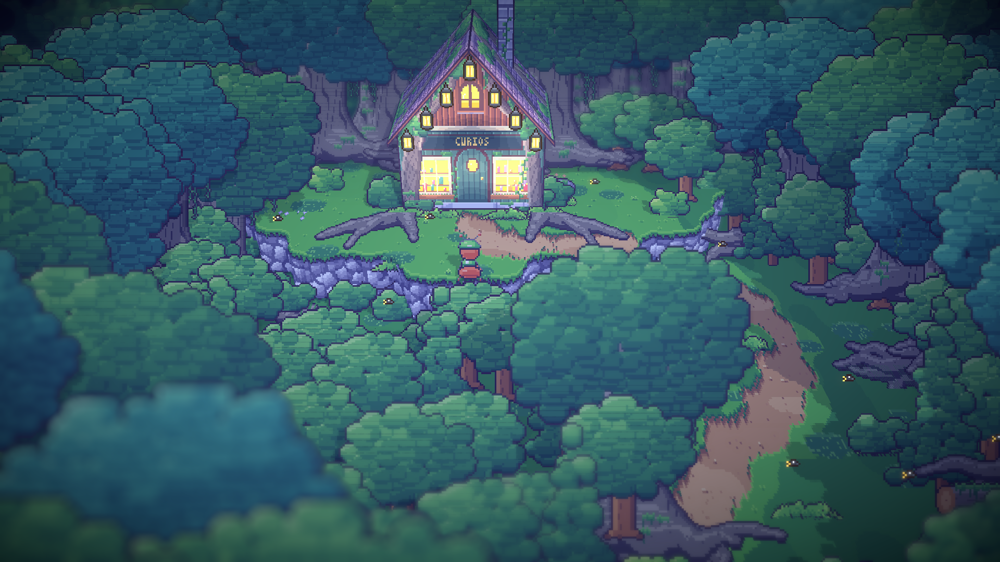
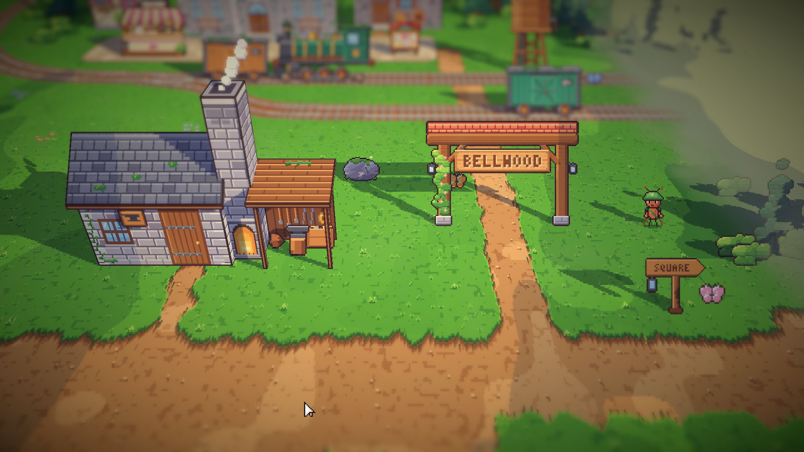
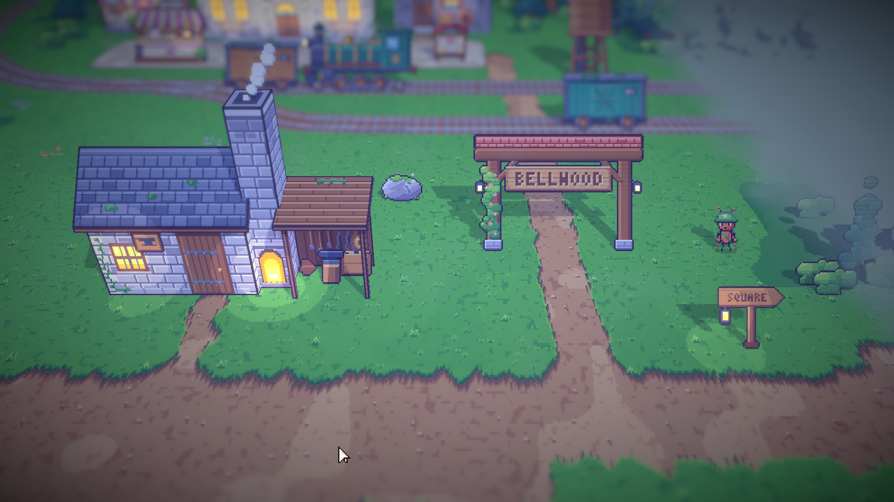
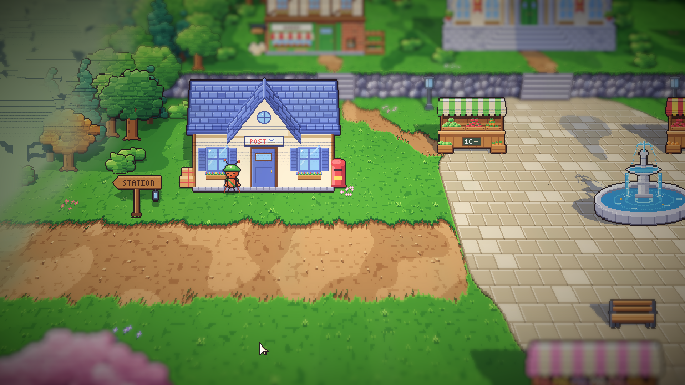
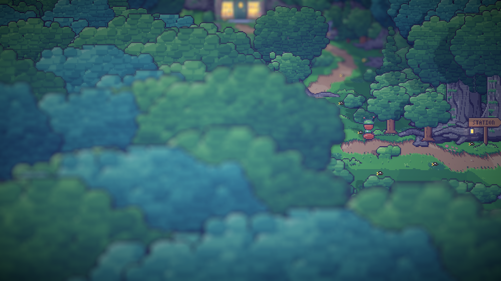
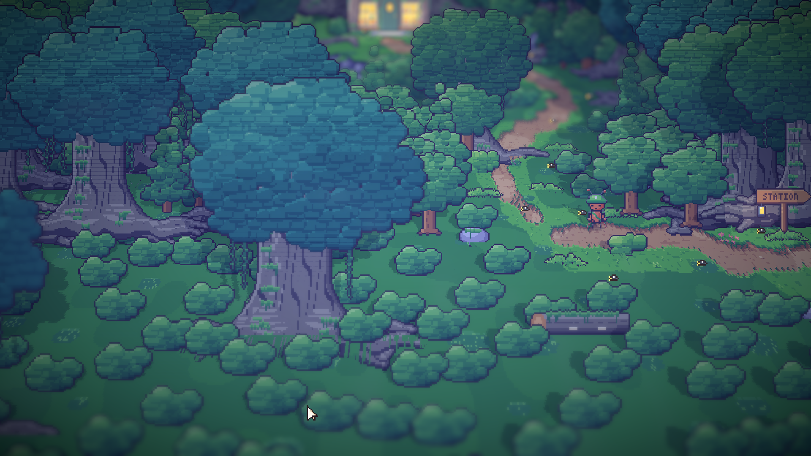

# 08. Kamera ala Octopath dan tepi area yang berkabut

**Tanggal:** 2026-10-18

## Tujuan

Tepi area masih terlihat aneh. Kamera juga perlu dipelajari ulang dari tiga rekaman Octopath Traveler 2: toko di dalam
istana dan kota istana di malam hari, kota istana dan tembok gerbangnya, serta jalan hutan di malam hari.

## Yang dipelajari dari rekaman

- **Kamera berdiri jauh.** Tokoh hanya sekitar sepersepuluh tinggi layar, sedangkan kurir kita hampir seperlima.
  Octopath menampilkan kira-kira dua kali lebih banyak dunia.
- **Depth of field-nya kuat.** Hanya pita di sekitar tokoh yang tajam. Atap dan pagar di dekat kamera serta latar
  belakang sangat kabur, sehingga semuanya terlihat seperti miniatur. Sudut layar digelapkan oleh vignette.
- **Tepinya tidak pernah terlihat berakhir.** Di jalan hutan, tanah yang bisa dijalani adalah pulau terang yang
  dikelilingi pohon lebat, lalu menghilang. Di kota, tembok, tangga, dan atap di latar depan menutup tepinya.
- **Lampu membuat genangan cahaya** di tanah, dan tanahnya selalu bertekstur, misalnya pasir berombak atau lantai batu.
- **Kamera tidak menempelkan tokoh ke tepi layar.**

## Yang dikerjakan

### Kamera (`Main.cs`)

- Kamera mundur dua kali lebih jauh: 640x360 art px di layar (`WorldZoom = 1`). Ukuran UI tidak berubah (`Zoom = 2`).
- Bukaan lensa diperbesar (`Aperture` 18,5 → 3,2), sehingga yang dekat dan yang jauh menjadi kabur. Vignette diperkuat
  (0,22 → 0,38).
- Kamera boleh melihat sampai 96 art px melewati tepi area (`Overscan`), sehingga kurir tidak pernah terjepit di tepi
  layar.

### Tepi area yang berkabut (`Pixel.shader`, `BakedArt.cs`)

Shader mengukur seberapa jauh setiap texel berada di luar area, menurut baris tanah di bawahnya. Makin jauh, makin
pudar ia ke dalam kabut. Tanah, pohon, dan rumah di luar area memudar bersama, dan lampu di sana tetap menyala. Garis
tepinya dibuat tidak rata dengan noise.

Percobaan pertama memudarkan semuanya ke dalam gelap, seperti jalan hutan Octopath. Hasilnya terasa seperti game horor
di siang hari dan bertentangan dengan keputusan bahwa Bellwood cerah. Karena itu, warnanya diganti menjadi kabut pucat
yang ikut di-grade sesuai waktu: hangat di pagi hari dan biru tua di malam hari, tetapi tidak pernah hitam. Warna latar
kamera memakai kabut yang sama, sehingga ujung peta tidak pernah terlihat.

### Hutan rendah di dekat kamera (`areas.js`)

Di jalan hutan, pohon besar di dekat kamera menutupi sekitar 60% layar. Sekarang, dalam 120 px dari tepi bawah area
(sisi yang paling dekat dengan kamera), hutan hanya berisi tanaman yang tingginya di bawah 48 px. Hutan itu tetap
membingkai pemandangan tanpa menutupi kurir.

### Tanah dan lampu

- Jalan dan rumput diberi butiran halus (`village.js`), sehingga tanah yang luas terbaca sebagai permukaan, bukan
  bidang warna datar.
- Jangkauan cahaya lampu diperbesar (`LampReach` 22 → 40 px), karena genangan cahaya hampir hilang setelah kamera
  mundur.

## Keputusan

Semua keputusan ini juga dicatat di `GAME-CONTEXT.md`.

- **Kamera menampilkan sekitar 640x360 art px**, dengan depth of field yang kuat dan vignette yang lebih gelap.
  Keputusan kamera dekat 320x180 dari 2026-09-29 diganti.
- **Tepi area memudar ke dalam kabut pucat sesuai waktu, bukan ke dalam gelap.**
- **Hutan di sisi kamera tetap rendah.** Jalan dan rumput bertekstur, dan lampu menerangi lebih luas.

## Masalah dan solusinya

- **Kurir terasa sangat cepat.** Setelah diukur, kecepatannya tetap 56 art px per detik, dan di layar justru lebih
  lambat karena kamera mundur. Ada bug yang bisa membuatnya benar-benar cepat: `PlaythroughTest` mempercepat waktu 8×
  sebelum blok `try`. Jika persiapan tes gagal, waktunya tidak pernah dikembalikan, dan salah satu tes memang gagal
  saat dijalankan ketika mode play belum selesai berhenti. Sekarang pengaturan itu dipindah ke dalam `try`, sehingga
  `finally` selalu mengembalikannya.
- **Editor tertinggal di scene tes sementara.** Penjalan tes meninggalkan `InitTestScene*.unity`, sehingga play tidak
  memuat game. `Main.unity` dibuka kembali, dan file sementara itu dihapus.
- **Garis-garis pada pohon berkabut.** Kartu tegak condong ke belakang, sehingga baris tanah yang dihitung bergeser
  menurut ketinggian. Kabut yang bertangga empat lalu memotong pohon menjadi garis. Kabut sekarang memudar halus.
- **Layar krem saat mengambil gambar.** Skrip tangkapan layar meminta titik muncul `start` yang hanya ada di stasiun,
  sehingga perpindahan tempat berhenti di tengah fade. Skripnya sudah diperbaiki.

## Cara dicek

- Ekspor dengan `python3 game/ArtSource/export.py --force areas`.
- Tangkapan layar Full HD: stasiun pada pagi dan malam hari, alun-alun, serta hutan dan toko pada malam hari.
- Kecepatan berjalan diukur di mode play: 195 px dalam 3,49 detik, yaitu 56 px per detik.
- Tes PlayMode lulus 2 dari 2.

## Commit

`feat(view): show Bellwood like Octopath, with 3D buildings and forest edges`

## Langkah berikutnya

- Lebih banyak benda dan ketinggian di setiap area, seperti di Octopath: tangga, tembok, panji, lentera.
- Memperbesar area menjadi sekitar 1600x1200 dengan 8–15 bangunan 3D.
