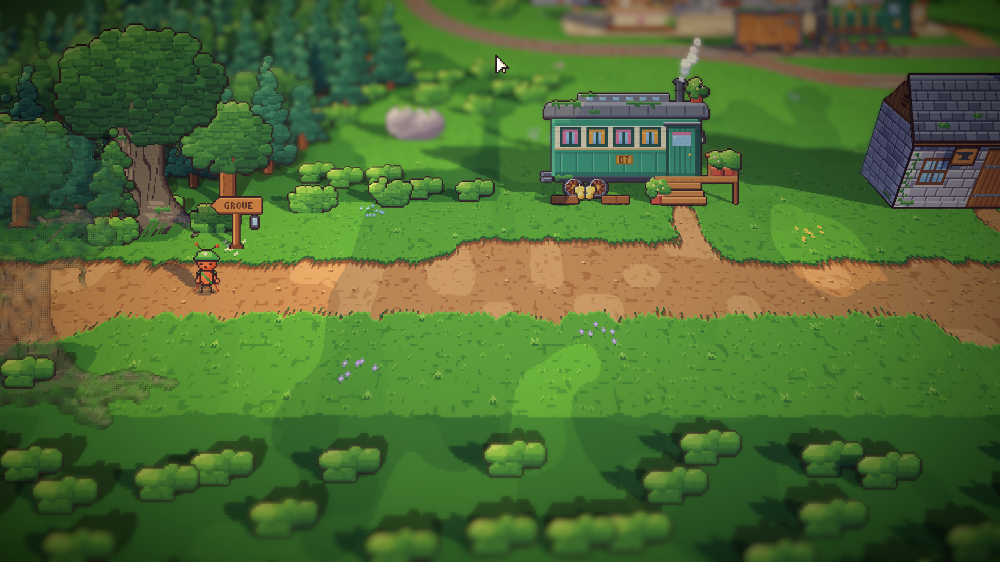
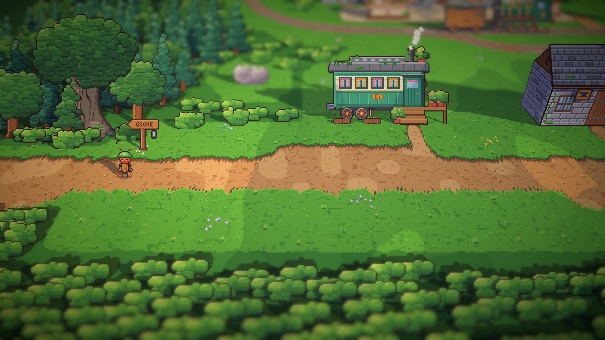
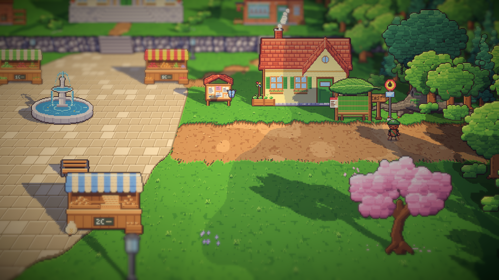
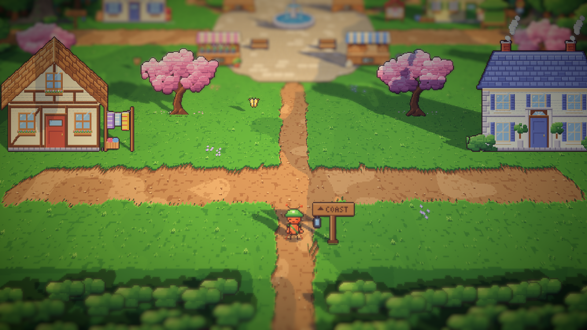
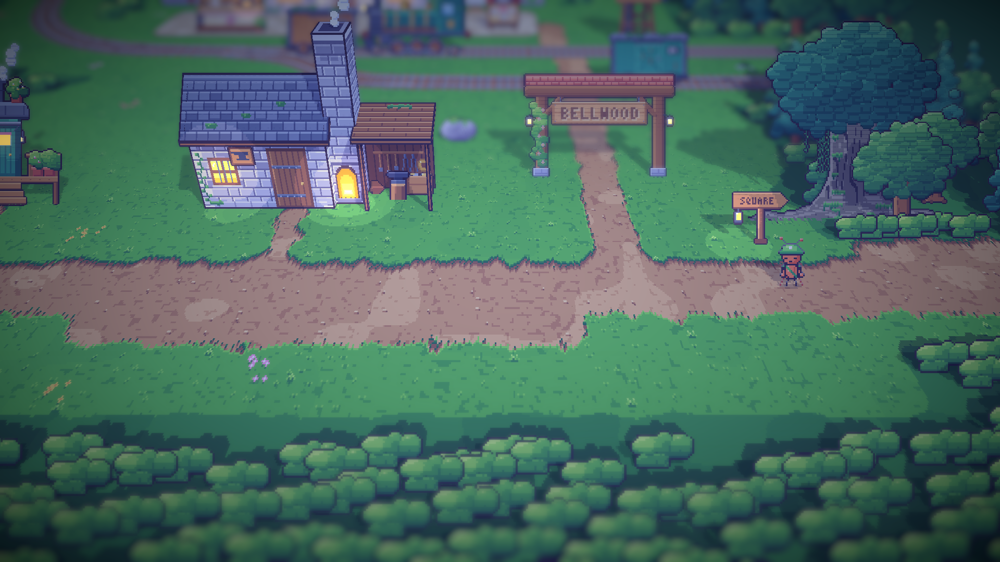

# 09. Tepi area ditutup hutan

**Tanggal:** 2026-10-18

## Tujuan

Kabut pucat di tepi area (entri 08) terasa seperti polusi. Sebagai gantinya, tepi setiap area ditutup oleh alam:
hutan yang rapat, pintu keluar berupa gerbang pohon, dan pagar semak di sisi kamera. Ini dicoba dulu di stasiun dan
alun-alun sebelum area lain dinilai.

## Yang dikerjakan

### Kabut dihapus (`Pixel.shader`, `BakedArt.cs`, `Main.cs`)

Shader tidak lagi memudarkan apa pun di luar area. Global `_Bounds` dan `_Haze` dihapus, dan warna latar kamera
kembali ke warna latar area.

### Hutan rapat di luar area (`areas.js`)

- Di luar area, hutan berdiri hanya 8 px dari jalan dan rel yang keluar (di dalam area tetap 40 px), sehingga tidak
  ada lagi celah rumput lebar di sepanjang jalan.
- Di luar area, mahkota pohon boleh menaungi jalan keluar, karena tidak ada yang berjalan di sana.
- Tanah di bawah mahkota pohon digelapkan (cahayanya 60%), sehingga lantai hutan terbaca sebagai bayangan hijau tua,
  bukan hitam.
- Rel meninggalkan stasiun lewat celah yang diapit pohon.

### Gerbang pohon di setiap jalan keluar

Setiap jalan yang keluar dari area diberi pohon tua 36 px di luar tepinya, di kedua sisi jalan. Pengecualiannya
adalah sisi yang menghadap kamera, karena pohon di situ berdiri di depan area dan dibuat tembus pandang oleh fitur
pemudar penghalang sehingga terlihat seperti noda. Jalan yang keluar ke selatan, ke arah kamera, tidak diberi gerbang.

### Pagar semak di sisi kamera

Di luar tepi bawah area (sisi kamera), semak ditanam dua kali lebih rapat (jarak 11 px, sebelumnya 22 px). Semak-semak
itu saling menumpuk menjadi pagar yang kabur oleh depth of field, seperti pagar di latar depan Octopath.

## Keputusan

Dicatat juga di `GAME-CONTEXT.md`.

- **Tepi area ditutup oleh alam, tanpa pudar.** Keputusan kabut dari entri 08 diganti.
- **Setiap jalan keluar adalah gerbang pohon**, tanpa pohon di sisi kamera. Sisi kamera ditutup pagar semak yang rendah
  dan rapat.

## Masalah dan solusinya

- **Pohon gerbang di sisi kamera tembus pandang.** Pohon yang berdiri di antara kamera dan kurir dipudarkan oleh
  game, sehingga di tepi layar terlihat seperti bayangan aneh. Pohon itu dihapus, dan hanya pohon di belakang jalan
  yang dipertahankan.
- **Semak depan berjajar seperti pola.** Semak yang jarang terlihat seperti ditanam satu per satu. Jaraknya dibuat
  lebih rapat agar semak saling menumpuk.
- **Hutan kecil tertutup semak.** Awalnya pagar rapat juga ditanam di dalam area, di 120 px terakhir. Di hutan, yang
  areanya kecil, semak itu menutupi hampir separuh layar. Sekarang pagar rapat hanya ada di luar area, sedangkan di
  dalam area semak tetap jarang seperti di entri 08.

## Cara dicek

- Ekspor dengan `python3 game/ArtSource/export.py --force areas`.
- Tangkapan layar Full HD: tepi barat, timur, barat laut, dan selatan stasiun, tepi barat, timur, barat laut, dan
  selatan alun-alun, serta keduanya pada malam hari. Lalu tepi hutan, timur (sungai), dan pantai (laut). Tidak ada
  tanah yang terlihat berakhir.
- Tes PlayMode lulus 2 dari 2.

## Commit

`feat(view): show Bellwood like Octopath, with 3D buildings and forest edges`

## Langkah berikutnya

- Tampilan ini disetujui untuk semua area.
- Bangunan seperti Octopath: lebih besar, atap dengan teritis dalam, alas batu dan tangga, lentera di pintu, rapat
  di sepanjang jalan. Dicoba dulu di alun-alun bersama benda dan ketinggian.
