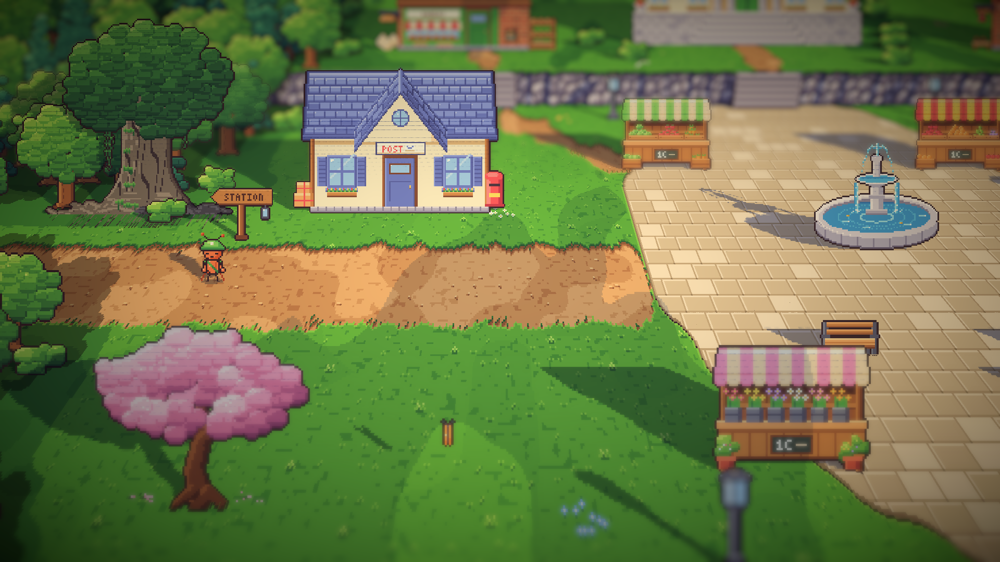
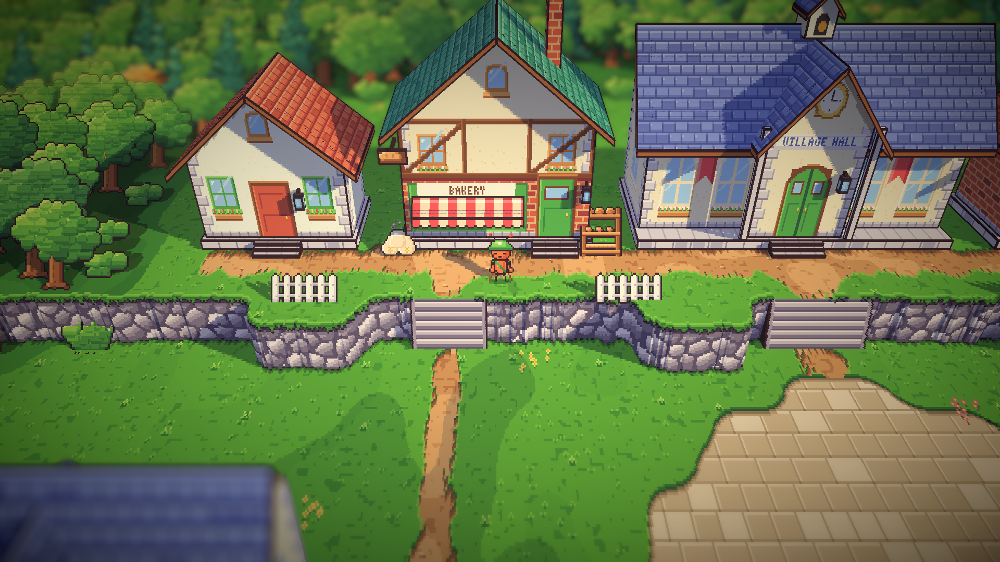
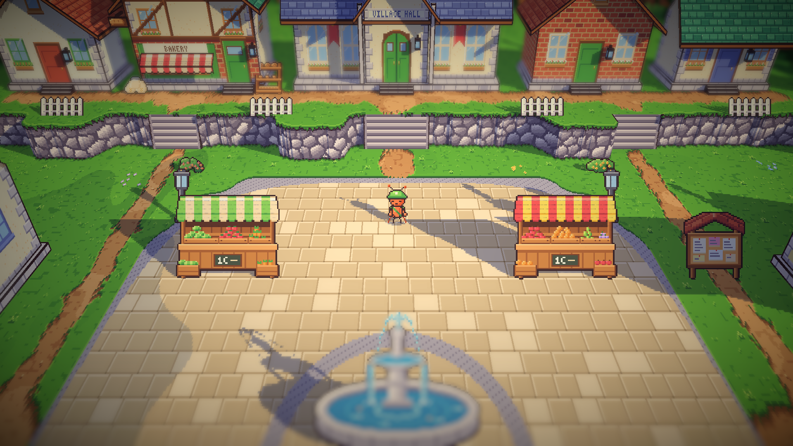
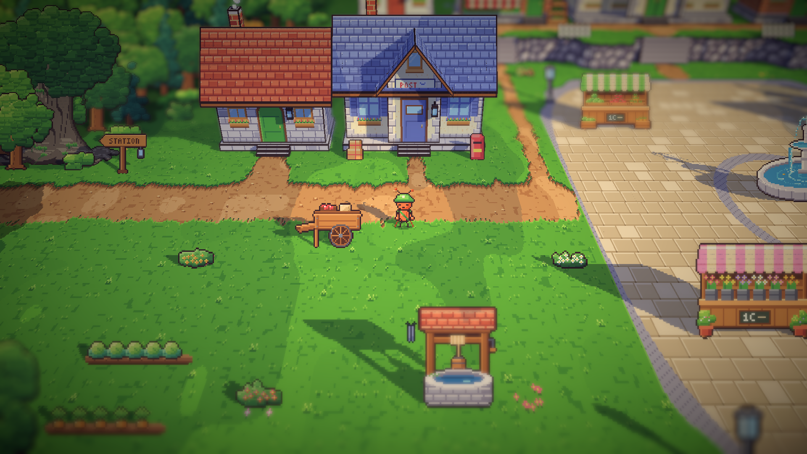
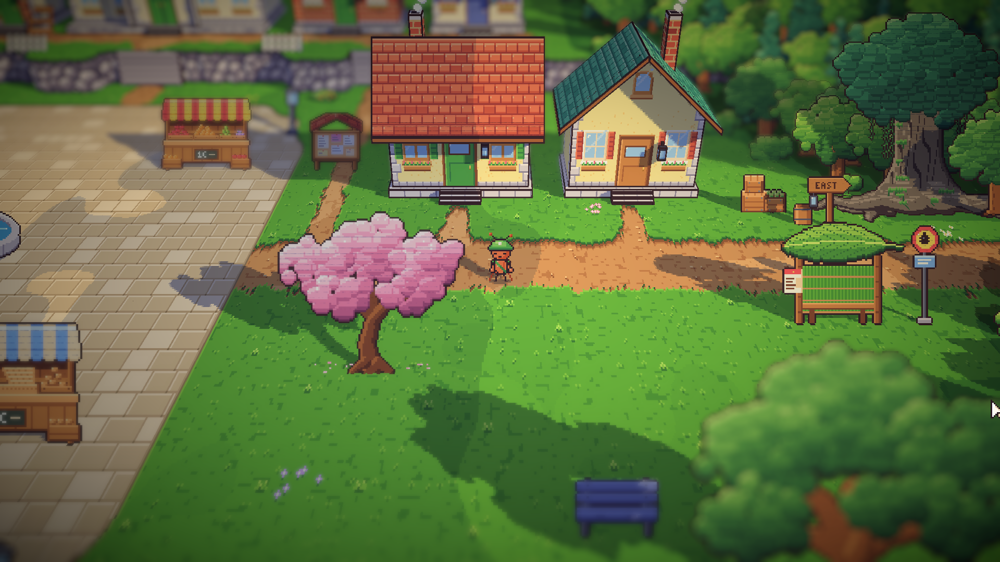
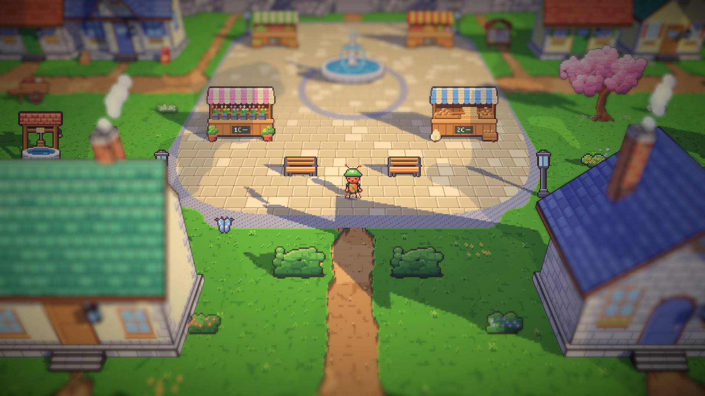
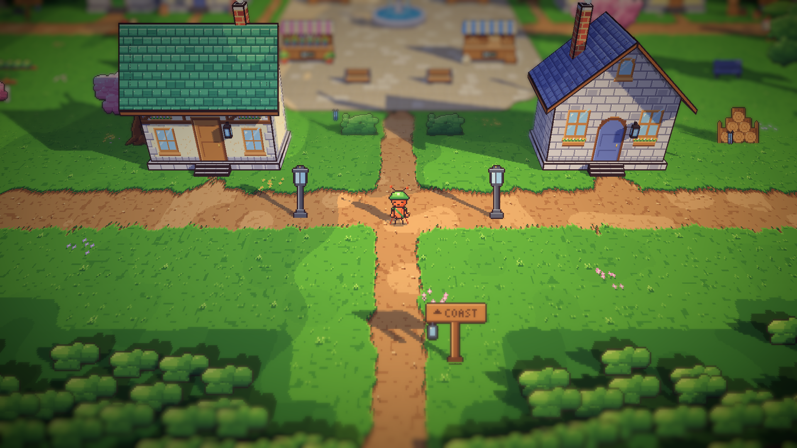
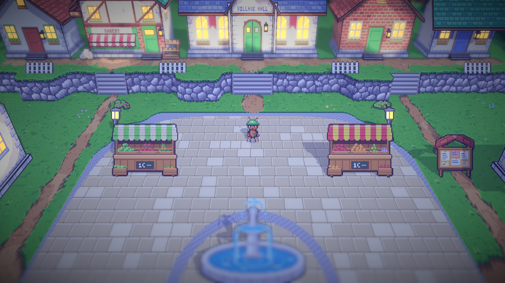

# 10. Alun-alun dan bangunan 3D ala Octopath

**Tanggal:** 2026-10-18

## Tujuan

Di rekaman Octopath Traveler 2, bangunanlah yang mengisi sebagian besar layar: rumah besar dengan teritis dalam, alas
batu dan tangga, berdiri rapat di sepanjang jalan, dengan lentera dan panji. Bangunan alun-alun kita masih kartu datar
yang kecil dan berjauhan di tengah rumput. Langkah ini membangun ulang alun-alun sebagai satu contoh untuk dinilai
sebelum area lain diubah.

## Yang dikerjakan

### Perangkat rumah 3D (`model.js`, `village-centre.js`)

- `MODEL.gable` mendapat tiga pilihan baru:
  - `up0`: dinding berdiri di atas alas;
  - `thick`: papan atap yang lebih tebal;
  - `shade`: bayangan teritis, yaitu beberapa baris di bawah garis atap pada setiap dinding dibuat lebih gelap.

  Bengkel dan toko Marlow tidak berubah, karena nilai bawaannya sama seperti sebelumnya.
- `house()` membangun setiap rumah Centre dari beberapa pengaturan:
  - alas batu dengan tiga anak tangga ke pintu;
  - dinding yang mundur di belakang tangga;
  - atap genteng dengan teritis dalam;
  - jendela dengan kotak bunga;
  - lentera di samping pintu yang dibuat sebagai muka bercahaya, sehingga menyala dan menerangi tanah di malam hari;
  - cerobong asap.

  Pilihan tambahannya adalah teras bergable yang menonjol di atas pintu, papan nama yang digantung pada lengan besi,
  dan tenda bergaris 3D.
- Balai desa, toko roti, dan kantor pos dibangun ulang dengan perangkat ini, dengan tetap mempertahankan cirinya:
  - **balai desa:** atap batu tulis biru, jendela lengkung, panji merah, teras dengan jam dan papan VILLAGE HALL, dua
    tiang, dan menara lonceng di bubungan;
  - **toko roti:** toko bata dengan etalase roti di bawah tenda, lantai atas setengah kayu, dan papan roti yang
    digantung;
  - **kantor pos:** daun jendela biru, teras dengan jendela bundar dan papan POST, kotak pos merah, dan tumpukan paket.
- `townHome()` membuat enam rumah dengan dinding dan atap yang berbeda-beda. `centreHome()` yang datar tetap
  dipertahankan, karena area timur masih memakainya.

### Tata letak alun-alun (`areas.js`, `Places.cs`)

Ukuran alun-alun sekarang 1280x1040, sebelumnya 960x800. Ukuran ini lebih kecil dari rencana 1600x1200, supaya tanah
tetap padat dan tidak setengahnya menjadi hutan. Ada 11 bangunan:

- **Di teras:** rumah krem, toko roti, balai desa, rumah bata, dan rumah sudut berdiri berdempetan di sepanjang
  jalan setapak. Tiga tangga turun lewat tembok teras ke alun-alun, dengan pagar kayu di antaranya.
- **Alun-alun:** alun-alun berbentuk persegi membulat dengan pinggiran batu yang lebih gelap dan cincin di sekeliling
  air mancur. Di sana ada empat kios, bangku, dan lampu di setiap sudut.
- **Di kedua sisinya:** di barat ada rumah batu dan kantor pos, di timur ada rumah Mia dan rumah kuning, sehingga
  jalan utama punya dinding.
- **Halaman di bawah jalan:** di barat ada sumur dan kebun sayur, di timur ada pohon ek dengan bangku dan tumpukan
  kayu, ditambah bunga dan pohon sakura.
- **Jalan bawah:** rumah si penenun dan rumah Sam, dengan dua lampu. Jalan ke pantai keluar ke selatan.

Pintu keluar di `Places.cs` mengikuti ukuran baru.

## Keputusan

Dicatat juga di `GAME-CONTEXT.md`.

- **Rumah Centre dibangun dari satu perangkat**, dengan alas, tangga, teritis dalam, lentera, dan kotak bunga, dan
  berdiri berdempetan di sepanjang jalan.
- **Ukuran area mengikuti kepadatan, bukan ukuran tetap.** Alun-alun berukuran 1280x1040 dengan 11 bangunan.

## Masalah dan solusinya

- **Alun-alun pertama terlalu kosong.** Alun-alunnya berupa lingkaran kecil, dan kantor pos serta rumah Mia berdiri
  sendiri di tengah rumput. Alun-alun diperbesar menjadi persegi membulat yang sampai ke tangga balai, setiap sisinya
  diberi rumah kedua, dan jalan bawah dinaikkan, lalu halamannya diisi.
- **Pintu toko roti tertutup gambar toko.** Gambar bagian depan toko dilukis setelah pintu. Urutannya dibalik,
  sehingga pintu selalu dilukis terakhir.

## Cara dicek

- Ekspor dengan `python3 game/ArtSource/export.py --force areas`.
- Tangkapan layar Full HD: teras, balai desa, sisi barat dan timur, alun-alun dari bawah, jalan bawah, dan malam hari.
- Tes PlayMode lulus 2 dari 2. Tes ini juga berjalan lewat ketiga pintu keluar alun-alun.

## Commit

`feat(world): rebuild the square with 3D houses shoulder to shoulder`

## Langkah berikutnya

- Tampilan ini disetujui. Berikutnya area lain dibangun dengan cara yang sama: stasiun, timur, dan pantai.
- Penduduk desa berbalik ke empat arah seperti kurir.
