# 11. Stasiun, timur, dan pantai dengan bangunan 3D

**Tanggal:** 2026-10-18

## Tujuan

Tampilan alun-alun sudah disetujui. Langkah ini membangun ulang tiga area lain dengan cara yang sama: stasiun, timur,
dan pantai. Setiap bangunan menjadi model 3D dari perangkat rumah, dengan bahan khas bagian kotanya. Area diisi dengan
benda-benda dan perbedaan ketinggian, sambil menjaga isi cerita dari `GAME-CONTEXT.md`: siapa tinggal di mana, jam yang
berhenti di 10:17, kedai teh Helen di peron, dan bukit Leo.

## Yang dikerjakan

### Perangkat rumah untuk setiap bagian kota (`village-centre.js`)

- `house()` sekarang bisa membuat:
  - dinding papan tumpang (`clap`) dan papan tegak (`plank`), dengan papan sudut;
  - warna atap dari daftar warna sendiri, bukan hanya warna bawaan;
  - rumah di atas tiang (`stilts`), yaitu lantai papan di atas tiang-tiang dengan tangga papan ke pintu;
  - alas setinggi apa pun, dengan jumlah anak tangga yang mengikuti;
  - teras yang lebih tinggi dari rumahnya, untuk menara jam stasiun.
- Pilihan `paint` membuat dinding dilukis dengan gambar milik bagian kotanya sendiri, misalnya batu kasar Barat dengan
  batu sudut dan lumut.
- Rumah datar lama (`centreHome`) dihapus, karena tidak dipakai lagi.

### Stasiun (`village-west.js`, `areas.js`, `Places.cs`)

- **Stasiun:** aula batu di bawah atap batu tulis, dengan jendela lengkung tinggi. Menara jamnya menonjol di atas pintu
  ganda lengkung. Jamnya berhenti di 10:17, dengan papan BELLWOOD di bawahnya dan tanaman rambat di dindingnya. Titik
  interaksi jam di `Places.cs` dipindah ke jam yang baru.
- **Rumah Helen:** dinding krem berbingkai kayu gelap, atap jerami keemasan, serta pintu, daun jendela, dan lengkung
  mawar berwarna merah muda.
- **Rumah Mender:** batu kasar di bawah atap besi, jendela berjeruji, cerobong batu besar, dan roda gigi kuningan sebagai
  papan nama. Rumah ini sekarang berdiri di samping bengkelnya, sesuai keputusan "rumah Mender di dekat bengkel".
- **Ketinggian:** rel dan peron sekarang berada di atas tanggul batu, dan jalan berada di bawahnya. Tangga turun di
  dekat gerbang.
- **Benda-benda:** lampu, bangku, peti, dan tong di peron. Di halaman antara rel dan jalan ada tumpukan bantalan rel
  tua, peti, karung, dan semak. Di jalan bawah ada gerbong Kapten Bram, pohon ek, sumur, bangku, tumpukan kayu, bengkel,
  rumah Mender, dan gerbang BELLWOOD.

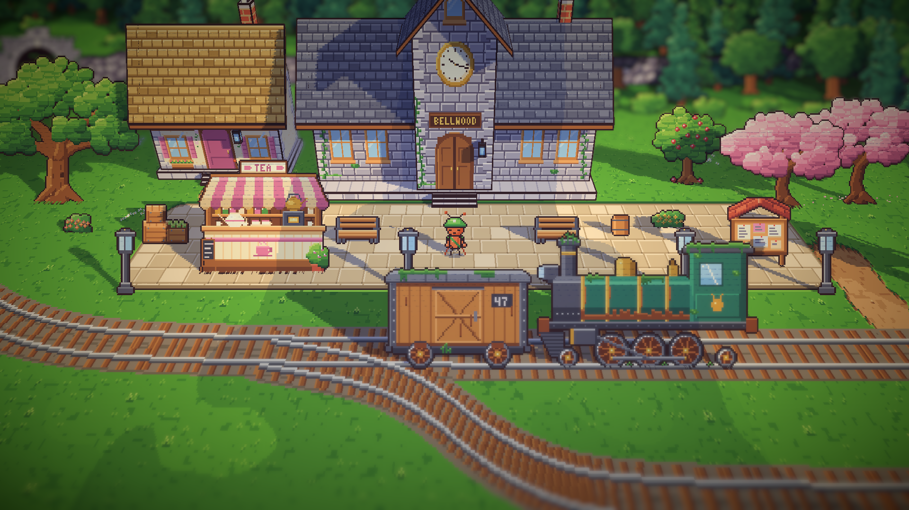

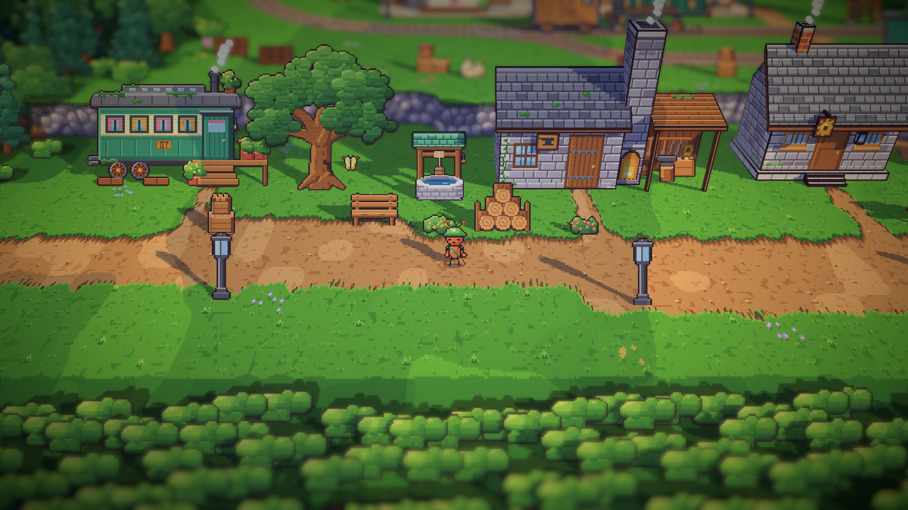

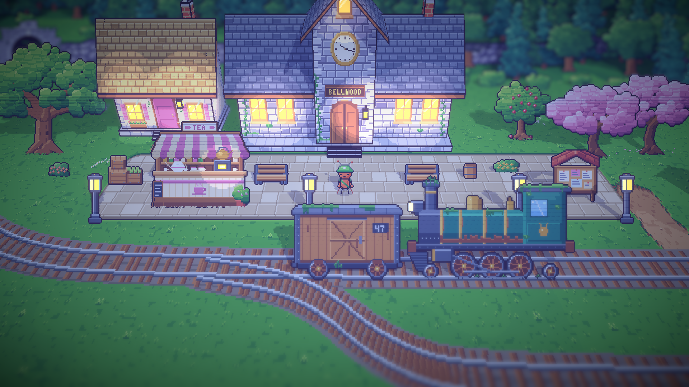

### Timur (`village-east.js`, `areas.js`)

- **Rumah Nenek Nora:** papan tumpang biru pastel di atas lantai papan bertiang tinggi, pintu koral di ujung tangga
  papan, papan gunting besar, bendera kain perca di bawah teritis, dan kotak bunga.
- **Rumah masa kecil Satria:** pondok yang warnanya pudar dimakan matahari, gentengnya memutih, plesterannya mengelupas
  sampai papannya terlihat, dan satu daun jendela abu-abu terlepas dari engselnya. Tali jemurannya berdiri di sampingnya.
- **Rumah si Tukang Kebun:** papan kayu madu di bawah atap hijau. Serambi kacanya yang lama sekarang menjadi rumah kaca
  tersendiri di sebelahnya, dengan bingkai putih dan tanaman tomat di dalamnya.
- **Pondok Leo di bukit:** pondok papan dengan jendela bundar. Di sebelahnya ada dek pengintai bertiang dengan pagar,
  tangga, teropong kuningan, dan bendera.
- **Di antara rumah-rumah:** kebun buah, kebun sayur Satria, taman bermain dan ayunan di dekat pohon dedalu, kandang
  kutu daun, dan kebun sayur di depan rumah kaca.

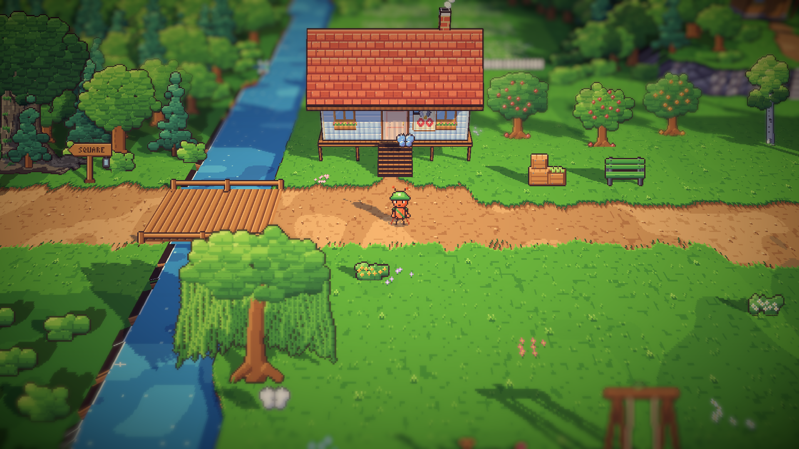

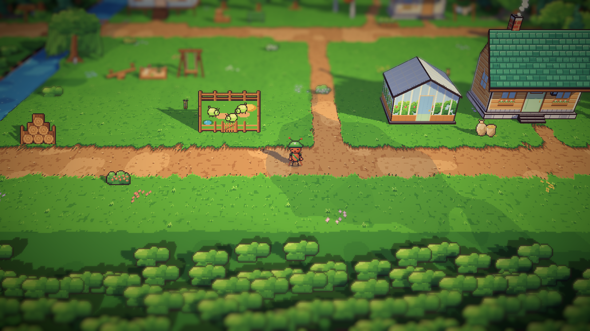

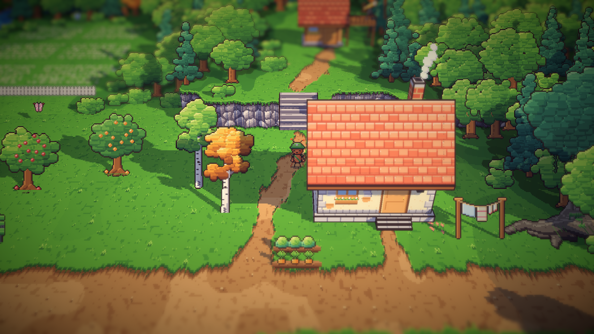

### Pantai (`village-south.js`, `areas.js`)

- **Studio Theo:** rumah krem berbingkai kayu di bawah atap batu tulis, dengan sisi bergable menghadap laut, jendela
  studio besar berpanel banyak, jendela kamar gelap yang ditutup hitam dengan lampu merah kecil, dan kamera kotak
  sebagai papan nama.
- **Gudang garam:** gudang papan yang memutih oleh matahari di bawah atap hijau laut, ventilasi berkisi di bubungannya,
  pintu ganda di bawah papan bergambar gundukan garam, dan kerak garam di kaki dinding. Di depannya ada gundukan garam,
  karung, dan timbangan.
- **Rumah Arlo:** papan tumpang biru yang lapuk dan mengelupas di bawah atap terakota, jendela bundar kuningan, jaring
  yang dijemur di bawah teritis, pelampung, dan dayung.
- **Jalan pantai:** gudang garam dan rumah Arlo kini berada di satu jalan, dengan rak ikan dan jaring di antaranya. Di
  pasir ada perahu dayung yang ditarik ke darat, peti, ember, kayu apung, dan batu. Di tebing ada bangku untuk
  memandang laut.

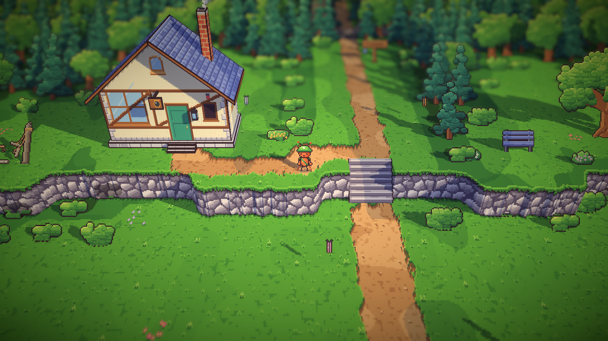

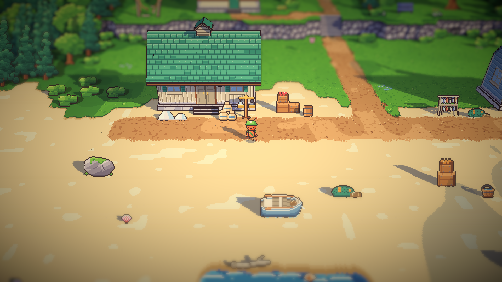

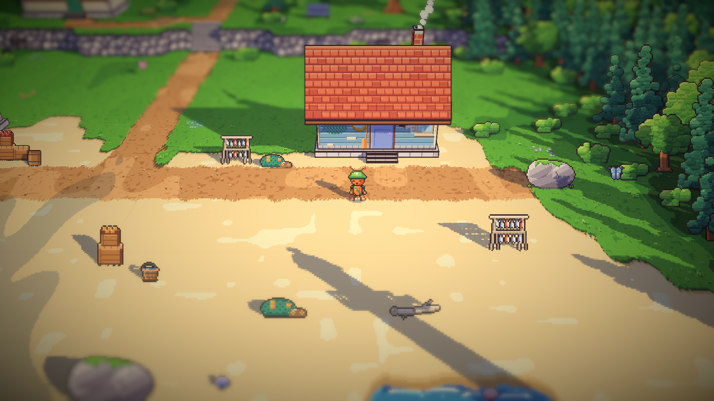

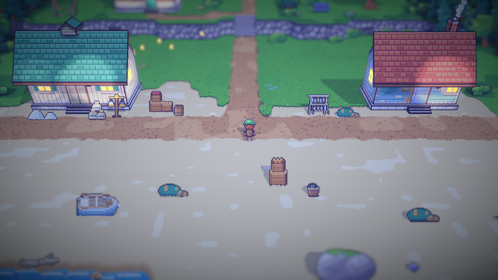

### Tangga menjadi anak tangga sungguhan (`village.js`, `areas.js`)

Dulu tangga hanyalah lereng yang hampir tegak dengan garis-garis yang dilukis, sehingga di tampilan 3D terlihat seperti
papan. Sekarang setiap tangga dipotong menjadi anak tangga:

- setiap anak tangga punya pijakan datar dan tegakan setinggi 4 px yang berdiri tegak seperti tebing;
- pijakannya terang dengan tepi depan yang lebih terang, tegakannya lebih gelap;
- tangga dipotong satu petak ke tingkat atas, sehingga ada ruang untuk pijakan;
- lebar tangga sama dengan lebar jalannya. Hanya jalan selebar satu petak yang mendapat satu petak tambahan di setiap
  sisi, supaya kaki semut tetap muat.

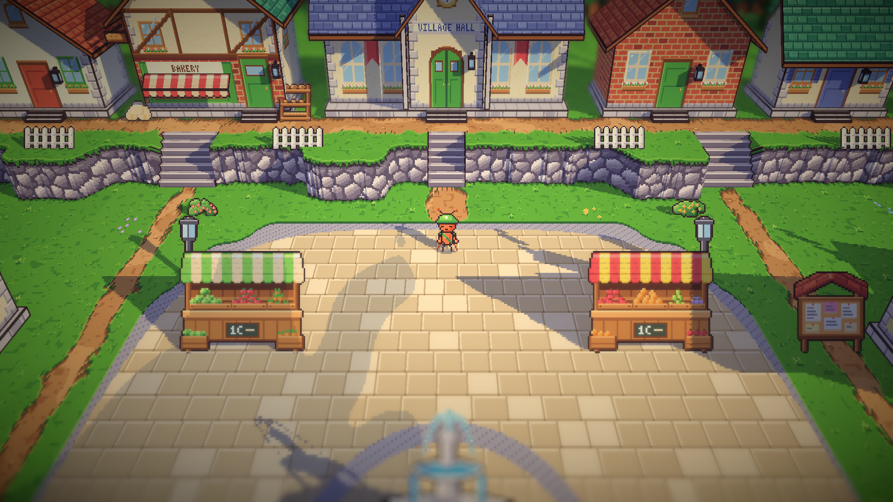

### Alun-alun (`areas.js`)

Rumah batu dan kantor pos, serta rumah Mia dan rumah kuning, dulu terlihat menempel. Sekarang ada celah di antara
mereka, diisi petak bunga dan tong.

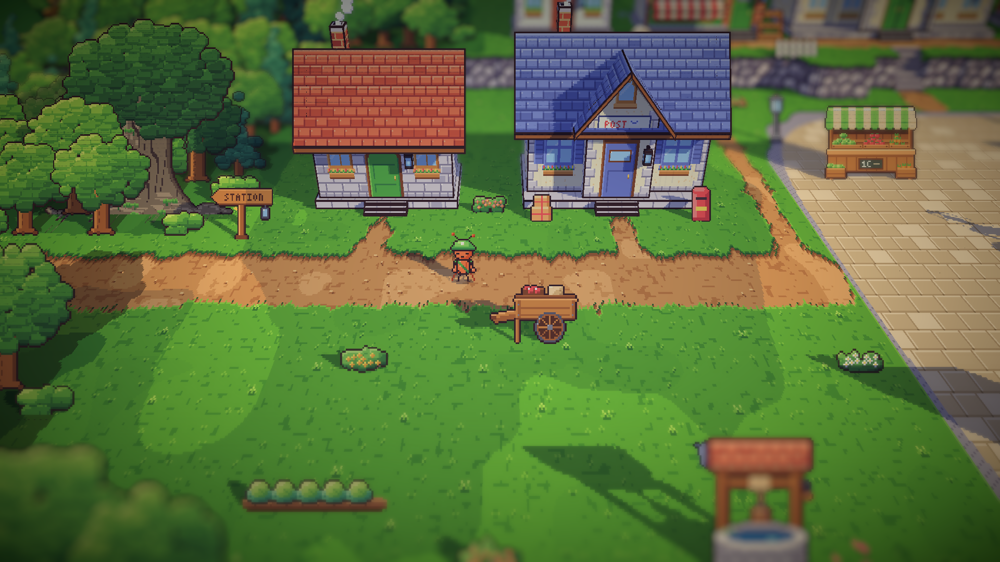

## Keputusan

Dicatat juga di `GAME-CONTEXT.md`.

- **Hanya bangunan yang disebut dalam cerita yang menjadi rumah.** Ruang di antaranya diisi benda yang memang ada di
  tempat itu, misalnya halaman, kebun, rumah kaca, rak ikan, dan perahu, bukan rumah pengisi yang berulang.
- **Benda di sisi kamera dari tempat berjalan dijaga tetap rendah**, karena bangunan tinggi di sana menjadi kabur dan
  menutupi pandangan.
- **Tangga adalah anak tangga sungguhan** selebar jalannya.

## Masalah dan solusinya

- **Terlalu banyak rumah di stasiun.** Percobaan pertama memakai empat pondok batu yang sama. Kemudian kotak sinyal dan
  dipo lokomotif juga terasa seperti rumah. Semuanya dihapus, dan rumah Mender dipindah ke samping bengkelnya.
- **Dipo menabrak gerbong Bram.** Dipo itu ikut dihapus.
- **Gudang di halaman menutupi peron.** Dari peron, gudang barang dan dipo di halaman berdiri di depan kamera dan
  menjadi kabur. Halaman sekarang hanya berisi benda rendah.
- **Bengkel dan rumah Mender menempel.** Bengkel digeser ke barat.
- **Tangga terlalu besar.** Percobaan pertama lebar satu petak lebih di setiap sisi dan menjorok ke tingkat bawah.
  Lebarnya sekarang sama dengan jalan.
- **Sebagian tangga miring.** Saat tangga hanya menjorok ke bawah, tepi tebing yang bergelombang membuat sebagian kolom
  mulai di tengah tebing. Tangga sekarang dipotong ke tingkat atas, sehingga setiap kolom mulai dari tanah atas.
- **Tangga di hutan tidak bisa dilewati.** Jalan ke toko Marlow hanya selebar satu petak, sehingga tidak ada ruang untuk
  kaki semut di antara dinding tangga. Jalan selebar satu petak tetap mendapat satu petak tambahan di setiap sisi.

## Cara dicek

- Ekspor dengan `python3 game/ArtSource/export.py --force areas`.
- Tangkapan layar Full HD dari setiap area: stasiun (peron, jalan bawah, malam), timur (sungai, rumah kaca, bukit
  Leo), pantai (tebing, jalan pantai, malam), serta tangga di alun-alun, stasiun, timur, dan hutan.
- Tes PlayMode lulus 2 dari 2.

## Commit

`feat(world): rebuild the station, east and coast with 3D homes and real stairs`

## Langkah berikutnya

- Penduduk desa berbalik ke empat arah seperti kurir.
