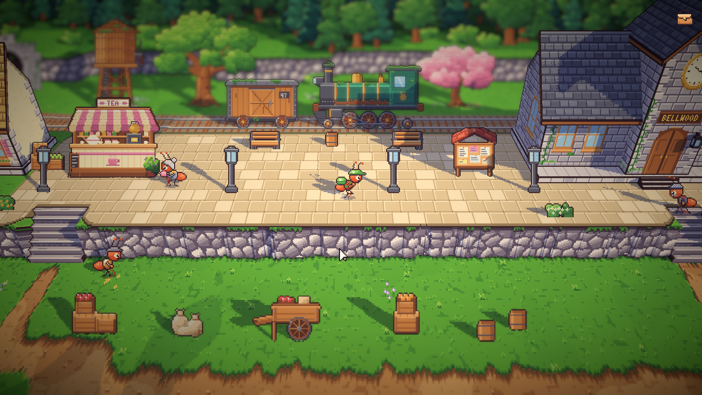
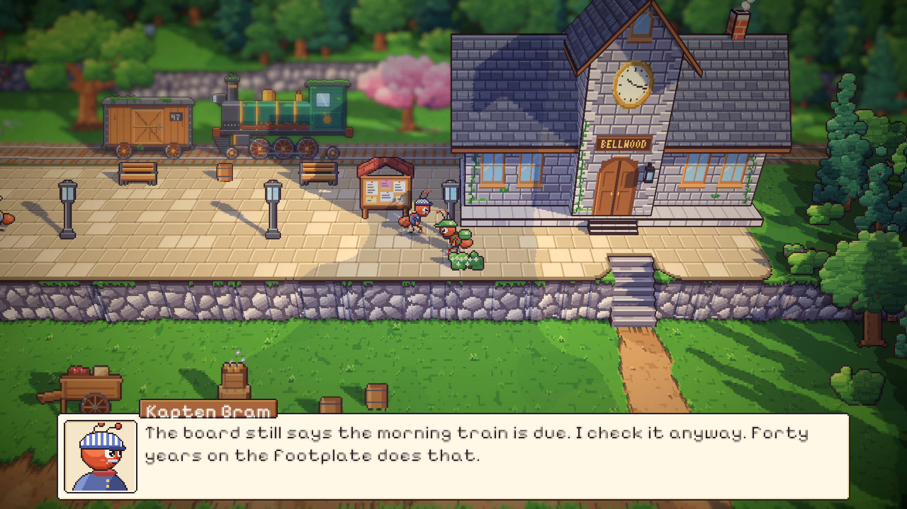
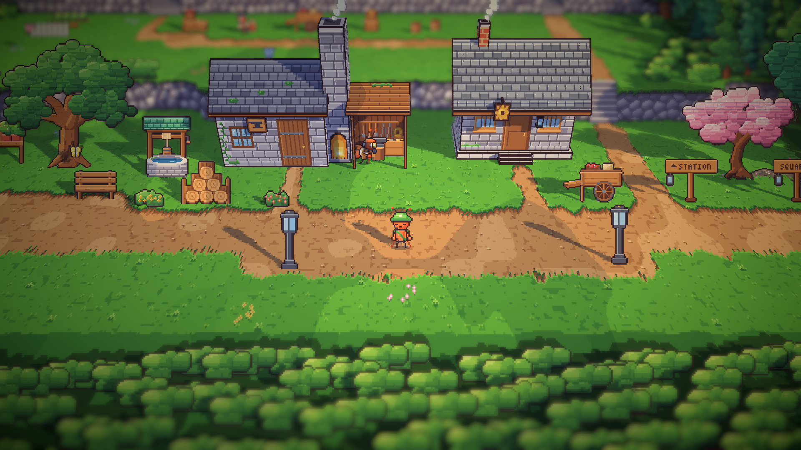
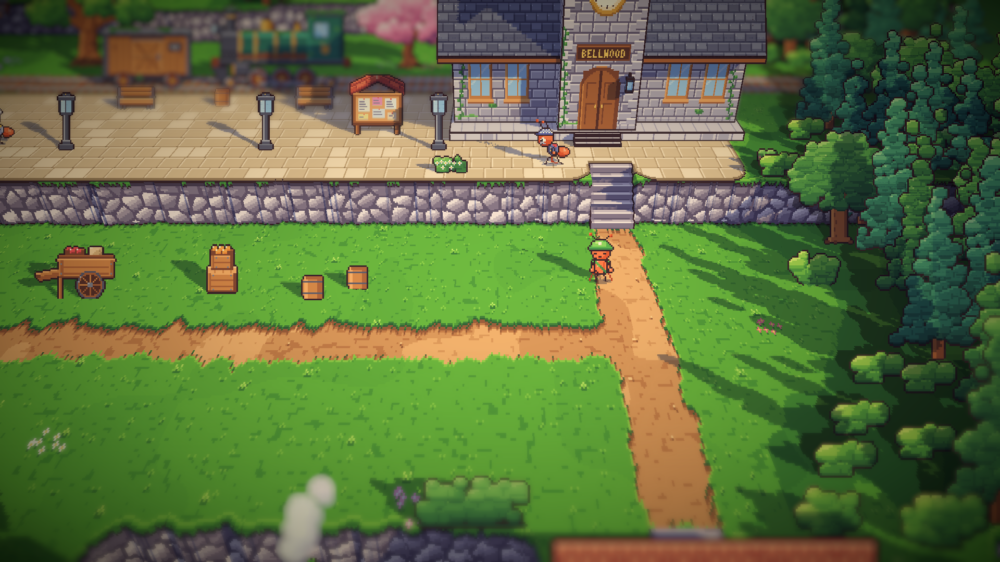
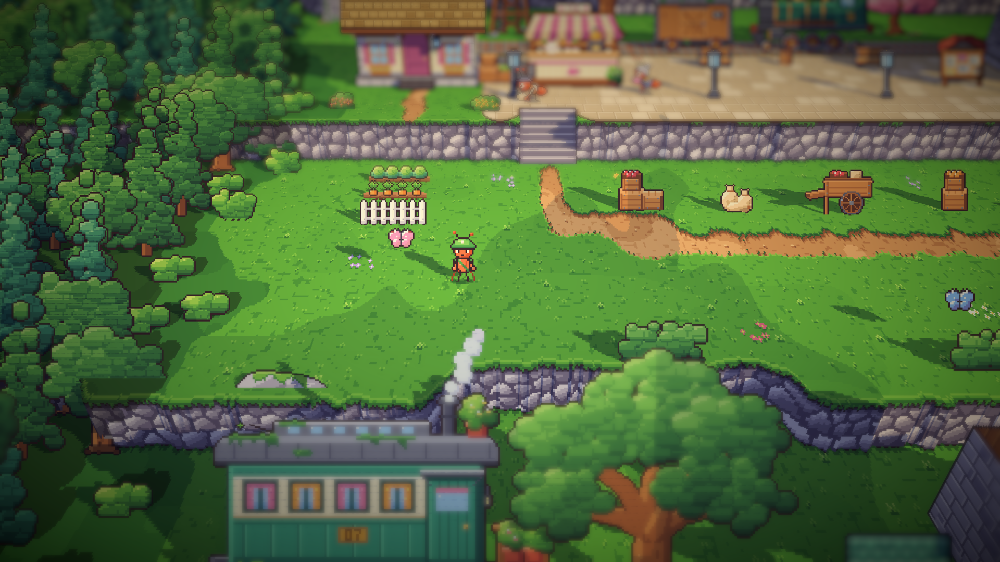
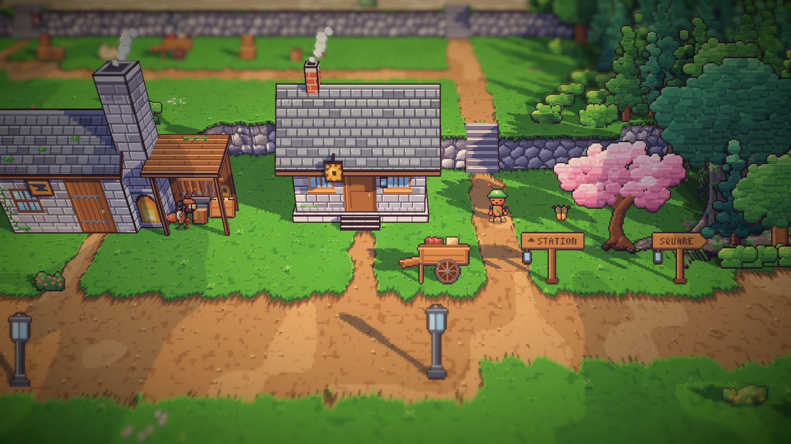

# 12. Penduduk yang hidup: pagi di stasiun

**Tanggal:** 2026-10-18

## Tujuan

Desain penduduk yang hidup sudah disetujui (`docs/superpowers/specs/2026-10-18-living-villagers-design.md`). Langkah
pertamanya satu contoh dulu, sebelum diperluas: pagi di stasiun. Ada empat penduduk, yaitu Helen, Kapten Bram, Mender,
dan seorang kuli angkut. Masing-masing punya kegiatan, bisa diajak bicara, lalu kembali ke kegiatannya. Selama
pengerjaan, stasiun juga ditata ulang, karena letaknya tidak masuk akal.

## Yang dikerjakan

### Penduduk dengan kegiatan (`Villager.cs`, `PlaceDef.cs`, `Places.cs`)

- `Person` sekarang punya:
  - `Phases`: di fase hari mana dia muncul;
  - `Round`: daftar perhentian yang dia jalani berulang-ulang;
  - `Line`: kalimat yang dia ucapkan saat diajak bicara.
- Setiap perhentian (`Stop`) punya tempat, pose, arah hadap, lama menunggu, dan tanda apakah dia membawa barang ke
  perhentian berikutnya.
- Komponen baru `Villager` menjalankan semua itu:
  - **Penduduk tanpa rute** diam di tempatnya dengan pose kegiatannya.
  - **Penduduk dengan rute** berjalan dari perhentian ke perhentian dan menahan pose setiap perhentian. Waktu tunggu
    pertamanya diacak, supaya dua rute tidak pernah seirama.
  - **Saat diajak bicara**, dia berhenti, berdiri (atau tetap memegang barangnya), dan menghadap kurir. Setelah dialog
    selesai, dia kembali ke kegiatannya, kecuali cerita sudah memberinya pose lain.
- Jika penduduk yang dituju sudah berjalan pergi saat kurir tiba, kurir mengikutinya ke tempat barunya.
- `Ant` punya `Carrying`: semut yang membawa barang berjalan dengan pose `carryWalk` dan berdiri dengan pose `carry`.

### Pagi di stasiun

- **Helen** menuang teh di ujung kedainya. Teko di tangannya miring dan menuang.
- **Kapten Bram** mondar-mandir di peron, antara jam menara yang berhenti dan papan jadwal. Di bawah jam dia menengadah,
  dengan tangan di belakang punggung. Dia tidak memakai jam tangan (lihat keputusan di bawah).
- **Kuli angkut** mengambil karung dari tumpukan di halaman barang, membawanya naik ke peti di samping kedai Helen,
  menaruhnya, lalu kembali untuk karung berikutnya.
- **Mender** memukul landasan di bengkelnya, dengan percikan api.

### Gambar penduduk (`chars.js`)

- **Tampak depan dan belakang untuk siapa saja.** Tabel `TURN` menyimpan apa yang berbeda dari setiap karakter: warna
  baju, dada, punggung, tas, topi, dan wajah. `renderTurned` sekarang umum untuk semua karakter. Hasil untuk kurir
  sama persis piksel demi piksel dengan sebelumnya.
- **Karakter baru:**
  - Kapten Bram: baju biru dongker, syal leher merah, kumis, dan topi bergaris.
  - Kuli angkut: rompi, topi wol, dan karungnya sendiri.
- **Pose baru:**
  - `brew`: menuang dari teko;
  - `hammer`: memukul dengan palu, dengan percikan api;
  - `look`: menengadah dengan tangan di belakang punggung;
  - `lift`: membungkuk mengangkat barang dari tanah.
- Helen dan Mender juga mendapat tampak depan dan belakang.

### Stasiun ditata ulang (`areas.js`)

Dulu stasiun menghadap kereta, dan kereta berada di sisi kamera. Tidak jelas untuk apa stasiunnya. Sekarang:

- **Rel di belakang:** rel keluar dari terowongan di punggung bukit dan berjalan di belakang peron. Kereta tua berdiri
  di atasnya.
- **Satu stasiun, bukan satu bangunan:** rel, peron, kedai teh, menara air, dan halaman depan aula berdiri bersama di
  satu teras berlantai batu, dengan tembok batu kasar yang menghadap kamera. Aula berada di ujung timur, dan rumah Helen
  di ujung barat.
- **Tangga naik:** satu di bawah pintu aula, dan satu di ujung barat peron. Tangga barat adalah jalan kuli angkut dari
  halaman barang.
- **Di bawah tembok:** halaman barang di sepanjang jalan gerobak (peti, karung, gerobak dorong, tong), dan kebun herba
  Helen di balik pagar putih.
- **Tanpa gapura BELLWOOD:** gapura selamat datang dihapus dari jalan menuju stasiun. Di tempatnya berdiri papan arah
  STATION, seperti papan arah di pintu keluar area.

### Alat pengembang

- **F5** (hanya di build pengembangan) mengganti fase hari dan memuat ulang tempat itu di posisi kurir, untuk mengecek
  penduduk di setiap fase.
- `Chapter.Chat` mengucapkan `Line` penduduk. Jika belum ada kalimatnya, yang muncul "Nothing written here yet".
- Bayangan di bawah semut sekarang cukup untuk 16 semut, dulu 8 (`_Feet[16]` di `Pixel.shader`).

## Keputusan

Dicatat juga di `GAME-CONTEXT.md`.

- **Tidak ada penduduk yang memakai atau memperlihatkan jam tangan**, supaya tidak ada yang menunjuk ke keepsake Malam
  1 hanya dari penampilan. Kapten Bram mencocokkan jam menara yang berhenti dengan papan jadwal.
- **Kereta diam sepanjang permainan**, karena jalur kereta sudah diputus sejak 1952. Kereta baru bergerak sekali, di
  epilog (Hari 8), saat waktu di Bellwood mengalir lagi.
- **Stasiun adalah satu tempat:** rel di belakang, semuanya di satu teras batu, tangga naik dari halaman barang.
- **Bellwood tidak punya gapura selamat datang.** Pendatang tiba dengan kereta, jadi stasiun adalah pintu depan kota,
  dan papan nama BELLWOOD di aula yang menyambut mereka.

## Masalah dan solusinya

- **Kuli angkut hanya mondar-mandir tanpa tujuan.** Pengguna melihat dia berjalan bolak-balik tanpa membawa apa pun.
  Sekarang dia mengangkat karung dari tumpukan, membawanya, dan menaruhnya di dekat peti kedai Helen.
- **Tempat menaruh karung tertutup sudut kedai.** Perhentiannya dipindah ke depan peti.
- **Helen tertutup meja kedainya.** Dia dipindah ke ujung kedai.
- **Mender berdiri di luar bengkel.** Dia dipindah ke landasan. Tempat berdiri penduduk tidak perlu bisa dilewati;
  yang perlu bisa dicapai hanya tempat kurir berdiri saat bicara.
- **Kurir berjalan ke tempat Bram tadinya berdiri.** Kurir sekarang mengikuti penduduk yang masih berjalan.
- **Helen tidak kembali menuang teh setelah diajak bicara.** Kotak dialog mengembalikan pose pembicara saat ditutup,
  setelah `Done()`. Karena itu `Done()` sekarang dipanggil setelah kontrol dilepas.
- **Tempat bicara dengan kuli angkut terhalang tiang lampu.** Tes baru menemukannya, lalu tempatnya digeser.
- **Peringatan `DEVELOPMENT_BUILD` usang (UAC0009).** Diganti dengan pengecekan `Debug.isDebugBuild` saat berjalan.
- **Halaman depan menjadi lapangan rumput kosong** setelah stasiun ditata ulang. Halaman diisi jalan gerobak, halaman
  barang, dan kebun Helen.
- **Tumpukan bantalan rel terlihat seperti potongan cokelat** di tengah rumput, jadi semuanya dihapus.
- **Kebun Helen terlukis di tembok** setelah peron dinaikkan. Kebun dipindah ke bawah tembok.

## Cara dicek

- Ekspor dengan `python3 game/ArtSource/export.py --force areas` dan `--force cast`.
- Tes PlayMode baru `VillagersTest.EveryoneCanBeReached`: untuk setiap tempat yang punya penduduk, setiap perhentian
  rute dan setiap tempat bicara harus bisa dilewati dan dicapai dari pintu masuk tempat itu.
- Tes PlayMode lulus 3 dari 3.
- Tangkapan layar Full HD: stasiun pagi, bicara dengan Bram, tangga aula, kebun Helen, papan arah, dan bengkel Mender.
  Rute kuli angkut dicek dari awal sampai akhir: berjalan, mengangkat di halaman, membawa, lalu menaruh di kedai.

## Commit

`feat(villagers): bring the station morning to life and rebuild the station as one place`

## Langkah berikutnya

- Rutinitas siang dan sore untuk penduduk stasiun.
- Penduduk di area lain, semut latar tanpa nama, dan karakter yang belum digambar (Pip, Sam dewasa, Arlo).
