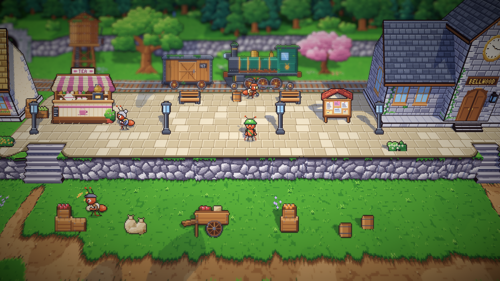
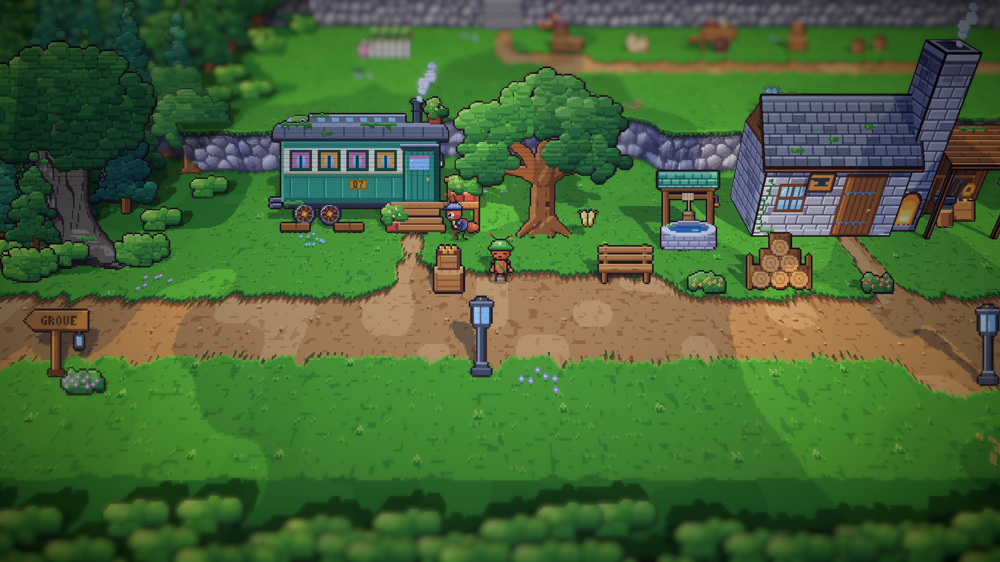
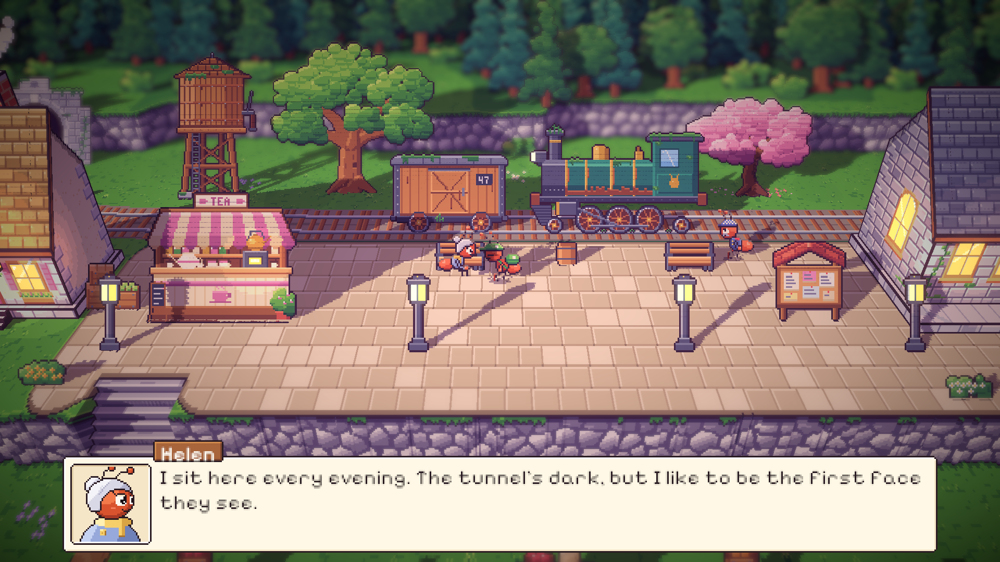
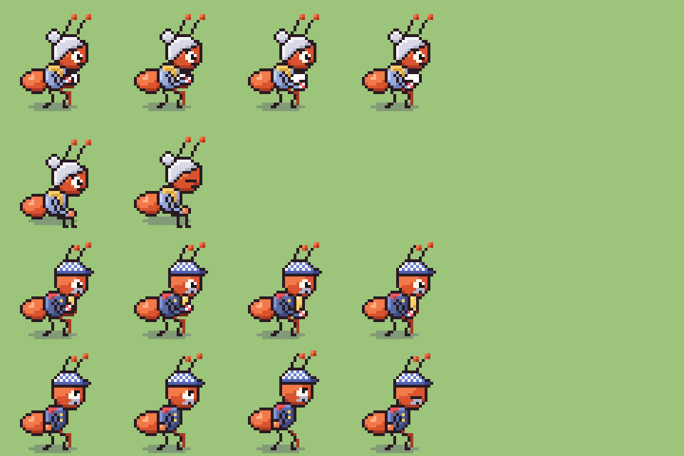

# 13. Siang dan sore di stasiun

**Tanggal:** 2026-10-18

## Tujuan

Pagi di stasiun sudah disetujui. Langkah ini melanjutkan hari yang sama: penduduk stasiun mendapat kegiatan untuk
siang dan sore, mengikuti tabel rutinitas di `docs/superpowers/specs/2026-10-18-living-villagers-design.md`. Dengan
begitu stasiun terlihat berubah sepanjang hari.

## Yang dikerjakan

### Rutinitas siang dan sore (`Places.cs`)

| Penduduk | Siang | Sore |
|---|---|---|
| Helen | mengelap cangkir di kedainya | duduk di bangku peron menghadap terowongan, masih menunggu kereta |
| Kapten Bram | menggosok peluit kuningannya di kaki tangga gerbongnya | berdiri di dekat lokomotif tua, menengadah memandanginya |
| Mender | mengetuk roda lokomotif tua dengan palunya | kembali ke bengkel |
| Kuli angkut | masih mengangkut karung | sudah pulang |

Setiap penduduk punya kalimat sendiri untuk setiap fase. Kalimat siang Bram berakhir dengan "in case she needs it",
petunjuk kecil untuk epilog, saat kereta bergerak lagi.

### Pose `polish` (`chars.js`)

- Helen dan Bram memakai pose yang sama: tangan jauh memegang benda di depan dada, dan tangan dekat menggosoknya
  memutar dengan kain kotak-kotak merah putih.
- Bendanya diambil dari karakternya (`polish` di `CAST`): cangkir putih untuk Helen, peluit kuningan untuk Bram.
- Kain krem yang pertama dicoba hilang di atas cangkir putih, jadi kainnya diganti kotak-kotak merah putih.

### Duduk di bangku (`Ant.cs`, `PlaceDef.cs`, `Villager.cs`)

- `Person.Seat` dan `Ant.Seat`: tinggi tempat duduk dalam art px. Tempat duduk bangku peron tingginya 9 px.
- Semut hanya dinaikkan setinggi itu **selama ia duduk**. Kalau cerita memberinya pose berdiri (misalnya `moved`
  saat menerima keepsake), ia berdiri di lantai dan tidak melayang.
- Penduduk yang duduk tetap duduk saat diajak bicara, dan berbalik ke arah kurir.

## Keputusan

- **Bram berdiri di kaki tangga gerbongnya, bukan di teras.** Teras itu bagian dari gambar datar gerbong, sehingga
  semut yang berdiri di atasnya akan tertutup gambar gerbong. Desainnya menandai tempat ini sebagai pilihan pembangun.
- **Tempat duduk hanya menaikkan semut yang sedang duduk**, supaya pose berdiri dari cerita tetap menapak di tanah.

## Masalah dan solusinya

- **Helen terlihat terduduk di lantai di depan bangku.** Pose `sit` menganggap kaki berada di permukaan tempat duduk,
  sedangkan Helen berdiri di lantai. Dia sekarang dinaikkan setinggi tempat duduk bangku.
- **Mender dan Bram tertutup roda lokomotif.** Mereka berdiri di garis rel, di belakang roda. Keduanya dipindah
  selangkah ke depan, ke peron.
- **Kurir menutupi Helen saat bicara.** Tempat bicaranya tepat di depan bangku, jadi dipindah ke samping bangku.
- **Tempat bicara Mender di siang hari berada di atas tong peron.** Tes `VillagersTest.EveryoneCanBeReached`
  menemukannya, lalu tempatnya dipindah ke sisi lain.

## Cara dicek

- Ekspor dengan `python3 game/ArtSource/export.py --force cast`.
- Pratinjau pose `polish`, `sit`, dan `look` untuk Helen dan Bram.
- Tangkapan layar Full HD: peron di siang hari, Bram di gerbongnya, dan Helen di bangku saat diajak bicara di sore
  hari. Fase diganti dengan F5.
- Tes PlayMode lulus 3 dari 3.

## Commit

`feat(villagers): give the station's villagers midday and dusk routines`

## Langkah berikutnya

- Penduduk alun-alun: Baker, Mia, Pip, dan Sam dewasa.
