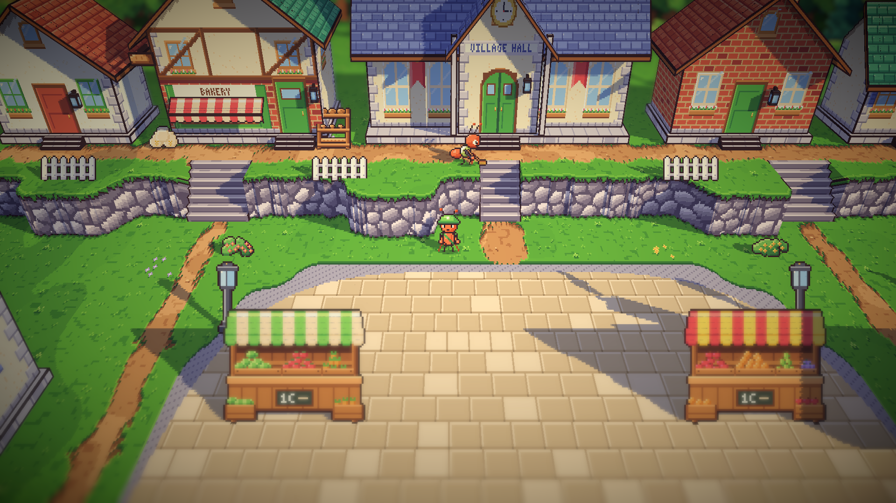
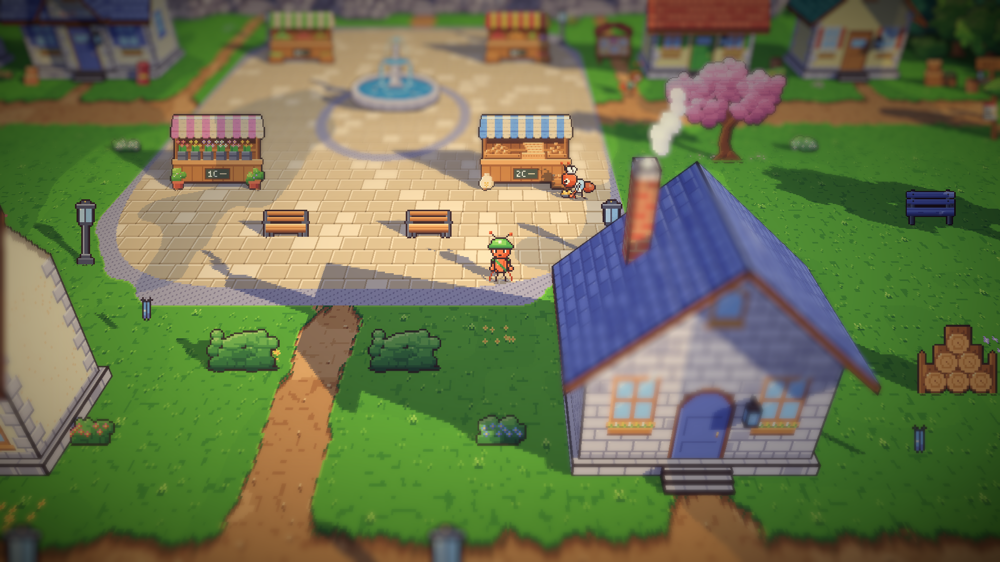
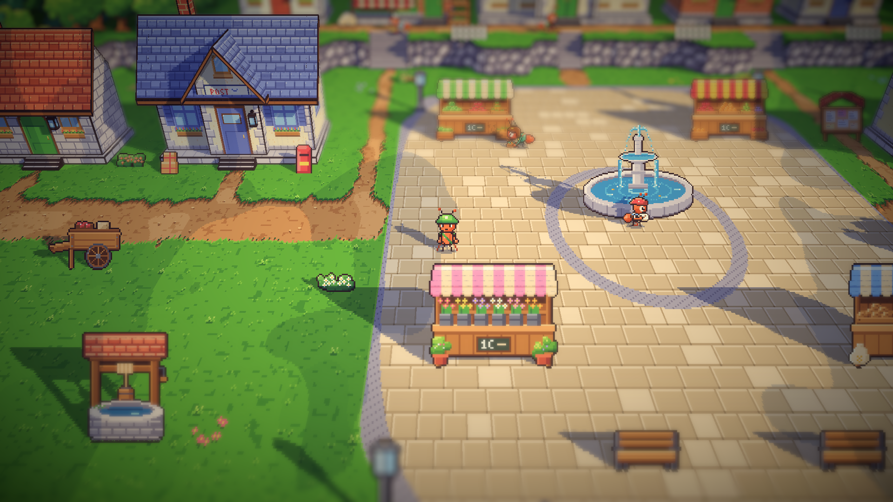

# 14. Pagi di alun-alun

**Tanggal:** 2026-10-18

## Tujuan

Stasiun sudah hidup sepanjang hari. Langkah ini membawa penduduk ke alun-alun, dimulai dari pagi: Baker, Mia, Pip,
dan Sam, sesuai tabel rutinitas di desain penduduk. Penampilan mereka diambil dari teks karakter di GDD (bab 6).

## Yang dikerjakan

### Pagi di alun-alun (`Places.cs`)

- **Baker** membawa nampan roti dari toko roti di teras, turun tangga, lalu menatanya di kios roti.
- **Mia** membawa peti sayur dari rumahnya untuk menata kios sayurnya.
- **Pip** mengambil surat dari tangga kantor pos yang tutup, lalu mengantarnya ke pintu tetangga. Pintu, papan, dan
  jendela kantor pos tidak berubah, karena kantor pos tetap tutup sampai Hari 8.
- **Sam** menyapu di depan pintu balai desa, di puncak tangganya.

Setiap penduduk punya kalimat pagi sendiri.

### Penampilan dari GDD (`chars.js`)

- **Sam** sekarang arsiparis dewasa: kemeja putih berkerah kaku, rompi rajut hijau lumut, dan pelindung lengan kain
  hitam. Dulu dia digambar sebagai anak-anak dari cerita lama.
- **Pip** karakter baru: kaos salur biru-putih, topi kurir kebesaran yang dipakai miring, dan seikat surat.
- **Kapten Bram** digambar ulang: topi pet kondektur dengan pita emas, kerah putih, kumis putih, dan peluit kuningan
  berantai di lehernya. Topi bergaris dan syal merahnya dihapus.
- **Mia** sekarang memakai selendang gendong tenun merah-kuning, di tampak samping maupun di potretnya.
- **Baker, Mia, dan Sam** mendapat tampak depan dan belakang.
- **Muatan baru:** nampan roti untuk Baker, peti sayur untuk Mia, dan seikat surat untuk Pip. Dengan muatan itu
  mereka memakai pose `carry`, `carryWalk`, dan `lift` seperti kuli angkut.
- **Pose baru `sweep`:** sapu dipegang rendah dengan dua tangan dan diayun maju-mundur, dengan sedikit debu.

## Keputusan

Dicatat juga di `GAME-CONTEXT.md`.

- **Teks karakter GDD menang jika lembar desainnya berbeda.** Lembar Sam masih menunjukkan Sam anak-anak dari cerita
  lama, dan lembar Pip menunjukkan anak berpita merah muda. Keduanya mengikuti teks.
- **Topi Pip berwarna merah kotak pos**, supaya Pip tidak pernah dikira kurir yang bertopi hijau.
- **Semua tetap semut merah kecokelatan.** Warna kulit di GDD tidak diikuti, sesuai keputusan tentang semut.

## Masalah dan solusinya

- **Topi koki Baker terlalu tinggi dari depan** dan menenggelamkan kepalanya, jadi topinya dipendekkan.
- **Pip bertopi hijau terlihat seperti kurir kecil** saat berdiri di samping kurir, jadi topinya diganti merah.
- **Baker sempat terlihat di belakang atap kios roti.** Ternyata itu saat dia berjalan memutari kios. Di tempat
  berhentinya, di sudut depan kios, dia terlihat jelas.
- **Satu kali tes gagal tepat setelah refresh,** kemungkinan karena lembar sprite Pip yang baru masih diimpor. Dua kali
  dijalankan ulang, tes lulus 3 dari 3.

## Yang belum

- Pip baru punya tampak samping. Tampak depan dan belakang digambar seukuran semut dewasa, sehingga anak-anak belum
  bisa berbalik ke arah kamera.
- Sarung tangan putih Kapten Bram belum digambar.

## Cara dicek

- Ekspor dengan `python3 game/ArtSource/export.py --force cast`.
- Pratinjau semua pose dan tampak depan-belakang untuk Bram, Sam, Pip, Baker, dan Mia, serta potret mereka.
- Posisi penduduk dicatat selama beberapa detik: setiap rute berjalan sampai ke setiap perhentiannya.
- Tangkapan layar Full HD: Sam di balai desa, Baker di kios roti, serta Pip dan Mia di alun-alun.
- Tes PlayMode lulus 3 dari 3, termasuk `VillagersTest.EveryoneCanBeReached` untuk alun-alun.

## Commit

`feat(villagers): bring the square's morning to life with the GDD's Baker, Mia, Pip and Sam`

## Langkah berikutnya

- Siang dan sore di alun-alun.
