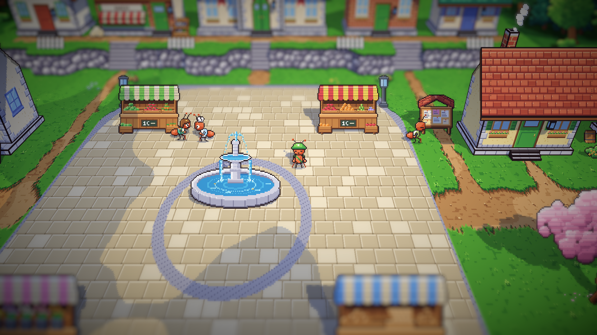
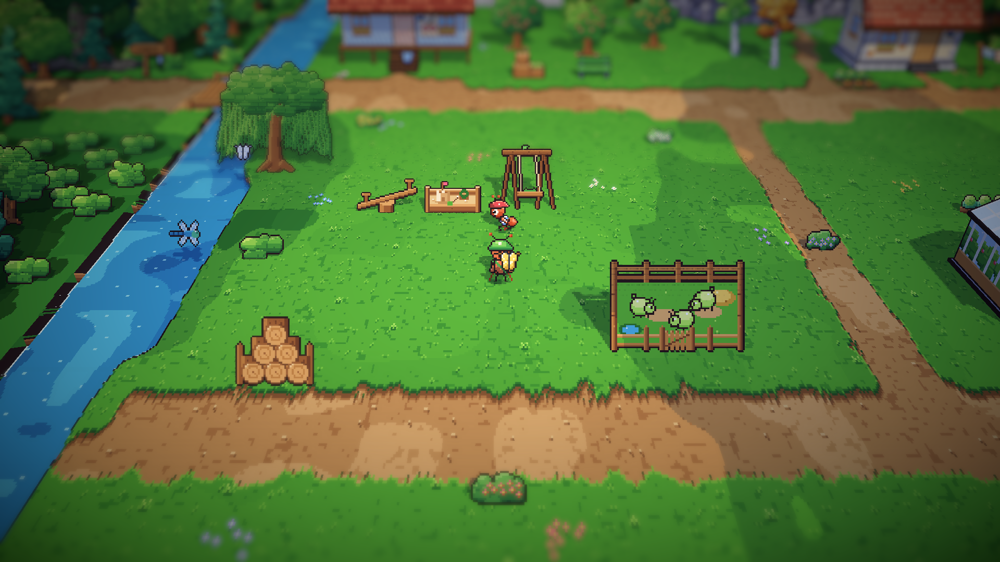
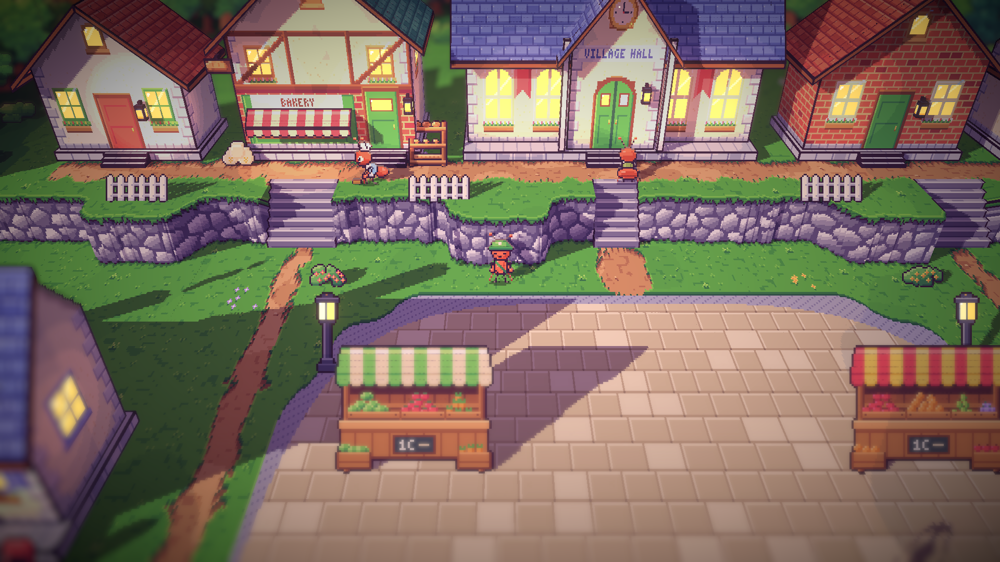
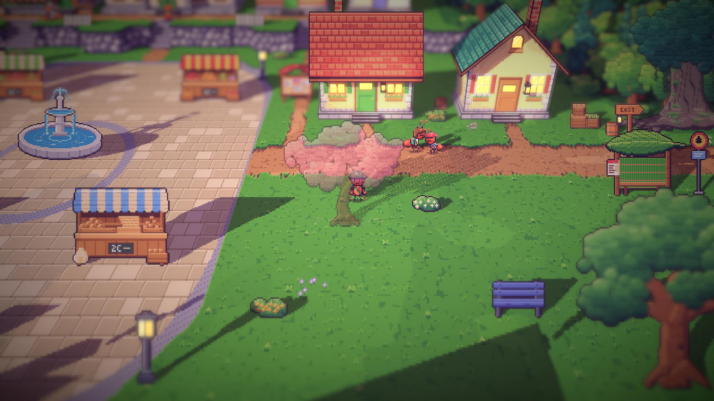

# 15. Siang dan sore di alun-alun

**Tanggal:** 2026-10-18

## Tujuan

Pagi di alun-alun sudah disetujui. Langkah ini melanjutkan hari yang sama untuk Baker, Mia, Pip, dan Sam, sesuai tabel
rutinitas di `docs/superpowers/specs/2026-10-18-living-villagers-design.md`.

## Yang dikerjakan

### Rutinitas siang dan sore (`Places.cs`)

| Penduduk | Siang | Sore |
|---|---|---|
| Baker | bergosip dengan Mia di kios sayur | menyapu di depan toko roti |
| Mia | bergosip dengan Baker di kios sayurnya | mengobrol dengan Pip di luar rumahnya sebelum masuk |
| Pip | "istirahat" di taman bermain di area timur, berlari bolak-balik | pulang, mengobrol dengan Mia |
| Sam | membaca papan pengumuman | mengunci pintu balai desa, membelakangi alun-alun |

Setiap penduduk punya kalimat sendiri untuk setiap fase. Kalimat sore Mia, "Pip knows why", petunjuk kecil tentang
alasan keluarganya selalu pulang sebelum gelap.

### Penduduk yang berlari dan membelakangi kamera (`PlaceDef.cs`, `Ant.cs`, `Villager.cs`)

- `Stop.Run`: penduduk berlari, bukan berjalan, menuju perhentian berikutnya. Pip memakainya di taman bermain.
- `Person.Away` dan `Ant.FaceAway()`: penduduk berdiri membelakangi kamera, dengan tampak belakang. Sam memakainya
  saat mengunci pintu balai desa.
- Penduduk tanpa rute kembali ke kegiatannya lewat satu jalur, `Hold()`, baik saat tempat dimuat maupun setelah diajak
  bicara. Dengan begitu Sam membelakangi kamera lagi setelah dialog selesai.

### Pose baru per penduduk (`chars.js`)

- Semua penduduk sekarang punya pose `talk`, dipakai Baker dan Mia saat bergosip. Lembar sprite Gardener, anak-anak,
  dan kuli angkut ikut diekspor ulang karena itu.
- Sam mendapat pose `look`, Baker mendapat pose `sweep`, dan Pip mendapat pose `run`.

## Masalah dan solusinya

- **Mia dan Pip tertutup pohon sakura** di depan rumah Mia. Tajuknya yang menjadi tembus pandang tetap menutupi
  mereka, jadi keduanya dipindah selangkah ke timur, keluar dari bayangan pohon.
- **Tempat Sam di siang hari terhalang.** Tes `VillagersTest.EveryoneCanBeReached` menemukan tempat bicaranya tidak bisa
  dicapai, lalu Sam dipindah ke depan papan pengumuman.

## Cara dicek

- Ekspor dengan `python3 game/ArtSource/export.py --force cast`.
- Tangkapan layar Full HD: alun-alun di siang hari, Pip di taman bermain, serta Baker, Sam, Mia, dan Pip di sore hari.
  Fase diganti dengan F5.
- Tes PlayMode lulus 3 dari 3, termasuk `VillagersTest.EveryoneCanBeReached` untuk alun-alun dan area timur.

## Commit

`feat(villagers): give the square's villagers midday and dusk routines`

## Langkah berikutnya

- Penduduk area timur: Nora, Gardener, dan Leo, digambar sesuai GDD.
