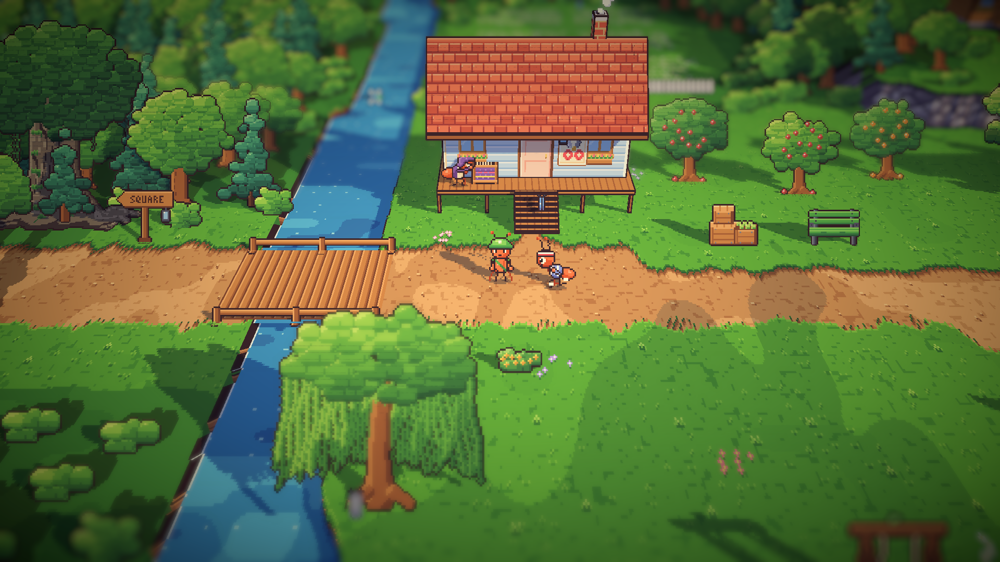
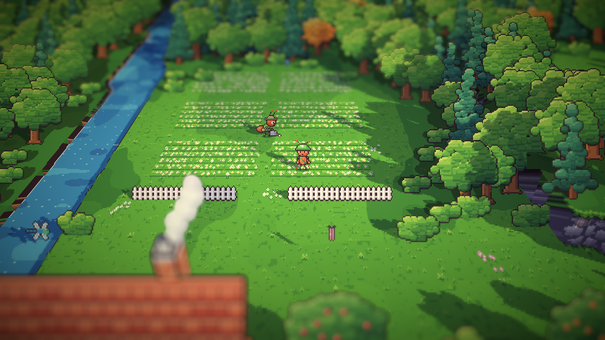
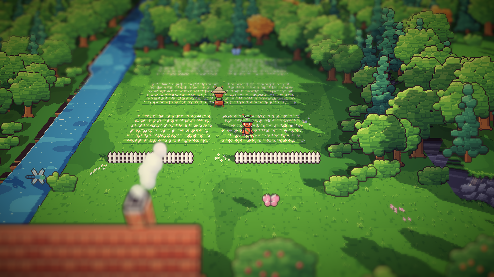

# 16. Pagi di area timur

**Tanggal:** 2026-10-19

## Tujuan

Alun-alun sudah hidup sepanjang hari. Langkah ini membawa penduduk ke area timur, dimulai dari pagi: Nenek Nora, Gardener,
dan Leo, sesuai tabel rutinitas di desain penduduk. Penampilan mereka diambil dari teks karakter di GDD (bab 6).

## Yang dikerjakan

### Pagi di area timur (`Places.cs`)

- **Nenek Nora** menenun di alat tenunnya, di beranda rumah panggungnya. Kurir bicara dengannya dari jalan di bawah
  beranda.
- **Gardener** menyiram ladang kamomil dengan gembor. Dia berjalan di jalan setapak di antara petak-petak bunga dan
  berhenti di setiap petak.
- **Leo** berlari bolak-balik di sepanjang jalan desa timur.

Setiap penduduk punya kalimat pagi sendiri.

### Penampilan dari GDD (`chars.js`)

- **Nenek Nora:** selendang rajut wol tebal berwarna ungu tua yang ditarik menutupi kepalanya, kacamata baca tebal
  bertali benang, dan badan yang sedikit membungkuk.
- **Leo:** jaket olahraga biru yang lusuh, bergaris putih dan beritsleting, ikat kepalanya, dan pembalut kain di
  pergelangan kaki. Sepatu larinya dihapus (lihat keputusan di bawah).
- **Gardener:** pakaian katun hijau rumput, kantong benih di pinggang, dan topi jerami teranyam halus dengan pita
  hijau.
- Ketiganya mendapat tampak depan dan belakang, serta potret baru.
- **Pose baru `weave`:** tangan meloloskan teropong benang di antara benang lungsin, lalu merapatkan tenunan.
- **Pose baru `water`:** gembor dipegang rendah, dimiringkan, dan airnya menetes ke bunga.

### Beranda dan alat tenun Nora (`village-centre.js`, `village-east.js`)

- Rumah buatan `V.house` sekarang punya pilihan `porch`: panggung atau dek yang menjorok lebih jauh di depan dinding,
  menjadi beranda. Rumah lain tidak berubah.
- Rumah panggung Nora mendapat beranda selebar 12 texel, dengan alat tenun di atasnya. Di alat tenun itu ada
  selendang ungu yang setengah jadi.

### Berdiri di lantai yang tinggi (`PlaceDef.cs`, `Ant.cs`, `Villager.cs`)

- `Person.Floor` dan `Ant.Floor`: tinggi lantai tempat penduduk berdiri, dalam art px. Berbeda dengan `Seat`, semut
  selalu dinaikkan setinggi itu, apa pun posenya. Nora berdiri di dek setinggi 16 px.

### Gerbang ladang kamomil (`areas.js`)

- Pagar ladang sekarang terbuka di tengahnya, menjadi gerbang ke jalan setapak di antara petak.

## Keputusan

Dicatat juga di `GAME-CONTEXT.md`.

- **Leo memakai pembalut kain di pergelangan kaki, bukan sepatu,** sesuai teks GDD. Dengan begitu penampilannya tidak
  menunjuk ke keepsake Malam 5, sepatu lari paku, seperti aturan jam tangan untuk keepsake Malam 1.
- **Nora menenun di beranda rumah panggungnya.** Dek lamanya hanya 4 texel di depan dinding, terlalu sempit untuk
  berdiri. Dek itu bagian dari model 3D, sehingga Nora berdiri di depan dinding dan tidak tertutup seperti Bram di
  teras gerbongnya.
- **Ladang kamomil punya gerbang,** supaya Gardener dan kurir bisa masuk.

## Masalah dan solusinya

- **Ladang kamomil tertutup rapat.** Tes `VillagersTest.EveryoneCanBeReached` menemukan perhentian Gardener tidak bisa
  dicapai: pagar menutup ladang dari jalan, dan sisi lainnya hutan. Bagian tengah pagar dihapus menjadi gerbang.
- **Kacamata Nora menjadi topeng gelap** di tampak samping, karena bingkainya diberi garis tepi tinta. Bingkainya
  sekarang setebal 1 px tanpa garis tepi, sehingga matanya terlihat.
- **Selendang Nora dari depan terlihat seperti helm.** Ujung selendang di kedua sisi kepala dipendekkan.
- **Gardener terlihat buram dari gerbang,** karena efek kedalaman fokus kamera. Dia jelas saat kurir masuk ke ladang.

## Cara dicek

- Ekspor dengan `python3 game/ArtSource/export.py --force cast` dan `--force areas`. Hanya area timur yang berubah.
- Pratinjau semua pose, tampak depan-belakang, dan potret untuk Nora, Leo, dan Gardener.
- Posisi penduduk dicatat saat bermain: Nora di dek, Gardener dan Leo di rute masing-masing.
- Tangkapan layar Full HD: Nora dan Leo di depan rumah panggung, Gardener di ladang, dan gerbang ladang.
- Tes PlayMode lulus 3 dari 3, termasuk `VillagersTest.EveryoneCanBeReached` untuk area timur.

## Commit

`feat(villagers): bring the east's morning to life with the GDD's Nora, Gardener and Leo`

## Langkah berikutnya

- Siang dan sore di area timur.
