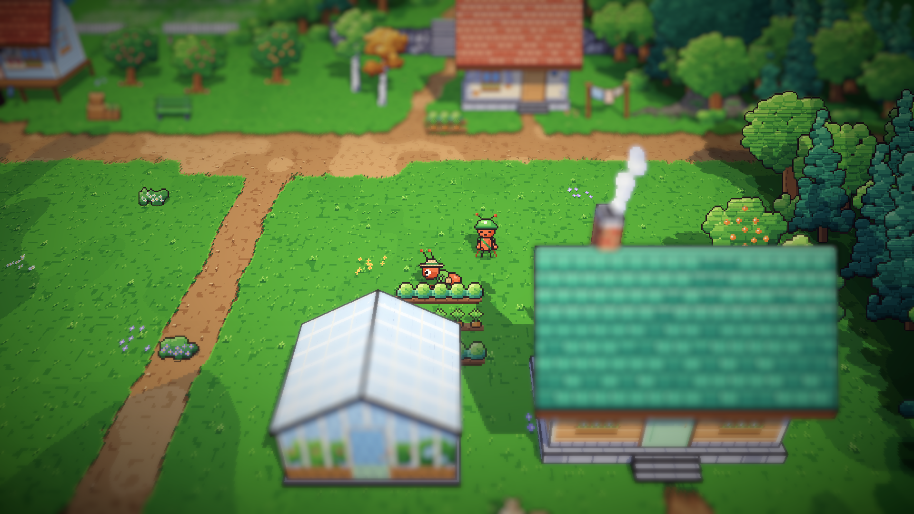
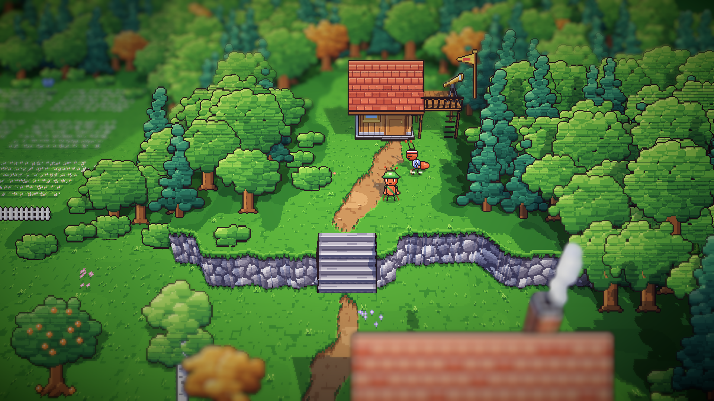
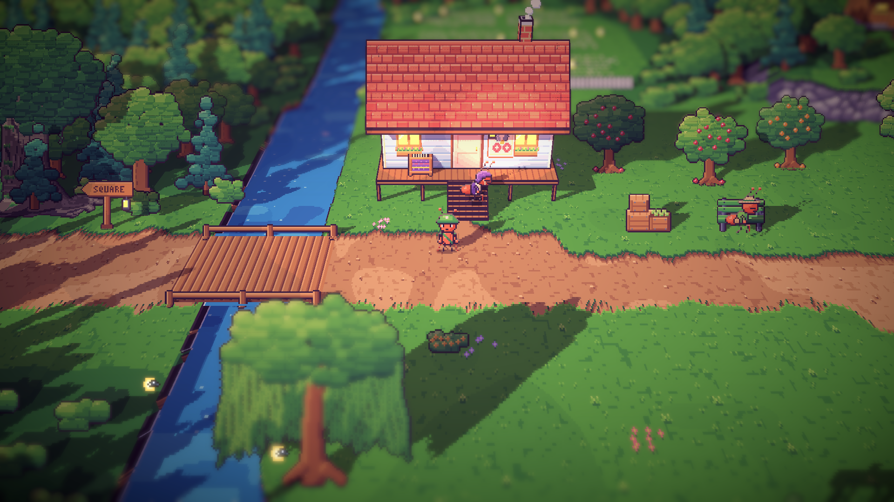
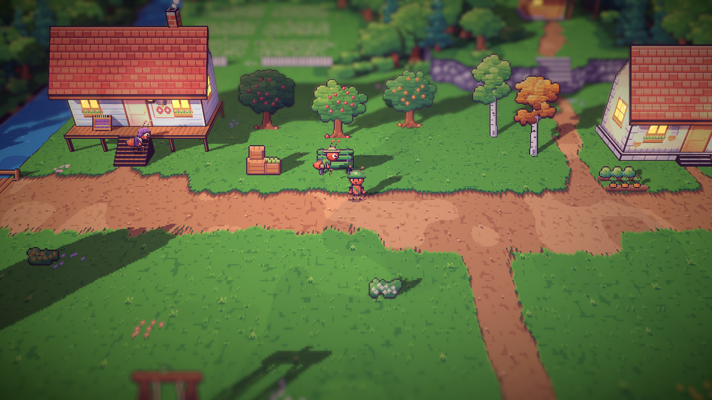
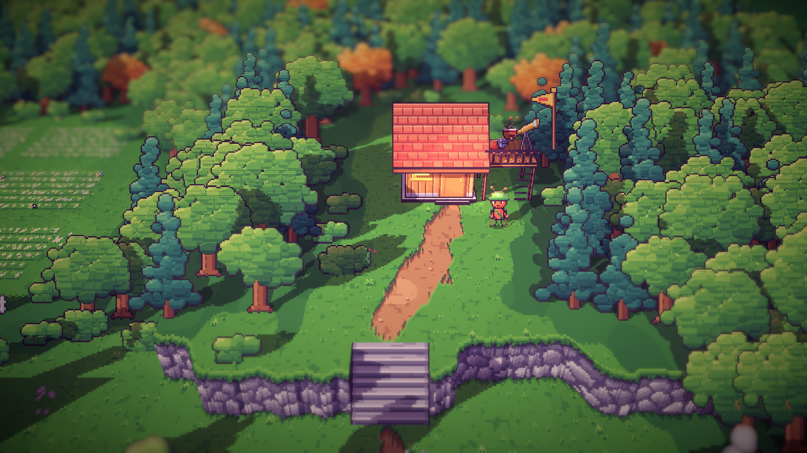

# 17. Siang dan sore di area timur

**Tanggal:** 2026-10-19

## Tujuan

Pagi di area timur sudah disetujui. Langkah ini melanjutkan hari yang sama untuk Nenek Nora, Gardener, dan Leo, sesuai
tabel rutinitas di `docs/superpowers/specs/2026-10-18-living-villagers-design.md`.

## Yang dikerjakan

### Rutinitas siang dan sore (`Places.cs`)

| Penduduk | Siang | Sore |
|---|---|---|
| Nenek Nora | masih menenun di berandanya | duduk di tangga rumah panggungnya |
| Gardener | merawat bedeng sayur di belakang rumah kaca | beristirahat di bangku kebun buah |
| Leo | berdiri di puncak bukit di depan pondoknya, memandang lembah | di dek pengintai, mengintip lewat teleskop |

Setiap penduduk punya kalimat sendiri untuk setiap fase. Kalimat siang Leo, "Every road a runner could take",
mengisyaratkan penyesalannya sebagai pelari, tanpa menunjuk ke keepsake-nya.

### Pose baru (`chars.js`)

- **`tend`:** membungkuk di atas bedeng, tangan bergantian menggemburkan tanah di sekitar tanaman. Mirip `lift`,
  tetapi tanpa barang bawaan.
- **`peer`:** satu mata di lensa teleskop, satu tangan menahan tabungnya.
- Leo juga mendapat pose `look`.

## Keputusan

- **Leo di puncak bukit pada siang hari, bukan di dek pengintai.** Di ujung barat dek dia tertutup atap pondok, dan sisa
  dek terisi teleskop. Dek dipakai pada sore hari, saat dia di teleskop.
- **Gardener merawat bedeng dari sisi belakangnya.** Bedeng berada tepat di belakang rumah kaca, sehingga dari kamera
  sebagian besar tertutup atapnya. Dari sisi belakang, Gardener tetap terlihat.

## Masalah dan solusinya

- **Leo tertutup atap pondok** di tempat siang pertamanya. Tempatnya dipindah ke puncak bukit.

## Cara dicek

- Ekspor dengan `python3 game/ArtSource/export.py --force cast`.
- Tangkapan layar Full HD untuk setiap penduduk di siang dan sore hari. Fase diganti dengan F5.
- Tes PlayMode lulus 3 dari 3, termasuk `VillagersTest.EveryoneCanBeReached` untuk area timur.

## Commit

`feat(villagers): give the east's villagers midday and dusk routines`

## Langkah berikutnya

- Penduduk pesisir: Theo dan Nelayan Arlo, digambar sesuai GDD.
