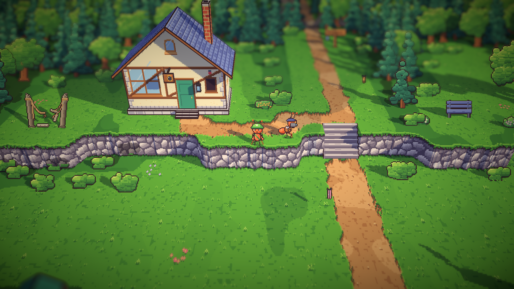
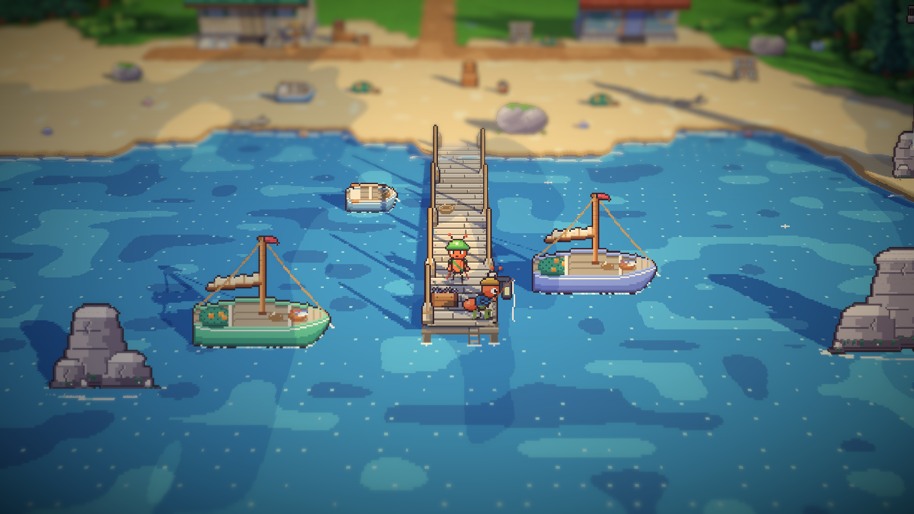
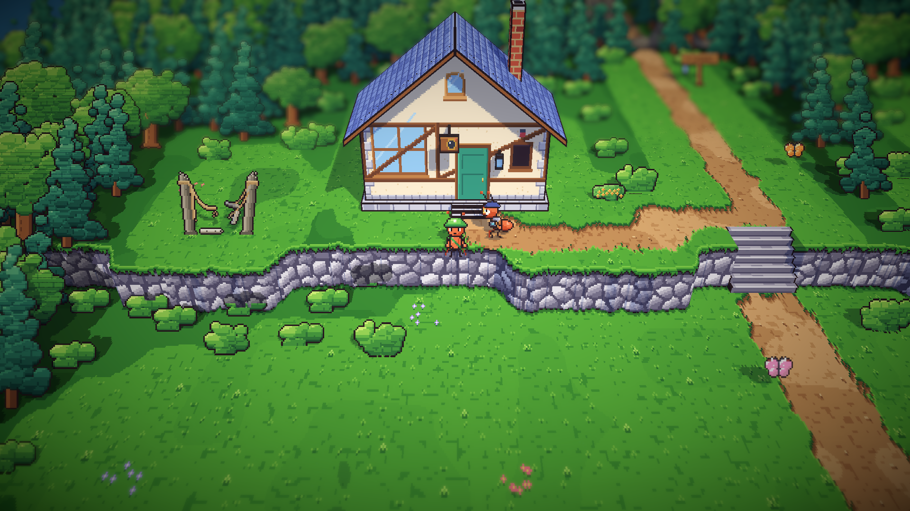
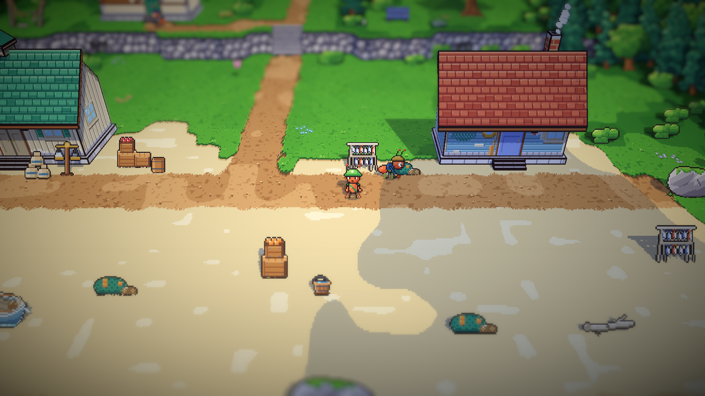
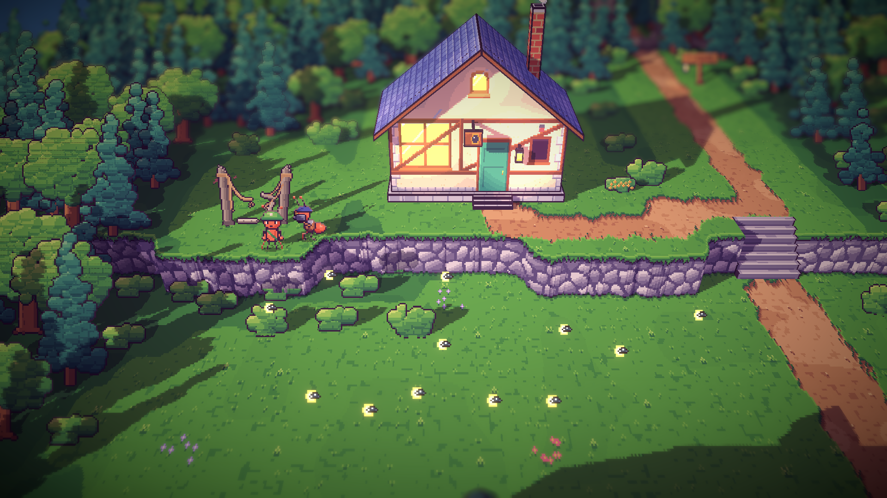
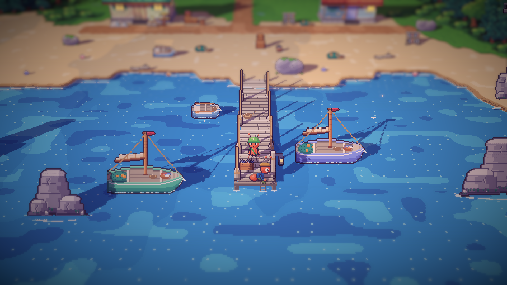

# 18. Sehari di pesisir

**Tanggal:** 2026-10-19

## Tujuan

Area timur sudah hidup sepanjang hari. Langkah ini mengisi pesisir, area terakhir yang punya penduduk bernama: Theo dan
Nelayan Arlo, dari pagi sampai sore, sesuai tabel rutinitas di desain penduduk. Penampilan mereka diambil dari teks
karakter di GDD (bab 6). Arlo belum punya sprite, jadi dia digambar baru.

## Yang dikerjakan

### Rutinitas sehari (`Places.cs`)

| Penduduk | Pagi | Siang | Sore |
|---|---|---|---|
| Theo | memotret laut dari tepi tebing | di pintu studionya, menunggu cahaya siang yang datar berlalu | memotret matahari terbenam di sisa jembatan tali |
| Nelayan Arlo | memancing di sudut timur ujung dermaga yang terbuka | membungkuk memperbaiki jalanya di jalan, dekat rak ikan | duduk di ujung dermaga |

Setiap penduduk punya kalimat sendiri untuk setiap fase.

### Penampilan dari GDD (`chars.js`)

- **Theo:** rompi fotografer cokelat tua berkantong banyak, lensa pembesar berbingkai kuningan di matanya, baret, dan
  kameranya sendiri bertali. Saat memotret, kamera pindah dari dada ke matanya.
- **Nelayan Arlo** (sprite baru): topi rajut kuning mustard, baju rajut wol biru bahari bergaris rajutan, celana kodok
  karet hijau zaitun bertali, dan sepatu boot karet tinggi.
- Keduanya mendapat tampak depan dan belakang, serta potret.
- **Pose baru `photo`:** kamera diangkat ke mata dengan dua tangan, dan rana berkedip di bingkai kedua.
- **Pose baru `fish`:** joran diulurkan di atas air, ujungnya mengangguk, dan senarnya hanyut.
- Arlo memakai pose `tend` untuk memperbaiki jala, dan pose `sit` di dermaga.
- Bagian tubuh karakter sekarang bisa disembunyikan untuk pose tertentu (`off`). Kamera di dada Theo memakainya.

## Keputusan

Dicatat juga di `GAME-CONTEXT.md`.

- **Theo tetap membawa kameranya sendiri,** karena rutinitasnya memotret. Keepsake Malam 3 adalah kamera film 8mm milik
  Daniel, kamera yang berbeda.
- **Theo di sore hari memotret di sisa jembatan tali, bukan di bangku tebing.** Bagian timur puncak tebing, tempat bangku
  itu, tidak bisa dilewati.

## Masalah dan solusinya

- **Tempat bicara dengan Theo di sore hari tidak bisa dilewati.** Peta jalan menunjukkan tempat itu tertutup, jadi Theo
  dan tempat bicaranya digeser ke sisi jembatan tali yang terbuka.
- **Dermaga hanya bisa dilewati di jalur tengahnya.** Arlo berdiri di sudut timur ujungnya, yang tidak bertiang, dan
  kurir bicara dengannya dari jalur tengah.

## Yang belum

- Bagian timur puncak tebing di pesisir, dengan bangkunya, tidak bisa dicapai kurir. Ini sudah ada sebelum langkah ini
  dan belum diperbaiki.

## Cara dicek

- Ekspor dengan `python3 game/ArtSource/export.py --force cast`.
- Pratinjau semua pose, tampak depan-belakang, dan potret untuk Theo dan Arlo.
- Tangkapan layar Full HD untuk kedua penduduk di setiap fase. Fase diganti dengan F5.
- Tes PlayMode lulus 3 dari 3, termasuk `VillagersTest.EveryoneCanBeReached` untuk pesisir.

## Commit

`feat(villagers): bring the coast to life with the GDD's Theo and Nelayan Arlo`

## Langkah berikutnya

- Semua penduduk bernama di tabel rutinitas sudah punya kegiatan. Berikutnya: semut latar tanpa nama di setiap area.
