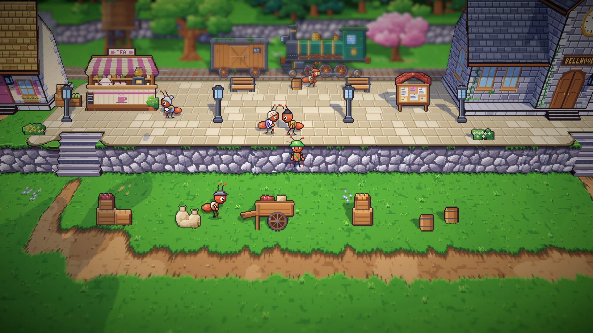
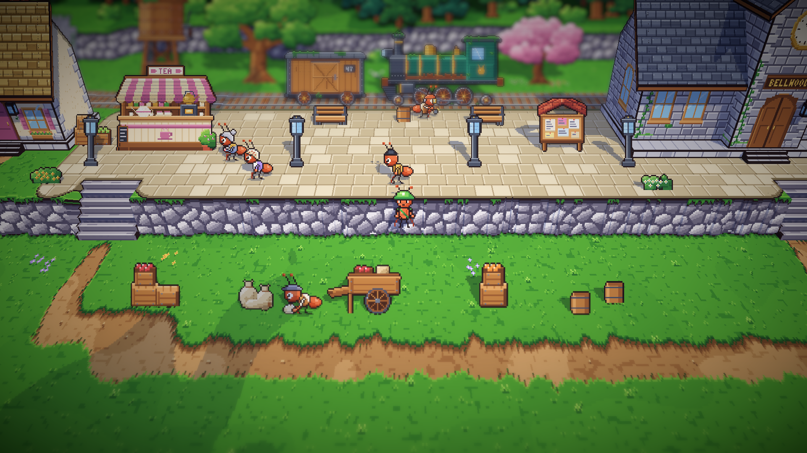
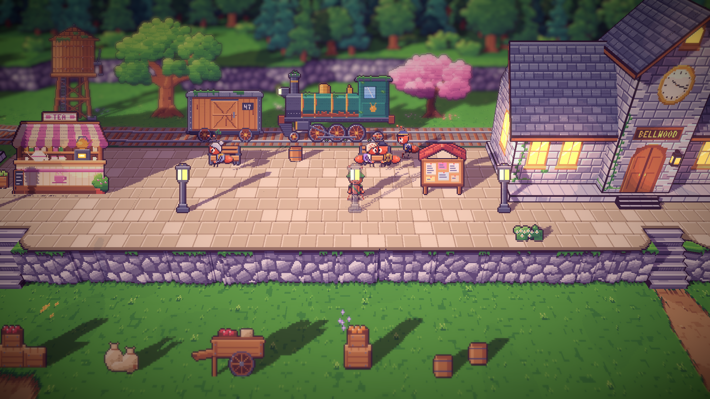

# 19. Semut latar di stasiun

**Tanggal:** 2026-10-19

## Tujuan

Semua penduduk bernama sudah punya kegiatan sepanjang hari. Langkah terakhir dari desain penduduk adalah semut latar
tanpa nama, dua sampai empat di setiap area. Sesuai aturan satu contoh dulu, stasiun dikerjakan lebih dulu.

## Yang dikerjakan

### Dua tetangga (`chars.js`)

- **Bibi:** gaun lavender, celemek putih, dan kerudung krem berbintik merah.
- **Paman:** kemeja kuning mustard, tali selempang celana cokelat, dan topi bowler hitam.
- Warna dan penutup kepala keduanya tidak dipakai penduduk bernama mana pun. Keduanya mendapat potret untuk kotak
  dialog, dengan label "Neighbour".

### Kegiatan mereka (`Places.cs`)

- **Pagi dan siang:** paman berdiri mendengarkan, menghadap bibi. Bibi bercerita, lalu berjalan ke papan pengumuman
  untuk membacanya, kembali bercerita, lalu menengok ke kedai teh Helen sebelum kembali lagi.
- **Sore:** keduanya duduk bersama di bangku peron yang kedua, saling menghadap, di sebelah Helen yang menunggu di bangku
  pertama.
- Masing-masing punya satu kalimat untuk siang hari dan satu untuk sore, dengan suara sendiri, dan tidak pernah berupa
  petunjuk.

Stasiun sekarang punya tiga semut latar di siang hari: kuli angkut (sampai siang) dan dua tetangga.

## Keputusan

Dicatat juga di `GAME-CONTEXT.md`.

- **Semut latar tidak pernah hanya berdiri diam.** Kalau berpasangan, satu mendengarkan sementara yang lain bercerita,
  dan paling tidak satu berjalan ke suatu tempat dengan tujuan, lalu kembali.
- **Semut latar ada dari pagi sampai sore,** dan pulang pada malam hari. Permainan sekarang selalu sore, jadi mereka
  harus terlihat di sore hari.

## Masalah dan solusinya

- **Pertama kali kedua tetangga hanya diam di tempat,** sama-sama memakai pose `talk`, sehingga keduanya berbicara
  bersamaan. Pengguna bertanya apakah mereka hanya diam. Sekarang paman mendengarkan dan bibi berjalan berkeliling.
- **Gaun bibi yang pertama berwarna terakota** hampir sama dengan warna tubuh semut, sehingga tidak terlihat. Gaunnya
  diganti lavender.
- **Tes sempat tidak bisa dijalankan,** karena editor masuk Play Mode setelah aset diperbarui. Play Mode dihentikan
  dulu, lalu tes dijalankan.

## Cara dicek

- Ekspor dengan `python3 game/ArtSource/export.py --force cast`.
- Pratinjau pose dan potret kedua tetangga.
- Empat tangkapan layar berjarak 5 detik di siang hari, ditambah posisi dan pose bibi yang dicatat saat bermain: dia
  berjalan, berhenti di kedai Helen, kembali, lalu bercerita.
- Tangkapan layar sore: keduanya di bangku peron.
- Tes PlayMode lulus 3 dari 3, termasuk `VillagersTest.EveryoneCanBeReached` untuk stasiun.

## Commit

`feat(villagers): add the station's background neighbours`

## Langkah berikutnya

- Semut latar di alun-alun, area timur, pesisir, dan hutan kecil.
- Puncak tebing bagian timur di pesisir yang belum bisa dicapai.
