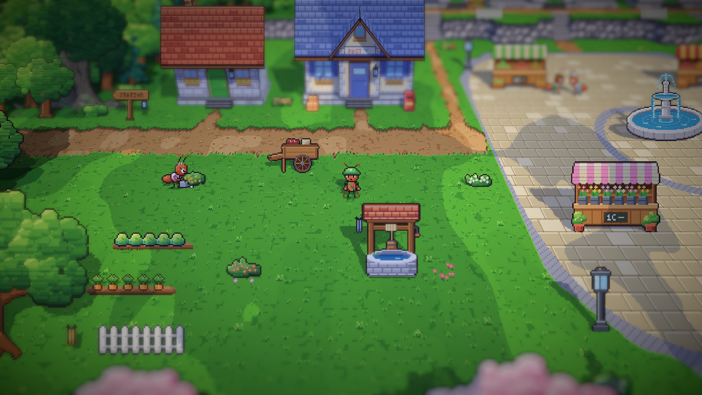
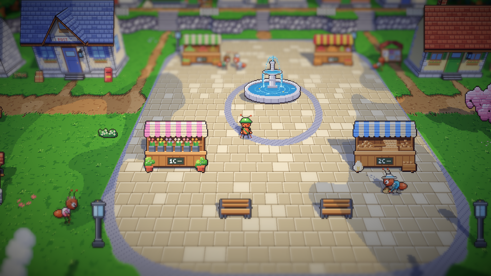
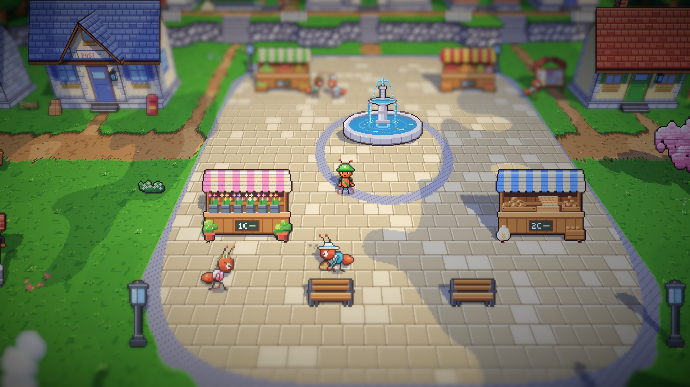
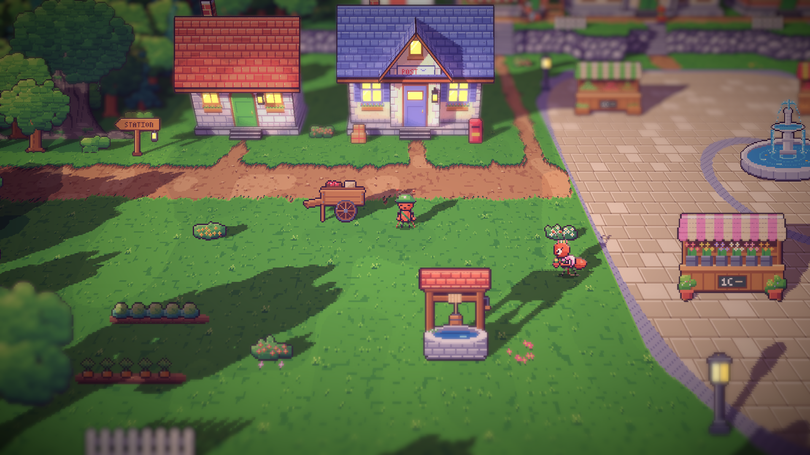
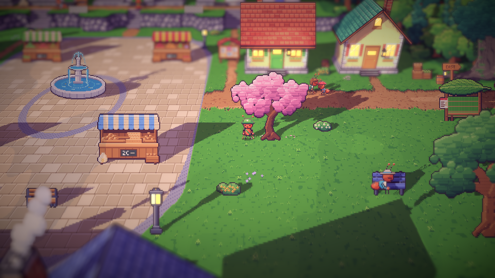

# 20. Semut latar di alun-alun

**Tanggal:** 2026-10-19

## Tujuan

Stasiun sudah punya semut latar. Langkah ini membawa dua semut latar ke alun-alun: seorang pembeli dengan keranjang
dan penjual bunga yang menjaga kios bunga, yang sebelumnya kosong.

## Yang dikerjakan

### Penampilan (`chars.js`)

- **Pembeli:** kardigan biru muda, blus krem, topi matahari krem berpita biru, dan keranjang anyaman berisi roti dan
  sayuran.
- **Penjual bunga:** celemek terusan merah muda, blus putih berlengan digulung, dan rangkaian bunga di kepalanya. Dia
  membawa baki pot bunga.
- Keduanya mendapat potret untuk kotak dialog.

### Kegiatan mereka (`Places.cs`)

- **Pagi dan siang, penjual bunga:** menyiram rumpun bunga putih dan kuning di halaman rumput barat, lalu kembali
  merapikan pot di kiosnya.
- **Pagi dan siang, pembeli:** berangkat dari rumahnya di sebelah rumah Mia, ke kios roti, ke kios bunga, ke kios
  sayur Mia, lalu pulang. Di setiap kios dia menurunkan keranjangnya untuk membeli sesuatu.
- **Sore:** penjual bunga membawa pot-potnya pulang ke rumah batu di ujung barat, dan pembeli beristirahat di bangku
  di bawah pohon ek.
- Masing-masing punya satu kalimat untuk siang hari dan satu untuk sore, tidak pernah berupa petunjuk.

## Masalah dan solusinya

- **Penjual bunga menyiram lantai.** Pot di kios berada di dalam area kios yang tidak bisa dilewati, jadi air jatuh ke
  batu paving. Dia sekarang menyiram rumpun bunga di halaman rumput.
- **Salah satu bedeng bunga tertutup atap rumah** di depannya, jadi penjual bunga tidak terlihat di sana. Perhentiannya
  dipindah ke rumpun bunga kuning yang terlihat jelas.
- **Pembeli hanya berdiri di kios bunga.** Sekarang dia menurunkan keranjangnya untuk memilih bunga, seperti di kios
  lain.
- **Pembeli duduk di depan bangku, bukan di atasnya.** `Seat` hanya mengubah kedalaman semut, tidak menaikkannya di
  layar, karena posisi gambar semut tetap pada baris `At`. Posisinya dinaikkan 6 px.

## Cara dicek

- Ekspor dengan `python3 game/ArtSource/export.py --force cast`.
- Pratinjau pose dan potret kedua semut.
- Posisi dan pose keduanya dicatat setiap beberapa detik saat bermain: pembeli berkeliling kios dan pulang, penjual
  bunga berpindah dari rumpun ke rumpun lalu ke kiosnya.
- Tangkapan layar siang dan sore hari.
- Tes PlayMode lulus 3 dari 3, termasuk `VillagersTest.EveryoneCanBeReached` untuk alun-alun.

## Commit

`feat(villagers): add the square's shopper and flower seller`

## Langkah berikutnya

- Semut latar di area timur, pesisir, dan hutan kecil.
- Puncak tebing bagian timur di pesisir yang belum bisa dicapai.
