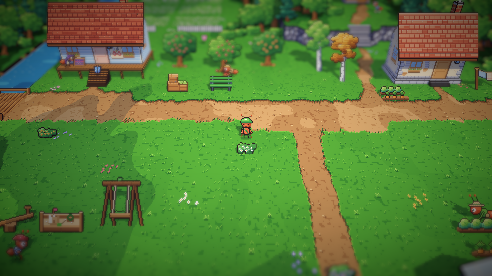
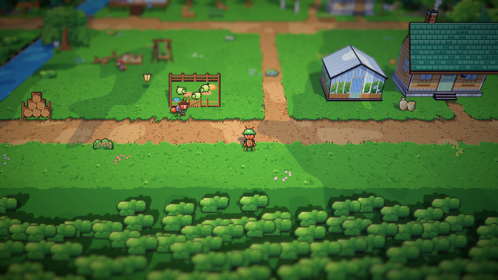
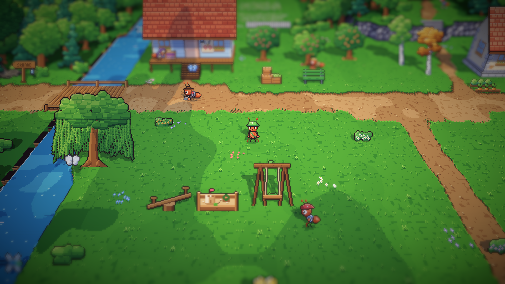
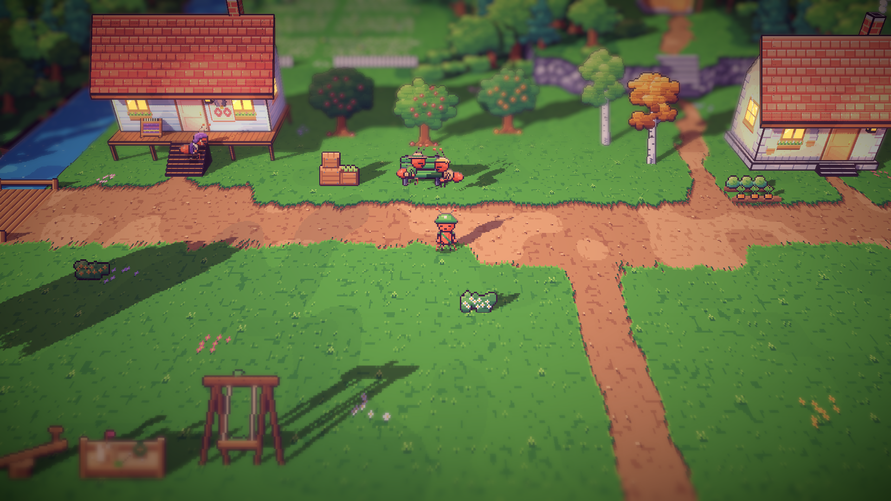

# 21. Semut latar di area timur

**Tanggal:** 2026-10-19

## Tujuan

Stasiun dan alun-alun sudah punya semut latar. Langkah ini membawa dua semut latar ke area timur: buruh kebun di
kebun buah dan penggembala kutu daun di kandangnya.

## Yang dikerjakan

### Penampilan (`chars.js`)

- **Buruh kebun:** kemeja kerja khaki berlengan digulung, ikat kepala kuning, dan keranjang berisi apel merah.
- **Penggembala kutu daun:** baju kerja abu-abu, syal leher merah, topi cokelat bertepi lebar, dan ember berisi madu
  kutu daun.
- Keduanya mendapat potret untuk kotak dialog.

### Kegiatan mereka (`Places.cs`)

- **Pagi dan siang, buruh kebun:** memungut apel yang jatuh di bawah dua pohon apel, lalu menuangkan isi keranjangnya
  ke peti-peti di kebun buah.
- **Pagi dan siang, penggembala:** merawat kutu daun di gerbang kandang, lalu membawa seember madu kutu daun ke tangga
  rumah Nenek Nora.
- **Sore:** buruh kebun duduk di ujung lain bangku kebun buah, berhadapan dengan Gardener. Penggembala bolak-balik di
  sepanjang kandang, menghitung kutu daun yang masuk untuk malam.
- Masing-masing punya satu kalimat untuk siang hari dan satu untuk sore, tidak pernah berupa petunjuk.

## Masalah dan solusinya

- **Buruh kebun dan Gardener saling menumpuk di bangku.** Kepala mereka bertemu menjadi satu gumpalan. Buruh kebun
  digeser ke ujung lain bangku, sehingga keduanya terlihat duduk berhadapan.

## Cara dicek

- Ekspor dengan `python3 game/ArtSource/export.py --force cast`.
- Pratinjau pose dan potret kedua semut.
- Posisi dan pose keduanya dicatat setiap beberapa detik saat bermain: buruh kebun dari pohon ke pohon lalu ke peti,
  penggembala dari kandang ke tangga rumah Nora dan kembali.
- Tangkapan layar siang dan sore hari.
- Tes PlayMode lulus 3 dari 3, termasuk `VillagersTest.EveryoneCanBeReached` untuk area timur.

## Commit

`feat(villagers): add the east's farmhand and aphid herder`

## Langkah berikutnya

- Semut latar di pesisir dan hutan kecil.
- Puncak tebing bagian timur di pesisir yang belum bisa dicapai.
