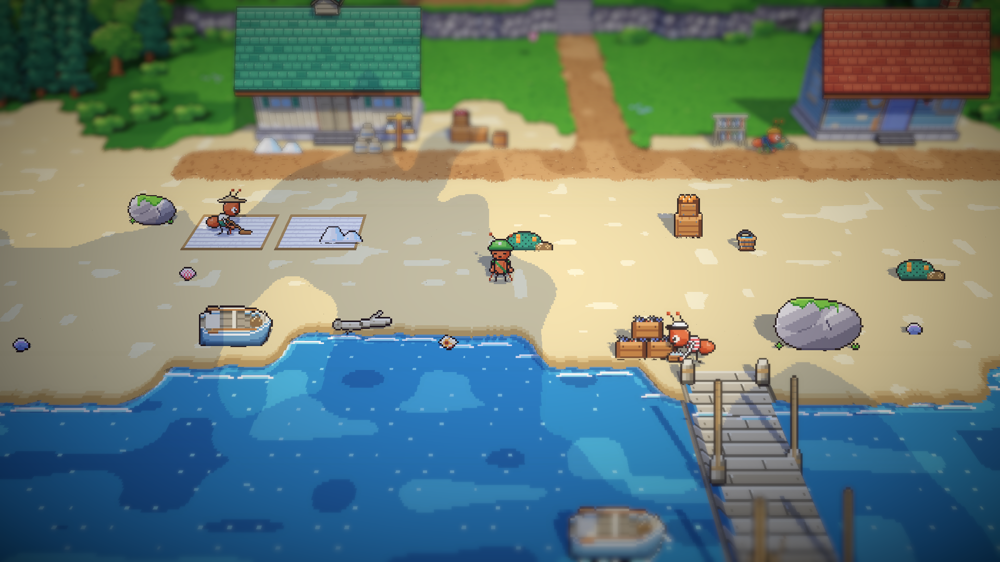
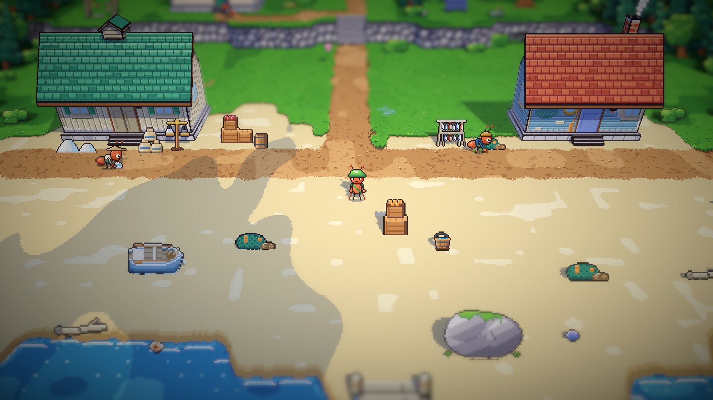
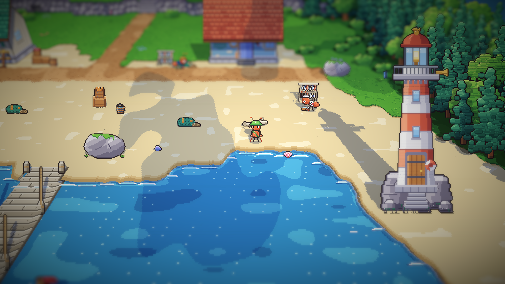
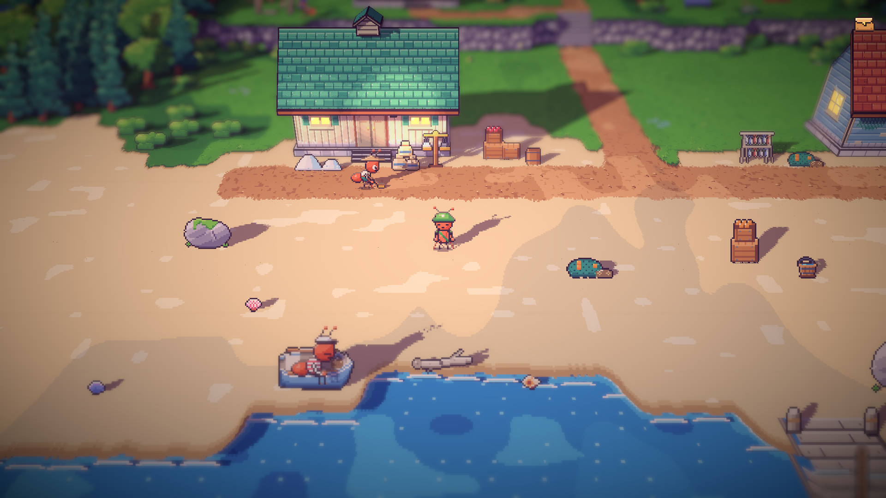

# 22. Semut latar di pesisir

**Tanggal:** 2026-10-19

## Tujuan

Stasiun, alun-alun, dan area timur sudah punya semut latar. Langkah ini membawa dua semut latar ke pesisir: nelayan
pengangkut ikan dan pekerja garam.

## Yang dikerjakan

### Penampilan (`chars.js`)

- **Nelayan:** kaus bergaris merah-putih, topi putih berpinggiran hitam, dan peti berisi ikan hasil tangkapan.
- **Pekerja garam:** kemeja krem berlengan digulung, sarung hijau tosca, caping lebar, dan karung garam.
- Keduanya mendapat potret untuk kotak dialog.

### Kegiatan mereka (`Places.cs`)

- **Pagi dan siang, nelayan:** mengambil peti ikan dari tumpukan hasil tangkapan di pangkal dermaga, lalu membawanya menyeberangi pasir ke rak ikan
  di dekat mercusuar. Kalimatnya menyebut Arlo: Arlo yang menangkap, dia yang mengangkut.
- **Pagi dan siang, pekerja garam:** menggaruk garam di dua petak garam di pasir dengan garuk kayu, lalu membawa
  karungnya ke gudang garam.
- **Sore:** nelayan duduk di perahu dayung yang ditarik ke pasir, dan pekerja garam menyapu di depan gudang garam, di
  sebelah tumpukan garam.
- Masing-masing punya satu kalimat untuk siang hari dan satu untuk sore, tidak pernah berupa petunjuk.

### Pantai yang mendukung pekerjaan mereka (`village-south.js`, `areas.js`, `chars.js`)

- **Petak garam:** dua petak dangkal digambar langsung di tanah pasir, berpinggiran pasir basah, dengan garam yang
  digaruk berbaris. Di ujungnya ada dua tumpukan garam (`saltHeaps`).
- **Hasil tangkapan:** tumpukan tiga peti berisi ikan (`catchCrates`) di sisi barat pangkal dermaga.
- **Pose baru `rake`:** gerakan menyapu dengan garuk kayu berkepala datar, bukan sapu. Pekerja garam memakainya di
  petak garam, dan tetap memakai sapu di sore hari.
- **Perahu yang ditarik ke pasir:** `V.rowboat(true)` menggambar perahu dayung yang diam di pasir, tanpa air di
  sekelilingnya. Perahu itu dipindah ke tepi air.

## Masalah dan solusinya

- **Kegiatan keduanya tidak terbaca.** Pengguna bertanya apa yang dilakukan dua semut itu. Pekerja garam terlihat
  membungkuk di atas pasir kosong, tanpa garam dan tanpa alat, dan nelayan mengambil peti dari tempat yang kosong.
  Sekarang ada petak garam, garuk kayu, dan tumpukan peti ikan.
- **Petak garam pertama terlalu kecil.** Petak itu dibuat sebagai benda berdiri setinggi 10 px, sehingga hanya terlihat
  seperti garis putih tipis di belakang perahu. Petak garam sekarang digambar di tanah, jauh lebih besar, di pasir yang
  lapang.
- **Tumpukan peti menempel pada batu besar** di sebelah timur dermaga. Tumpukan itu dipindah ke sisi barat.
- **Perahu terlihat terapung di tengah pasir.** Pengguna bertanya kenapa ada perahu di pasir. Perahu di pasir memakai
  gambar perahu yang mengapung: bergoyang, dengan buih di sekeliling lambungnya dan riak di haluannya, padahal letaknya
  jauh dari air. Sekarang perahu itu diam, tanpa buih, dan berada di tepi air. Tempat duduk nelayan ikut pindah.

## Cara dicek

- Ekspor dengan `python3 game/ArtSource/export.py --force cast` dan `--force areas`. Hanya pesisir yang berubah.
- Pratinjau pose dan potret kedua semut.
- Posisi dan pose keduanya dicatat setiap beberapa detik saat bermain: nelayan dari dermaga ke rak ikan dan kembali,
  pekerja garam dari pasir ke gudang garam dan kembali.
- Tangkapan layar siang dan sore hari.
- Tes PlayMode lulus 3 dari 3, termasuk `VillagersTest.EveryoneCanBeReached` untuk pesisir.

## Commit

`feat(villagers): add the coast's fisher and salt worker`

## Langkah berikutnya

- Memeriksa apakah hutan kecil perlu semut latar.
- Puncak tebing bagian timur di pesisir yang belum bisa dicapai.
