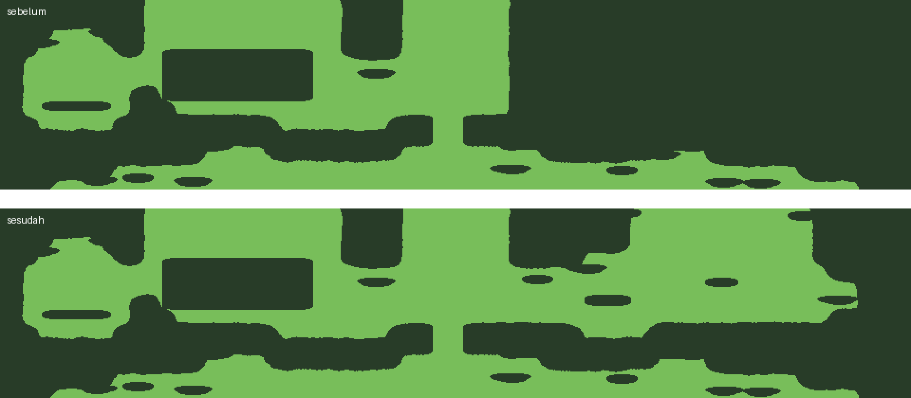
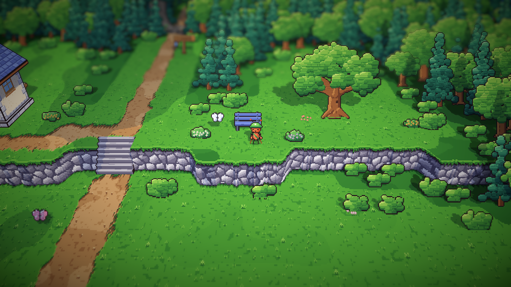
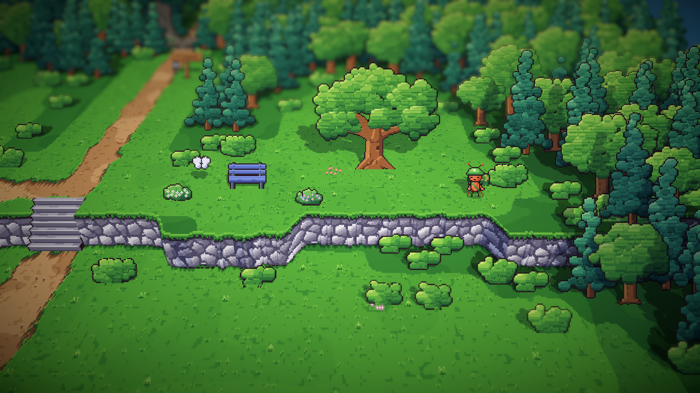

# 23. Puncak tebing pesisir bisa dilewati

**Tanggal:** 2026-10-19

## Tujuan

Sejak langkah 18, bagian timur puncak tebing di pesisir, dengan bangku menghadap laut, tidak bisa dicapai kurir. Langkah
ini membukanya, dan mencatat keputusan bahwa hutan kecil (grove) tidak mendapat semut latar.

## Yang dikerjakan

### Tanah lapang di puncak tebing (`areas.js`)

- Penyebabnya: hutan mengisi semua tanah yang tidak tercakup jalan, lorong bangunan, atau tanah lapang (`clear`). Di
  pesisir, jalan hanya turun di x≈480, dan tanah lapangnya berada di bawah tebing. Jadi puncak tebing di timur jalan
  tercatat sebagai hutan di peta jalan. Rumputnya tetap terlihat, tetapi kurir tidak bisa melewatinya.
- Pesisir mendapat tanah lapang kedua, elips `[700, 192, 210, 44]`, yang membentang dari jalan ke timur sampai bunga
  kuning di ujung tebing. Bangku, pohon ek, dan rumpun bunga tetap di tempatnya.
- Hanya berkas pesisir yang berubah saat diekspor ulang.

## Keputusan

Dicatat juga di `GAME-CONTEXT.md`.

- **Hutan kecil tidak mendapat semut latar.** Ini satu-satunya area luar tanpa semut latar. Sepinya menjaga toko
  tersembunyi Marlow tetap terasa terpisah dari desa yang ramai.

## Cara dicek

- Ekspor dengan `python3 game/ArtSource/export.py --force areas`.
- Piksel `walk.png` pesisir dicek di sekitar x 480–960, y 120–250. Puncak tebing sekarang terbuka sampai x≈880,
  kecuali di bawah bangku, pohon, dan semak.
- Tangkapan layar Full HD: kurir di depan bangku dan di ujung timur puncak tebing.
- Tes PlayMode lulus 3 dari 3.

## Commit

`fix(areas): open the coast's bluff top east of the road`

## Langkah berikutnya

- Tampak samping dan belakang untuk anak-anak (Pip), serta sarung tangan putih Kapten Bram.
