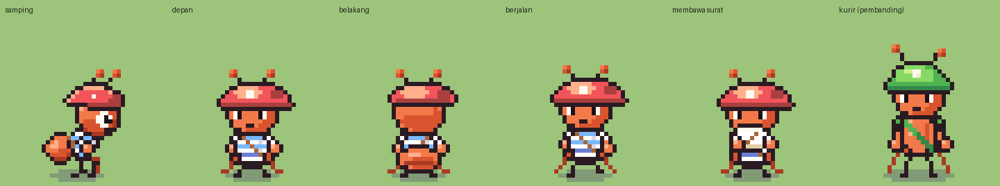
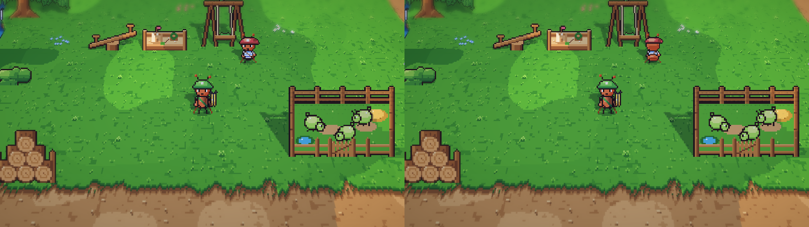
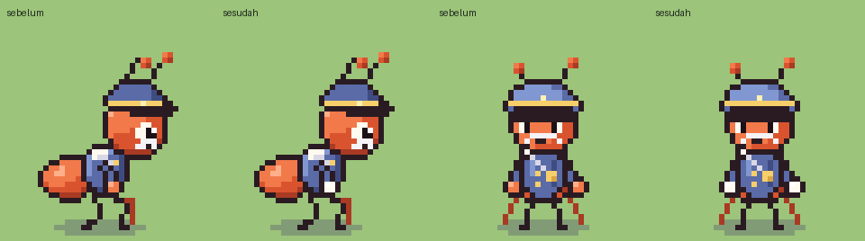
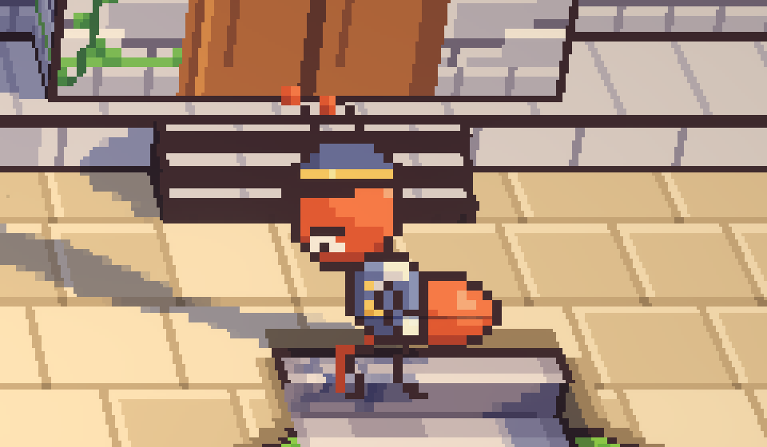

# 24. Pip berbalik, dan sarung tangan Kapten Bram

**Tanggal:** 2026-10-19

## Tujuan

Dua hal yang tertunda sejak langkah 14: Pip baru punya tampak samping, dan sarung tangan putih Kapten Bram belum
digambar.

## Yang dikerjakan

### Tampak depan dan belakang ukuran anak (`chars.js`)

- `renderTurned` sekarang punya ukuran anak. Gambarnya sama dengan semut dewasa, tetapi lebih kecil:
  - kepala turun 4 px dan badan turun 3 px, sehingga kakinya lebih pendek;
  - dada, perut, lengan, dan antena masing-masing lebih pendek.
- Ukurannya diambil dari `kid` di data karakter, seperti tampak samping. Titik tangan untuk barang yang dipegang
  (`CH.hand`) ikut turun.
- **Pip** mendapat entri `TURN`:
  - kaus bergaris biru-putih;
  - tali bungkusan suratnya menyilang di dada (dari belakang, arahnya terbalik);
  - topi merah kotak pos yang kebesaran dan miring, dengan lencana krem di depannya.
- Pip sekarang berbalik menghadap kamera atau membelakanginya saat berjalan, berlari, dan membawa surat ke atas atau ke
  bawah layar.

### Sarung tangan Kapten Bram (`chars.js`)

- Sesuai GDD (6.13): sarung tangan kain putih yang sudah usang.
- Tangan semut sekarang bisa memakai warna sarung tangan (`glove`), yang menggantikan warna tangan cokelat kemerahan.
  Karakter tanpa `glove` tidak berubah.
- Sarung tangan Bram putih dan krem, terlihat di tampak samping, depan, dan belakang. Saat menggosok peluit, tangannya
  tertutup kain lap.

## Masalah dan solusinya

- **Topi Pip dari depan terlihat seperti jamur:** kubahnya terlalu tinggi dan bulat. Kubahnya dibuat lebih pipih.
- **Perut Pip dari belakang terlalu lebar** untuk seorang anak. Perut anak dibuat lebih sempit.

## Cara dicek

- Ekspor dengan `python3 game/ArtSource/export.py --force cast`. Hanya lembar sprite Bram, Pip, dan `chars.json` yang
  berubah.
- Setiap frame semua karakter dibandingkan piksel demi piksel dengan sebelum perubahan. Hanya frame Bram yang berubah,
  dan hanya frame tampak depan-belakang Pip yang bertambah.
- Tangkapan layar Full HD: Pip menghadap kamera dan membelakanginya di taman bermain, dan Bram di stasiun.
- Tes PlayMode lulus 3 dari 3.

## Commit

`feat(villagers): turn Pip toward and away from the camera, and glove Kapten Bram`

## Langkah berikutnya

- Interior: sembilan ruangan, sesuai urutan kerja di `GAME-CONTEXT.md`.
