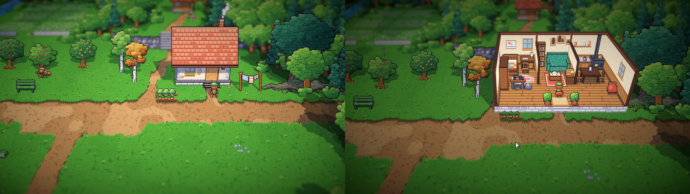
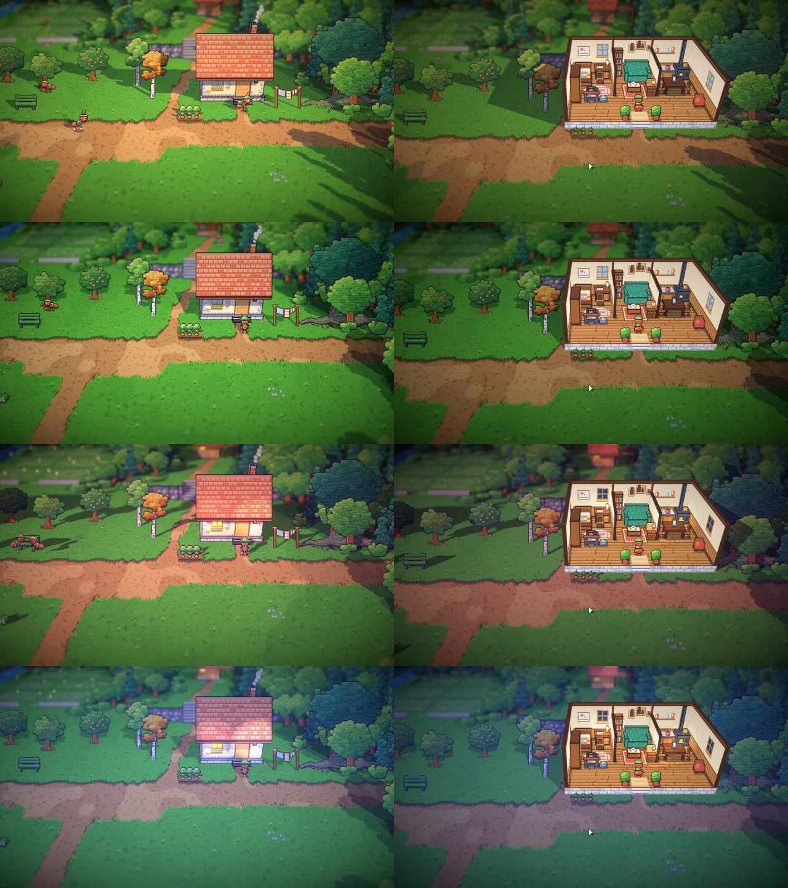
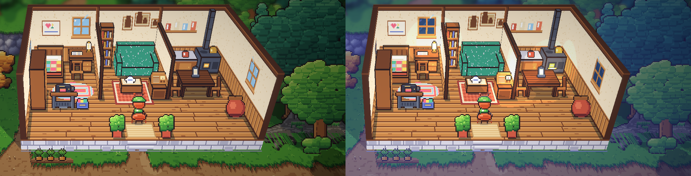
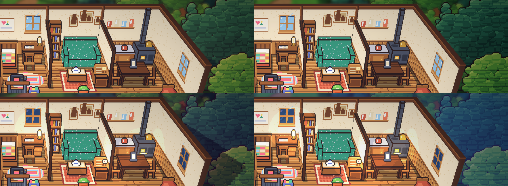

# 25. Rumah masa kecil Satria, interior pertama

**Tanggal:** 2026-10-19

## Tujuan

Interior pertama dari sembilan: rumah masa kecil Satria (GDD 7.5). Rumah ini dipakai sejak Hari 1, karena prolog
menjelajahinya dan jurnal ditulis di mejanya setiap malam. Masuk dan keluar pintunya harus mulus seperti di Octopath
Traveler 2: tanpa layar hitam, tanpa jeda, dan kamera tidak berpindah.

## Yang dikerjakan

### Ruangan yang dibelah (`inside.js`)

- Ruangan digambar sebagai diorama ala Octopath:
  - dinding belakang dan samping tetap berdiri;
  - dinding depan dan atap diangkat;
  - kamera tetap memakai kemiringan luar ruangan.
- Ruangan berdiri **di tempat rumahnya berdiri** di area timur, dengan koordinat area itu sendiri. Pintunya tepat di
  pintu rumah, dan sisi depannya yang terbuka tepat di depan rumah. Lebarnya kira-kira dua kali lebar rumah.
- Di sekeliling ruangan tetap ada area timur yang asli: tanah, pohon, dan tetangganya. Semuanya diredupkan sedikit,
  tetapi tidak dibuat hitam.
- Dinding, sekat, dan perabot besar adalah model 3D berupa kotak dengan pixel art di setiap sisinya. Barang kecil
  berupa kartu. Lantai papan berdiri di atas fondasi batu dengan satu anak tangga di pintu.
- Isinya mengikuti denah GDD 7.5, dalam tiga bagian:
  - **Kamar tidur:** ranjang dengan selimut perca buatan Ibu Ratih, lemari, meja tulis dengan jurnal dan lampu minyak,
    mesin jahit injak, dan kaleng sisa kain.
  - **Ruang keluarga:** rak buku Ayah, sofa berdebu, meja teh dengan teko, radio tabung kayu, dan foto-foto keluarga.
  - **Dapur:** meja dapur dengan panci, kompor kayu dengan pipanya, meja kenari dengan lentera, dan tempayan air.
- Rumah ini diekspor bersama area lain (`export-world.js`), dengan langkah yang sama seperti area luar.

### Pintu yang langsung berganti (`Main.cs`, `Place.cs`)

- Lewat pintu, tampilan langsung berganti tanpa fade. Karena ruangan berdiri di tempat rumahnya, kamera tidak bergeser:
  yang berubah hanya atap dan dinding depan.
- Saat masuk, kurir sudah berdiri di balik pintu dan membelakangi kamera. Saat keluar, kurir muncul di ambang pintu,
  menghadap kamera, lalu turun satu langkah.
- Kedua sisi pintu disiapkan lebih dulu dan disimpan. Tempat dibangun ulang hanya saat bab atau fase hari berganti, dan
  itu terjadi di balik fade yang memang sudah ada.
- Jalan keluar di tepi area tetap memakai fade pendek seperti sebelumnya.

### Cahaya di dalam ruangan (`Pixel.shader`, `PlaceDef.cs`)

- Ruangan selalu memakai cahaya dalam ruangannya sendiri. Area di sekelilingnya tetap mendapat warna fase hari, cahaya
  matahari, dan bayangan awan. Jadi pada malam hari ruangan tetap hangat di tengah jalan yang gelap, seperti di Octopath
  Traveler 2.
- Shader mengenali apa yang berdiri di lantai ruangan (lantai, dinding, perabot, dan kurir) dari kotak lantai yang
  ditulis ekspor ke `place.json`, lalu melewatkan warna fase hari untuk semuanya.
- Saat senja dan malam, empat lampu menyala dan bercahaya ke sekitarnya: lampu meja, api kompor, lentera di meja dapur,
  dan lampu skala radio.

### Jendela siang dan malam (`inside.js`)

- Pagi dan siang, kaca jendela menampilkan langit biru. Senja dan malam, kacanya biru gelap.
- Kaca malam dilukis di dinding. Kaca siang dipasang di atasnya sebagai panel yang hanya tampil pagi dan siang, dengan
  penanda `day` yang sudah dipakai kupu-kupu.

## Keputusan

Dicatat juga di `GAME-CONTEXT.md`.

- **Interior adalah diorama yang dibelah,** berdiri di tempat rumahnya, kira-kira dua kali lebar rumah, dikelilingi
  areanya sendiri yang diredupkan.
- **Lewat pintu, tampilan langsung berganti tanpa fade.** Kurir masuk membelakangi kamera dan keluar dari ambang pintu.
- **Ruangan memakai cahayanya sendiri, sedangkan sekelilingnya mengikuti fase hari.** Lampu menyala saat senja dan
  malam, dan jendela menampilkan langit malam.
- **Rumah Satria menjadi interior pertama** dan dipakai sejak Hari 1.

## Masalah dan solusinya

- **Versi pertama tidak terasa seperti Octopath.** Ruangannya empat kali lebar rumah dan berdiri di halaman rumput
  buatan. Ruangan diperkecil dan dipindah ke tempat rumahnya, di tengah tetangganya yang asli, sehingga bingkai kamera
  tidak berubah saat lewat pintu.
- **Lewat pintu terasa tersendat 0,4 sampai 0,9 detik,** karena tempat dibangun ulang setiap kali. Sekarang kedua sisi
  pintu disimpan, dan pergantiannya sekitar 1 milidetik.
- **Saat senja dan malam, sekeliling ruangan tetap terang seperti siang.** Area di sekeliling ruangan sekarang mendapat
  warna fase hari.
- **Pada malam hari bagian dalam rumah ikut gelap.** Shader sekarang melewatkan warna fase hari untuk apa pun yang
  berdiri di lantai ruangan.
- **Jendela tetap menampilkan langit siang pada malam hari.** Kaca siang dan kaca malam dipisah, seperti dijelaskan di
  atas.
- **Kurir tiba-tiba berjalan sangat cepat di editor.** Tes PlayMode yang terputus meninggalkan objek runner yang
  tersembunyi. Karena domain reload dimatikan, objek itu terus menjalankan tes playthrough setiap kali Play ditekan,
  dengan skala waktu 8 kali. Objek itu dan scene tes sisanya dihapus dari editor. Kode game tidak berubah.

## Cara dicek

- Ekspor dengan `python3 game/ArtSource/export.py --force areas`. Hanya file `places/satria_home/` yang berubah.
- Tangkapan layar Full HD di luar dan di dalam pada keempat fase hari. Fase diganti lewat editor.
- Waktu pergantian lewat pintu diukur di editor: sekitar 1 milidetik.
- Tes PlayMode lulus 3 dari 3.

## Commit

`feat(interiors): open Satria's childhood home with Octopath door cuts`

## Langkah berikutnya

- Interior kedua: toko Marlow, yang tertutup akar beringin tua.
