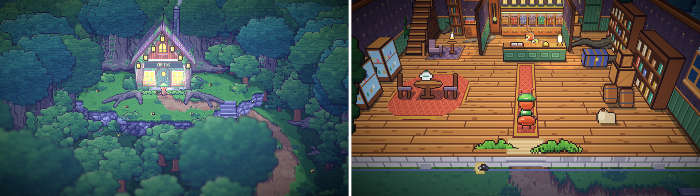
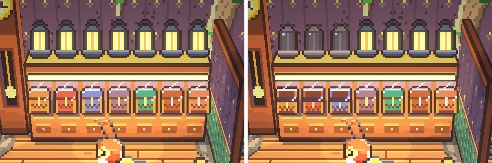
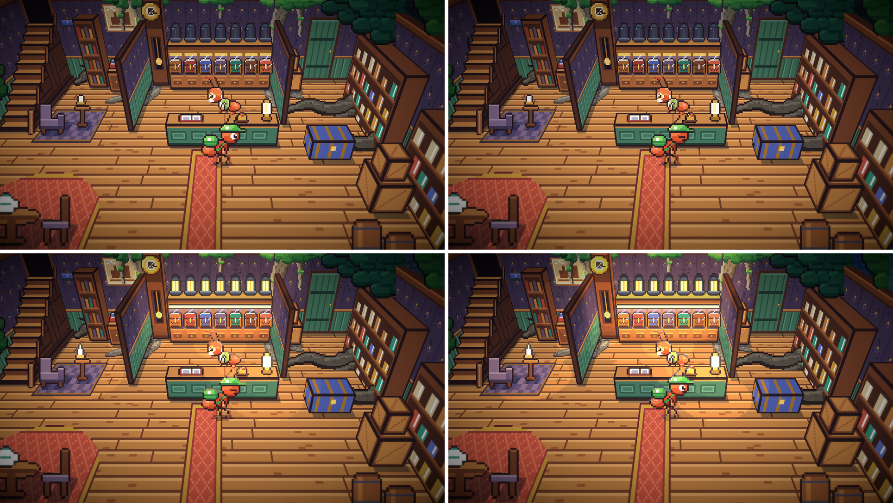
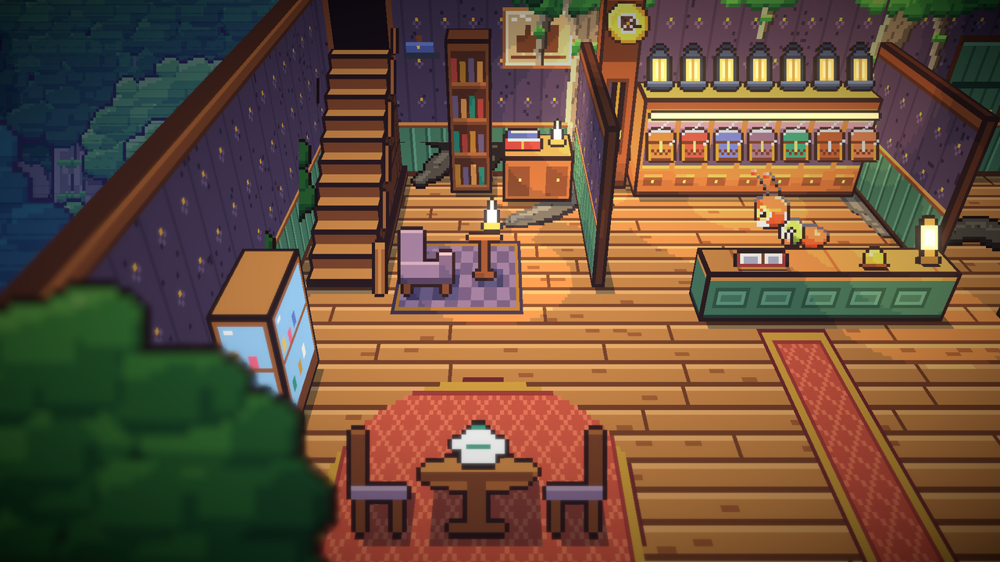

# 26. Toko Marlow, interior kedua

**Tanggal:** 2026-10-19

## Tujuan

Interior kedua dari sembilan: toko misterius Marlow (GDD 7.6). Di sinilah setiap malam dimulai. Marlow menyerahkan
satu barang peninggalan, lalu satu lentera padam setiap kali sebuah kasus selesai. Toko ini sebelumnya masih set lama
dari versi Godot, berupa gambar datar 360 × 240 dengan jam yang menunjukkan 18:17. Sekarang toko ini dibelah seperti
rumah Satria, berdiri di tempat etalasenya di ujung jalan setapak hutan, dan dimasuki lewat pintu yang langsung berganti.

Versi pertama langkah ini terlalu sempit. Marlow tertutup lentera, balok lentera mengganggu tampilan dan bertabrakan
dengan balon bicara, dan ketujuh barang peninggalan nyaris tidak terlihat. Versi ini menjawab semuanya: tokonya jauh
lebih besar, barang peninggalannya selalu terlihat, dan kamera mendekat di dalam ruangan seperti Octopath Traveler 2.

## Yang dikerjakan

### Toko yang lebih besar (`inside.js`)

- Lantainya 272 × 136 piksel, kira-kira dua setengah kali lebar etalase. Denah GDD 7.6 dipakai sebagai acuan saja,
  bukan disalin, karena gambar itu buatan AI:
  - **Pintu masuk** di depan, dengan keset dan dua pakis di kiri-kanannya. Karpet merah panjang membentang dari pintu
    ke meja kasir.
  - **Ruang toko** di tengah: meja kasir hijau botol dengan buku catatan, lonceng, dan lampu minyak. Marlow berdiri di
    belakangnya. Jam pendulum yang berhenti di 10:17 dan lemari tujuh kotak berdiri di dinding belakang.
  - **Sisi barat**: karpet merah bundar dengan meja bundar, dua kursi, dan teko. Dua lemari kaca berisi barang antik
    berdiri di sepanjang dinding.
  - **Ruang pribadi Marlow** di pojok barat laut, di balik sekat: tangga yang naik di sepanjang dinding barat menuju
    pintu gelap ke lantai atas, lengkap dengan pegangan dan tiang tangga. Ada juga rak buku, meja tulis dengan buku
    besar dan lilin, kursi berlengan dengan meja kecil dan lilin, topi kepala stasiun di gantungan, dan foto kereta
    terakhir di atas meja tulis.
  - **Gudang** di sisi timur, di balik sekat: rak berisi stoples dan bungkusan di dinding timur, tumpukan peti, peti
    besi, tong, karung, dan pintu belakang.
- Akar pohon tua turun di dinding belakang lewat kedua sekat, lalu menjalar di lantai. Daunnya menjuntai di atas dinding.
- Pohon tua kembali berdiri tepat di belakang etalase, seperti sebelum langkah ini. Dari dalam, pohon itu ikut
  diangkat bersama benda lain yang berdiri di dalam ruangan. Bukit kecil tempat toko berdiri diperbesar agar ruangan
  yang lebih besar tetap berdiri di atasnya.

### Lemari tujuh kotak (`inside.js`, `Place.cs`, `Chapter.cs`)

- Ketujuh barang peninggalan disimpan di lemari berkaca di dinding belakang, satu kotak di setiap ceruk berlapis
  beludru ungu yang diterangi dari atas. Setiap kotak diukir dan diberi gesper kuningan, dengan warna yang berbeda.
- Lentera setiap malam berdiri di atas lemari, tepat di atas kotaknya. Balok lentera dihapus, sehingga Marlow dan
  balon bicaranya tidak tertutup lagi.
- Kotak tetap tertutup sampai Marlow menyerahkan isinya. Setelah itu kotaknya berdiri terbuka dan kosong
  (`box_open_i`). Jadi kotak-kotak ini ikut menghitung malam, dan isi Malam 6 dan 7 tetap rahasia.

### Kamera mendekat di dalam ruangan (`Main.cs`)

- Di dalam ruangan yang dibelah, kamera dua kali lebih dekat daripada di luar. Ruangan memenuhi layar dan dindingnya
  terpotong di tepi layar, seperti Octopath Traveler 2. Ini juga berlaku di rumah Satria.
- Kamera melihat sedikit melewati kurir ke arah dinding belakang, tempat benda-benda penting berdiri. Saat kurir
  berdiri di depan meja kasir, Marlow, lemari, dan lenteranya tetap terlihat.
- Diafragma lensa ikut mengecil di dalam ruangan, sehingga seluruh ruangan tetap tajam. Tanpa ini, dinding belakang
  menjadi buram karena kamera lebih dekat.

### Toko di dalam game (`Places.cs`, `Place.cs`, `Chapter.cs`)

- Toko menjadi ruangan yang dibelah (`Open`) dengan satu varian `day`, sama seperti rumah Satria. Area hutan di
  sekitarnya mengikuti fase hari, sedangkan ruangannya tetap memakai cahayanya sendiri. Lentera, lampu minyak, lilin,
  dan lampu lemari menyala saat senja dan malam.
- Lewat pintu di hutan, tampilan langsung berganti tanpa fade. Saat keluar, kurir muncul di ambang pintu etalase.
- Jam toko sekarang dimulai dari 10:17, bukan 18:17. Jam yang tampil selalu sesuai dengan jumlah lentera yang sudah
  padam, juga ketika toko dibuka lagi.
- Letak Marlow, meja kasir, jam, dan lentera di `Places.cs` disesuaikan dengan denah baru.
- Set lama dari Godot dihapus, berikut ekspornya di `export-rooms.js`.

## Keputusan

Dicatat juga di `GAME-CONTEXT.md`.

- **Toko Marlow adalah interior kedua, jauh lebih besar daripada etalasenya.** Tokonya tumbuh menyatu dengan pohon
  tua di belakangnya dan menggantikan set lama dari Godot.
- **Ketujuh barang peninggalan selalu terlihat**, masing-masing di kotaknya di lemari berkaca, dengan lenteranya di atas.
  Kotak terbuka dan kosong setelah isinya diserahkan.
- **Di dalam ruangan kamera mendekat dua kali.** Ini menggantikan keputusan bahwa kamera tidak berubah saat lewat pintu.
- **Lantai ruangan berdiri setinggi fondasinya di atas tanah di depan pintunya,** di mana pun tanah itu berada.
- **Pohon dan benda di area yang akan berdiri di dalam ruangan diangkat,** sedangkan yang berdiri di belakangnya tetap ada.
- **Percakapan adalah adegan hidup**, sebagai sistem umum: tokoh berjalan, berbalik, dan membawa barang sambil bicara,
  tidak membeku. Ini dikerjakan di langkah berikutnya.
- **Cutscene ada dua jenis.** Adegan masa kini dimainkan langsung di dalam game sebagai adegan sinematik (bilah
  letterbox, kamera dekat, tokoh berakting). Kenangan, seperti badai 1952, ditampilkan sebagai panel komik sepia yang
  digambar dengan kode. Tidak ada video.

## Masalah dan solusinya

- **Toko terlalu sempit, Marlow tertutup lentera, dan balok lentera mengganggu tampilan.** Ruangan diperbesar, kamera
  mendekat, dan lentera dipindah dari balok ke atas lemari di dinding belakang.
- **Pohon hutan muncul di dalam toko.** Pohon pengisi hutan adalah decal, bukan item, sehingga tidak ikut diangkat seperti
  benda area lainnya. Sekarang setiap klip pohon mencatat letak kakinya, dan decal yang kakinya berada di dalam ruangan
  ikut diangkat. Perbaikan ini juga mengangkat satu pohon yang ternyata berdiri di pojok belakang rumah Satria.
- **Ruangan tenggelam ke dalam bukit.** Lantai ruangan dipasang 10 piksel dari ketinggian nol, padahal bukit kecil
  tempat toko berdiri tingginya 28 piksel. Lantai sekarang dihitung dari tanah di depan pintunya. Batas cahaya ruangan
  ikut naik, sehingga tajuk pohon di belakang toko tidak lagi ikut terang.
- **Kotak di lemari hanya terlihat tutupnya.** Kartu yang berdiri miring ke belakang sepertiga baris untuk setiap
  piksel tingginya, sehingga bagian atas kotak masuk ke balik muka lemari. Kotak, kaca, dan wajah jam sekarang berdiri
  beberapa baris di depan muka perabotnya dan diangkat setinggi itu juga, sehingga letaknya di layar tidak berubah.
- **Dinding belakang buram setelah kamera mendekat.** Keburaman depth of field membesar saat kamera lebih dekat.
  Diafragmanya sekarang ikut mengecil sesuai jarak kamera.
- **Tangga terlihat seperti tumpukan peti.** Tangga pertama berupa enam balok besar yang naik ke samping. Sekarang
  tangganya terdiri dari anak tangga sempit yang naik di sepanjang dinding barat menuju pintu ke lantai atas, dengan
  pegangan di sisi yang terbuka.
- **Pintu toko harus diklik, tidak bisa dimasuki dengan berjalan.** Area pintu di hutan berhenti di baris 238,
  sedangkan tanah di depan etalase baru bisa dipijak mulai baris 239. Area pintu sekarang turun sampai baris 242,
  sama seperti pintu rumah Satria, sehingga berjalan ke pintu langsung masuk ke toko.
- **Masuk toko langsung dari stasiun tidak lagi memotong tanpa fade.** Saat lentera padam, cerita membawa kurir dari
  stasiun ke meja kasir. Potongan langsung tanpa fade sekarang hanya dipakai untuk pintu yang benar-benar
  menghubungkan dua tempat, jadi perpindahan ini memakai fade.

## Cara dicek

- Ekspor dengan `python3 game/ArtSource/export.py --force areas`. File yang berubah: `places/shop/`, `places/grove/`
  (bukit diperbesar), dan `place.json` rumah Satria (satu pohon diangkat).
- Tangkapan layar Full HD di luar dan di dalam pada keempat fase hari, ditambah lemari setelah tiga malam selesai.
- Tes PlayMode lulus 3 dari 3. Tes playthrough masuk toko, menerima jam saku, lalu kembali ke meja kasir saat lentera
  pertama padam.

## Commit

`feat(interiors): open Marlow's shop grown into the ancient tree`

## Langkah berikutnya

- Adegan hidup: tokoh bergerak sambil bicara, rutinitas Marlow di tokonya, dan penyerahan barang di Malam 1 sebagai
  adegan sinematik.
- Panel komik untuk kenangan, dimulai dari badai 1952 di Malam 1.
