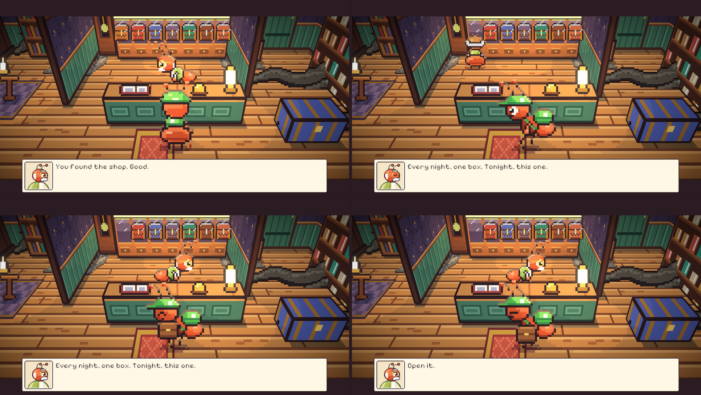
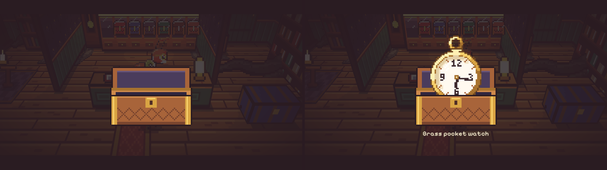
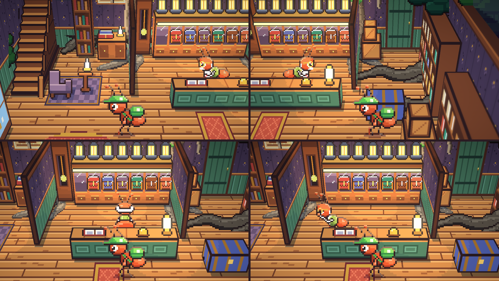

# 27. Adegan hidup, rutinitas Marlow, dan kotak yang dibuka

**Tanggal:** 2026-10-19

## Tujuan

Percakapan tidak lagi membeku. Selama dialog berjalan, tokoh tetap berjalan, berbalik, dan membawa barang, sebagai
sistem umum untuk setiap bab. Marlow mendapat rutinitas di tokonya, dan penyerahan barang menjadi adegan sinematik
pertama, dengan bilah letterbox dan kamera yang lebih dekat. Bab Malam 1 belum ada, karena beberapa pertanyaannya masih
terbuka, jadi adegan ini dipasang di bab uji sistem (`DevChapter`).

## Yang dikerjakan

### Adegan hidup (`Chapter.cs`, `Villager.cs`, `Main.cs`)

- `Actor(id)` mengambil seorang warga ke dalam adegan. Warga itu berhenti dari aktivitasnya dan menunggu digerakkan
  cerita (`Villager.Cue`).
- Langkah cerita yang tidak ditunggu berjalan bersamaan dengan dialog. Contohnya, Marlow berjalan ke lemari sambil
  berbicara.
- Saat adegan selesai, `Wrap()` mengembalikan setiap warga yang diambil ke aktivitasnya, mulai dari perhentian
  terdekat di rutenya. Warga tidak lagi menyeberangi ruangan menuju tempat yang tadi sedang ia tuju.
  `Wrap()` dipanggil setelah kendali kembali ke pemain, juga untuk adegan yang terjadi saat pemain baru masuk tempat.
- Setiap baris dialog membuat kurir menoleh ke pembicara, kecuali saat kurir sedang berjalan.

### Adegan sinematik (`Main.cs`)

- `Cinema(true)` menurunkan dua bilah letterbox dan mendekatkan kamera satu tingkat lagi. `Cinema(false)` menutup
  dialog dan mengembalikan semuanya.
- Kedua bilah berada di bawah balon dialog, sehingga teks tetap terbaca.

### Penyerahan kotak (`Chapter.cs`, `DevChapter.cs`)

- Marlow meninggalkan kegiatannya dan berjalan ke meja kasir, sementara kurir mendekat. Sambil berkata "Every night,
  one box. Tonight, this one.", ia berjalan ke lemari, membelakangi kamera, lalu mengambil kotak malam itu
  (`FetchBox`). Ceruknya kosong selama kotak dibawa kurir.
- Marlow kembali ke meja kasir dan menyerahkan **kotaknya**, bukan barang di dalamnya (`HandOver`). Kurir memegang
  kotak itu.
- "Open it." Kurir membuka kotaknya dalam adegan dekat (`OpenBox`), lalu barangnya masuk ke tas.

### Membuka kotak dari dekat (`Reveal.cs`, `inside.js`, `audio.js`)

- Layar meredup. Kotak tampil besar di tengah, tiga kali ukuran pikselnya. Gespernya terbuka dengan bunyi `latch`
  yang baru, lalu tutupnya terangkat dan memperlihatkan beludru di dalamnya.
- Barangnya naik dari dalam kotak sambil diiringi motif kotak musik, dan namanya muncul di bawahnya. Klik atau tombol
  interaksi menutup adegan ini.
- Setiap kotak punya empat gambar baru yang digambar dengan kode (`boxItem` di `inside.js`): kotak kecil yang
  dipegang tokoh, serta kotak besar tertutup, terbuka, dan bagian depannya. Bagian depan kotak menutupi barang yang
  masih berada di dalam.

### Marlow menjaga tokonya (`Places.cs`, `PlaceDef.cs`, `Villager.cs`, `chars.js`)

- Marlow mendapat pose baru: melambai, melihat, memeriksa, menyapu, dan mengelap cangkir. Ia juga bisa terlihat dari
  depan dan dari belakang.
- Rutinitasnya ada di balik meja kasir. Ia mengelap cangkir sambil memperhatikan kurir, sesekali berbalik ke lemari
  untuk melihat lentera, dan sesekali memeriksa buku catatan di ujung meja.
- Perhentian rute punya dua penanda baru:
  - `Watch`: tokoh terus menghadap kurir ke mana pun kurir berjalan;
  - `Away`: tokoh membelakangi kamera.

### Lemari mengikuti cerita (`Place.cs`, `Chapter.cs`)

- Kotak tertutup di ceruknya sampai Marlow mengambilnya.
- Selama kotak dibawa kurir, ceruknya kosong.
- Setelah malam itu selesai dan lenteranya padam, kotaknya kembali ke ceruk dalam keadaan terbuka dan kosong.

## Keputusan

Dicatat juga di `GAME-CONTEXT.md`.

- **Marlow menyerahkan kotaknya, bukan barangnya.** Kurir membuka kotak itu dalam adegan dekat, dan baru setelah itu
  barangnya masuk ke tas. Ini merevisi keputusan lemari tujuh kotak di langkah 26.
- **Dalam adegan hidup, tokoh berakting bersamaan dengan dialog.** Setelah adegan selesai, setiap tokoh kembali ke
  aktivitasnya dari perhentian terdekat.
- **Marlow menjaga tokonya selama kurir ada di dalam.** Ia tetap di balik meja kasir dan memperhatikan kurir, tidak
  pergi seolah kurir sudah keluar.

## Masalah dan solusinya

- **Marlow menyerahkan jam saku begitu saja.** Atas masukan Praffi, barangnya sekarang tetap di dalam kotak, dan
  membukanya menjadi adegan tersendiri.
- **Setelah penyerahan, Marlow meninggalkan Satria seolah tidak terjadi apa-apa.** Rute lamanya berisi lima
  perhentian yang membawanya ke sudut barat dan ke pintu untuk menyapu, dan setelah adegan ia langsung pergi. Praffi
  menilai gerakan ini aneh dan berulang. Rutenya sekarang hanya di balik meja kasir, ia terus menghadap kurir, dan ia
  melanjutkan rutinitas dari perhentian terdekat.
- **Tes gagal: kurir tidak bisa mendekati Marlow di depan lemari.** Kurir berbicara dengan Marlow dari depan meja
  kasir. Saat Marlow berdiri di depan lemari, titik itu jatuh di dalam meja. Sekarang Marlow cukup berbalik di
  tempatnya untuk melihat lentera.
- **Saat berbalik melihat lentera, Marlow masih terlihat dari samping.** Hanya pose diam, berjalan, berlari, dan
  membawa barang yang punya tampilan belakang. Untuk perhentian ini dipakai pose diam.
- **Adegan dekat terlalu terang dan kotaknya terlalu kecil.** UI dicampur dalam ruang warna linear, sehingga bayangan
  dengan alpha 0,75 masih memperlihatkan banyak isi ruangan. Alpha dinaikkan menjadi 0,95, dan kotak diperbesar dari
  dua menjadi tiga kali ukuran pikselnya.
- **Ekspor suara mengodekan ulang semua klip.** Hanya `latch.ogg` yang baru. Klip lain dikembalikan ke versi
  sebelumnya.
- **Titik `box_6`, tempat Marlow berdiri di depan kotak ketujuh, tidak bisa dipijak**, karena terhalang sekat.
  Titiknya dibatasi sampai x 190.

## Cara dicek

- Ekspor dengan `python3 game/ArtSource/export.py --force` untuk `areas`, `cast`, `rooms`, dan `sound`. File baru:
  28 gambar `items/box_*` dan `sound/latch.ogg`. File yang berubah: `chars/marlow.png`, `chars.json`, dan
  `place.json` toko (titik Marlow dan ketujuh kotak).
- Adegan dimainkan di editor dari pintu toko saat senja, dengan tangkapan layar pada setiap baris dialog dan saat
  kotak dibuka.
- Setelah adegan selesai, letak, pose, dan arah hadap Marlow dicatat selama setengah menit, dengan kurir dipindah ke
  kiri dan ke kanan meja kasir.
- Tes PlayMode lulus 3 dari 3.

## Commit

`feat(scenes): play the handover as a living cinematic scene with the box opened up close`

## Langkah berikutnya

- Panel komik untuk kenangan, dimulai dari badai 1952 di Malam 1.
