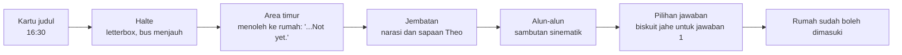
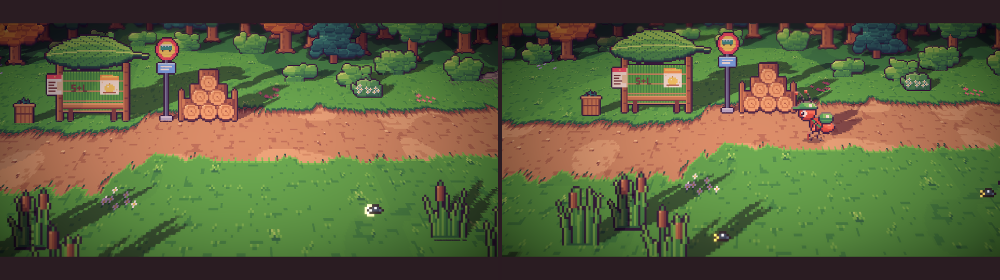
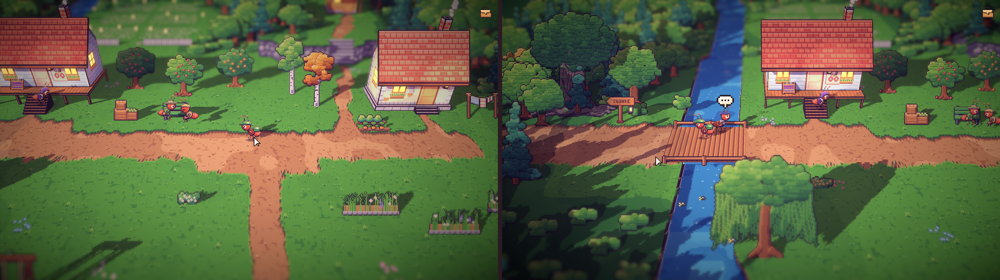
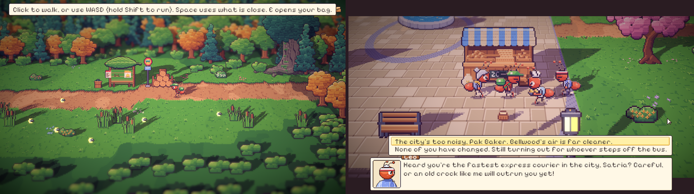
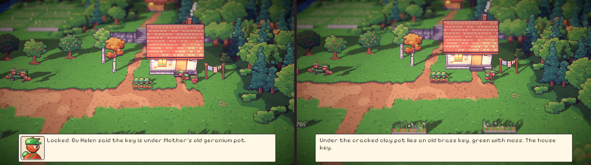

# 28. Naskah dan bible baru, Jalan Timur, dan awal prolog

**Tanggal:** 2026-10-20

## Tujuan

Praffi membagikan dua dokumen baru: naskah master (`The_Shop_That_Opens_Once_ULTIMATE_30PAGE_SCRIPT.pdf`, 54
halaman) dan bible dunia dan tokoh (`The_Shop_That_Opens_Once_WORLD_AND_CHARACTER_BIBLE.pdf`, 40 halaman). Keduanya
dibaca, dibandingkan dengan GDD dan keputusan yang sudah ada, lalu bentrokannya diputuskan bersama Praffi. Setelah itu
dibangun bagian pertama prolog: Satria turun dari bus, berjalan melintasi area timur, lalu disambut warga di alun-alun.

## Yang dikerjakan

### Dua dokumen baru masuk ke `GAME-CONTEXT.md`

- Aturan prioritas: naskah menang untuk cerita, adegan, dan dialog. Bible menang untuk dunia, tempat, interior, dan
  detail tokoh. Keputusan di `GAME-CONTEXT.md` menang atas keduanya, jadi planet semut, tampilan HD-2D, dan kontrolnya
  tetap.
- Badai terjadi pada 1952 dan cerita berlangsung pada 1972. Satria berumur sekitar 28 tahun, pergi ke kota sebelas
  tahun lalu, dan Ratih meninggal dua tahun lalu.
- Daniel adalah ayah Satria. "Ayah Satria" dan "Daniel, sahabat Theo" di GDD ternyata orang yang sama.
- Helen menunggu Marcus Bell, kepala stasiun yang tak lain adalah Marlow. Nama "Arthur" di naskah tidak dipakai,
  karena berasal dari cerita lama.
- Agen properti dari kota bernama Valdo, dari perusahaan Bram Capital. Satu-satunya Bram adalah Kapten Bram.
- Toko Marlow buka pukul 00:00 sampai 00:30.
- Tabel tokoh, tabel bab, pertanyaan terbuka, dan daftar ketidakcocokan ikut diperbarui.

### Jalan Timur: area luar keenam (`areas.js`, `village-east.js`, `Places.cs`)

- Area baru `eastroad` ada di sebelah timur area timur. Isinya jalan masuk dari kota yang keluar dari hutan, dengan
  halte kayu beratap daun (`busStop`) di tepi hutan, tempat Satria tiba.
- Jalan ini bersambung ke jalur selatan area timur, sehingga Satria yang baru tiba melewati rumah kaca dan rumah
  Gardener, bukan pintu rumahnya sendiri. Jalan utama area timur sekarang berakhir di rumah Satria.
- Halte di alun-alun dihapus, jadi Bellwood hanya punya satu halte.
- Bus tidak ditampilkan, hanya terdengar menjauh (`bus_far`), karena bus terlalu besar untuk jalan semut.

### Day 0 bisa dijelajahi, tetapi tetap di jalur cerita (`Chapter.cs`, `Main.cs`, `Place.cs`, `PlaceDef.cs`)

- `Chapter.Closed(id)` memberi alasan untuk jalan keluar yang sedang ditutup. Kurir mengucapkan alasannya, lalu
  mundur selangkah dari jalan itu. Tidak ada dinding tak terlihat.
- `Hotspot.Step` menandai titik tak terlihat. Saat kurir menginjaknya untuk pertama kali dalam bab itu, cerita
  diberi tahu lewat `Chapter.Stepped(id)`.
- Warga yang hanya muncul di Day 0 memakai filter `Chapters`: Helen di kios roti, Leo di bangku bawah pohon ek, dan
  Theo di jembatan. Teleskop Leo saat senja dibatasi untuk bab 1 sampai 8, supaya Leo tidak muncul di dua tempat.

### Prolog bagian pertama (`Prologue.cs`)

- **Halte.** Kartu judul muncul, lalu adegan letterbox. Kamera memperlihatkan halte yang masih kosong. Bus terdengar
  berhenti di balik tikungan hutan (bunyi `bus_stop` baru: mesin melambat, desis rem, pintu terbuka), lalu Satria
  berjalan keluar dari balik pepohonan sambil membawa tasnya. Ia berhenti di halte, menatap bus yang menjauh,
  bergumam "Eleven years...", lalu berbalik ke arah desa. Titik munculnya (`off_bus`) ada di luar tepi area, di
  `PlaceDef.Spawns`, sehingga Satria benar-benar datang dari luar layar. Tasnya berisi kemeja ganti, dompet koin, dan draf kontrak Valdo. Tong sampah, poster Festival Panen
  Madu, dan bangku berukiran "S + L" bisa diperiksa.
- **Area timur.** Di tengah perjalanan, Satria menoleh ke rumahnya di ujung jalan dan berkata "...Not yet." Hamparan
  bunga Ratih yang sudah ditumbuhi rumput liar mengisi halaman kosong di seberang rumah (`overgrownBed`).
- **Jembatan.** Narasi "Bellwood. It still smells of bread and river water." muncul, lalu Theo menyapa dari pagar
  jembatan. Momen ini tanpa letterbox.
- **Alun-alun.** Sambutan dimulai saat Satria masuk alun-alun, jadi tidak bisa dilewati:
  1. Gosip warga tentang agen properti dan bunga chamomile Ratih terdengar.
  2. Helen melihat Satria dan menjatuhkan keranjangnya (`Ant.Drop`, bunyi `drop` baru).
  3. Baker turun membawa nampan, dan Leo bangkit dari bangku di bawah pohon ek lalu ikut mendekat.
  4. Keempatnya berkumpul di depan kios roti dan menghadap Satria: Helen di kirinya, Baker dan Leo di kanannya, masing-
     masing berjarak satu langkah dan tidak tertutup tiang lampu. Kamera membingkai mereka berempat.
  5. Satria memilih jawaban. Jawaban pertama ("kota terlalu bising") membuat Baker memberi biskuit jahe hangat, yang
     masuk ke tas.
  6. Helen menunjukkan jalan pulang dan memberi tahu bahwa kunci ada di bawah pot geranium. Petunjuk ini masuk ke
     catatan, lalu Helen memungut keranjangnya lagi (`Ant.PickUp`).
- **Kunci di bawah pot geranium.** Pot geranium Ratih yang retak berdiri di samping pintu rumah (`flowerPot` sekarang
  bisa diberi warna dan retakan). Setelah sambutan, memeriksa pot memberi kunci kuningan berlumut (`homekey`). Tanpa
  kunci itu, pintu menjawab "Locked. Bu Helen said the key is under Mother's old geranium pot."
- **Jalan yang ditutup.** Pintu rumah menjawab "Not yet." sampai sambutan selesai. Jalan ke stasiun dan ke pantai
  menjawab "It's getting dark. I should get home first.", dan jalan kembali ke halte menjawab "The last bus has gone."
- **Sapaan Day 0.** Warga yang dilewati, seperti Nenek Nora ("Is that... Ratih's boy?"), Gardener, Mia, Pip, Sam, dan
  semut latar, punya kalimat khusus Day 0, bukan obrolan harian mereka.

### Barang di tas (`interiors.js`, `export-rooms.js`, `Keepsakes.cs`)

- Gambar baru: draf kontrak, dompet koin, dan kemeja ganti, masing-masing dalam ukuran kecil dan besar; biskuit jahe
  dan kunci rumah dalam tiga ukuran; dan keranjang Helen dalam ukuran yang dipegang tokoh.
- `Keepsakes.All` sekarang juga memuat barang milik Satria dan barang pemberian warga, lengkap dengan apa yang dilihat
  kurir saat memeriksanya.

## Keputusan

Dicatat juga di `GAME-CONTEXT.md`.

- **Aturan prioritas** antara naskah, bible, GDD, dan keputusan yang sudah ada.
- **Tahun 1952 dan 1972, Daniel, Marcus Bell, Valdo, dan jam buka 00:00 sampai 00:30.**
- **Satria tiba dengan berjalan kaki.** Bus hanya terdengar, dan halte berada di Jalan Timur, area luar keenam.
- **Day 0 bisa dijelajahi, tetapi jalan di luar jalur cerita ditutup dengan alasan.** Bebas menjelajah dimulai pada
  pagi Day 1.
- **Pembagian adegan prolog.** Momen besar (halte, sambutan) memakai letterbox. Momen kecil (menoleh ke rumah, narasi
  di jembatan, sapaan Theo) tidak. Memeriksa benda dan mendengar gosip adalah permainan biasa.
- **Sambutan berlangsung di alun-alun**, karena warung Helen sendiri ada di peron. Pada Day 0, Helen sedang membeli
  roti di kios Baker.

## Masalah dan solusinya

- **Bus menutupi rumah Nora, dan halte berdiri tepat di depan rumah Satria.** Bus dihapus dan hanya terdengar. Halte
  dipindah ke Jalan Timur.
- **Setelah masuk area timur, rumah Satria langsung ada di depan mata.** Praffi menilai ini aneh. Jalan dari halte
  sekarang bersambung ke jalur selatan, dan jalan utama berakhir di rumah Satria. Titik lari Leo digeser dari x 900
  ke x 880.
- **Tampilan Jalan Timur bermasalah.**
  - Parit air yang lebarnya hanya 5 px tergambar sebagai garis batu yang rusak, jadi parit dihapus.
  - Satria tertutup batu besar, jadi batunya dihapus.
  - Ada sisa rumput kosong di bawah, jadi tinggi area dikurangi dari 480 menjadi 416.
  - Alang-alang berbaris rata seperti pagar, jadi sekarang dikelompokkan.
- **`walk.png` tidak ikut diperbarui.** Ekspor biasa tidak menimpa mask jalan yang sudah ada, sehingga mask area
  timur, alun-alun, dan Jalan Timur masih versi lama. Mask diekspor ulang dengan `--force`. Perubahannya hanya di
  sekitar halte lama dan jalan timur yang baru.
- **Titik menoleh ke rumah terlewat.** Titiknya semula hanya di persimpangan jalur dan jalan utama, padahal klik
  berjalan bisa memotong lewat rumput. Titiknya sekarang berupa pita yang melintang di seluruh area timur, yang pasti
  dilewati setiap rute dari halte.
- **Satria langsung muncul di halte.** Praffi meminta kedatangan yang lebih hidup. Sekarang bus terdengar berhenti
  di luar layar, dan Satria berjalan keluar dari hutan.
- **Kamera melompat setelah adegan di halte.** Jalan Timur hanya selebar 640 px, padahal pandangan luar sekitar 960 px.
  Di luar adegan, kamera tidak bisa mengikuti dan terkunci di tengah area, sehingga saat letterbox hilang kamera
  melompat dan Satria terjepit di tepi layar. Area dilebarkan menjadi 1024 px seperti area lain, dengan halte di
  tengahnya. Selain itu, `Cinema()` sekarang membuat kamera meluncur ke posisi barunya, tidak melompat.
- **Leo tidak terlihat saat berbicara, dan para tokoh tidak tampak saling berbicara.** Kamera terpaku di tempat
  Helen semula berdiri, sementara Leo berbicara dari bangku di luar layar. Adegan disusun ulang: semua berkumpul di
  satu titik, saling berhadapan, dengan jarak di antara mereka, dan Leo berjalan mendekat sebelum berbicara.
- **Rumah bisa dimasuki tanpa kunci.** Pintu sekarang tetap terkunci sampai kunci diambil dari bawah pot geranium.
- **Anchor `home` harus berada di tanah yang bisa dipijak**, jadi diletakkan di depan pintu rumah (877, 452).
- **Ekspor suara mengodekan ulang semua klip.** Hanya `drop.ogg` yang baru. Klip lain dikembalikan ke versi
  sebelumnya.

## Cara dicek

- Ekspor dengan `python3 game/ArtSource/export.py` untuk `areas` (ditambah `--force` untuk mask jalan), `rooms`, dan
  `sound`.
- Prolog dimainkan di editor lewat pilihan judul "Prologue (in progress)", yang hanya ada di editor, mulai dari
  halte sampai sambutan selesai. Tangkapan layar diambil di halte, saat memeriksa bangku, di area timur, di jembatan,
  dan saat sambutan.
- Bendera `stepped_glimpse`, `stepped_bridge`, dan `welcomed` diperiksa setelah berjalan dari halte ke alun-alun.
- Prolog dimainkan ulang setelah setiap perbaikan: kedatangan dari luar layar, kamera saat keluar dari adegan,
  sambutan (dengan pilihan pertama: biskuit masuk tas, petunjuk kunci masuk catatan), pintu yang terkunci, kunci dari
  pot, lalu pintu yang terbuka ke dalam rumah.
- Tes PlayMode lulus 3 dari 3.

## Commit

`feat(prologue): bring Satria home along the east road to the village's welcome`

## Langkah berikutnya

- Bagian kedua prolog: Valdo menunggu di papan arah EAST di alun-alun.
- Bagian ketiga: halaman rumah (gerbang berkarat, rumput liar, pot geranium dan kunci, pintu terkunci), memeriksa
  isi rumah, monolog, tempat tidur dan lilin, lalu pindah ke Malam 1 pukul 00:12.
