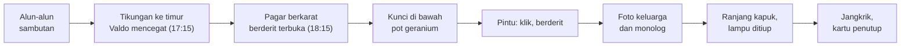
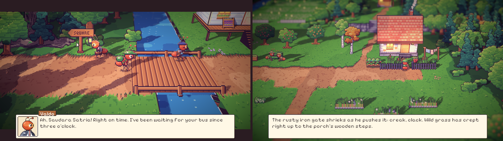
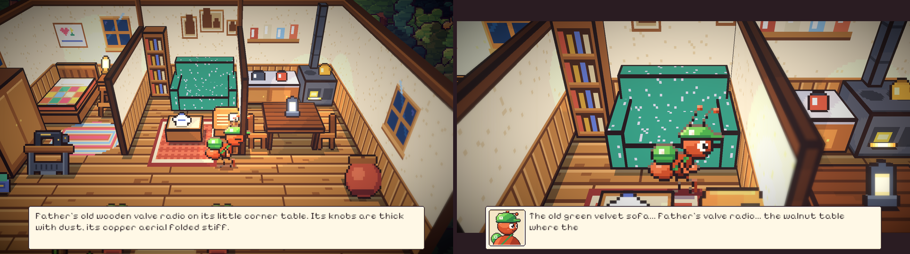
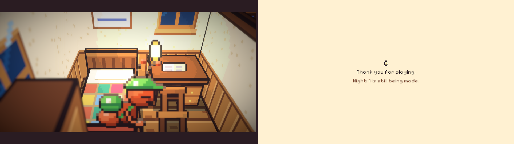

# 29. Valdo, pulang ke rumah, dan malam pertama

**Tanggal:** 2026-10-20

## Tujuan

Melanjutkan prolog dari sambutan di alun-alun sampai akhir Day 0, mengikuti naskah: pukul 17:15 Valdo mencegat
Satria di tikungan jalan menuju area timur, lalu pukul 18:15 Satria pulang. Ia membuka pagar berkarat, mengambil
kunci, masuk rumah, melihat peninggalan keluarganya, dan tidur untuk pertama kalinya. Praffi meminta bagian kedua
dan ketiga prolog dibangun sekaligus supaya lebih mudah diperiksa.

## Yang dikerjakan

### Agen Valdo (`chars.js`, `interiors.js`, `Places.cs`, `Prologue.cs`)

- Tokoh baru, dibuat dari deskripsi bible (6.15): jas wol abu-abu arang, kemeja putih, dasi sutra merah marun,
  kacamata berbingkai emas, dan koper kulit mengilap di tangan (barang `briefcase` ukuran kecil). Warnanya diambil
  dari palet yang sudah ada (`iron`, `roofR`, `brass`), jadi tidak ada warna baru. Potretnya memakai jas berkerah,
  dasi, sapu tangan di saku, dan kacamata.
- Valdo menunggu di samping papan petunjuk SQUARE di ujung barat area timur, yaitu tikungan jalan menuju permukiman
  timur dalam naskah. Ia baru muncul setelah sambutan, lewat filter baru `Person.After`: orang itu hanya ada setelah
  cerita menandai flag tertentu (di sini `welcomed`). Dengan begitu, Satria tidak berpapasan dengannya saat pertama
  kali lewat dari halte.
- Begitu Satria masuk area timur dari alun-alun, adegan letterbox dimulai. Valdo memanggil Satria, melangkah
  menghadangnya, lalu menyampaikan tawarannya: investor pabrik gula, pelunasan cicilan motor kurir, dan batas waktu
  pagi Hari Kedelapan. Panggilan "Pak Bram" dalam naskah diganti "Pak Valdo", sesuai keputusan sebelumnya. Batas
  waktunya masuk ke catatan.
- Setelah adegan, Valdo tetap berdiri di papan petunjuk dan punya kalimat pengingat sendiri.

### Pagar dan halaman rumah (`village-east.js`, `areas.js`, `Place.cs`)

- Halaman depan rumah Satria sekarang berpagar. Pagar besinya rendah dan sudah berkarat (`ironFence`), dengan
  gerbang di antara dua tiang (`yardGate`, dalam keadaan tertutup dan terbuka). Semak di kedua sisi menutup halaman
  sampai ke dinding rumah, dan rumput liar tumbuh sampai ke anak tangga teras.
- Mask jalan sudah diperiksa: satu-satunya jalan masuk ke halaman adalah lewat gerbang.
- Gerbang adalah titik `Step`. Saat Satria melewatinya, gerbang berderit terbuka (bunyi `gate` baru) dan narasi
  naskah muncul. `Place.FollowStory` menampilkan gerbang tertutup pada Day 0 sampai Satria membukanya, dan terbuka
  sesudahnya.
- Titik berdiri di depan pot geranium digeser sedikit (`Spot` 12 menjadi 9), karena pagar sekarang berada di depannya.

### Di dalam rumah (`inside.js`, `Places.cs`, `Prologue.cs`)

- Saat pertama kali masuk, kunci berbunyi klik dan pintu jati berderit berat (bunyi `door` baru), lalu muncul narasi
  tentang udara pengap yang berbau kertas tua.
- Ada empat benda yang bisa diperiksa, masing-masing dengan teks dari naskah: foto keluarga di atas sofa, radio tabung
  Ayah, mesin jahit Ibu, dan tempayan air di dapur.
- Foto keluarga memutar monolog batin Satria ("Tiga hari. Tiga hari saja, lalu semuanya selesai.") dalam adegan
  letterbox. Ranjang baru bisa dipakai setelah monolog itu. Sebelumnya Satria berkata "Not yet. I've hardly looked
  round."
- **Ranjang.** Satria duduk di atas kasur kapuk (bunyi `bed`), lalu meniup lampu minyak di meja sebelah ranjang
  (bunyi `blow`, cahaya lampu padam). Jangkrik mulai berbunyi (`crickets`), dan bab ditutup. Kartu yang muncul
  berbunyi "Night 1 is still being made", karena Night 1 belum dibangun.
- Lampu di meja tulis dipindah ke ujung meja yang dekat ranjang. Di tempat lamanya, lampu itu tertutup sekat kamar.
- Kaleng perca Ibu dipindah ke lantai di samping lemari. Di tempat lamanya, kaleng itu menutup satu-satunya jalan
  antara kamar tidur dan ruangan lain.

### Bunyi baru (`audio.js`, `export-sound.js`)

- `gate`: engsel berkarat berderit, lalu palang gerbang berbunyi klak.
- `door`: kunci berbunyi klik, lalu pintu berat berderit terbuka.
- `bed`: per ranjang tua berderit dua kali.
- `blow`: hembusan napas pelan.
- `crickets`: dua ekor jangkrik, salah satunya lebih jauh.
- Derit pagar, pintu, dan ranjang memakai satu fungsi bantu, `creak`: denyut gesekan berulang dengan nada yang
  bergeser, seperti kayu atau besi yang tersendat lalu tergelincir.

## Keputusan

Dicatat juga di `GAME-CONTEXT.md`.

- **Valdo menunggu di papan petunjuk SQUARE di area timur**, baru muncul setelah sambutan, dan tetap di sana sampai
  senja Day 0 berakhir.
- **Valdo memakai dasi sutra dari bible**, bukan dasi kupu-kupu dari naskah.
- **Lilin di meja dalam naskah diganti lampu minyak di meja tulis**, yang memang sudah tergambar sebelumnya. Kompor
  minyak tanah diganti kompor kayu, dan meja jati diganti meja kenari, sesuai gambar yang ada.
- **"Membaringkan tubuh" ditampilkan sebagai duduk di ranjang**, karena belum ada pose berbaring.
- **Akhir Day 0 memakai gaya game**: jangkrik terdengar di atas kartu penutup berwarna krem, bukan layar hitam.
  Ruangan punya cahayanya sendiri, sehingga tidak ikut gelap oleh grading malam.

## Masalah dan solusinya

- **Kamar tidur tidak bisa dicapai.** Pencarian jalan memakai grid 4 px, sedangkan celah antara kaleng perca dan
  ujung sekat kamar hanya beberapa piksel dan miring. Akibatnya jalan ke ranjang dan ke mesin jahit tidak ditemukan.
  Kaleng dipindah ke samping lemari, sehingga sekarang ada lorong selebar sekitar 11 px.
- **Lampu di meja tidak terlihat**, karena tertutup sekat kamar dari sudut pandang kamera. Lampu dipindah ke ujung
  meja yang lain.
- **Area klik benda di dinding terlalu rendah.** Area klik diukur ulang dari posisi di layar (`Main.ToCanvas`) dan
  digeser supaya pas dengan foto, radio, mesin jahit, dan ranjang.
- **Valdo berdiri terlalu dekat dengan Satria**, sampai wajah mereka hampir bersentuhan. Jarak di antara mereka
  dilebarkan dari 24 px menjadi 30 px.
- **Ekspor bunyi menulis ulang semua klip.** Klip lama yang tidak berubah dikembalikan dengan `git checkout`, dan
  hanya lima klip baru yang disimpan.

## Cara dicek

- Pilih "Prologue (in progress)" di layar judul, lalu mainkan sampai sambutan selesai. Kembali ke area timur: Valdo
  mencegat Satria di papan petunjuk SQUARE, dan batas waktunya masuk ke catatan.
- Berjalan ke rumah. Pagar berderit terbuka saat dilewati. Ambil kunci dari pot geranium, lalu masuk.
- Periksa radio, mesin jahit, dan tempayan. Coba ranjang sebelum melihat foto: Satria menolak. Periksa foto untuk
  memutar monolog, lalu pakai ranjang: lampu padam, jangkrik berbunyi, dan bab berakhir.
- Tes PlayMode lulus 3 dari 3.

## Commit

`feat(prologue): bring Satria home past Valdo to his first night in the house`
