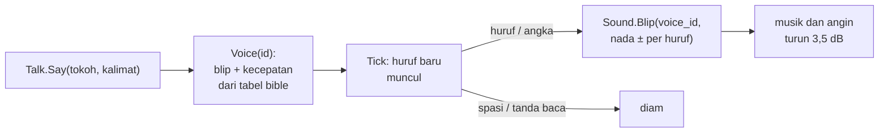

# 30. Suara dialog ala Animal Crossing

**Tanggal:** 2026-10-20

## Tujuan

Sampai sekarang dialog tidak bersuara sama sekali. Praffi meminta suara dialog seperti di Animal Crossing. Bible
ternyata sudah merinci sistem ini di bagian 3.1B ("Parameter Voice Blip Sintetis"): setiap tokoh punya bentuk
gelombang, nada dasar, dan kecepatan bicara sendiri. Langkah ini membangun sistem itu sesuai tabel bible.

## Yang dikerjakan

### Blip tiap tokoh (`audio.js`, `export-sound.js`)

- Tabel `VOICES` baru berisi satu blip pendek (sekitar 0,06–0,15 detik) untuk tiap tokoh di tabel bible. Bentuk
  gelombang dan nada dasarnya mengikuti bible:
  - Satria (`courier`): gelombang segitiga, 320 Hz.
  - Marlow: sinus rendah 110 Hz, ditambah ekor gema panjang (sekitar 0,6 detik), seperti lonceng tua di celah akar.
    Bible menyebut reverb ruang bawah tanah untuk Marlow, dan gema ini dipanggang langsung ke blipnya.
  - Helen: sinus lembut seperti seruling dan lonceng, 440 Hz. Parsial yang hampir satu oktaf di atasnya membuat
    getaran pelan.
  - Pip: gelombang kotak tinggi, 680 Hz.
  - Theo: bunyi klik rana kamera di atas nada 290 Hz.
  - Sam: ketukan kering mesin tik di atas pulsa 360 Hz.
  - Mender: dentum palu di paron, 95 Hz.
  - Kapten Bram: siulan uap yang berongga, dengan desis tipis.
  - Valdo: sinus licin 340 Hz yang naik sedikit, seperti orang tersenyum.
  - Ada juga Baker, Gardener, Arlo, Mia, Nora, Leo, dan Trio Kelereng (suara `kid`, dipakai juga oleh `grandkid`).
- Figuran yang tidak ada di tabel bible memakai satu blip `villager` bersama. Nadanya digeser menurut id masing-masing,
  jadi tetangga yang satu tidak terdengar sama persis dengan yang lain.
- Setiap blip diekspor sebagai `voice_<id>.ogg`, jadi ada 17 klip baru.

### Talk dan Sound (`Talk.cs`, `Sound.cs`)

- Setiap huruf atau angka yang muncul saat kalimat diketik memainkan satu blip. Nadanya digeser sedikit menurut
  hurufnya (sekitar ±10%), seperti di Animal Crossing, sehingga kata yang sama selalu terdengar sama. Spasi dan
  tanda baca tidak bersuara.
- Kalimat juga diketik dengan kecepatan tokohnya, sesuai bible: Pip 25 ms per huruf, Satria 35 ms, Marlow 55 ms.
  Narasi tanpa tokoh tetap diketik cepat (50 huruf per detik) tanpa suara.
- Klik atau Spasi tetap langsung menampilkan seluruh kalimat, dan blipnya berhenti.
- Selama tokoh berbicara, musik dan angin turun 3,5 dB (dikali 0,67), lalu naik lagi saat kalimat selesai diketik
  atau kotak dialog ditutup. Ini mengikuti ducking yang disebut bible.
- Blip diputar dari satu `AudioSource` khusus suara dengan `PlayOneShot`, jadi ekor blip sebelumnya tetap berbunyi
  di bawah blip berikutnya.

## Keputusan

Dicatat juga di `GAME-CONTEXT.md`.

- **Suara dialog mengikuti tabel bible 3.1B**, termasuk kecepatan bicaranya. Akibatnya, dialog para tokoh sekarang
  diketik sedikit lebih lambat dari sebelumnya (dulu semua 20 ms per huruf).
- **Figuran memakai satu suara `villager`** yang nadanya digeser menurut id.
- **Slider volume suara tersendiri ditunda**, karena menu pengaturan baru punya tombol suara hidup/mati.

## Masalah dan solusinya

- **Ekspor bunyi menulis ulang semua klip.** Klip lama yang tidak berubah dikembalikan dengan `git checkout`, dan
  hanya 17 klip suara baru yang disimpan.

## Cara dicek

- Mainkan prolog. Saat Satria, Valdo, atau warga berbicara, setiap huruf berbunyi, dan masing-masing tokoh terdengar
  berbeda. Narasi tetap diam.
- Saat kalimat sedang diketik, musik terdengar sedikit lebih pelan. Dicek di editor: volume musik dan angin turun ke
  0,67 selama Marlow berbicara, lalu kembali ke 1,00 setelah kalimatnya selesai.
- Ke-17 klip `voice_*` berhasil dimuat dari `Resources`.
- Tes PlayMode lulus 3 dari 3.

## Commit

`feat(audio): give every speaker an Animal Crossing style voice blip`
