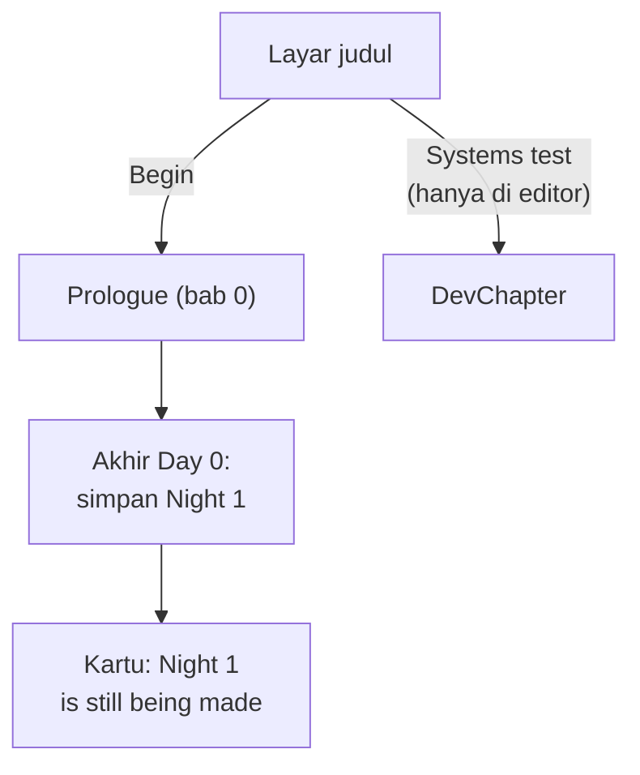
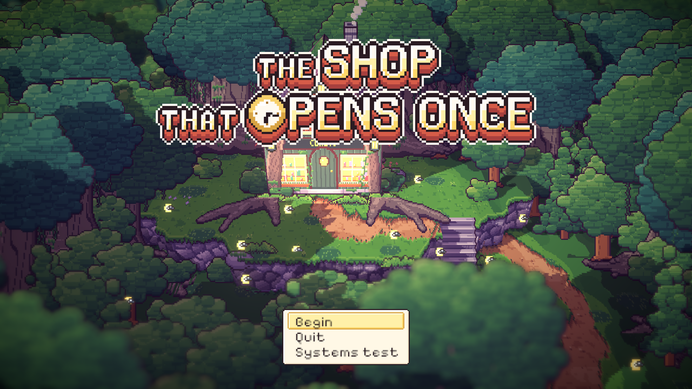
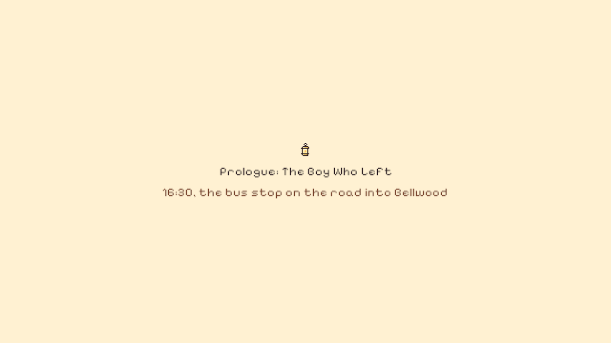

# 31. Prolog menjadi awal game, dan penampilan Marlow

**Tanggal:** 2026-10-20

## Tujuan

Prolog (Day 0) sudah utuh dari halte sampai malam pertama, tetapi selama ini hanya bisa dimainkan lewat pilihan
"Prologue (in progress)" di editor. Tombol Begin masih menjalankan uji sistem. Langkah ini menjadikan prolog bab
pertama game yang sebenarnya, sekaligus menambahkan tes yang memainkan Day 0 dari awal sampai akhir. Selain itu, Praffi
memutuskan penampilan Marlow sebelum Night 1 dibangun.

## Yang dikerjakan

### Prolog sebagai bab 0 (`Main.cs`, `DevChapter.cs`)

- `Main.Chapters[0]` sekarang `Prologue`. Begin di layar judul memulai prolog, dan akhir prolog menyimpan Night 1 sebagai
  bab berikutnya.
- Pilihan editor "Prologue (in progress)" dihapus dan diganti "Systems test" (`Main.SystemsTest`), juga hanya di
  editor. Uji sistem (`DevChapter`) tetap dipertahankan karena ia satu-satunya bab yang menguji penyerahan keepsake dan
  lentera padam. Nanti Night 1 yang menggantikannya.

### Tes (`PlaythroughTest.cs`, `RunTest.cs`)

- Tes baru `ProloguePlaysThrough` memainkan Day 0 tanpa pemain:
  1. turun dari bus, lalu ke area timur;
  2. menyeberang jembatan ke alun-alun untuk sambutan, lalu kembali ke timur dan dicegat Valdo;
  3. masuk lewat pagar, mengambil kunci di pot geranium, lalu masuk rumah;
  4. melihat foto untuk monolog, lalu ke ranjang, sampai bab selesai dan Night 1 tersimpan.
- Titik `Step` di perjalanan (Satria menoleh ke rumah, jembatan, pagar) menghentikan langkah selama adegannya. Fungsi
  bantu baru `Use` di tes berjalan lagi setelah adegan selesai, seperti pemain yang mengklik lagi.
- Kalau tes kehabisan waktu, pesannya sekarang menyebut baris langkah yang sedang ditunggu, jadi langsung kelihatan di
  mana permainan tersangkut.
- `SystemsTestPlaysThrough` dan `RunTest.ShiftRuns` sekarang memilih "Systems test" di layar judul, karena keduanya
  butuh stasiun dan tanah lapangnya.

## Keputusan

Dicatat juga di `GAME-CONTEXT.md`.

- **Prolog adalah bab pertama game.** Uji sistem tetap ada sebagai pilihan editor sampai Night 1 menggantikannya.
- **Penampilan Marlow mengikuti naskah**: semut tua abu-abu dengan rompi cokelat lusuh dan seuntai kunci kuningan di
  pinggang. Ia terlihat seperti penjaga toko biasa, supaya kejutan Night 6 (Marlow adalah arwah Marcus Bell) terasa.
  Hanya dua petunjuk yang diambil dari sosok roh di bible: matanya berpendar samar dan langkahnya tidak bersuara. Mantel
  biru bersulam bintang, syal, dan lentera dari bible tidak dipakai. Gambar Marlow yang sekarang (mantel hijau lumut,
  dasi kupu-kupu, monokel, kumis) akan diganti saat Night 1 dibangun.

## Masalah dan solusinya

- **Tes prolog tersangkut di area timur.** Titik `glimpse` menghentikan langkah Satria untuk adegannya, dan
  `WalkAndUse` mengembalikan `false`, tetapi tes tidak berjalan lagi. Dengan fungsi bantu `Use`, langkah dilanjutkan
  setelah adegan selesai.
- **`RunTest` gagal** karena menunggu stasiun, padahal Begin sekarang mulai di halte. Tes itu sekarang memilih
  "Systems test".

## Cara dicek

- Jalankan game di editor. Layar judul menampilkan Begin, Quit, dan Systems test. Begin membuka kartu "Prologue: The Boy
  Who Left".
- Tes PlayMode lulus 4 dari 4, termasuk `ProloguePlaysThrough`.

## Commit

`feat(prologue): start the game on the prologue and play it through in a test`
