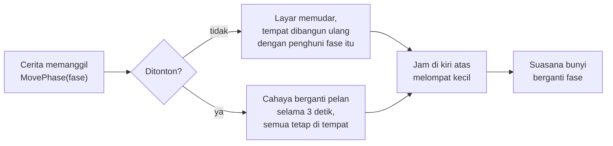
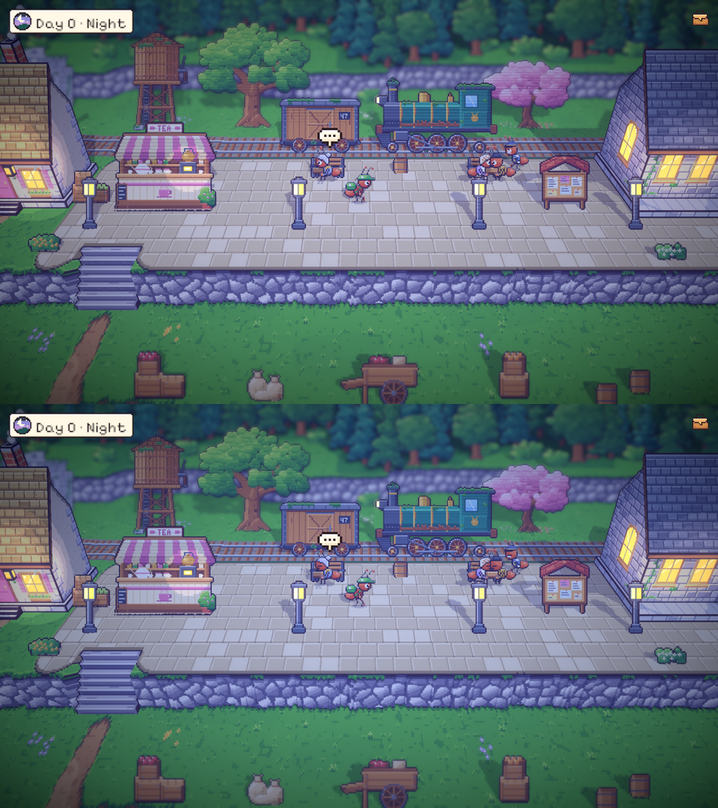
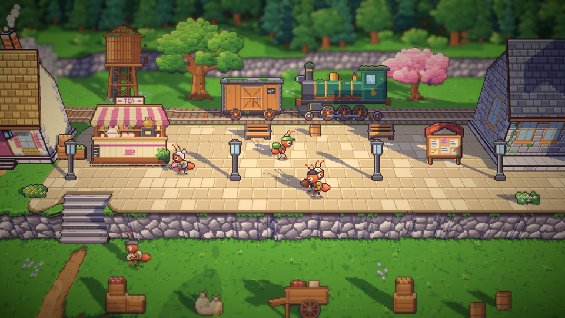

# 32. Jam hari, peralihan waktu, dan suasana bunyi per fase

**Tanggal:** 2026-10-20

## Tujuan

Langkah pertama dari pembangunan game sampai tamat. Waktu di Bellwood bergerak hanya karena cerita, sesuai
keputusan sebelumnya: empat pergantian sehari, dan pergantian senja ke malam saat penyerahan keepsake terjadi di
depan pemain. Praffi juga meminta jam di kiri atas layar.

## Yang dikerjakan

### Jam hari di kiri atas (`Hud.cs`, `interiors.js`)

- Panel krem kecil di kiri atas berisi jendela bundar ke langit dan tulisan seperti "Day 1 · Morning". Ada empat
  gambar 16x16: matahari terbit di atas bukit, matahari tinggi, matahari terbenam, serta bulan sabit dan bintang.
  Semuanya digambar dengan kode, tanpa jam digital, sesuai GDD.
- Jam hanya tampil saat menjelajah, sama seperti tombol tas. Saat fase berganti, panel melompat kecil supaya
  perubahan itu terlihat.
- Petunjuk yang panjang turun ke bawah jam supaya tidak bertumpuk dengannya.

### Waktu digerakkan cerita (`Main.cs`, `Grade.cs`, `Game.cs`, `Chapter.cs`)

- `Main.MovePhase(fase, watched)` adalah satu-satunya cara memindahkan waktu. Tanpa ditonton, layar memudar dan
  tempat dibangun ulang dengan cahaya dan penghuni fase baru, sementara Satria tetap di tempatnya berdiri. Saat
  ditonton, `Grade.Blend` menggeser warna, awan, matahari, bayangan, dan cahaya lampu sedikit demi sedikit selama tiga
  detik. Semua orang tetap di posisinya, seperti saat penyerahan keepsake di senja hari.
- Tombol fase khusus pengembang sekarang memakai jalur yang sama.
- Bab malam (1 sampai 7) dimulai pada fase malam, saat lonceng tengah malam berbunyi. Prolog tetap dimulai senja.
- `GiveKeepsake` menandai `handed_over`. Pintu toko Marlow hanya terbuka di malam hari dan sebelum keepsake malam itu
  diserahkan. Di luar waktu itu Satria berkata "Just roots and shadow. The fog only comes at midnight."
- Tes sistem sekarang menyerahkan jam saku kepada Helen saat senja, lalu menonton cahaya berganti menjadi malam
  sebelum lentera padam.

### Suasana bunyi per fase (`audio.js`, `export-sound.js`, `Sound.cs`)

Ada empat loop 16 detik yang disintesis dengan kode dan dibunyikan di bawah musik. Isinya hanya serangga, karena
Bellwood adalah planet semut:

- **Pagi:** jangkrik pohon sesekali berderik, seekor lebah lewat berdengung, dan embun menetes dari daun.
- **Siang:** gumam pasar dari kejauhan, roda gerobak berketuk, dan keranjang diletakkan.
- **Senja:** ombak pecah di pantai jauh, lalu desisnya surut.
- **Malam:** jangkrik bersahutan, paduan suara jangkrik di kejauhan, dan tetes embun.

Suasana bunyi berpindah perlahan antarfase. Di dalam ruangan volumenya turun menjadi 35%, dan ikut mengecil saat ada
yang berbicara.

## Keputusan

Dicatat juga di `GAME-CONTEXT.md`.

- **Suasana pagi memakai serangga, bukan burung gereja.** GDD menyebut burung gereja, tetapi keputusan "hanya
  serangga" berlaku, jadi pagi diisi jangkrik pohon, lebah, dan embun.
- **Label jam memakai "Day N · Fase"**, termasuk "Day 0" untuk prolog, sesuai penomoran GDD.

## Masalah dan solusinya

- **Lingkar jam bergerigi seperti roda gigi.** Batas lingkar dan cincinnya digeser (8 dan 7 px dari pusat) sampai
  lingkarannya bulat rapi.
- **Petunjuk panjang menutupi jam.** Petunjuk sekarang turun ke bawah jam bila keduanya akan bertabrakan.
- **Ekspor bunyi menulis ulang klip lama.** Klip yang tidak berubah dikembalikan dengan `git checkout`.

## Cara dicek

- Pilih "Systems test". Jam di kiri atas menunjukkan "Day 0 · Dusk". Saat jam saku diserahkan kepada Helen, cahaya
  peron berganti pelan menjadi malam, jam berubah menjadi "Day 0 · Night", lalu jangkrik terdengar.
- Di build pengembang, tombol fase memudarkan layar dan membangun ulang tempat itu pada fase berikutnya.
- Tes PlayMode lulus 4 dari 4, termasuk pemeriksaan baru bahwa penyerahan mengubah senja menjadi malam.

## Commit

`feat(time): move the time of day with the story, show it top left, and give each phase its ambience`
