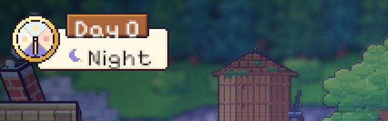
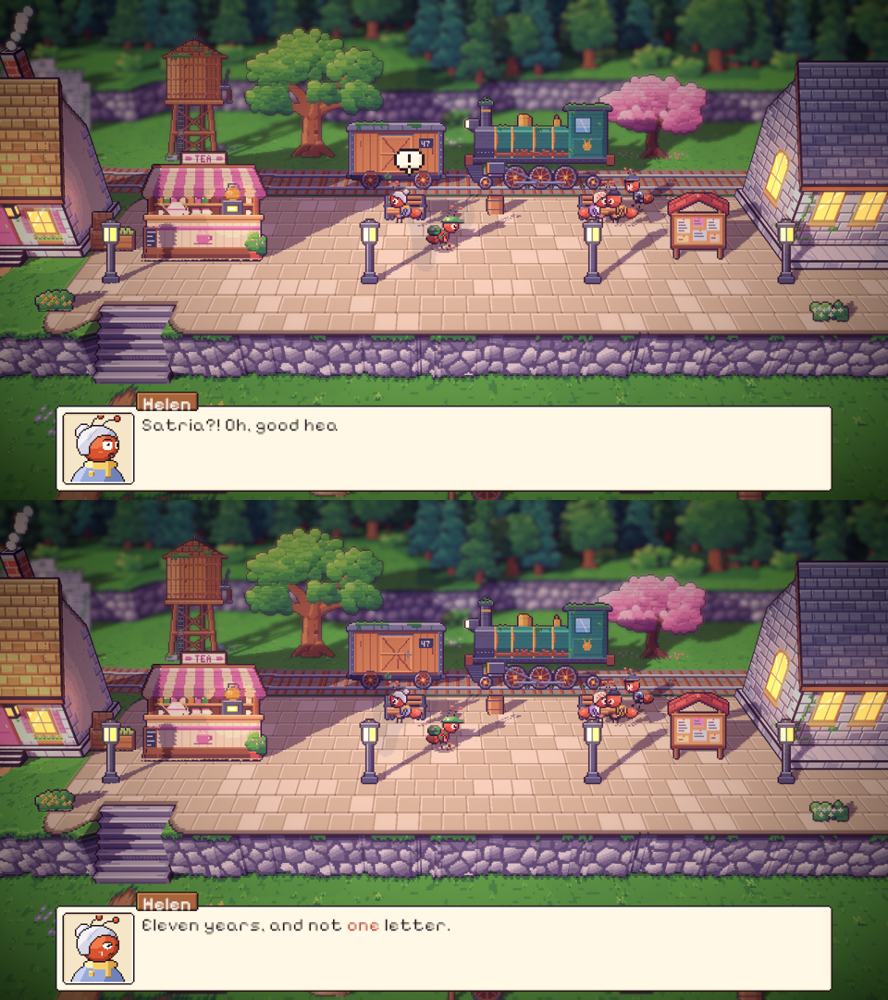
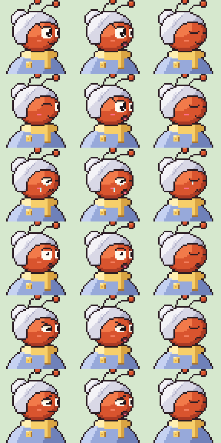

# 33. Jam hari berbentuk roda, dialog yang lebih hidup, dan teks berbahasa Inggris

**Tanggal:** 2026-10-20

## Tujuan

Tiga permintaan Praffi setelah entri 32:

1. Jam hari dibuat lebih interaktif, seperti roda fase di lembar HUD GDD, tetapi tetap serasi dengan UI game yang
   lain.
2. Dialog dibuat lebih hidup, karena sebelumnya terlalu pendek dan datar.
3. Semua teks yang masih berbahasa Indonesia (Pak, Bu, Saudara, dan sebagainya) diganti ke bahasa Inggris.

## Yang dikerjakan

### Jam hari berbentuk roda (`Dial.cs`, `export-cast.js`)

- Versi pertama meniru lembar GDD apa adanya: roda kayu, papan kayu bertuliskan "DAY 00" berukuran besar, dan pita
  krem. Praffi menilai versi itu tidak serasi dengan UI lain, jadi desainnya diganti dengan bahasa visual game ini
  sendiri:
  - Roda kecil berbingkai kuningan, berisi empat perempat fase searah jarum jam: pagi di kiri, siang di atas, senja
    di kanan, dan malam di bawah. Tiap perempat berwarna langit fasenya. Perempat yang sedang berlaku tampil jernih,
    sedangkan yang lain diberi selubung.
  - Roda itu menempel seperti medali di panel kertas krem, panel yang sama dengan kotak dialog.
  - "Day N" ditulis di label kayu yang menggantung di tepi atas panel, sama seperti nama pembicara di kotak dialog.
    Di bawahnya ada gambar kecil fase dan namanya.
- Saat cerita menggerakkan waktu, jarum kuningan berputar searah jarum jam selangkah demi selangkah sambil berdetak.
  Perempat yang baru menjadi jernih, nama fase berbalik ke fase baru, dan panel melompat kecil.
- Bila kursor diarahkan ke jam, muncul keterangan seperti "Dusk, Day 1. Time moves on with the story."

### Dialog yang lebih hidup (`Talk.cs`, `chars.js`, `export-cast.js`)

- **Jeda alami.** Ketikan berhenti sejenak setelah koma, dan sedikit lebih lama di akhir kalimat. Hasilnya terbaca
  seperti orang berbicara.
- **Penekanan.** Kata yang ditulis `*seperti ini*` di naskah tampil berwarna merah tua.
- **Ekspresi wajah.** Sebelumnya hanya beberapa tokoh yang punya wajah tersenyum atau terharu. Sekarang setiap potret
  punya lima ekspresi: senyum, terharu, terkejut (mata membelalak dan mulut "o"), sedih (kelopak turun dan alis
  naik), dan kesal (alis menukik dan mulut datar).
- **Emote.** Gelembung kecil muncul di atas kepala pembicara sesuai suasana kalimatnya: terkejut (!), bingung (?),
  senang (not musik), terharu (hati), kesal (urat), dan sedih (tetes keringat). Gelembung itu meletup lalu terayun
  pelan selama dua detik.
- **Guncangan.** Kalimat yang terkejut atau kesal membuat kotak dialog sedikit bergetar.
- **Percakapan, bukan satu kalimat.** Semua warga yang ditemui Satria di Day 0 sekarang punya percakapan pendek, dan
  sebagian memberi pilihan jawaban. Pip bertanya apakah tas kurir berisi harta karun. Mia bercerita tentang gosip
  agen. Nenek Nora mengenang Ratih yang dulu membantunya di alat tenun. Bila Satria kembali menyapa, mereka
  mengatakan hal lain. Adegan besar (sambutan, Valdo, monolog) diberi suasana dan penekanan pada kata pentingnya.

### Semua teks berbahasa Inggris

Sapaan berbahasa Indonesia diganti padanan bahasa Inggris yang wajar:

| Sebelumnya | Sekarang |
|---|---|
| Kapten Bram | Captain Bram |
| Nenek Nora | Grandma Nora |
| Bu Helen | Aunt Helen (sahabat ibu Satria) |
| Pak Valdo, Saudara Satria | Mr Valdo, Mr Satria (gaya kaku orang kota) |
| Pak Baker | Mr Baker |
| Bu Ratih (dalam gosip warga) | Ratih |

Semua teks di kode juga sudah dipindai, dan tidak ada lagi kata bahasa Indonesia yang tersisa.

## Keputusan

Dicatat juga di `GAME-CONTEXT.md`.

- **Jam hari memakai bahasa UI game sendiri**, bukan papan kayu dari lembar GDD.
- **Semua teks dalam game berbahasa Inggris, termasuk sapaan.**
- **Dialog hidup** dengan jeda, penekanan, lima ekspresi wajah untuk semua tokoh, emote, dan percakapan pendek
  dengan pilihan jawaban.

## Masalah dan solusinya

- **Ada dua objek `Main` di scene.** Satu objek tertinggal di scene yang sedang terbuka setelah tes dijalankan (tidak
  tersimpan ke berkas), sehingga logo judul ikut muncul di atas permainan. Scene sekarang dibuka ulang dari berkas
  setiap kali tes selesai.
- **Kalimat `else` terlepas.** Setelah jeda ditambahkan, `else StopSpeaker()` kehilangan pasangan `if`-nya.
  Perbaikannya: `if (!Typing) StopSpeaker()`.
- **Bulan di pita tidak terlihat**, karena warnanya krem di atas krem. Warnanya diganti ungu senja.

## Cara dicek

- Jalankan "Systems test". Jam di kiri atas menunjukkan roda, label "Day 0", dan "Dusk". Saat jam saku diserahkan,
  jarum berputar ke bawah sambil berdetak, lalu nama fase berbalik menjadi "Night".
- Mainkan prolog dan sapa warga. Emote muncul di atas kepala mereka, wajah berubah sesuai suasana, kata penting
  berwarna merah, dan sapaan kedua berbeda dari yang pertama.
- Tes PlayMode lulus 4 dari 4.

## Commit

`feat(ui): a day dial in the kit's style, lively talk with moods and emotes, and English throughout`
