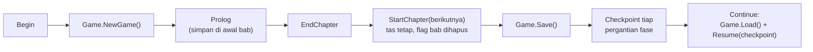
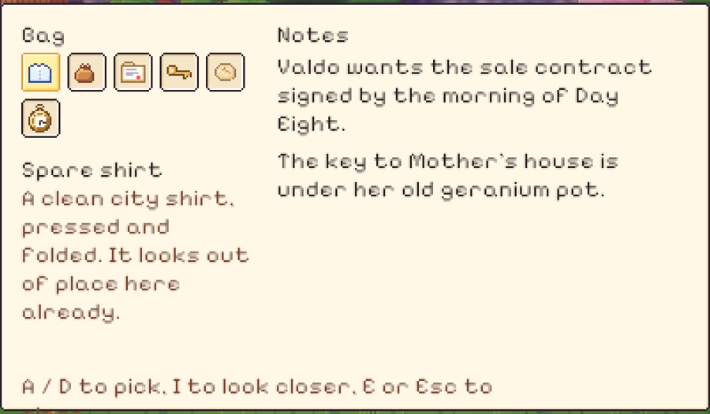

# 34. Simpanan antarbab, checkpoint, dan tas yang lebih jelas

**Tanggal:** 2026-10-20

## Tujuan

Menyiapkan dasar yang dibutuhkan malam-malam berikutnya: barang dan catatan Satria terbawa dari satu bab ke bab
berikutnya, permainan bisa dilanjutkan dari tengah malam, dan alur cerita yang gagal tidak pernah membuat kurir
membeku. Ini milestone M1 dari roadmap pembangunan sampai tamat.

## Yang dikerjakan

### Simpanan (`Game.cs`, `Main.cs`, `Chapter.cs`)

- Simpanan sekarang berupa satu nilai JSON di PlayerPrefs. Isinya bab, fase, checkpoint, isi tas, catatan, dan flag.
  Sebelumnya yang disimpan hanya nomor bab.
- **Isi tas terbawa ke bab berikutnya.** Kontrak, dompet, kunci rumah, dan biskuit dari prolog masih ada saat Night 1
  dimulai.
- **Flag dan catatan biasa berakhir bersama babnya.** Fakta yang tetap berlaku (`Game.Remember`, misalnya Helen
  membiarkan lenteranya menyala) dan catatan yang disimpan (batas waktu Valdo di pagi Hari Kedelapan) terbawa terus.
- **Tiap bab menentukan fase awalnya sendiri** (`StartPhase`): prolog dimulai senja, dan setiap malam dimulai saat
  lonceng tengah malam berbunyi.
- **`Chapter.Checkpoint(id)` menyimpan di tengah bab**, dan `Chapter.Resume(id)` melanjutkan dari situ saat pemain
  memilih Continue. Sementara ini bab dimulai ulang dari awal. Tiap malam nanti akan menimpanya.
- Di editor ada pilihan judul baru, "Chapter...", untuk memulai bab mana pun yang sudah dibuat. Pilihan ini berguna
  untuk tes dan tangkapan layar.

### Pengaman supaya kurir tidak membeku (`Main.cs`)

Setiap langkah cerita yang dipicu hotspot, dan setiap awal bab, sekarang dibungkus `try/finally`. Bila sebuah langkah
gagal karena error, kontrol tetap dikembalikan ke pemain. Warga yang dicolek pun kembali ke kegiatannya.

### Tas yang lebih jelas (`Bag.cs`)

- Barang yang dipilih ditandai dengan kotak keemasan, lalu nama dan keterangannya tampil di bawah slot. Sebelumnya
  yang ditampilkan selalu nama barang pertama.
- Barang bisa dipilih dengan A / D atau dengan kursor. Klik atau tombol I untuk melihat lebih dekat.
- Slot berpindah ke baris baru setiap lima barang.
- Catatan menampilkan yang terbaru dan sebanyak yang muat di kolomnya.
- Klik di luar tas akan menutupnya.

## Keputusan

Dicatat juga di `GAME-CONTEXT.md`.

- **Simpanan per checkpoint**, seperti dijelaskan di atas. Pertanyaan terbuka soal penyimpanan dihapus dari daftar.
- **Pilihan cerita yang masih terbuka diputuskan agen sesuai serah terima** (Praffi tetap bisa mengubahnya):
  - Daniel masih hidup setelah 1952, lalu meninggal beberapa tahun lalu saat menopang tiang jembatan yang dulu ia
    bangun, ditemani Theo.
  - Hanya ada akhir kanon: Satria tetap tinggal dan merobek kontrak.
  - Di Hari Kedelapan, kantor pos alun-alun dibuka kembali sebagai kantor pos Satria.
  - Pengaturan tetap hanya suara hidup/mati sampai game selesai.
- **Pintu toko Marlow di luar tengah malam** menampilkan kartu CLOSED yang memang tergambar di pintunya, bukan "akar
  dan bayangan".

## Masalah dan solusinya

- **Tes sistem gagal: "lantern goes out, expected 1 but was 0".** Akhir bab sekarang langsung memulai bab berikutnya,
  dan Night 1 memang dimulai dengan nol lentera padam. Tes sekarang memeriksa lentera dan fase malam saat penyerahan
  berlangsung, sebelum bab berganti.
- **`sed` di macOS tidak mengenal `\b`.** Penggantian nama `tag` menjadi `nameTag` di `Dial.cs` dilakukan dengan
  `perl`.
- **Berkas recovery Unity dan dump crash** sekarang masuk `.gitignore`, sehingga tidak bergantung pada ingatan untuk
  tidak meng-commit-nya.

## Cara dicek

- Tes baru `SaveTest`: simpan, lalu muat. Tas, catatan, flag, fase, dan checkpoint kembali sama. Saat bab berikutnya
  dimulai, tas tetap, flag bab hilang, dan fakta tetap serta catatan yang disimpan masih ada.
- `ProloguePlaysThrough` sekarang juga memeriksa bahwa kontrak masih di tas dan batas waktu Valdo masih di catatan
  saat Night 1 tersimpan.
- Tes PlayMode lulus 5 dari 5.

## Commit

`feat(save): carry the story across chapters, save at checkpoints, never freeze, and a clearer bag`
