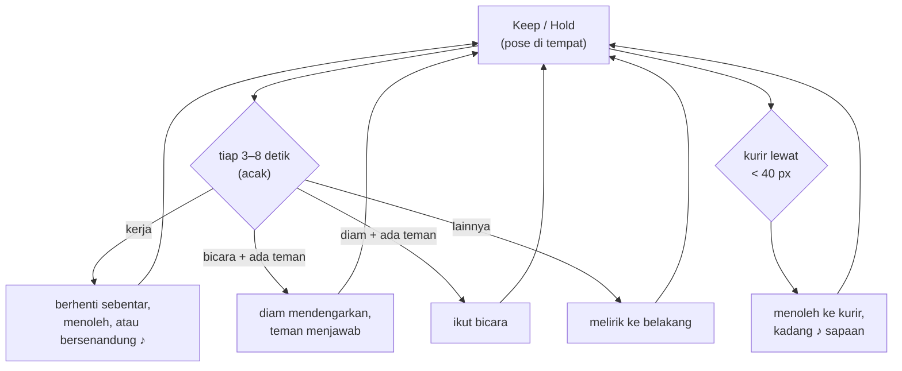
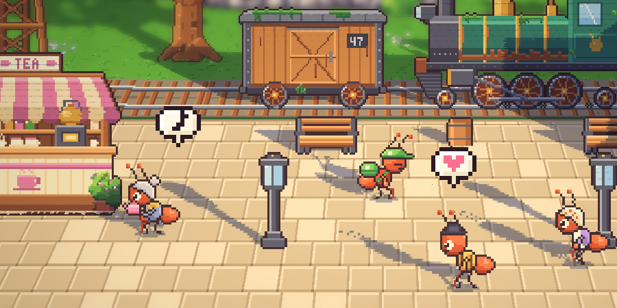
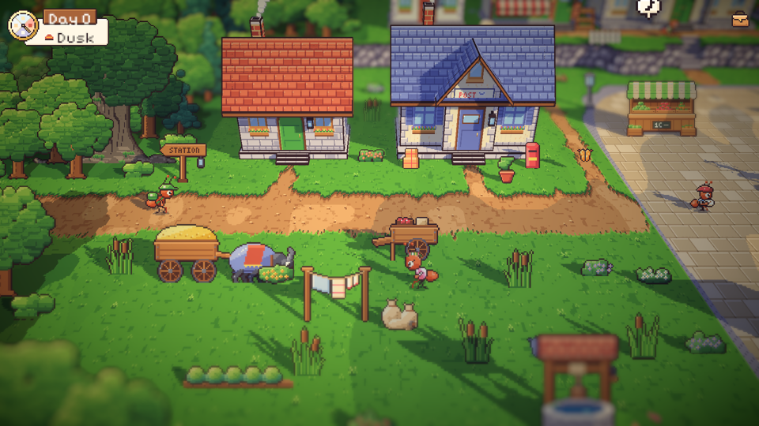
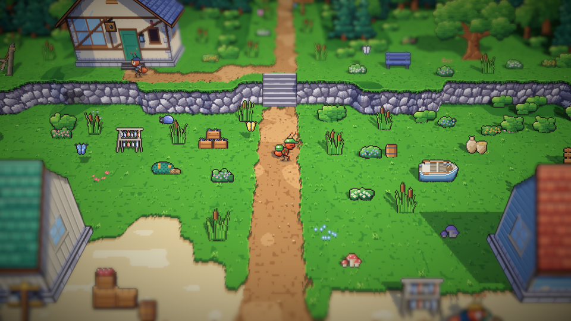
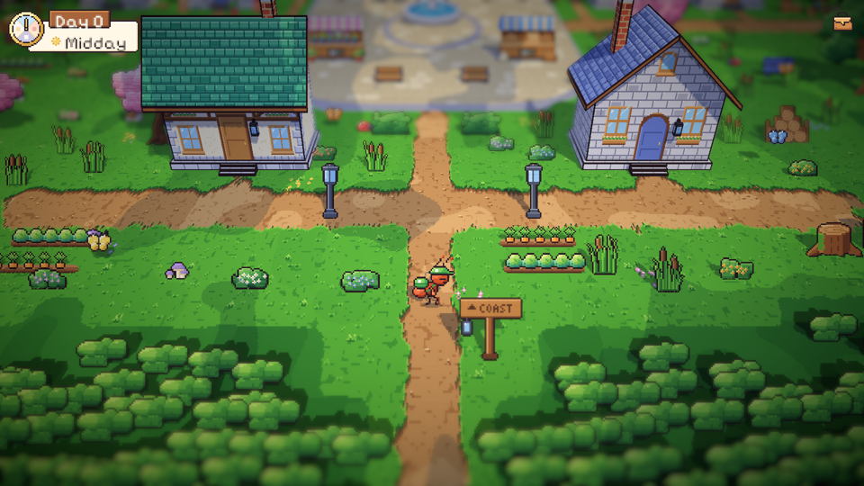

# 35. Warga yang hidup dan halaman yang penuh

**Tanggal:** 2026-10-20

## Tujuan

Praffi menilai gerak dan kegiatan warga masih kaku dan terasa tidak hidup, dan banyak halaman di desa yang masih
kosong. Langkah ini menghidupkan warga di dalam kegiatannya dan mengisi halaman-halaman kosong dengan isi desa,
tanpa menambah rumah pengisi.

## Yang dikerjakan

### Warga (`Villager.cs`, `Ant.cs`)

- **Langkah sendiri-sendiri.** Anak-anak (Pip, Leo, dan anak-anak lain) berjalan lebih cepat, sedangkan Nenek Nora,
  Kapten Bram, Helen, dan Marlow lebih pelan. Warga lain mendapat langkah sedikit berbeda (`Ant.Pace`).
- **Lama berhenti di tiap titik diacak** (75–135% dari waktunya), jadi tidak ada dua warga yang bergerak seirama.
- **Hidup di dalam pose.** Setiap beberapa detik warga melakukan hal kecil sesuai pose dan teman di dekatnya:
  - yang sedang bekerja berhenti sebentar untuk bernapas dan melihat sekeliling, atau bersenandung (not ♪ di atas
    kepala);
  - yang sedang bicara diam sejenak untuk mendengarkan, lalu temannya menjawab, dan kadang mereka tertawa;
  - yang berdiri di dekat orang lain ikut bicara;
  - yang duduk berdua di bangku saling menoleh dan kadang bertukar kata.
- **Teman bicara dicari sendiri** (orang yang berdiri diam dalam jarak 44 px), lalu keduanya saling berhadapan.
  Sebelumnya tetangga di peron terus menatap ke kiri walaupun temannya sudah pergi.
- **Menoleh ke kurir.** Bila kurir lewat dalam jarak 40 px, warga mengangkat kepala dari pekerjaannya dan menoleh,
  kadang dengan not sapaan. Sapaan ini paling cepat terulang 40 detik kemudian.

### Gelembung di dunia (`Hud.cs`, `Talk.cs`)

Gelembung emosi dari dialog sekarang juga bisa muncul di atas kepala siapa saja saat menjelajah (`Hud.Emote`).
Gelembung ini memakai cara muncul dan bergoyang yang sama dengan `Talk.Over`.

### Halaman yang penuh (`areas.js`)

- **Padang rumput.** Setiap halaman terbuka sekarang ditumbuhi rumput tinggi yang bergoyang, bunga liar, dan
  sesekali jamur. Isinya tidak pernah menutupi jalan, lereng, atau benda lain, dan bisa dilewati.
- **Serangga di tanah.** Kepik, siput, dan kumbang yang sudah lama tergambar tapi belum pernah dipakai kini merayap
  bolak-balik di rumput pada siang hari. Jumlah kupu-kupu juga mengikuti luas area.
- **Isi desa di halaman yang kosong:**
  - di alun-alun barat: jemuran kain milik penenun, keranjang, ember di sumur, gerobak kumbang, dan pot bunga di
    depan pintu;
  - di alun-alun timur: pohon apel dan ayunan;
  - di lorong selatan: petak sayur Sam dan penenun, serta tunggul untuk membelah kayu;
  - di halaman pantai: rak ikan, jaring, hasil tangkapan, perahu terbalik yang sedang diperbaiki, bangku, dan pohon
    jeruk.

## Masalah yang ditemui

- Gerobak kumbang pertama kali diletakkan di titik tempat penjual bunga menyiram bunga, sehingga `VillagersTest`
  gagal ("florist cannot walk to the stop"). Gerobaknya dipindah ke tepi barat.
- Ada `Main` ganda dari sisa tes lama di scene yang terbuka, dan ini memunculkan galat null. Scene dibuka ulang dan
  galatnya hilang. Galat ini bukan berasal dari kode baru.
- Masker jalan (`walk.png`) dicek dulu sebelum diubah. Isinya sama persis dengan hasil ekspor, jadi aman diekspor
  ulang dengan `--force`.

## Verifikasi

- Dicoba di permainan:
  - tetangga di peron bergantian bicara dan saling berhadapan;
  - Helen menoleh ke kurir;
  - gelembung muncul di atas kepala;
  - alun-alun, pantai, dan timur dicek pada pagi dan siang.
- Tes PlayMode 5/5 lulus, termasuk `VillagersTest` (setiap warga bisa berjalan ke setiap titiknya).

## Berikutnya

Warga malam hari (malam-malam permainan masih sepi) dan kalimat warga yang bergantian setiap kali disapa.
