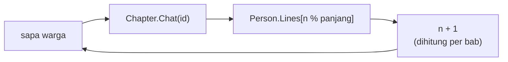
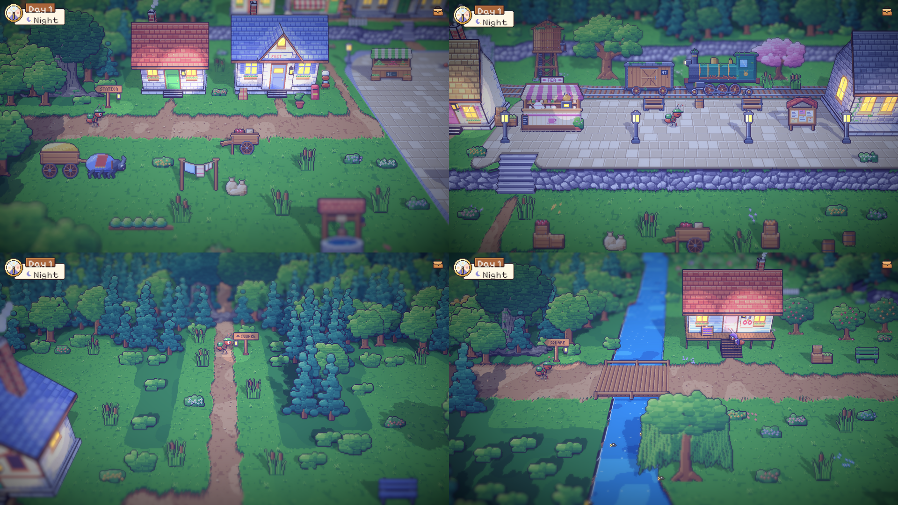

# 36. Kalimat warga yang bergantian, warga malam, dan cutscene untuk adegan penting

**Tanggal:** 2026-10-20

## Tujuan

Melanjutkan pekerjaan dunia yang hidup dari entri 35 dengan tiga perubahan:

- Warga tidak lagi mengulang satu kalimat yang sama setiap kali disapa.
- Malam hari tidak lagi kosong. Kurir justru paling banyak berjalan di malam hari, saat toko Marlow buka.
- Praffi meminta agar setiap adegan penting dijadikan cutscene.

## Yang dikerjakan

### Kalimat yang bergantian (`PlaceDef.cs`, `Chapter.cs`, `Places.cs`)

- `Person.Line` diganti `Person.Lines`. Saat pertama disapa, warga mengucapkan kalimat pertamanya. Setiap kali disapa
  lagi dalam bab yang sama, ia mengucapkan kalimat berikutnya, lalu kembali ke awal.
- Ke-57 warga yang sudah ada mendapat dua kalimat tambahan dengan suara masing-masing. Beberapa contoh:
  - Helen memasukkan gula tanpa ditanya;
  - Kapten Bram mengaku pernah terlambat sekali;
  - Sam menempelkan dua sarung tangan hilang berdampingan "dengan harapan";
  - Nenek Nora bercerita tentang ibu Satria yang dulu duduk di tangga yang sama.
- Hitungan sapaan disimpan per bab, jadi bab baru dimulai lagi dari kalimat pertama.

### Warga malam (`Places.cs`)

Mulai Night 1 (prolog tidak berubah), ada warga yang masih terjaga di malam hari:

- **Stasiun:** Kapten Bram yang tak bisa tidur berjalan di peron antara jam yang mati dan papan jadwal.
- **Alun-alun:** Sam memeriksa lampu satu per satu. Si Tukang Roti mengangkut tepung untuk oven yang dinyalakan pukul
  empat pagi.
- **Timur:** Nenek Nora duduk di beranda. Leo mengawasi jalan jauh dari menara pengintai.
- **Pantai:** Arlo memancing di ujung dermaga.

Setiap malam tetap boleh mengambil warga mana pun untuk ceritanya sendiri.

### Setiap adegan penting sebagai cutscene (`Chapter.cs`, `Prologue.cs`)

- Helper baru `Chapter.Scene(async () => ...)` masuk ke tampilan sinematik (bilah atas-bawah, kamera mendekat),
  menjalankan adegannya, lalu keluar lagi. Tampilan tetap keluar walaupun adegannya gagal.
- Di prolog, adegan besarnya sudah memakai cutscene sejak awal: kedatangan, Valdo, sambutan alun-alun, monolog, dan
  malam pertama. Tiga momen cerita yang tadinya masih di tampilan biasa sekarang juga jadi cutscene:
  - Satria menoleh ke rumahnya ("...Not yet.");
  - gerbang halaman yang berderit;
  - sambutan Theo di jembatan.
- Aturan ini dicatat di `GAME-CONTEXT.md` dan akan dipakai di setiap malam berikutnya. Yang termasuk adegan penting:
  - kedatangan dan pertemuan;
  - pengungkapan;
  - keepsake yang diserahkan atau dibuka;
  - lentera yang padam;
  - pergantian waktu yang ditampilkan cerita;
  - akhir bab.

  Yang tetap di tampilan biasa: melihat benda, kalimat warga sambil lalu, dan petunjuk.

## Verifikasi

- Dicoba di permainan:
  - Night 1 dibuka lewat `Game.StartChapter(1, Night)`;
  - warga malam muncul di stasiun, alun-alun, timur, dan pantai.
- Tes PlayMode 6/6 lulus. Ada satu tes baru, `EveryoneOutdoorsHasSomethingToSay`, yang memastikan setiap warga di
  luar ruangan punya kalimat.
- `ProloguePlaysThrough` tetap lulus dengan tiga cutscene baru.

## Berikutnya

Kit NightChapter (M2): toko Marlow di malam hari, kotak keepsake, lentera yang padam sebagai cutscene, dan helper
Show/Receive. Setelah itu menyusul kerangka minigame dan Night 1.
