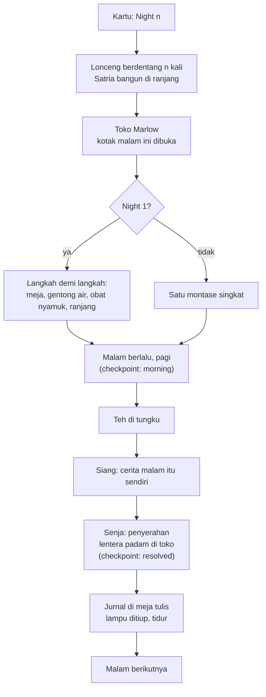
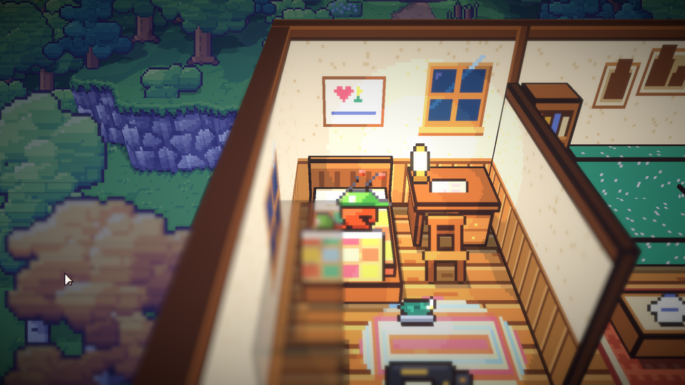
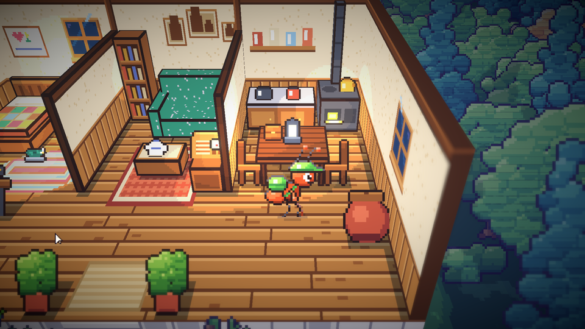
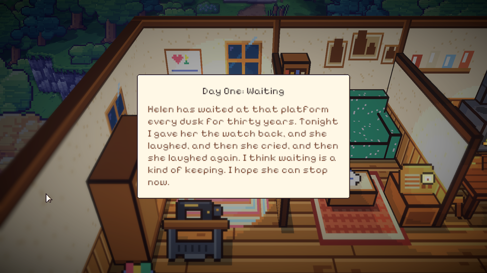

# 37. Rutinitas malam: satu kerangka untuk ketujuh malam

**Tanggal:** 2026-10-20

## Tujuan

Ketujuh malam punya bentuk yang sama: dibangunkan lonceng, ke toko Marlow, pulang dan tidur, pagi, siang,
penyerahan di senja, lalu jurnal sebelum tidur. Bentuk itu dibuat sekali di `NightChapter`, supaya kelas tiap malam
cukup berisi ceritanya sendiri. Sesuai aturan dari Praffi, setiap langkah yang menggerakkan cerita dimainkan sebagai
cutscene.

## Yang dikerjakan

### `NightChapter` (`Chapters/NightChapter.cs`)

- Kelas dasar abstrak. Tiap malam hanya mengisi:
  - nomor malam;
  - judul;
  - keepsake;
  - kata hari itu;
  - halaman jurnal;
  - cerita siangnya (`Day`, `Arrived`), yang memanggil `Handover(...)` saat keepsake diserahkan.
- Rutinitas di rumah:
  - kaki digosok di keset;
  - kotak diletakkan di meja kenari;
  - cuci muka di gentong air;
  - obat nyamuk dinyalakan;
  - tidur.

  Ranjang menolak sampai langkah lainnya selesai, dengan kalimat Satria sendiri.
- Night 1 memainkan setiap langkah sebagai tekanan tersendiri. Malam-malam berikutnya memutarnya sebagai satu
  montase dengan satu kalimat "rumah ini mulai mengenalku".
- Penyimpanan: pagi menyimpan `morning`, penyerahan menyimpan `resolved`. Continue melanjutkan di rumah.
- `LanternGoesOut` sekarang memotong ke toko, menampilkan lentera yang padam, lalu mengembalikan kurir ke tempatnya
  berdiri.

### Seni dan suara (`chars.js`, `inside.js`, `audio.js`)

- Tujuh pose baru untuk kurir: `lie`, `wake`, `write`, `drink`, `crouch`, `strike`, `wash`.
- Pose `lie` dilihat dari kaki ranjang, karena ranjangnya membujur ke belakang: wajah yang tidur di bantal dan selimut
  perca Ibu ditarik sampai dagu. Versi pertama (badan dibaringkan menyamping) terlalu panjang untuk ranjang, jadi
  digambar ulang.
- Obat nyamuk menyala (`coil_lit`) dan kotak keepsake di meja (`box_on_table_*`) mengikuti cerita lewat
  `Place.FollowStory()`.
- Tujuh efek suara baru:
  - `bell_toll` (lonceng besar);
  - `match`;
  - `hiss`;
  - `scrub`;
  - `pour`;
  - `kettle`;
  - `pen`.
- Motif musik sekarang 1-0-1-7, dan jam di layar judul menunjuk 10:17.

### Jurnal (`UI/Journal.cs`)

- Halaman kertas di atas ruangan yang diredupkan. Judulnya "Day One: Waiting".
- Teks tertulis huruf demi huruf diiringi goresan pena.
- Klik pertama menyelesaikan tulisan, klik berikutnya menutup jurnal.

### Rumah Satria (`Places.cs`)

- Hotspot baru, hanya di Night 1–7: meja, obat nyamuk, meja tulis, tungku.
- Foto, radio, mesin jahit, gentong air, dan ranjang sekarang ada di setiap bab. Prolog tetap memakai teks Day 0-nya
  sendiri.

## Masalah yang ditemukan

- Spawn `door` yang baru berada di dalam area pintu keluar, sehingga kurir langsung terlempar keluar lagi dan tes
  prolog macet. Spawn itu dihapus; anchor `door` dari ekspor tetap dipakai.
- Titik berdiri meja tulis dan tungku ada di luar lantai yang bisa dilalui, jadi dipindah ke lantai di depannya.
- `Main.Go` memanggil `Story.Wrap()` setelah bab berakhir, saat `Story` sudah kosong. Sekarang memakai `Story?.Wrap()`.

## Verifikasi

- Tes baru `RoutineTest` memainkan satu malam penuh tanpa pemain, dari lonceng sampai jurnal:
  - `FirstNightStepByStep`: langkah demi langkah, termasuk ranjang yang menolak lebih dulu;
  - `LaterNightsAsOneMontage`: versi montase.

  Keduanya memeriksa:
  - checkpoint pagi;
  - lentera yang padam;
  - kurir yang kembali ke stasiun;
  - bab berikutnya yang tersimpan.
- Tes PlayMode 8/8 lulus.
- Dicoba di permainan: tidur di ranjang, obat nyamuk menyala, kotak di meja, dan halaman jurnal.

## Berikutnya

Kerangka minigame (M3), lalu Night 1 di atas `NightChapter`.
