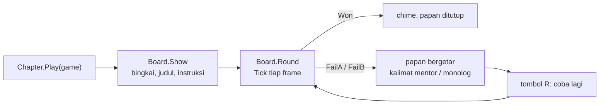
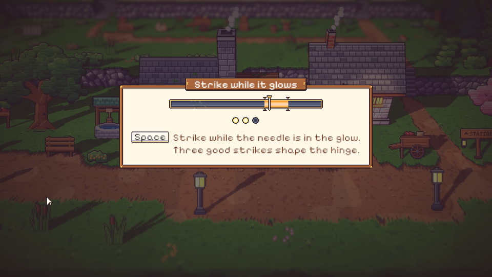
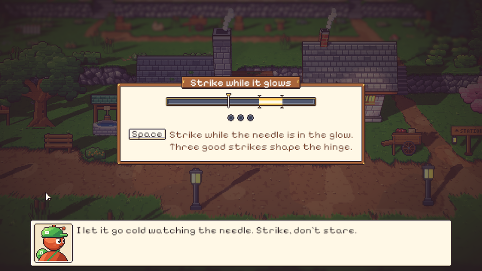
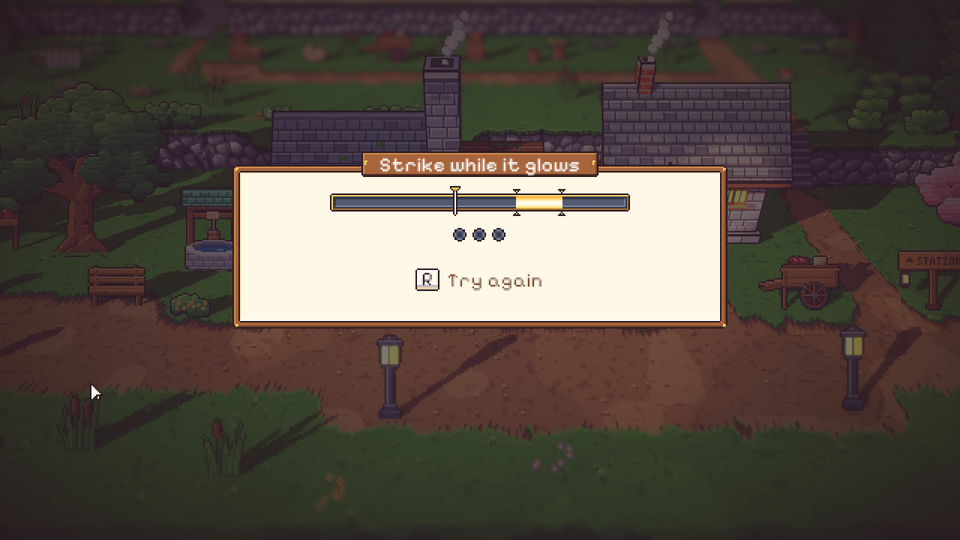

# 38. Papan minigame: satu kerangka untuk keempat belas minigame

**Tanggal:** 2026-10-20

## Tujuan

Naskah punya 14 minigame, dan semuanya mengikuti aturan yang sama: tidak pernah kalah. Setiap gagal punya kalimat
mentornya sendiri (atau monolog Satria), lalu langsung coba lagi tanpa penalti. Kerangka itu dibuat sekali di sini
(M3), supaya setiap malam tinggal membuat permainannya sendiri.

Di tengah pengerjaan, Praffi menilai tampilan papannya masih "sangat polos dan sederhana", jadi papannya dipoles
dengan seni piksel sendiri.

## Yang dikerjakan

### Kerangka (`UI/Minigame.cs`, `UI/Board.cs`, `Core/Chapter.cs`)

- `Minigame` adalah kelas dasar abstrak. Setiap minigame mengisi:
  - judul;
  - instruksi berupa pasangan (tombol, teks);
  - kalimat untuk `FailA` dan `FailB`;
  - ukuran area;
  - `Build`, `Reset`, `Tick`, dan `Solve`.
- `Board` adalah layarnya:
  - dibuat sebelum kotak dialog, jadi kalimat gagal tampil di atas papan;
  - selama papan terbuka, tas dan jeda tidak bisa dibuka.
- `Chapter.Play(game)` mengulang ronde sampai menang. Setiap gagal memutar kalimatnya, lalu menunggu tombol R.
- Untuk tes, `Main.Auto` langsung memanggil `Solve`. `Board.FailFirst` bisa memaksa beberapa kali gagal dulu.

### Poles tampilan (`export-cast.js`)

Potongan UI baru, semuanya digambar dalam kode:

- `bench`: bingkai meja kerja dari kayu dengan paku keling kuningan di keempat sudut, kertas di dalamnya.
- `plate`: papan nama kayu yang dipaku, untuk judul minigame.
- `gauge` dan `glow`: meteran besi berbingkai kuningan. Zona tepatnya menyala seperti besi panas dan berdenyut pelan.
- `notch`: takik kuningan di atas dan bawah ujung zona tepat, supaya tetap terbaca tanpa bergantung pada warna.
- `needle`: jarum berkepala kuningan, jelas berbeda dari takiknya.
- `pip`: soket besi untuk langkah yang belum selesai. Soket itu menyala dan "meletup" saat langkahnya selesai.
- `key`: tutup tombol untuk Space, R, dan tombol lain yang disebut instruksi.

Gerak kecil yang ditambahkan:

- percikan api saat pukulan tepat;
- papan bergetar saat gagal.

### Contoh di systems test (`DevChapter.cs`)

Mender di stasiun saat senja sekarang punya minigame "Strike while it glows": tekan Space saat jarum di zona yang
menyala, tiga kali.

- Gagal A, karena salah waktu: Mender menegur.
- Gagal B, karena terlalu lama menunggu sampai besinya dingin: Satria bermonolog.

## Masalah yang ditemukan

- Tepi dalam meteran tergores melebar karena bevel-nya jatuh di bagian 9-slice yang direntang. Margin dinaikkan dari 3
  ke 4.
- Kalimat pembuka Mender masih terbuka di atas papan. `Play` sekarang menutup kotak dialog lebih dulu.

## Ditunda (YAGNI)

Hal berikut dibuat bersama minigame pertama yang membutuhkannya:

- widget ketukan, kenop, dan timer matahari terbenam;
- status keepsake (gosong, bersih, pulih);
- seni khusus tiap minigame.

## Verifikasi

- Tes baru `MinigameTest.FailThenRetryThenWin` menjalankan satu putaran gagal, coba lagi, lalu menang. Tes ini juga
  memastikan kontrol dunia (dan tasnya) tertahan selama papan terbuka.
- Tes PlayMode 9/9 lulus.
- Dicoba di permainan: papan, pukulan tepat, gagal B dengan monolog, dan tombol R.

## Berikutnya

Perbaikan seni M5 (termasuk jam saku yang digambar ulang di 10:17), lalu Night 1.
