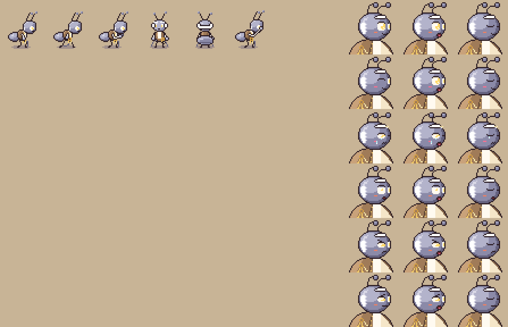
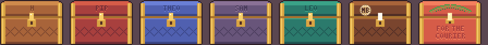
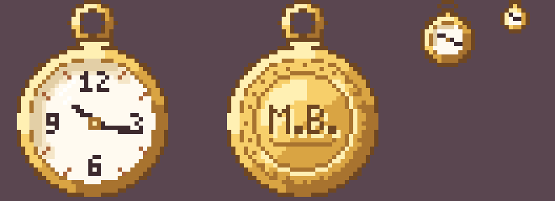
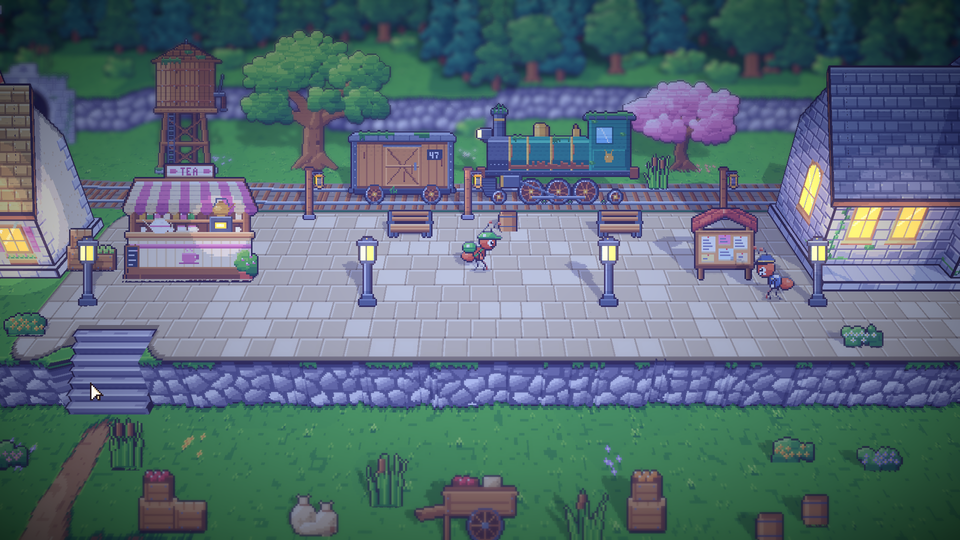
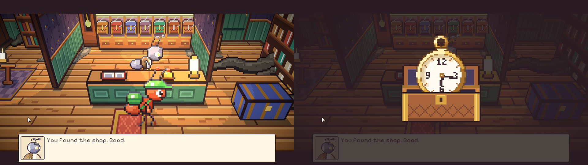

# 39. Perbaikan seni bersama: Marlow, tutup kotak, jam 10:17, dan lentera peron

**Tanggal:** 2026-10-20

## Tujuan

Sebelum malam-malam memakainya, seni yang dipakai bersama oleh setiap malam dibersihkan dari sisa cerita lama dan
dilengkapi (M5).

## Yang dikerjakan

### Marlow (`chars.js`)

- Marlow sekarang seperti di naskah:
  - semut tua berwarna abu-abu;
  - rompi cokelat yang sudah usang;
  - seikat kunci kuningan di pinggang;
  - alis dan rambut putih;
  - mata yang menyala samar berwarna kuning tembaga.
- Monokel, dasi kupu-kupu, rantai jam, dan kumis dibuang.
- Warna abu-abu dibuat dengan *palette swap* pada frame yang sudah jadi (`BODIES.grey`). Warna tubuh semut merah
  ditukar ke rampa batu, dan pupil ditukar ke cahaya kuning. Satu baris `body: 'grey'` di data karakter sudah cukup,
  dan cara ini berlaku untuk sprite maupun potret.

### Tutup kotak (`inside.js`)

- Setiap kotak diukir untuk malamnya:
  - H, PIP, THEO, SAM, LEO;
  - segel kulit rusa M.B. (Marcus Bell) di kotak keenam;
  - pelepah kelapa di atas tulisan FOR THE COURIER di kotak ketujuh.
- Ukiran ini hanya terlihat dari dekat saat kotak dibuka. Kotak kecil di lemari Marlow tetap polos, jadi malamnya tetap
  rahasia.
- Hurufnya dibuat dengan font piksel 3×5: bagian yang terpotong gelap, dan bibir bawahnya menangkap cahaya.

### Jam saku (`interiors.js`)

- Jarumnya sekarang di 10:17, jam ketika jam itu berhenti, di ketiga ukuran.
- Bagian belakangnya diukir M.B. untuk Marcus Bell, menggantikan A.T. dari cerita lama.

### Lentera peron (`village-centre.js`, `areas.js`, `Place.cs`)

- Tiga lentera minyak tua di tiang kayu berdiri di sepanjang peron. Semuanya gelap sejak badai.
- Kaca lentera menyala hanya jika ceritanya menyalakannya (`lantern_post_<i>`).
- Mulai Night 2, Helen menjaga lentera di dekat bangkunya tetap menyala.

### Pose (`chars.js`)

- Pose memberi dan menerima: Baker, Arlo, Mender, Gardener, Pip.
- Pose duduk: Nora, Pip, Leo, Theo, Kapten Bram, Valdo.
- Pose terharu: Pip, Theo, Sam, Leo, Nora, Mender.

## Verifikasi

- Ekspor `cast`, `rooms`, dan `areas` berjalan bersih.
- Tes PlayMode 9/9 lulus, termasuk tes yang memakai peta jalan stasiun yang baru.
- Dicoba di permainan:
  - Marlow di tokonya pada malam hari;
  - kotak 0 dibuka dari dekat;
  - peron dengan lentera yang menyala dan yang padam.

## Ditunda

Ekspor `toyshop` dan `doll` lama baru dihentikan setelah penggantinya ada.

## Berikutnya

Interior toko roti dan bengkel Mender (M6), lalu Night 1.
