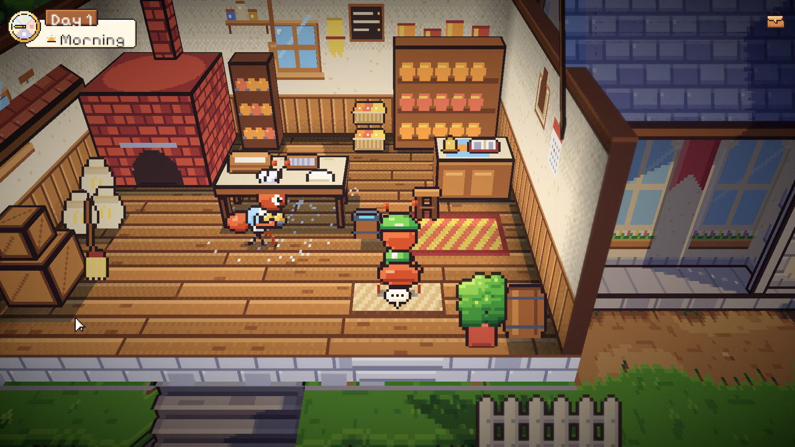
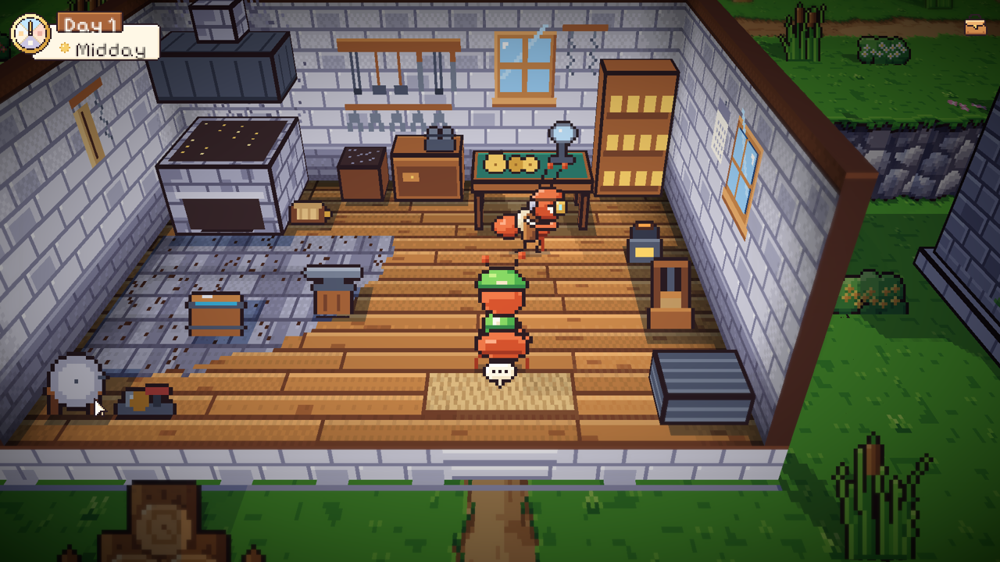
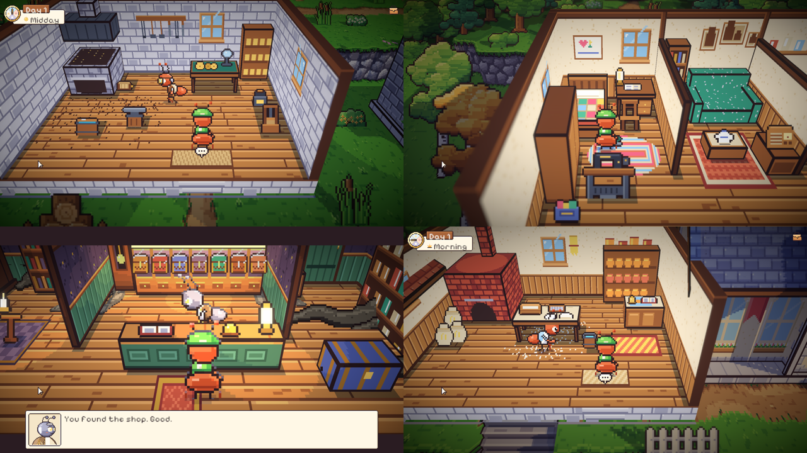
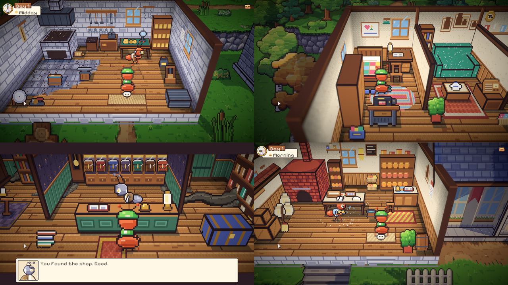
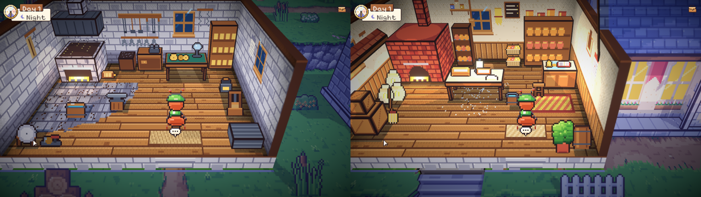

# 40. Toko roti, bengkel Mender, dan ruangan yang lebih hidup

**Tanggal:** 2026-10-20

## Tujuan

Night 1 butuh dua ruangan yang belum ada: toko roti Baker untuk minigame 1A dan bengkel Mender untuk minigame 1B (M6).
Saat dicoba, Praffi melihat dua masalah lagi:

- ada benda yang menembus dinding bengkel;
- semua ruangan, bukan hanya yang baru, masih terlihat kosong dan datar.

Keduanya ikut dibereskan di langkah ini.

## Yang dikerjakan

### Toko roti (`inside.js`, `Places.cs`)

- Ruangan terpotong di dalam rumah toko roti di alun-alun. Pintunya ada di jangkar `bakery_door`.
- Isinya:
  - oven kubah bata dengan bara yang selalu terlihat, dan api yang menyala saat senja dan malam;
  - karung tepung dan tong tepung;
  - meja adonan dengan baskom cemara, ayakan, adonan, dan ember cuci;
  - rak roti, konter dengan kotak kaca roti manis, buku resep, dan bel;
  - rak pendingin roti, keranjang roti, rak toples, sekop roti, papan menu kapur, panci tembaga, kalender, krat,
    sapu, bangku kecil, dan pot tanaman.
- Pagi hari, Baker bekerja di dalam:
  - menguleni adonan di meja (pose baru `knead`);
  - mengambil loyang dari oven;
  - menata roti di rak.

  Rutinitas paginya yang dulu, membawa nampan ke lapak di alun-alun, diganti dengan ini.

### Bengkel Mender

- Ruangan terpotong di bengkel dekat rel. Dindingnya batu, dengan alas batu gelap dan jelaga di atas tungku.
- Isinya:
  - tungku batu dengan bara, tudung besi, cerobong, dan ububan;
  - bak celup;
  - landasan dari potongan rel lama di atas tunggul;
  - lantai batu di sekitar tungku dan landasan;
  - rak perkakas, ladam kuda, dan rantai di dinding;
  - peti arang dan meja kerja dengan ragum;
  - meja gir berlapis kain hijau dengan lensa kalibrasi;
  - rak suku cadang dengan pelat kuningan BELLWOOD 1952;
  - pemanas getah damar dan alat pres sepatu kayu;
  - batu asah, tumpukan besi tua, dan potongan rel;
  - kalender di dinding.
- Mender ada di dalam pada siang hari di malam-malam yang ceritanya membawanya bekerja (Night 1 dan 5):
  - mengutak-atik gir (pose baru `tinker`);
  - menatap api;
  - memukul di landasan.

  Di hari lain, dia tetap di lokomotif tua di peron.

### Pintu dan teks benda

- Pintu toko roti di alun-alun dan pintu bengkel di stasiun baru ada mulai Night 1. Di Day 0 keduanya tidak ada, jadi
  Prolog tidak berubah.
- `Hotspot.Text` adalah teks untuk benda yang bisa diperiksa. Teks ini dipakai `Chat` kalau bab tidak punya kalimat
  sendiri untuk benda itu. Setiap benda di kedua ruangan punya teksnya.

### Benda yang menembus dinding

- Gundukan rumput tanggul di belakang bengkel tampak menembus dinding belakang.
- Sebabnya: dinding ruangan condong ke belakang menghadap kamera, sedangkan tanggul berdiri tegak tepat di
  belakangnya.
- Perbaikannya ada di pembuat ruangan, jadi berlaku untuk semua ruangan: tanah yang lebih tinggi tepat di belakang
  dinding belakang diratakan setinggi lantai. Tanah itu sendiri tertutup dinding.

### Ruangan yang lebih hidup (semua ruangan)

- **Cahaya**, dihitung sekali di pembuat ruangan sehingga semua ruangan mendapatkannya:
  - lantai menggelap ke arah dinding dan sudut, dan sedikit ke arah belakang;
  - setiap papan lantai punya nadanya sendiri;
  - sinar matahari dari jendela dinding belakang jatuh miring di lantai;
  - dinding menggelap ke arah langit-langit, lantai, dan sudut.

  Gradasinya dibuat bertingkat dengan matriks Bayer, jadi tetap tajam seperti pixel art.
- **Perabot kecil.** Ada kit bersama `PROPS`:
  - krat, tong, karung, keranjang (roti, benang, sayur), bangku, sapu, dan pot tanaman;
  - untuk dinding: rak toples, panci gantung, kalender, dan gantungan.
- Isi baru di setiap ruangan:
  - **Rumah Satria:** sandal di dekat ranjang, topi Ayah di gantungan, jam dinding, keranjang benang Ibu, palem di
    sekat ruangan, sendok sayur dan celemek di dapur, panci, karung beras, dan kayu bakar.
  - **Toko Marlow:** meja barang antik dengan kompas, lensa kuningan, kamera hitam, gulungan benang perca, dan sepatu
    bot tua (benda-benda dari naskah); bola dunia, tempat payung, dan tumpukan buku.
- Lampu gantung sempat dicoba, lalu dibuang: ruangan terpotong tidak punya langit-langit, jadi lampunya tampak
  melayang.

## Verifikasi

- Ekspor `areas` dan `cast` bersih. Setiap jangkar di semua ruangan bisa dijangkau dari pintu (pemeriksaan walk mask
  saat ekspor).
- Setiap tempat berdiri untuk hotspot di semua ruangan dalam bisa dicapai dari pintu (dicek di editor).
- Tes PlayMode 9/9 lulus. `VillagersTest` mencakup Baker dan Mender di dalam ruangan.
- Dicoba di permainan:
  - masuk ke toko roti dari alun-alun di pagi hari, dan ke bengkel dari stasiun di siang hari;
  - kedua ruangan di malam hari;
  - rumah Satria dan toko Marlow setelah perubahan cahaya dan perabot.

## Berikutnya

Night 1, The Stopped Watch (M7): investigasi pagi, minigame 1A di meja adonan, minyak damar Arlo, minigame 1B di meja
gir, lentera peron, dan serah terima ke Helen.
