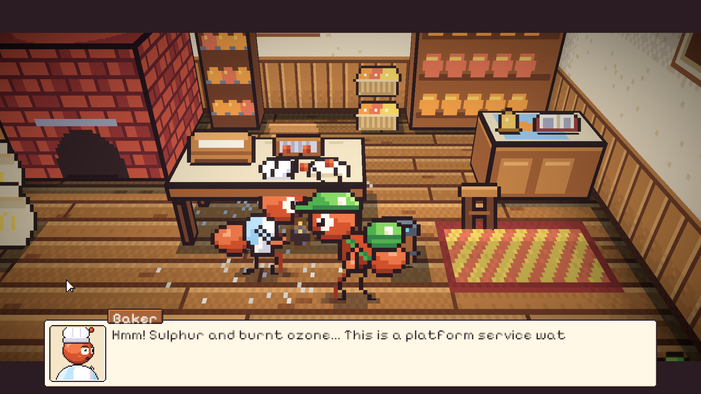
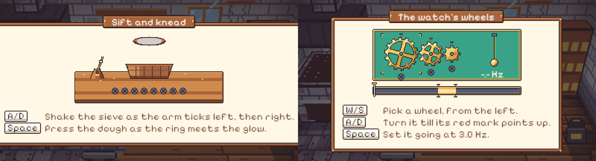
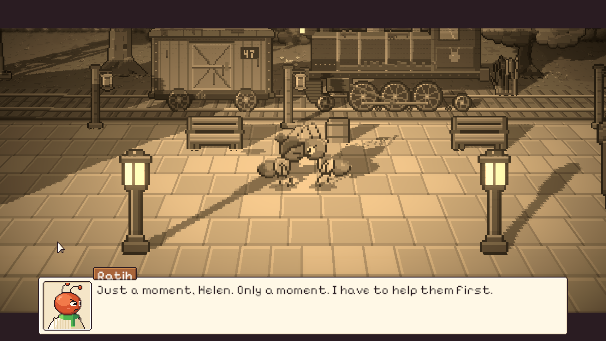

# 41. Malam pertama: Jam Saku yang Berhenti

**Tanggal:** 2026-10-20

## Tujuan

Membangun Night 1 (M7) dari lonceng tengah malam sampai jurnal sebelum tidur, sesuai naskah. Keputusan yang sudah
ada tetap berlaku:

- serah terima terjadi saat senja;
- kekasih Helen adalah Marcus, bukan Arthur;
- semua teks dalam bahasa Inggris;
- setiap adegan penting dimainkan sebagai cutscene.

## Yang dikerjakan

### Alur Night 1 (`Chapters/Night1.cs`)

Night 1 dibangun di atas `NightChapter`. Kelasnya hanya berisi cerita malam ini.

- **Toko Marlow.** "You're twelve minutes late." Marlow menyebut namanya, menjelaskan aturan tujuh malam ("There is
  no eighth"), lalu menyerahkan kotak berukir H.
- **Keluar dari toko.** Monolog Satria di hutan beringin: apakah tadi nyata, dan tidak boleh ada yang tahu.
- **Pagi di alun-alun.** Gosip rel yang bergetar sendiri terdengar. Valdo (agen properti di naskah) duduk di bangku
  pohon ek dengan kopinya dan mencemooh jam itu sebagai rongsokan. Mia menyarankan bertanya ke Baker.
- **Toko roti.** Baker mengenali jam dinas peron dari baunya. Dia minta dibantu dulu (minigame 1A), lalu memberi roti
  manis untuk ditukar. Waktu bergeser ke siang.
- **Dermaga.** Arlo menukar roti dengan sebotol minyak damar.
- **Bengkel Mender.**
  - Minyak damar mengangkat jelaga dan inisial M.B. terlihat.
  - Gir jam disetel (minigame 1B), lalu jam berdetak lagi dan tutup belakangnya terbuka: "For Helen. Don't wait for
    me at the station if the storm won't ease. M."
  - Mender menyebut nama Helen dan meminjamkan lentera minyak. Waktu bergeser ke senja.
- **Peron saat senja.**
  - Satria menyalakan tiga lentera peron, lalu duduk di samping Helen di bangkunya dan menyerahkan jam.
  - Helen bercerita tentang malam badai 1952.
  - Kenangan "Just a moment, Helen" dimainkan dalam warna sepia.
  - Helen berkata dia akhirnya bisa berhenti menunggu. Cahaya berganti malam dan satu lentera di toko Marlow padam.
- **Malam.** Halaman jurnal "Day One: Waiting", lampu dipadamkan, lalu tidur.

Pemain mendapat pesan untuk setiap orang yang salah ditanya atau yang ditanya terlalu awal:

- Arlo tanpa roti;
- Mender tanpa minyak;
- Helen sebelum lentera menyala.

Hari ini disimpan di dua checkpoint baru, siang dan senja (`ResumeDay`).

### Jam yang berubah di tas (`Keepsakes.cs`, `interiors.js`)

Jam punya tiga keadaan. Masing-masing menggantikan yang sebelumnya di posisi yang sama di tas:

| Keadaan | Bagian belakang |
|---|---|
| `watch` | hitam hangus |
| `watch_clean` | bersih, dengan ukiran M.B. |
| `watch_ticking` | berdetak, tutupnya terbuka dan ukirannya terbaca |

Ada juga tiga benda baru:

- roti manis;
- botol minyak damar;
- lentera minyak.

### Minigame 1A: Mengayak dan Menguleni (`Minigames/BakerKnead.cs`)

- **Mengayak.** A dan D mengikuti metronom kuningan 75 BPM: A saat lengannya berdetak ke kiri, D saat ke kanan.
  - Setiap ayakan yang tepat menjatuhkan tepung ke baskom cemara, yang makin penuh. Delapan ayakan dibutuhkan.
  - Tombol yang salah, ayakan di luar ketukan, atau dua ayakan dalam satu ketukan membuat tepung tumpah (gagal A).
    Baker tertawa dan menyuruh mengulang dari ayakan pertama.
- **Menguleni.** Spasi ditekan saat lingkaran yang menyempit bertemu lingkaran yang menyala, lima kali.
  - Meleset berarti gagal B: monolog Satria tentang tangannya yang terlalu kaku.
  - Gagal di tahap ini tidak mengulang ayakan: tepungnya tetap di baskom.

### Minigame 1B: Kalibrasi Gir (`Minigames/ClockworkAlign.cs`)

- Tiga gir kuningan di atas kain hijau meja gir Mender: gir utama, gir perantara, dan gir escapement.
  - W/S memilih gir, ditandai siku kuningan.
  - A/D memutarnya sampai tanda merahnya menunjuk ke panah.
  - Gir harus dipasang berurutan dari kiri. Memutar gir sebelum gir di kirinya terpasang membuatnya selip (gagal A,
    bunyi TINGGG). Mender lalu menenangkan Satria.
- Setelah ketiganya terpasang, pendulum berayun. Angka frekuensinya naik turun di meteran.
  - Spasi harus ditekan saat jarum berada di pita 3,0 Hz.
  - Di luar pita itu gagal B: jam ini sudah diam dua puluh tahun.

### Kenangan sepia (`Chapter.Memory`, `Place.Bring`, `Pixel.shader`)

- Kenangan 1952 dimainkan di tempat kejadiannya sendiri, sesuai keputusan cutscene. Di balik tirai krem:
  - seluruh dunia berubah sepia lewat global `_Sepia` di shader, termasuk cahaya lampu;
  - musik berganti ke musik kenangan;
  - semua orang masa kini disembunyikan.
- Orang-orang dalam kenangan dihadirkan dengan `Bring`: Helen muda (palet rambut cokelat) dan Ratih.
- Setelah kenangan selesai, semuanya kembali seperti semula.

### Suara baru (`audio.js`)

| Suara | Bunyi |
|---|---|
| `sift` | ayakan |
| `thump` | adonan ditekan |
| `click` | gigi gir |
| `ting` | pegas lepas |
| `ticktock` | jam hidup lagi |
| `oil` | minyak digosok |
| `flare` | sumbu lentera menyala |
| `whistle` | peluit uap 1952 |
| `rain` | hujan badai |

### Lain-lain

- Nama semua warga desa sekarang dikenal di setiap malam (`KnowVillage`), tidak hanya di prolog. Arlo, Mender, dan
  Kapten Bram ikut ditambahkan.
- Prolog kini berlanjut langsung ke Night 1.
- Systems test tetap menjadi opsi editor untuk tes. Di akhir, systems test kembali ke judul, tidak lagi menyimpan
  Night 1.

## Validasi

- Tes PlayMode baru `NightsTest.Night1PlaysThrough` memainkan Night 1 dari lonceng sampai tidur tanpa pemain. Setiap
  minigame gagal sekali dulu, lalu menang. Tes ini memeriksa:
  - roti ditukar dengan minyak;
  - jam berdetak dan ada di tas bersama lentera;
  - checkpoint senja;
  - Helen menerima jam;
  - malam berikutnya tersimpan.
- `PlaythroughTest` diperbarui: prolog sekarang berlanjut ke Night 1, dan bagian belakang jam yang dilihat adalah
  bagian yang hangus.
- Semua tes PlayMode lulus.
- Dicoba langsung di editor:
  - papan kedua minigame;
  - adegan di toko roti;
  - tiga lentera di peron;
  - serah terima dengan kenangan sepia sampai lentera di toko Marlow padam.
