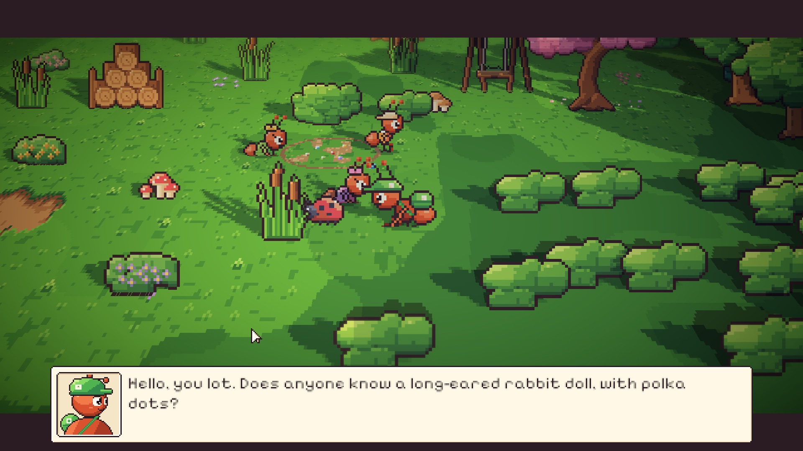
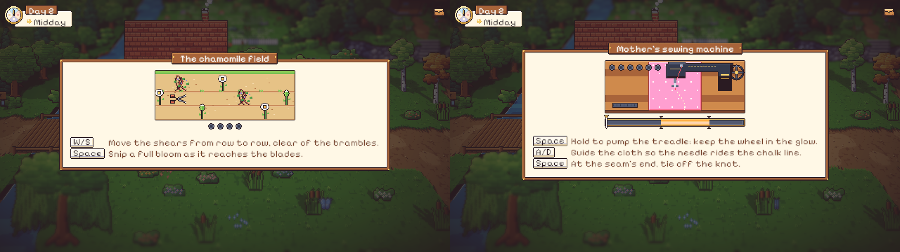
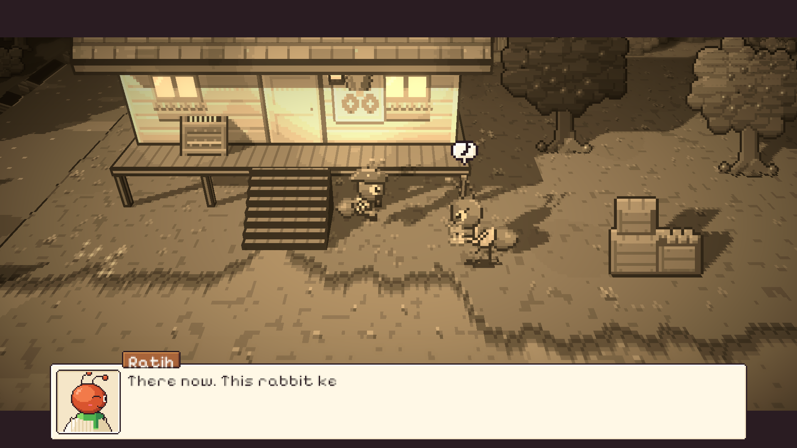
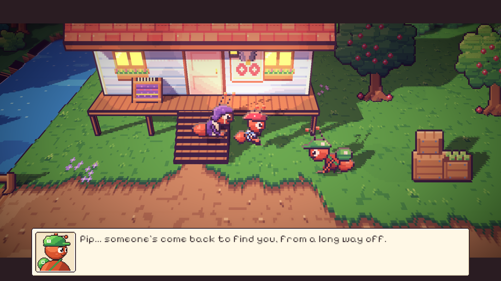

# 42. Malam kedua: Kelinci yang Dijahit

**Tanggal:** 2026-10-20

## Tujuan

Membangun Night 2 (M8) dari lonceng tengah malam sampai jurnal sebelum tidur, sesuai naskah. Keepsake malam ini
adalah Mochi, boneka kelinci Pip yang telinganya robek dan matanya hilang. Keputusan yang sudah ada tetap berlaku:

- serah terima terjadi saat senja;
- semua teks dalam bahasa Inggris;
- setiap adegan penting dimainkan sebagai cutscene;
- kenangan dimainkan di tempat kejadiannya, dalam sepia.

Garis waktu Pip dicatat di `GAME-CONTEXT.md`:

- angin puting beliung sepuluh tahun lalu;
- boneka-boneka jahitan Ratih di tenda darurat;
- Mochi hilang terbawa banjir lumpur dua tahun lalu.

## Yang dikerjakan

### Alur Night 2 (`Chapters/Night2.cs`)

- **Toko Marlow.** Kotak kedua dibuka, dan Marlow bicara tentang rasa takut yang belum sembuh (`Opened`).
- **Hutan beringin.** Monolog Satria yang mulai ragu.
- **Pagi di alun-alun.**
  - Pembeli dan penjual bunga bergosip.
  - Valdo mencemooh: kemarin jam rongsokan, hari ini boneka, padahal investor pabrik gula datang lusa.
  - Tiga anak (Gigi, Kiko, Lulu) berjongkok di lingkaran kelereng. Satria ikut berjongkok di samping mereka dan
    bertanya tentang kelinci berbintik.
  - Mia mengenali Mochi. Waktu bergeser ke siang.
- **Siang di timur.**
  - Pip duduk di tangga rumah Nora dan menolak melihat kelinci yang masih robek.
  - Nora memberi benang merah milik Ratih, lalu kancing jati dari pagar kapal feri lama.
  - Gardener minta dibantu memanen chamomile (minigame 2A), lalu memberi bunganya.
- **Rumah.**
  - Di mesin jahit ibu, telinga Mochi dijahit kembali (minigame 2B).
  - Mochi disemprot air chamomile, lalu lagu nina bobo ibu teringat lagi. Waktu bergeser ke senja.
- **Senja di tangga Nora.**
  - Satria berjongkok setinggi mata Pip dan menyerahkan Mochi.
  - Nora bercerita tentang Ratih yang tiga malam tidak tidur menjahit boneka di tenda darurat.
  - Kenangan dimainkan dalam sepia: Pip kecil di tangga, Ratih datang di tengah hujan dan memberinya Mochi ("His name
    is Mochi").
  - Satria dan Nora menutup adegan dengan baris tentang batu sungai. Satu lentera lagi padam di toko Marlow.
- **Malam.** Halaman jurnal "Caring", lampu dipadamkan, lalu tidur.

Pemain mendapat pesan untuk setiap urutan yang salah:

- menjahit tanpa bahan yang lengkap;
- memberi Pip kelinci yang masih robek.

Hari ini disimpan di checkpoint siang dan senja.

### Bagian bersama di `NightChapter`

- `Meet`, `Trade`, `Swap`, dan posisi `Beside` dipindah dari Night 1 ke `NightChapter`, supaya dipakai semua malam.
- `Receive(item)` baru: pose menerima, bunyi pop, lalu benda masuk ke tas. Serah terima di Night 1 juga memakainya.
- Kegiatan di rumah dipisah. `Routine` berisi langkah malam dan pagi. `AtHome` berisi teks untuk meja, kompor,
  foto, radio, mesin jahit, dan lainnya. Di siang hari, perabot rumah menampilkan teksnya, bukan obrolan kosong.

### Benda baru (`interiors.js`, `Keepsakes.cs`)

| Benda | Keterangan |
|---|---|
| `rabbit` | Mochi robek: telinga terkulai dengan isian keluar, lubang mata berjumbai, berdebu |
| `rabbit_mended` | jahitan silang merah di telinga, mata kancing kayu, hati merah di punggung, ekor kapas |
| `chamomile` | seikat bunga chamomile |
| `red_thread` | gulungan benang merah dengan jarum |
| `button` | kancing jati |

Lingkaran kelereng di alun-alun (`village-nature.js`) hanya muncul di Night 2. Garisnya putus-putus dan rumputnya
terkikis di beberapa tempat, jadi terlihat seperti tanah bekas main, bukan lubang.

### Minigame 2A: Ladang Chamomile (`Minigames/ChamomileHarvest.cs`)

- Tiga baris tanaman bergerak melewati gunting kecil Gardener. W/S memindah gunting antar baris, Spasi menggunting
  bunga yang mekar penuh tepat di bilahnya. Empat bunga dibutuhkan.
- Gunting yang tersangkut semak berduri adalah gagal A. Gardener memberi daun sirih untuk getahnya dan menyuruh
  pelan-pelan.
- Menggunting kuncup atau tempat kosong adalah gagal B: akarnya ikut tercabut.
- Bunga yang sudah dipetik tetap di keranjang setelah gagal.

### Minigame 2B: Mesin Jahit Ibu (`Minigames/TreadleStitch.cs`)

- Spasi ditahan untuk memompa pedal, dan roda gila makin cepat. Kecepatannya harus dijaga di pita yang menyala.
  Terlalu cepat membuat jarum menghantam pelat dan benang kusut (gagal A, bunyi TRRAK).
- A/D menggeser kain supaya jarum mengikuti garis kapur telinga. Terlalu lama keluar garis membuat jahitannya
  melenceng (gagal B).
- Jahitan merah tertinggal di belakang jarum, persis di tempat jarum turun.
- Di ujung jahitan, Spasi mengikat simpulnya.

`Controls.Holding` baru dibuat untuk Spasi atau Enter yang ditahan. Tombol aksi di kedua minigame adalah Spasi,
karena E membuka tas.

### Suara baru (`audio.js`)

| Suara | Bunyi |
|---|---|
| `clink` | kelereng beradu |
| `snip` | gunting |
| `rustle` | semak berduri |
| `whir` | roda mesin jahit |
| `trrak` | jarum menghantam pelat |
| `knot` | simpul diikat |
| `spray` | air chamomile disemprot |
| `lullaby` | satu frasa nina bobo ibu |

### Perbaikan

- **Satria menembus semak.** Saat bertanya ke tiga anak, Satria berdiri di dalam pagar semak di belakang Kiko. Kiko
  sekarang di tepi lingkaran yang terbuka, dan Satria berjalan ke rumput kosong di samping Lulu.
- **Nora menghilang saat serah terima.** Setiap orang yang diambil ke dalam adegan berganti ke pose berdiri
  (`Villager.Cue`). Nora yang duduk di tangga berdiri di tempat duduknya dan tertutup dek. Sekarang orang yang duduk
  tetap duduk, sama seperti saat diajak bicara.
- **Pip tertutup.** Satria dan Ratih berdiri terlalu dekat di depan Pip, sehingga Pip dan Mochi tertutup.
  Tempat mereka digeser lebih jauh.
- Bab yang selesai sekarang langsung berlanjut ke bab berikutnya. Tes menunggu cerita benar-benar berganti, bukan hanya
  simpanannya.

## Validasi

- Tes PlayMode baru `NightsTest.Night2PlaysThrough` memainkan Night 2 tanpa pemain:
  - Valdo, Kiko, dan Mia di alun-alun;
  - Pip menolak kelinci yang robek;
  - Nora memberi benang dan kancing;
  - panen chamomile, gagal sekali dulu lalu menang;
  - menjahit, gagal sekali dulu lalu menang;
  - Pip menerima Mochi;
  - dua lentera sudah padam.
- `VillagersTest.EveryoneCanBeReached` memastikan setiap warga Night 2 bisa didekati.
- Semua tes PlayMode lulus (11/11).
- Dicoba langsung di editor:
  - adegan tiga anak di lingkaran kelereng;
  - papan kedua minigame;
  - serah terima saat senja dengan Nora tetap duduk;
  - kenangan sepia sampai lentera di toko Marlow padam.
