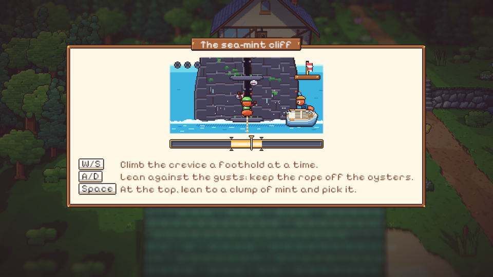
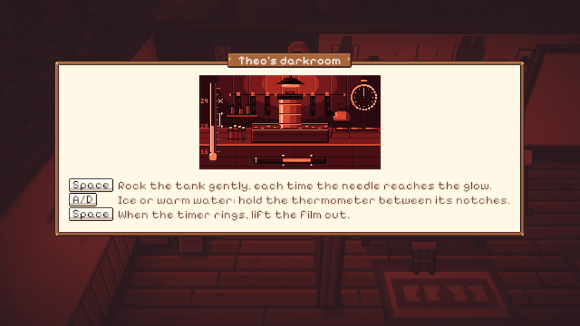
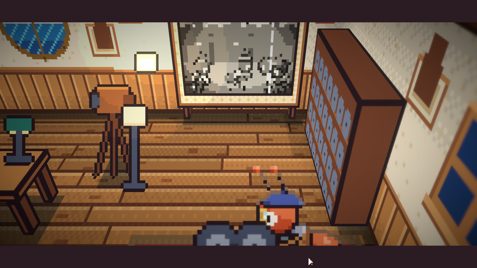
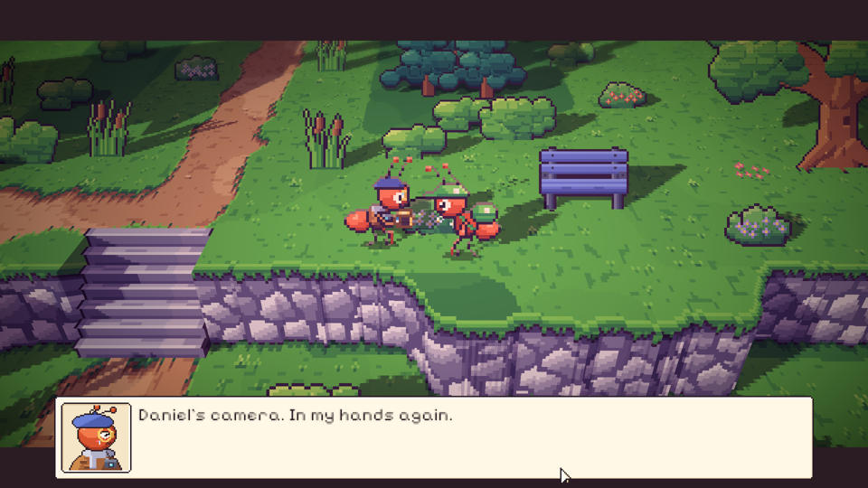

# 43. Malam ketiga: Kamera Film Tua

**Tanggal:** 2026-10-20

## Tujuan

Membangun Night 3 (M9) dari lonceng ketiga sampai jurnal sebelum tidur, sesuai naskah. Keepsake malam ini adalah
kamera film 8mm milik Daniel, ayah Satria. Engkolnya macet dan gulungan film terakhirnya masih di dalam. Keputusan
yang sudah ada tetap berlaku:

- serah terima terjadi saat senja;
- semua teks dalam bahasa Inggris;
- setiap adegan penting dimainkan sebagai cutscene.

Garis waktu Daniel mengikuti keputusan 130: Daniel meninggal lima tahun lalu saat menopang tiang jembatan muara,
dengan Theo di sampingnya.

Pekerjaan ini dilanjutkan dari sesi sebelumnya yang terputus. Ruangan, alur cerita, dan tesnya sudah setengah jadi,
lalu diselesaikan dan diperiksa ulang di editor.

## Yang dikerjakan

### Alur Night 3 (`Chapters/Night3.cs`)

- **Toko Marlow.** Kotak ketiga berukiran THEO dibuka. Marlow bercerita bahwa kamera itu diserahkan Daniel ke tangan
  Theo pada malam jembatan muara runtuh.
- **Jalan ke toko.** Jendela rumah Mia dan Pip menyala redup dan sunyi, karena Pip sudah tidur memeluk Mochi.
- **Hutan beringin.** Monolog Satria tentang ayahnya.
- **Pagi di pantai.**
  - Di kedai kopi dekat dermaga, penambang garam dan nelayan bergosip: pintu Theo dirantai rantai kapal sejak
    pemakaman.
  - Valdo mencemooh kamera rongsokan.
  - Leo, yang sedang peregangan setelah lari pantai, memberi petunjuk: Theo tidak membuka pintu untuk tamu yang
    datang dengan tangan kosong, tetapi teh mint buatan Daniel akan membuka ventilasinya.
  - Di gudang garam, Arlo meminjamkan tali rami. Waktu bergeser ke siang.
- **Siang.**
  - Satria memanjat tebing untuk memetik mint liar (minigame 3A).
  - Mint diseduh di kedai, lalu cangkirnya ditaruh di ambang ventilasi. Rantai dilepas dari dalam dan Theo keluar.
  - Di kamar gelap, gulungan film dicuci di bawah lampu merah (minigame 3B). Waktu bergeser ke senja.
- **Senja.**
  - Theo mengengkol proyektor, dan film terakhir Daniel diputar di layar goni.
  - Mereka keluar ke tebing, dan dengan sisa cahaya, kamera kembali ke tangan Theo. Satu lentera lagi padam di toko
    Marlow.
- **Malam.** Halaman jurnal "Remembering", lampu dipadamkan, lalu tidur.

### Tempat baru

- **Studio Theo dan gudang garam Arlo.** Keduanya ruangan terbuka (cutaway) di tebing dan jalan pantai, bisa dimasuki
  mulai Night 3.
- **Pantai.**
  - Kedai kopi kecil dengan tenda biru-putih dan teko kuningan di atas tungku.
  - Meja dan bangku kafe.
  - Rumpun mint liar berbunga ungu di tepi tebing.

### Kamar gelap dan film

- `Pixel.shader` mendapat `_Safelight`: seluruh dunia berubah hitam-merah selama minigame kamar gelap
  (`Main.Safelight`).
- Film Daniel terdiri dari delapan bingkai hitam-putih yang digambar dari sprite tokoh sendiri: Daniel memanggul
  balok, Ratih dan Helen muda memanggil dari tepi sungai. Ada goresan dan debu yang berbeda di tiap bingkai.

### Persiapan malam berikutnya

Commit ini juga membawa bahan yang sudah dibuat untuk Night 4 sampai 7, tetapi belum dipakai cerita:

- minigame 4A sampai 7B;
- benda dan keepsake Night 4 sampai 8;
- tokoh dan pose baru (Marcus, Leo muda, Satria kecil, anak pengantar roti);
- 22 suara, 2 ambience, dan 3 lagu baru.

Ada juga dua bagian bersama yang baru:

- **Hujan untuk Night 4** (`UI/Rain.cs`): garis hujan miring, percikan di tanah, langit yang lebih kelabu
  (`_Rain`), dan ambience hujan.
- **Tangga.** Berjalan dari satu ruangan ke ruangan lain sekarang memakai fade, seperti menuruni tangga. Hanya pintu
  ke luar yang memotong langsung.

### Perbaikan

- **Film tidak terlihat.** Film berupa kartu berdiri tepat di depan layar. Kartu di game ini condong ke belakang
  supaya menghadap kamera, jadi bagian atasnya masuk ke dalam layar dan tertutup. Sekarang film menjadi delapan model
  tipis di muka layar yang tegak, dan adegan pemutaran menampilkannya bergantian empat kali per detik.
- **Theo hilang di tebing.** Pantai yang dimasuki lewat pintu memakai versi yang dibangun sebelum film diputar, jadi
  Theo belum ada di sana. Sekarang adegan memunculkan Theo sendiri.
- **Pose yang belum ada.** `tinker`, `inspect` (Theo), `look` (Valdo), dan `drink` (penambang garam) belum digambar.
  Theo sekarang mengengkol proyektor dengan pose `crank`, dan yang lain memakai pose yang ada.

## Validasi

- Tes PlayMode `NightsTest.Night3PlaysThrough` memainkan Night 3 tanpa pemain, lulus.
- Semua tes PlayMode lulus (12/12).
- Dicoba langsung di editor:
  - papan minigame tebing;
  - kamar gelap dengan lampu merah;
  - film di layar;
  - serah terima di tebing saat senja.
