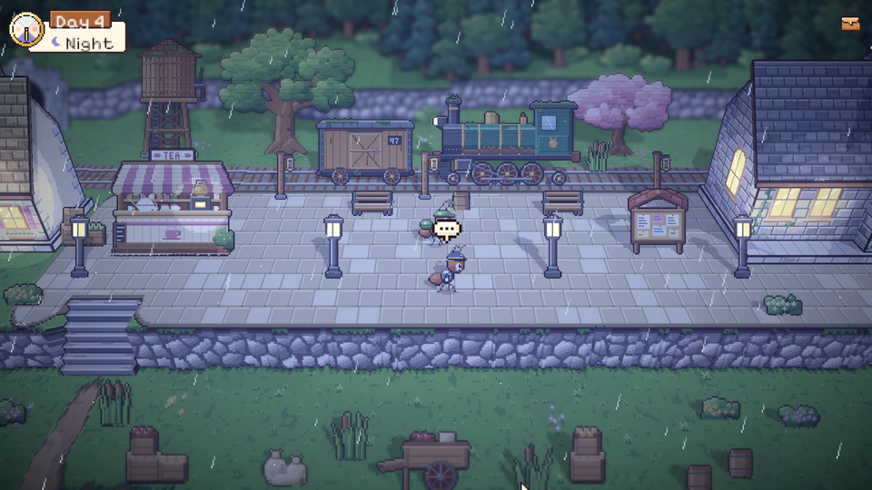
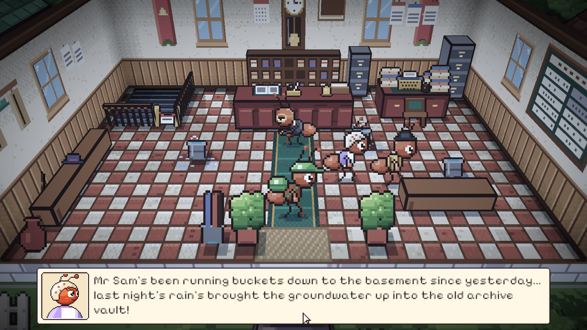
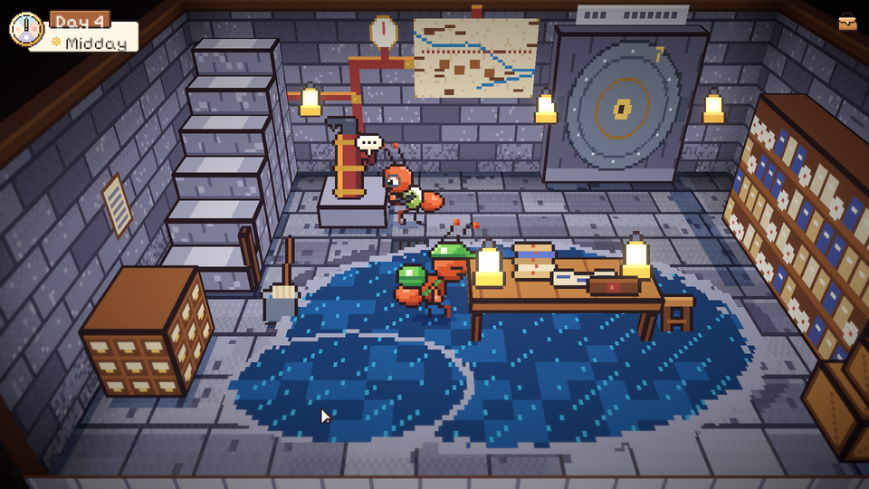
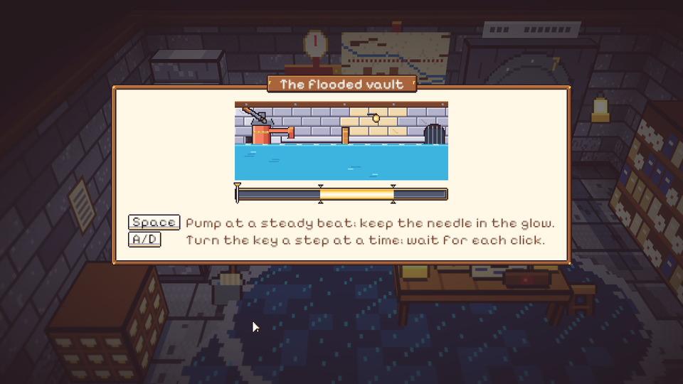
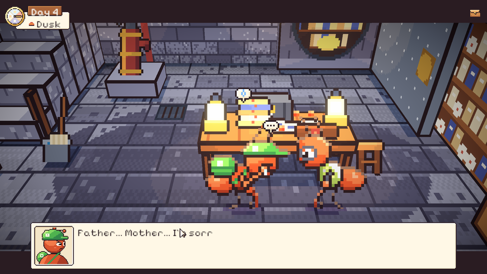
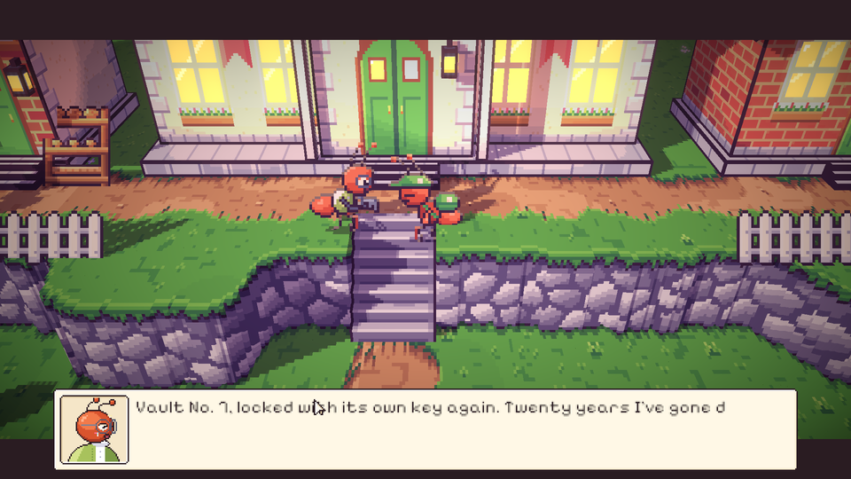

# 44. Malam keempat: Kunci Tanpa Ukiran

**Tanggal:** 2026-10-20

## Tujuan

Membangun Night 4 (M10) dari lonceng keempat sampai jurnal sebelum tidur, sesuai naskah. Keepsake malam ini adalah
kunci besi hitam polos dengan empat gerigi bertingkat, tanpa nomor dan tanpa nama. Pemiliknya Sam, juru arsip balai
desa. Keputusan yang sudah ada tetap berlaku:

- serah terima terjadi saat senja;
- semua teks dalam bahasa Inggris;
- setiap adegan penting dimainkan sebagai cutscene.

Mulai sesi ini semua pekerjaan dikerjakan sendiri, tanpa subagent. Setiap bagian dimainkan dan difoto di editor
sebelum di-commit.

## Yang dikerjakan

### Alur Night 4 (`Chapters/Night4.cs`)

- **Hujan pertama.** Gerimis turun bersama lonceng keempat dan berlangsung sepanjang malam dan pagi. Di jalan ke toko,
  hujan berdesis di lantai peron dan genangan berdiri di jalan.
- **Toko Marlow.** Kotak keempat berukiran SAM dibuka. Kata Marlow, ada pintu yang dikunci dari dalam oleh rasa takut
  orang pada masa lalunya sendiri.
- **Hutan beringin.** Monolog Satria tentang dokumen yang menentukan jalan keluarganya.
- **Pagi di balai desa.**
  - Lantai lobi basah oleh rembesan, dan air menetes ke ember-ember seng.
  - Dua tetangga bergosip: Pak Sam mengangkut ember ke ruang bawah tanah sejak kemarin.
  - Valdo, yang sedang mengesahkan denah tanah di loket, mengira kunci itu kunci brankas perhiasan. Satria menolaknya:
    "None of your business, Mr Valdo."
  - Kapten Bram, di bangku peron dengan korannya, mengenali kunci itu sebagai kunci brankas arsip tahan api standar
    kereta 1952. Hanya satu pintu di Bellwood yang memakainya: gudang di bawah balai desa. Hujan berhenti dan waktu
    bergeser ke siang.
- **Siang di arsip bawah tanah.**
  - Sam panik di depan pompa yang macet. Air sudah menggenangi lantai batu, dan kunci brankas hilang dua puluh tahun
    lalu.
  - Minigame 4A memompa banjir keluar, lalu memutar kunci di empat tumbler brankas No. 7. Kuncinya keluar mengilap.
  - Minigame 4B menyelamatkan cetak biru jembatan dan register penyelamatan yang basah di meja Sam. Waktu bergeser ke
    senja.
- **Senja.**
  - Sam membuka map kulit bersegel lilin: register keberangkatan kereta darurat 1952. Tiket 041 atas nama Daniel,
    Ratih, dan Satria kecil dibatalkan atas permintaan mereka sendiri pukul 22.15. Catatan tinta merah Marcus Bell
    menulis bahwa kursinya diberikan kepada dua yatim korban longsor muara, sementara Daniel dan Ratih tinggal untuk
    memimpin perbaikan tiang jembatan.
  - Sam memberi Satria salinan halaman itu. Di tangga depan balai, dengan sisa cahaya, kunci kembali ke tangan Sam.
- **Malam.** Halaman jurnal "Preserving", lampu dipadamkan, lalu tidur.

### Tempat baru

- **Lobi balai desa.** Ruangan terbuka (cutaway) di alun-alun, bisa dimasuki mulai Night 4. Isinya:
  - lantai tegel;
  - loket pendaftaran dan rak surat;
  - meja mesin tik Sam;
  - papan penduduk;
  - lemari arsip besi;
  - bangku dan pakis;
  - ember di bawah bocoran.
- **Arsip bawah tanah.** Ini ruangan bawah tanah pertama di game. Ruangan ini tidak punya langit, jadi lampunya
  selalu menyala (`PlaceDef.Underground`). Isinya:
  - lantai batu bendera dan dinding batu;
  - pompa tangan tembaga;
  - pintu baja brankas No. 7;
  - rak arsip;
  - katalog kartu;
  - peta Bellwood tahun 1950;
  - meja kerja dengan dua lampu minyak.

  Genangan banjir, pintu brankas yang terbuka, dan kotak arsip mengikuti cerita.

### Perbaikan

- **Tangga yang langsung naik lagi.** Titik tiba di bawah tangga arsip berada di dalam area keluar tangga itu sendiri,
  jadi langkah pertama langsung membawa kurir naik ke lobi. Area keluarnya sekarang dipersempit.
- **Tokoh yang bertumpuk.** Posisi bicara Kapten Bram dan salah satu tetangga digeser, dan Sam mundur dari pompa ke
  tempat yang lapang, supaya kurir tidak berdiri di atas mereka.
- **Air yang datar.** Air di papan minigame 4A dulu hanya satu blok biru. Sekarang ada riak kecil yang bergerak pelan
  dan berkurang saat air surut. Genangan di ruangan juga dibuat lebih keruh, supaya batu di bawahnya tetap terlihat.
- **Adegan register.** Sam membaca dari map, lalu menyodorkannya, dan Satria membaca catatan tinta merahnya sendiri.
  Kamera membingkai keduanya, bukan hanya pintu brankas.

## Validasi

- Tes PlayMode baru `NightsTest.Night4PlaysThrough` memainkan Night 4 tanpa pemain dan lulus. Tes ini memeriksa:
  - hujan di pagi hari dan hujan berhenti di siang hari;
  - kedua minigame;
  - kunci yang berganti di tas;
  - salinan register;
  - lentera keempat padam.
- Semua tes PlayMode lulus.
- Dicoba langsung di editor:
  - hujan di peron;
  - kotak SAM;
  - lobi saat hujan;
  - Valdo dan Bram;
  - Sam di pompa;
  - papan 4A dan 4B;
  - register saat senja;
  - serah terima di tangga balai.
