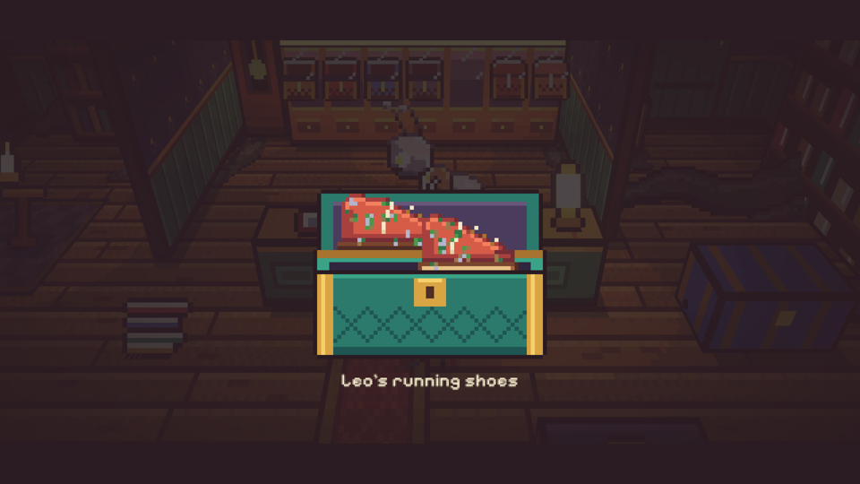
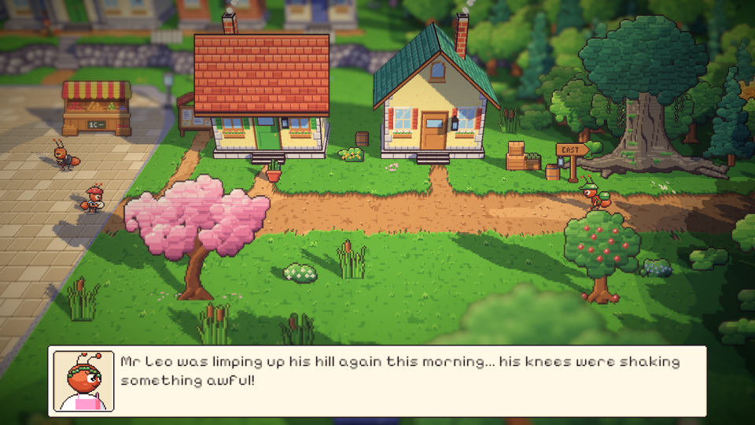
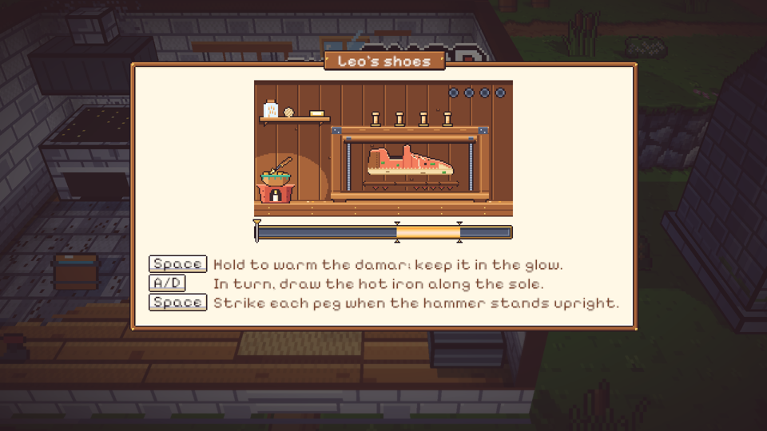
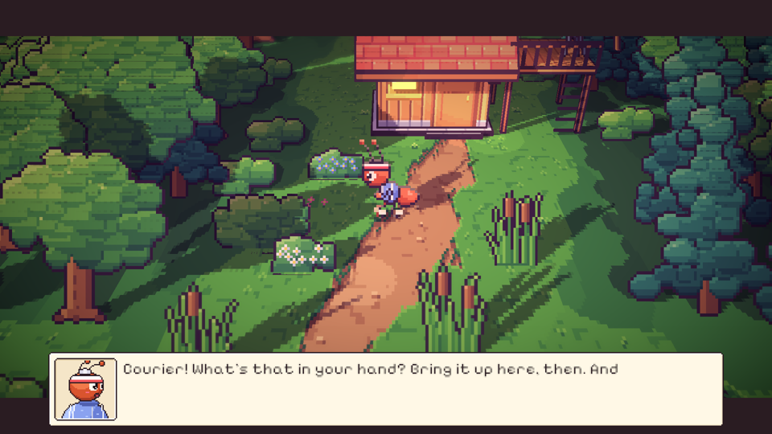
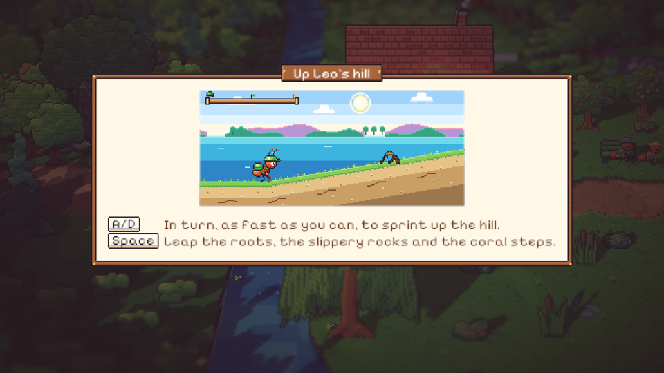
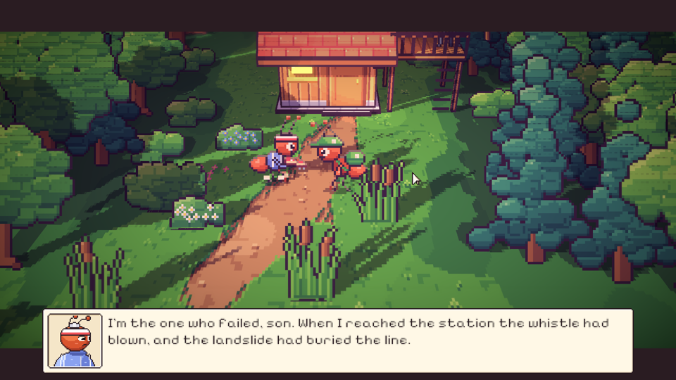

# 45. Malam kelima: Sepatu Lari yang Tidak Serasi

**Tanggal:** 2026-10-20

## Tujuan

Membangun Night 5 (M11) dari lonceng kelima sampai jurnal sebelum tidur, sesuai naskah. Keepsake malam ini adalah
sepatu lari kanvas tua milik Leo. Sepatunya berpaku, ukuran solnya berbeda, dan karetnya sudah keras seperti batu
sungai. Keputusan yang sudah ada tetap berlaku:

- serah terima terjadi saat senja;
- semua teks dalam bahasa Inggris;
- setiap adegan penting dimainkan sebagai cutscene.

## Yang dikerjakan

### Alur Night 5 (`Chapters/Night5.cs`)

- **Setelah hujan.** Hujan sudah reda. Di jalan stasiun udara berbau tanah basah, dan bulan purnama cukup terang untuk
  berjalan tanpa lentera.
- **Toko Marlow.** Kotak kelima berukiran LEO dibuka. Dua puluh tahun lalu Leo adalah pelari darurat. Ia berlari
  menembus badai untuk mengabarkan bahwa kereta malam masih menunggu keluarga Satria, sampai solnya habis di batu
  karang. Sejak itu ia hanya jogging, tidak pernah lagi berlari kencang, karena yakin ia datang terlambat. Kata
  Marlow: ada orang yang berlari karena takut menoleh ke belakang.
- **Hutan beringin.** Monolog Satria tentang sebelas tahun berlari di rute kota tanpa libur.
- **Pagi di alun-alun.**
  - Penjual bunga dan pembeli bergosip bahwa Pak Leo pincang mendaki bukitnya pagi ini, lututnya gemetar.
  - Valdo, yang sedang mengukur jalan, menyebut sepatu itu rongsokan. Ia mengingatkan bahwa para investor datang pagi
    Hari Kedelapan.
  - Anak tukang roti, di depan toko roti, mengenali sepatu Leo. Ia memperingatkan bahwa karet sekeras itu bisa
    mematahkan sendi kaki Leo, lalu menyuruh Satria ke bengkel Mender. Waktu bergeser ke siang.
- **Siang di bengkel.** Mender mengenali sepatu itu. Minigame 5A mengganti sol di pres sepatunya:
  - hangatkan damar di dalam cahaya;
  - tarik setrika panas di sepanjang sol;
  - pukul empat pasak saat palu tegak.

  Sepatunya kembali mengilap, dan waktu bergeser ke senja.
- **Senja di bukit Leo.** Leo, di depan pondoknya, menantang kurir berlomba dengan matahari. Minigame 5B adalah lari
  menanjak:
  - A dan D bergantian untuk berlari;
  - Space untuk melompati akar, batu licin, dan anak tangga karang;
  - kalau gagal, mulai lagi dari bendera tengah bukit.

  Di puncak, dengan sisa cahaya, sepatu kembali ke Leo. Satria menceritakan isi register: orang tuanya memilih
  tinggal, dan Leo tidak pernah mengecewakan siapa pun.
- **Malam.** Halaman jurnal "Moving", lentera kelima padam, lalu tidur.

### Tempat dan tokoh

Orang-orang baru untuk Night 5 ditambahkan sebagai data di `Places.cs`:

- Leo tidak berlari keliling pagi itu. Pagi hari ia berdiri di bukitnya, dan saat senja ia menunggu di depan pondok.
- Valdo mengukur jalan di alun-alun.
- Anak tukang roti mengantar roti di depan toko roti.

### Perbaikan

- **Anak tukang roti tidak terjangkau.** Posisi bicaranya berada di jalur yang tidak bisa dilalui. Ia digeser sedikit
  ke utara.
- **Tokoh yang bertumpuk.** Kurir berdiri menempel pada Valdo, anak tukang roti, dan Mender. Jarak bicara ketiganya
  diperlebar.
- **Genangan yang tidak ada.** Narasi di stasiun awalnya menyebut genangan, padahal tidak ada gambar genangan di sana.
  Narasinya diganti dengan apa yang memang terlihat: bulan purnama di atas jalan yang basah.

## Validasi

- Tes PlayMode baru `NightsTest.Night5PlaysThrough` memainkan Night 5 tanpa pemain dan lulus. Tes ini memeriksa:
  - gosip di alun-alun;
  - pergeseran waktu ke siang dan senja;
  - sepatu yang berganti di tas setelah minigame 5A;
  - minigame 5B dan lentera kelima padam.
- `VillagersTest` lulus: semua orang baru bisa didatangi.
- Semua tes PlayMode lulus.
- Dicoba langsung di editor:
  - jalan stasiun;
  - kotak LEO;
  - gosip, Valdo, dan anak tukang roti;
  - Mender dan papan 5A;
  - panggilan Leo dan papan 5B;
  - serah terima di bukit.
