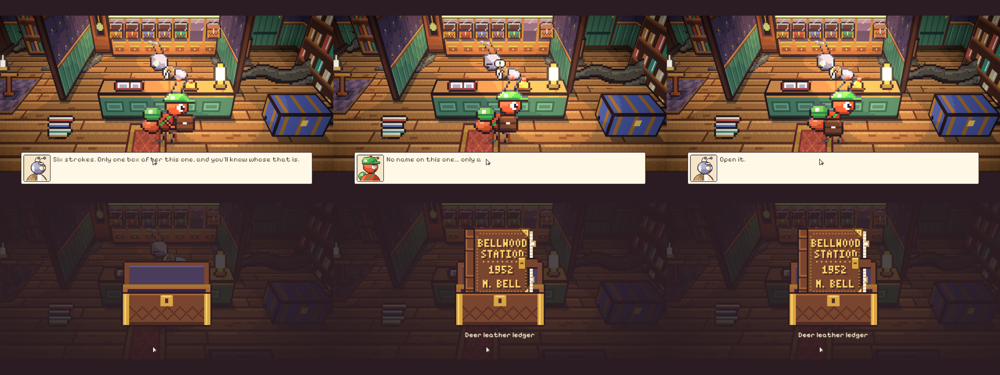
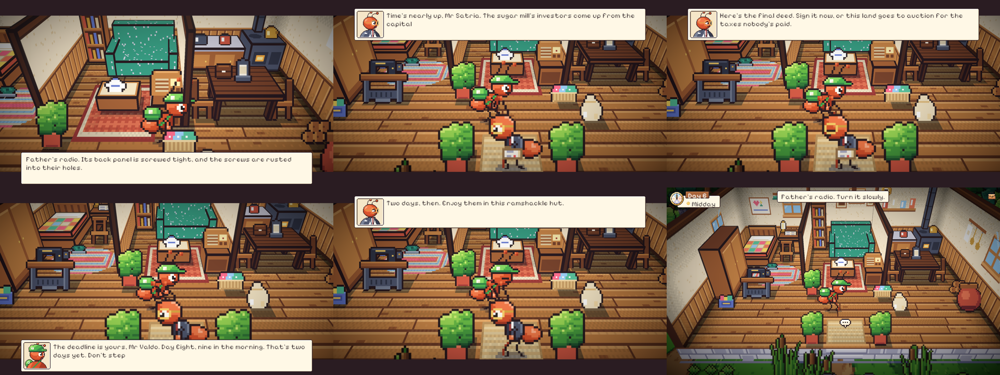
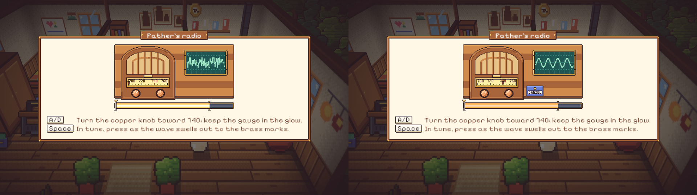
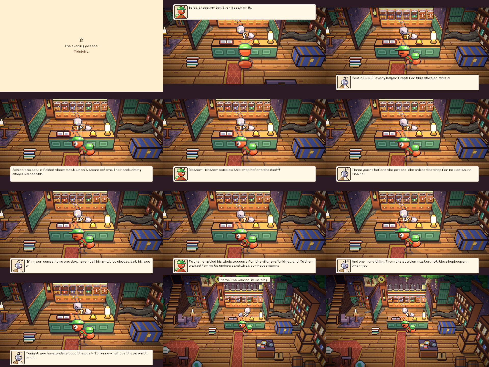

# 47. Malam keenam: Buku Kas Bersampul Kulit Rusa

**Tanggal:** 2026-10-20

## Tujuan

Membangun Night 6 (M12) dari lonceng keenam sampai jurnal sebelum tidur, sesuai naskah. Keepsake malam ini adalah buku
kas stasiun tahun 1952 milik Marcus Bell. Malam ini berbeda dari malam lain dalam tiga hal:

- seluruh hari dihabiskan di rumah;
- rutinitas di rumah dimainkan langkah demi langkah seperti Night 1;
- buku kas dikembalikan kepada Marlow sendiri, di tokonya, tengah malam.

## Yang dikerjakan

### Alur Night 6 (`Chapters/Night6.cs`)

- **Toko Marlow.** Kotak keenam dibuka. Sampul buku kas bertuliskan BELLWOOD STATION 1952, M. BELL. Satria bertanya
  apakah nama asli Marlow adalah Marcus Bell. Kata Marlow, nama hanyalah jubah, dan di bawahnya ia hanya seorang saksi.
  Buku itu penuh catatan sumbangan kayu dan semen dari Ayah untuk jembatan. Saldo terakhirnya kosong, ditandai tanda
  tanya merah. Marlow menyuruh Satria mencari buku tabungan Ayah di balik radio tua.
- **Hutan beringin.** Monolog Satria: Marlow sudah dua puluh tahun menjaga celah akar itu, dan lusa adalah Hari
  Kedelapan.
- **Rutinitas di rumah.** Setiap langkah dimainkan sendiri seperti Night 1: kotak di meja, cuci di tempayan, obat
  nyamuk, lalu tidur.
- **Pagi di rumah.** Satria memeriksa radio Ayah. Panel belakangnya tersekrup rapat. Lalu Valdo masuk lewat pintu depan
  membawa akta final. Para investor datang lusa, atau tanah ini dilelang untuk pajak. Satria menolak: tenggatnya
  masih dua hari lagi. Waktu bergeser ke siang.
- **Siang.**
  - Minigame 6A menala radio ke stasiun lama di 740. Musik keroncong terdengar, dan buku tabungan Ayah bertuliskan
    DANIEL meluncur keluar dari ruang rahasia.
  - Minigame 6B menyeimbangkan buku kas di meja kenari sampai tercap PAID IN FULL WITH FAMILY LOVE. Saldo tabungan
    Ayah ternyata nol. Waktu bergeser ke senja.
- **Senja sampai tengah malam.** Ini satu-satunya pengecualian aturan serah terima. Senja ditunggu di rumah: Satria
  naik ke ranjang, lalu muncul kartu "The evening passes / Midnight".
- **Tengah malam di toko.** Buku kas kembali ke tangan Marlow.
  - Di dalamnya ada lembar tulisan tangan Ibu. Ibu pernah datang ke toko ini dan menitip pesan agar Satria dibiarkan
    memilih sendiri.
  - Marlow menitipkan pesan untuk Helen: Marcus juga tidak pernah berhenti menunggu.
  - Lentera keenam padam.
- **Malam.** Halaman jurnal "Letting Go", lalu tidur. Buku tabungan Ayah tetap dibawa Satria.

### Keputusan untuk konflik naskah

- **Loteng.** Di naskah ada loteng, tetapi loteng tidak dibangun. Radio tetap di ruang keluarga, sesuai rumah yang
  sudah ada dan keputusan sebelumnya. Dengan begitu tidak perlu ruangan, tingkap, atau tangga baru.
- **Tenggat waktu.** Kata Valdo "lusa" dan "dua hari". Kata "besok" dan "dua puluh empat jam" disimpan untuk Hari
  Ketujuh.
- **Lama Marlow menjaga toko.** "Setengah abad" di naskah diganti menjadi dua puluh tahun, sesuai tahun 1952.

### Perbaikan

- **Klaim segel di tutup kotak.** Satria awalnya menyebut segel M.B. di tutup kotak, padahal tutup kotak tidak
  menampilkannya. Kalimatnya diganti.
- **Posisi Valdo dan kurir.** Valdo dan kurir awalnya berdiri bertumpuk. Kurir sekarang berdiri di samping pintu, dan
  keduanya saling berhadapan.

## Validasi

- Tes PlayMode baru `NightsTest.Night6PlaysThrough` memainkan Night 6 tanpa pemain dan lulus. Tes ini memeriksa:
  - Valdo ditolak;
  - pergeseran waktu ke siang, senja, dan malam;
  - buku tabungan dari radio;
  - buku kas yang seimbang;
  - lentera keenam padam di toko;
  - buku tabungan tetap ada di tas.
- Semua tes PlayMode lulus.
- Dicoba langsung di editor:
  - pembukaan kotak;
  - Valdo di pintu;
  - papan 6A dan 6B;
  - menunggu tengah malam;
  - serah terima di toko.
