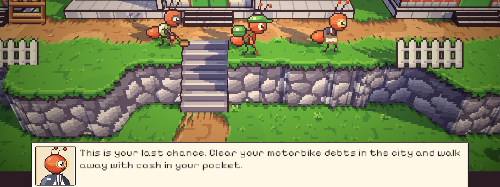
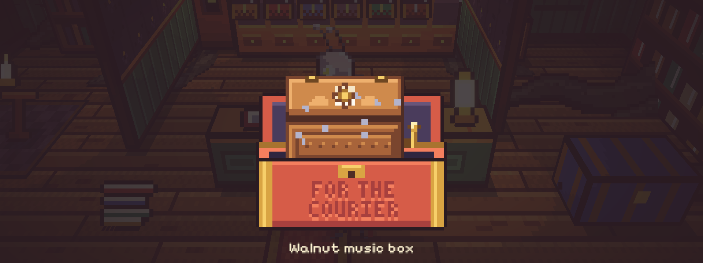
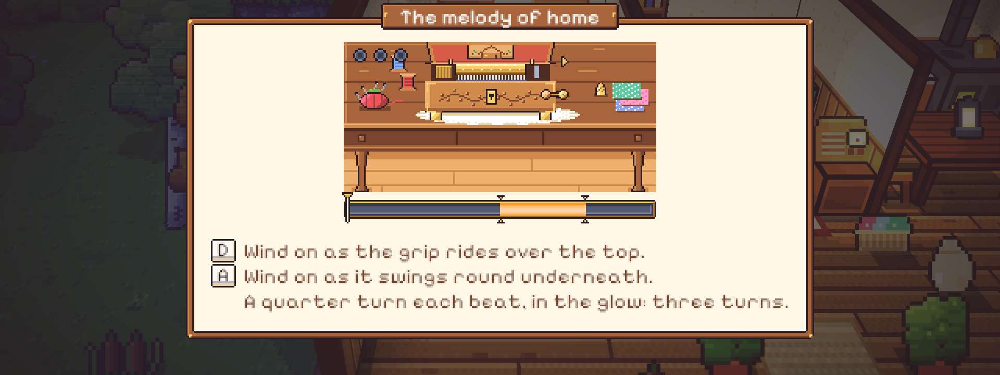
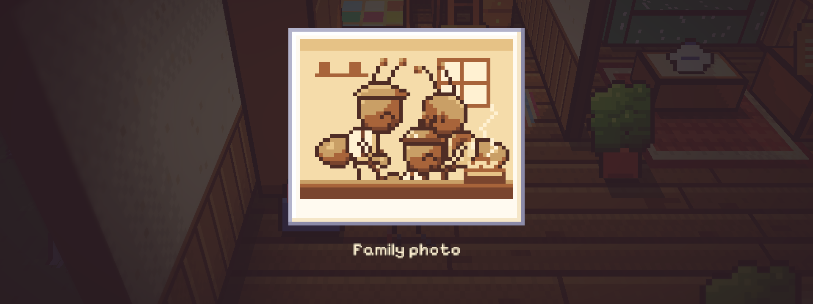
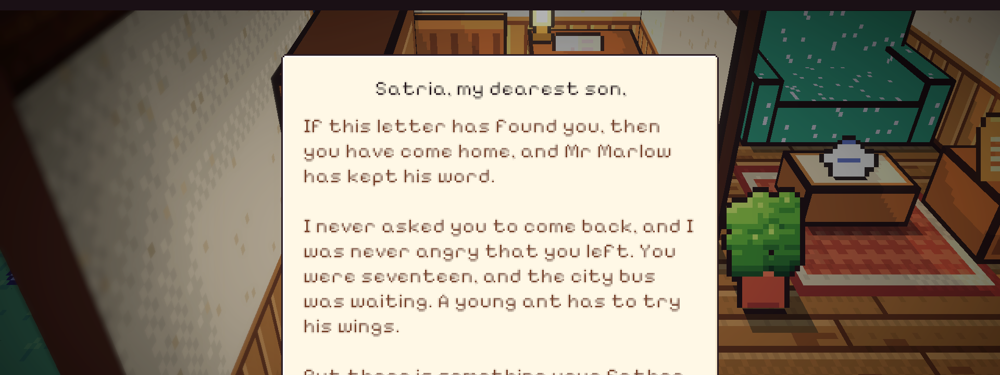
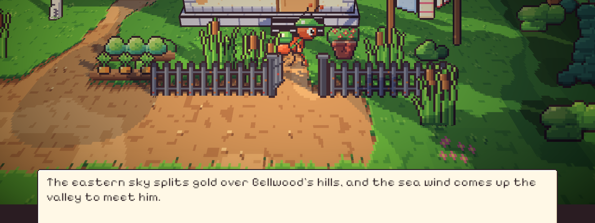

# 48. Malam ketujuh: Surat Tanpa Tanda Tangan

**Tanggal:** 2026-10-20

## Tujuan

Membangun Night 7 (M13), malam terakhir sebelum Hari Kedelapan, sesuai naskah. Kata malam ini adalah *Choosing*.
Malam ini berbeda dari malam lain dalam tiga hal:

- siangnya dimainkan lebih dulu, baru kotaknya di akhir hari;
- kotak ketujuh bukan untuk penduduk, melainkan FOR THE COURIER: kotak musik kenari milik Ibu dan surat bersegel lilin
  merah;
- tidak ada serah terima. Surat Ibu dibaca di rumah, dan malam berakhir saat pintu depan terbuka ke fajar Hari Kedelapan.

## Yang dikerjakan

### Alur Night 7 (`Chapters/Night7.cs`)

- **Pagi di rumah.** Satria bangun karena cahaya, bukan lonceng. Rumahnya sudah terasa hangat. Rutinitas pagi
  dimainkan langkah demi langkah: cuci muka di tempayan, teh di tungku, sarapan roti Baker di meja kenari.
- **Valdo di alun-alun.** Valdo mondar-mandir di depan balai. Begitu diajak bicara, ia mendekat dan menawarkan
  kesempatan terakhir: investor datang malam ini, dan besok jam sembilan akta ditandatangani di balai. Satria
  menolak, karena tenggat di draf Valdo sendiri adalah besok, jadi hari ini masih miliknya. Waktu bergeser ke siang.
- **Siang berkeliling desa.** Desa yang dihidupkan enam malam terakhir bisa disapa satu per satu: Helen, mekanik, Sam,
  Mia, Baker, Pip, Leo, dan Theo. Masing-masing punya kalimat penutup. Pesan Marcus disampaikan kepada Helen: Marcus
  juga tidak pernah berhenti menunggu. Setelah pesan itu, Satria boleh pulang.
- **Senja sampai lonceng ketujuh.** Satria duduk di lantai di depan mesin jahit Ibu dengan draf Valdo di tangan. Senja
  turun, lalu malam, lalu lonceng berdentang tujuh kali.
- **Toko Marlow.** Enam kotak di lemari sudah terbuka dan kosong. Kotak ketujuh berukir daun kelapa, dan di depannya
  terpahat FOR THE COURIER. Isinya kotak musik kenari dan amplop bersegel lilin merah. Marlow berpamitan: toko ini
  tidak akan membuka pintunya lagi.
- **Rumah yang dingin.** Lampu meja belum menyala dan tungku belum berapi. Keduanya harus dinyalakan dulu sebelum
  kotak musik bisa dimainkan di meja jahit.
- **Minigame 7: The melody of home.** Engkol kotak musik diputar seperempat putaran tiap ketukan, tepat di cahaya,
  sampai tiga putaran. Lagu nina bobo Ibu terdengar, dan laci rahasia di bawah meja jahit terbuka berisi foto keluarga.
- **Surat Ibu.** Segel dipecah, dan surat dibaca halaman demi halaman tanpa pena. Isinya rahasia yang tidak pernah
  diceritakan: tiket kereta khusus keluarga itu diberikan kepada dua anak yatim dari muara, dan "sebentar saja" itu
  menjadi dua puluh tahun. Pilihannya kini sepenuhnya milik Satria.
- **Jurnal dan fajar.** Halaman jurnal "Choosing" ditulis di meja Ibu, lalu lentera ketujuh padam. Saat Satria keluar
  dari pintu depan, langit timur terbelah emas: "Morning, Bellwood." Bab berakhir di sini, dan epilog dimulai dari
  pagi Hari Kedelapan.

### Foto keluarga dari tokoh sungguhan (`ArtSource/interiors.js`)

Foto di laci awalnya digambar dengan bulatan sepia sederhana, jadi terlihat seperti gambar 8-bit. Padahal Daniel,
Ibu, dan Satria kecil sudah punya sprite sendiri. Foto sekarang digambar dari sprite mereka sendiri dengan pose
tertawa, dalam ukuran aslinya:

- Ayah dan Ibu berdiri di belakang meja dapur, kepala mereka saling mendekat;
- Satria kecil berdiri di depan, di antara keduanya;
- di belakang ada dinding dapur, jendela, dan rak, dan di meja ada tungku tanah liat berisi jagung bakar yang
  berasap.

Lalu seluruh gambar dicuci ke tujuh nada sepia menurut terangnya, seperti film Ayah dicuci ke abu-abu di Night 3.
Ukuran foto naik dari 44x36 menjadi 64x54 piksel. Di baliknya, cap studio THEO dibesarkan supaya namanya tidak
menabrak cincin cap.

### Perubahan pendukung

- **Hari dulu, malam kemudian.** `NightChapter` mendapat `DayFirst`. Night 7 memakainya supaya rutinitas pagi tidak
  mengirim Satria tidur, dan petunjuk setelah toko menyuruhnya pulang ke mesin jahit Ibu.
- **Rumah yang dingin di malam ketujuh.** `Place.FollowStory` menyembunyikan cahaya lampu meja dan api tungku sampai
  keduanya dinyalakan.
- **Foto dari dekat tanpa kotak.** `Reveal` sekarang punya `Show(keepsake)` untuk benda yang muncul tanpa kotak.
  Bagian yang sama dengan pembukaan kotak dipecah menjadi `Darken`, `Rise`, dan `Name`.
- **Surat tanpa pena.** `Journal.Show` mendapat `pen: false`. Halaman surat langsung tampil utuh, karena surat itu
  sudah ditulis, bukan sedang ditulis.
- **Kotak ketujuh.** Bagian depannya (`box_6`) sekarang benar-benar terpahat FOR THE COURIER, sesuai
  narasinya.

### Perbaikan

- **Valdo terlalu jauh.** Awalnya Valdo berdiri di bawah tembok teras, dan kurir harus berjalan jauh melintasi
  alun-alun. Sekarang Valdo mondar-mandir di depan balai, dan adegan dimulai saat ia diajak bicara.
- **Valdo menumpuk dengan kurir.** Valdo kadang sedang berjalan saat diajak bicara. Sekarang ia berjalan dulu ke
  samping kurir, dan jalur mondar-mandirnya dipindah ke kanan pintu, menjauh dari Sam.
- **Titik bicara Valdo.** Titik tempat kurir berdiri untuk bicara dengan Valdo jatuh di luar area jalan. Titik itu
  digeser dua piksel ke atas, dan Valdo diberi kalimat cadangan seperti penduduk lain.
- **Helen terlalu dekat.** Saat menyapa penduduk, kurir sekarang menjaga jarak samping minimum.
- **Narasi yang tidak sesuai gambar.** Beberapa kalimat diganti supaya cocok dengan yang tergambar:
  - draf Valdo dipegang di tangan, bukan diletakkan di meja;
  - rumah disebut "lampu belum menyala dan tungku belum berapi", bukan "gelap dan dingin";
  - cahaya lampu naik ke jendela, bukan ke tirai Ibu yang tidak ada;
  - enam kotak disebut "terbuka dan kosong", bukan "enam lentera padam".

## Validasi

- Tes PlayMode baru `NightsTest.Night7PlaysThrough` memainkan Night 7 tanpa pemain dan lulus. Tes ini memeriksa:
  - pagi di rumah, lalu Valdo menggeser waktu ke siang;
  - pesan untuk Helen;
  - pulang, lalu senja dan malam;
  - kotak musik dan surat dari toko;
  - lampu dan tungku dinyalakan;
  - kotak musik terbuka, foto, dan surat yang sudah dibaca;
  - lentera ketujuh padam;
  - keluar dari pintu depan ke fajar.
- Semua tes PlayMode lulus.
- Dicoba langsung di editor:
  - Valdo di alun-alun;
  - Helen dan penduduk lain di siang hari;
  - duduk di depan mesin jahit sampai lonceng ketujuh;
  - kotak FOR THE COURIER;
  - lampu dan tungku;
  - papan 7;
  - foto keluarga dari dekat;
  - halaman surat;
  - jurnal, lentera ketujuh, dan fajar.
