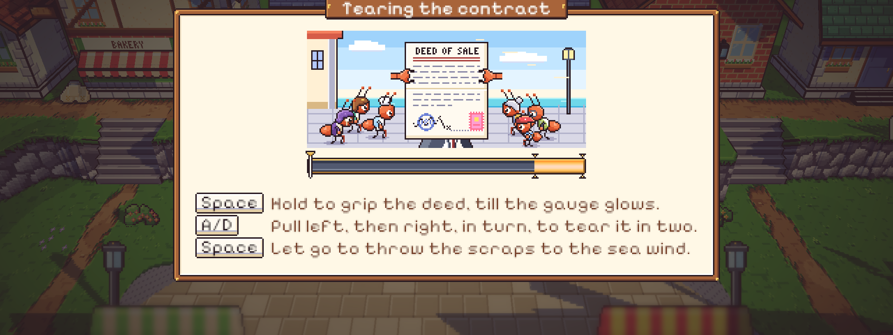
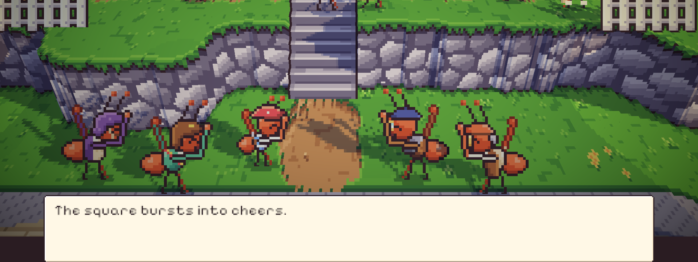
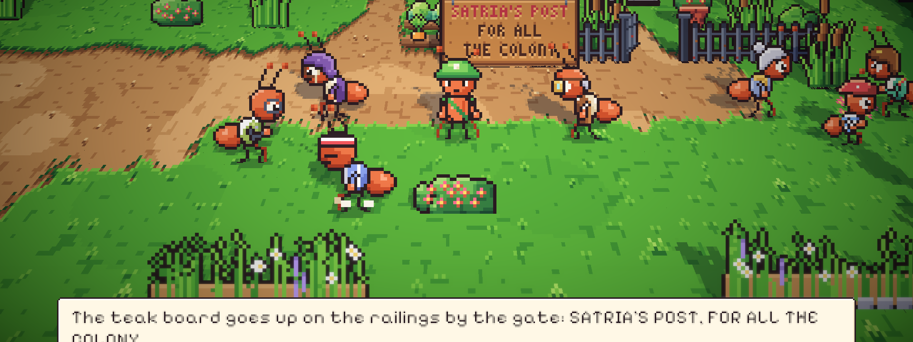
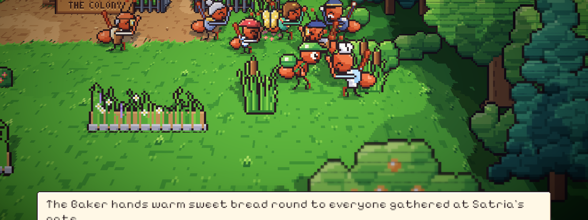
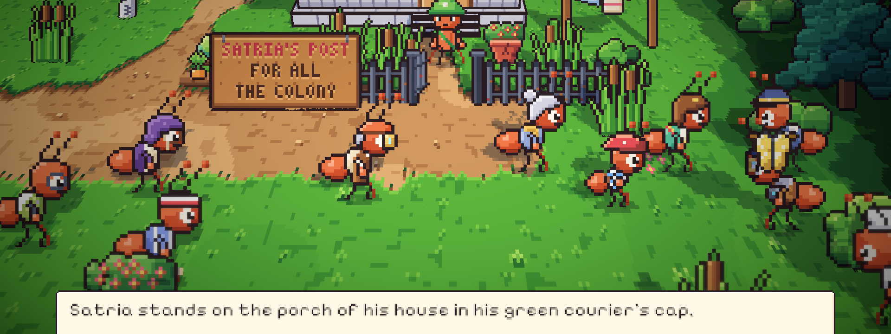
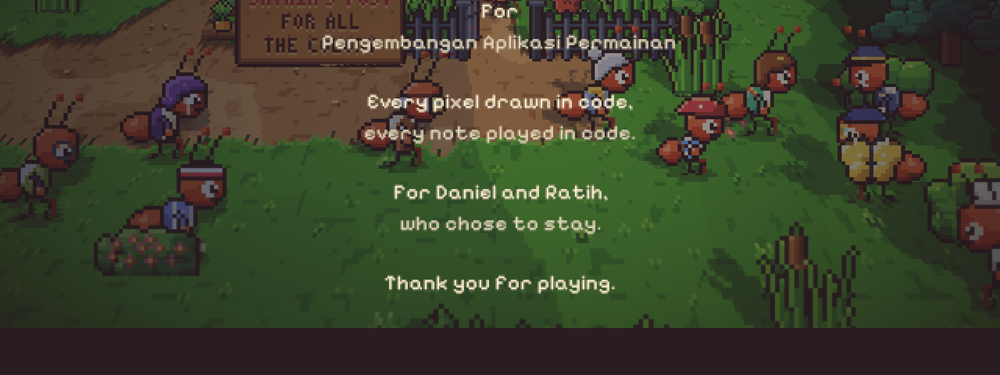

# 49. Epilog: Pagi Hari Kedelapan

**Tanggal:** 2026-10-20

## Tujuan

Membangun Epilog (The Morning After) sesuai naskah, sampai kredit dan kembali ke judul. Dengan ini cerita game
selesai dari prolog sampai tamat. Langkah ini juga memperbaiki laporan bahwa BGM tiba-tiba tidak terdengar.

## Yang dikerjakan

### Alur Epilog (`Chapters/Epilogue.cs`)

- **07:30, hutan beringin.** Celah di akar beringin tempat Toko Marlow dulu berdiri kini tertutup tirai akar gantung,
  dengan bunga liar yang mekar di kakinya. Pintu, kartu CLOSED, dan ketujuh lentera sudah hilang. Satria berdamai dengan
  kepergian toko itu.
- **09:00, alun-alun.** Seluruh desa berkumpul di depan balai, di teras dan di bawah temboknya di sekitar tangga. Valdo
  menunggu dengan koper dan pulpen emasnya. Satria menyerahkan draf, lalu merebutnya kembali di **minigame 8, Tearing the
  Contract**:
  - tahan Space sampai indikator menyala untuk mencengkeram akta;
  - tekan A dan D bergantian untuk merobeknya;
  - lepaskan Space untuk menghamburkan serpihannya ke angin laut.
- **Sesudah akta dirobek.** Valdo menghentakkan kaki dan berjalan keluar dari alun-alun. Satu per satu menyusul:
  - Helen merangkul Satria dan mengancam Valdo dengan sapu peronnya;
  - alun-alun bersorak, dan Pip berlari memeluk Satria;
  - Theo mengangkat kamera Daniel;
  - Mender bilang ia sudah mengukir sebuah papan.
- **10:30, gerbang rumah Satria.** Seluruh desa naik ke jalan timur, ke depan gerbang rumah Satria, sesuai naskah:
  - bicara dengan Mender: Satria dan Mender memaku papan jati SATRIA'S POST, FOR ALL THE COLONY di pagar besi di
    samping gerbang;
  - bicara dengan Baker: roti manis hangat dibagikan ke semua yang berkumpul, lalu Satria masuk lewat gerbang dan
    berdiri di teras rumahnya dengan topi kurir hijau. "I'm home."
- **Kredit (`UI/Credits.cs`).** Kredit bergulir pelan di atas adegan terakhir dengan lagu *Uncut Letter*:
  - judul game;
  - tim SE.3 Kelompok 1;
  - mata kuliah Pengembangan Aplikasi Permainan;
  - "Every pixel drawn in code, every note played in code";
  - "For Daniel and Ratih, who chose to stay".

  Baris "Thank you for playing." berhenti di tengah layar dan menunggu klik, lalu game kembali ke judul. Klik atau Space
  mempercepat gulirannya.

### Perubahan pendukung

- **Hari Kedelapan di peta.** `Place.FollowStory`:
  - menyembunyikan toko dan semua bagiannya di Hari Kedelapan, lalu menampilkan tirai akar (`shop_gone`);
  - menampilkan papan nama (`post_board`) setelah dipaku.
- **Penduduk Hari Kedelapan.** Di `Places.cs`, penduduk mendapat posisi pagi di alun-alun dan siang di gerbang rumah
  Satria, masing-masing dengan kalimatnya. Rutinitas biasa mereka di tempat yang sama dikecualikan di Hari Kedelapan,
  supaya tidak ada semut yang muncul dua kali.
- **Serah dan terima di semua bab.** `Receive`, `Give`, dan `Swap` dipindah dari `NightChapter` ke `Chapter`, supaya
  Epilog juga bisa memakainya.

### Yang dicoba lalu dibatalkan: kereta yang berjalan

Awalnya Epilog punya adegan tambahan di stasiun: Kapten Bram meniup peluit dan lokomotif tua berjalan lagi sebagai
tanda waktu di Bellwood mengalir kembali. Adegan ini tidak ada di naskah. Kami mencobanya dalam tiga versi:

1. kereta bergeser sedikit;
2. kereta berangkat penuh ke barat;
3. Bram mengemudikannya keluar lalu kembali, dengan roda yang berputar sesuai jarak tempuhnya.

Hasilnya tetap terasa janggal. Kamera jatuh ke atap rumah Helen, kereta melaju tanpa masinis, dan gerakan Bram terasa
kaku. Masalahnya bukan di animasi, tapi di adegannya sendiri: adegan itu tempelan yang tidak ada di cerita. Adegan
stasiun dihapus seluruhnya, begitu juga papan nama yang sempat dipasang di kantor pos. Akhir cerita sekarang kembali ke
naskah: papan nama, roti, dan teras, semuanya di rumah Satria.

### Perbaikan

- **BGM tiba-tiba hilang (`Core/Sound.cs`).** Saat perangkat audio berganti (misalnya headphone dicabut atau output
  dipindah), Unity mereset audionya dan menghentikan semua sumber suara: musik, angin, dan suara latar. Tidak ada yang
  menyalakannya kembali, jadi alun-alun jadi sunyi. `Sound` sekarang mendengarkan
  `AudioSettings.OnAudioConfigurationChanged` dan menyalakan lagi suara yang seharusnya masih terdengar.
- **Papan tidak menutupi teras.** Naskah menaruh papan "di atas gerbang besi". Gerbang itu tepat di depan teras, jadi
  papan di atasnya akan menutupi Satria di adegan terakhir. Papan dipaku di pagar di samping gerbang.
- **Penduduk tidak bertumpuk.** Grandma Nora, Sam, dan Leo digeser, supaya kurir tidak menabrak mereka saat mundur dari
  pagar.

## Validasi

- Tes PlayMode baru `NightsTest.EpiloguePlaysThrough` memainkan Epilog tanpa pemain dan lulus. Tes ini memeriksa:
  - akta sudah robek di bawah;
  - kurir sampai di gerbang rumahnya;
  - papan nama terpasang;
  - roti, teras, dan kredit;
  - game kembali ke judul.
- Semua 17 tes PlayMode lulus.
- Dicoba langsung di editor:
  - tirai akar di hutan beringin;
  - kerumunan di alun-alun dan papan minigame 8;
  - Valdo pergi, sorak, pelukan Pip, dan kamera Theo;
  - papan nama di pagar, roti manis, dan teras;
  - kredit bergulir lalu kembali ke judul.
- BGM: setelah audio Unity direset paksa (`AudioSettings.Reset`), musik pagi terdengar lagi.
