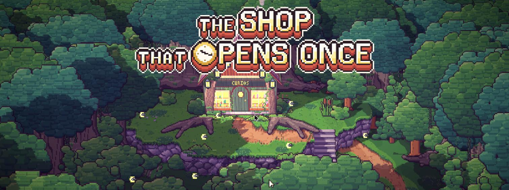
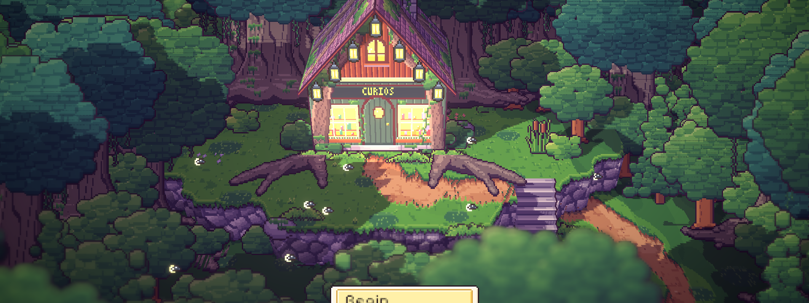

# 50. Rilis: Build Desktop, Bukan Web

**Tanggal:** 2026-10-20

## Tujuan

Menyiapkan game yang sudah tamat untuk dimainkan di luar editor (M15). Rencana awalnya Web dulu, lalu Windows.
Ternyata build web tidak sanggup menjalankan tampilan HD-2D game ini, jadi game dirilis sebagai build desktop untuk
Windows dan macOS. Tampilannya sama persis dengan versi di editor.

## Yang dikerjakan

### Mencoba build web

Build web (WebGL) berhasil dibuat dan berjalan di Chrome:

- judul, Prologue, dialog, HUD, dan jalan dengan klik semuanya berjalan tanpa error di konsol;
- simpanan tersimpan di browser (PlayerPrefs di IndexedDB) dan masih ada setelah halaman dimuat ulang.

Tapi build itu terlalu berat. Di Chrome pada Apple M4, judul berjalan sekitar 10 fps. Setelah blur dikembalikan
(lihat Perbaikan), angkanya turun ke sekitar 6 fps. Kami mengukurnya di editor sebagai pembanding:

| | Editor (native) | Web (Chrome) |
| --- | --- | --- |
| Waktu per frame | 2,4 ms CPU, 1,7 ms render thread | sekitar 174 ms |
| Draw call | 153 | adegan yang sama |
| SetPass call | 30 | adegan yang sama |

Pekerjaan game sendiri sangat ringan. Yang berat adalah merender seluruh jendela dengan depth of field Bokeh, bloom,
HDR, dan bayangan lewat WebGL. Untuk mencapai 60 fps di web, gambarnya harus dikurangi, dan itu akan terlihat. Kami
memilih tampilan utuh: build web dibatalkan, dan game dirilis untuk Windows dan macOS. Keputusan ini dicatat di
`GAME-CONTEXT.md`.

### Build desktop

- **macOS:** `game/Builds/macOS/The Shop That Opens Once.app`, 395 MB.
- **Windows:** `game/Builds/Windows/The Shop That Opens Once.exe`, 420 MB. Bagikan seluruh folder `Windows`, karena
  `.exe` membutuhkan folder `_Data` dan DLL di sebelahnya.

Folder `Builds/` tidak masuk git. Folder `..._BackUpThisFolder_ButDontShipItWithYourGame` di samping build hanya
berisi simbol debug dan tidak ikut dibagikan.

### README

README sekarang menjelaskan:

- game yang sudah tamat, dari Prologue sampai Epilog;
- kontrolnya;
- cara membuat build desktop;
- cara menjalankan tes.

## Perbaikan

- **Blur hilang di build.** Depth of field, bloom, dan vignette dibuat lewat kode (`Main.Effects`), bukan lewat asset
  volume. Akibatnya stripper URP mengira efek itu tidak dipakai dan membuang shader-nya dari setiap build, sehingga
  build web tampil tanpa blur. Pengaturan "strip unused post-processing variants" sekarang dimatikan, dan build
  menampilkan blur seperti di editor.
- **Sisa pengaturan dari build.** Setiap build menulis ulang beberapa pengaturan URP dan Input System secara otomatis.
  Perubahan itu dibuang, dan yang di-commit hanya perubahan stripping di atas.

## Yang belum dikerjakan

- **Sisa cerita lama.** Ada aset yang tidak dipakai lagi: toko mainan Nora, boneka, buku lama, koper bertanda
  "A.T.", serta adegan toko dan stasiun lama dari presentasi (masih bertuliskan "18:17"). Semuanya ada di
  `ArtSource` dan `Resources`. Tidak ada yang tampil di game, tapi aset-aset itu ikut masuk ke build dan menambah
  ukurannya. Penghapusannya ditunda sampai disetujui.
- **Uji Windows.** Build Windows belum dicoba di PC Windows.

## Validasi

- Build web dicoba di Chrome dan kecepatannya diukur, seperti tabel di atas.
- Build macOS dan Windows berhasil tanpa error.
- Build macOS dijalankan di Apple M4.
- Judul di editor menampilkan blur setelah pengaturan stripping diubah.
- Semua 17 tes PlayMode lulus sebelum langkah ini. Langkah ini tidak mengubah kode game.
