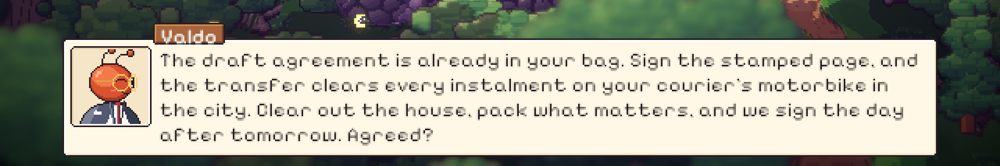

# 51. Bersih-Bersih, Dialog yang Terpotong, dan FPS di Layar Besar

**Tanggal:** 2026-10-21

## Tujuan

Menutup sisa pekerjaan rilis desktop (M15) dari laporan main langsung di build macOS:

- membuang aset cerita lama yang tidak dipakai lagi;
- memperbaiki teks dialog panjang yang terpotong;
- menaikkan fps, yang turun ke sekitar 30 di alun-alun dan ke 20 di layar 4K penuh.

## Yang dikerjakan

### Membuang sisa cerita lama

Setelah disetujui, aset cerita lama dihapus:

- toko mainan Nora (`ArtSource/toyshop.js` dan `Resources/Art/places/toyshop`);
- barang-barang boneka, buku lama, dan koper bertanda "A.T.";
- adegan toko dan stasiun lama di `interiors.js`, dengan semua fungsi bantunya.

`export-rooms.js` sekarang hanya mengekspor barang dan ikon. Hasil ekspor ulang sama persis dengan sebelumnya, kecuali
`items.json` yang kehilangan ketiga barang tadi. Build macOS jadi 392 MB, sebelumnya 395 MB.

### Kotak dialog memanjang

Kotak dialog dulu selalu setinggi 62 px. Kalimat panjang yang butuh empat baris, seperti tawaran Valdo di Prologue,
keluar dari bawah kotak. Sekarang `Talk.Say` menata seluruh kalimat lebih dulu, dengan sisa yang belum diketik tidak
terlihat, lalu memanjangkan kotak sesuai tingginya sebelum kalimat mulai diketik. Panah lanjut dan daftar pilihan ikut
bergeser.

### FPS di layar besar

Hasil pengukuran di editor (alun-alun saat senja, jendela 1906x840, Apple M4):

| Bagian | Waktu GPU |
| --- | --- |
| Peta bayangan (4096) | sekitar 6 ms |
| Gambar utama | sekitar 5,5 ms |
| Post-processing (DoF, bloom, vignette) | sekitar 2,5 ms |
| Total | sekitar 14 ms |

Yang dicoba dan tidak membantu: depth priming, loop shader (lampu, kaki, awan), dan mematikan bayangan dari tanah atau
overlay. Peta bayangan 2048 menghemat 3 sampai 4 ms, tapi mengubah sekitar 2% piksel gambar, jadi tidak dipakai.

Masalah utamanya ada di layar 4K. Gambar utama dan post-processing dihitung per piksel, dan 4K punya empat kali piksel
1080p. Padahal art game ini digambar 3 piksel layar per piksel art di 1080p, jadi 4K tidak menambah detail apa pun,
hanya menambah beban.

Atas pilihan pengguna, dunia sekarang digambar paling detail setara 1080p. Di layar yang lebih besar, gambarnya
diperbesar dengan kelipatan bulat tanpa penghalusan:

- `Main.FitWindow` memasang render scale URP `1 / (factor / 3)`; `factor` 6 di 4K, jadi skalanya 0,5;
- filter upscaling URP diganti ke Point, supaya piksel tetap tajam;
- UI tetap digambar di resolusi penuh jendela.

Sampai 1080p dan jendela yang lebih kecil (`factor` di bawah 6), tidak ada yang berubah. Keputusan ini dicatat di
`GAME-CONTEXT.md`.

| Pengukuran di editor, adegan sama | Waktu GPU |
| --- | --- |
| Render scale 1 | 12,8 ms |
| Render scale 0,5 (seperempat piksel) | 9,0 ms |

Sisanya hampir seluruhnya peta bayangan, yang biayanya tetap di resolusi berapa pun. Di 4K, bagian per piksel kira-kira
lima kali jendela editor tadi, jadi penghematannya jauh lebih besar di sana. Build macOS di 4K sekarang menggambar
jumlah piksel yang sama dengan 1080p.

## Masalah dan solusinya

- **Tes Night 5 gagal sekali.** Di satu putaran penuh, `NightsTest.Night5PlaysThrough` gagal karena kurir tidak sampai ke
  tempayan air. Tes itu lulus saat dijalankan sendiri (21 detik) dan lulus di putaran-putaran sebelumnya. Kedua
  perubahan di langkah ini tidak menyentuh cara kurir berjalan, jadi kegagalan itu dicatat sebagai tes yang kadang
  gagal.
- **Sisa pengaturan dari build.** Seperti biasa, perubahan otomatis dari build dibuang. Yang di-commit hanya filter
  upscaling Point.

## Cara dicek

- 16 dari 17 tes PlayMode lulus di putaran penuh, dan Night 5 lulus saat diulang sendiri.
- Di editor, kalimat Valdo empat baris di Prologue tampil utuh di dalam kotak.
- Di editor dengan `factor` 2, render scale tetap 1, jadi tampilan tidak berubah.
- Build macOS (392 MB) dan Windows (417 MB) dibuat ulang dengan kedua perbaikan, tanpa error.

## Commit

- `1b94afb` chore(art): remove the retired story's leftovers
- `e50c1ec` fix(ui): grow the talk box to fit long lines
- `782de45` perf(render): draw the world at 1080p detail on bigger screens

## Langkah berikutnya

- Membaca Metal HUD di build macOS baru, di layar 4K penuh dan di alun-alun.
- Mencoba build Windows di PC Windows.
