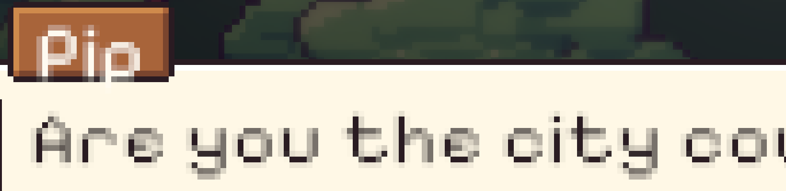
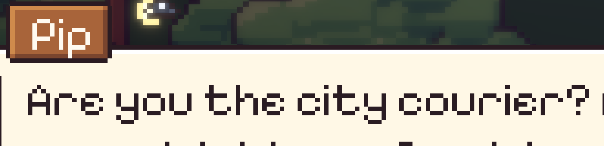
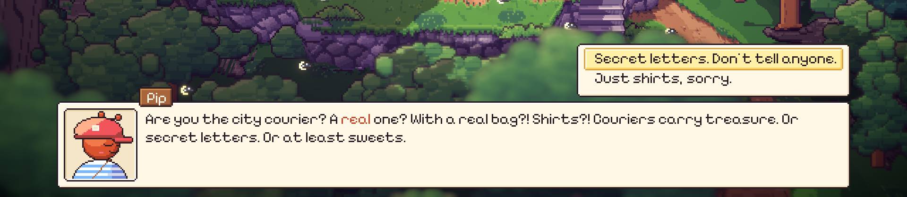
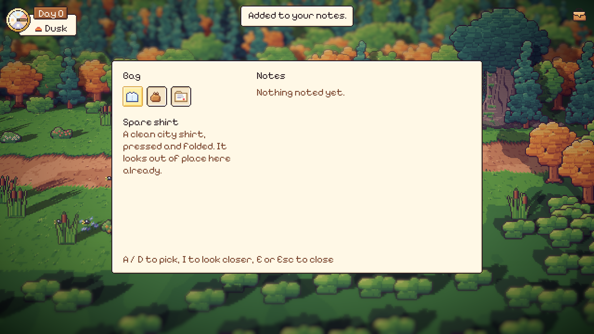

# 52. Huruf yang Tajam

**Tanggal:** 2026-10-21

## Tujuan

Pengguna melaporkan dari build macOS di layar 4K bahwa teks UI kabur dan sulit dibaca. Nama di label kayu ("Pip",
"Day 0") dan tooltip juga terlihat turun keluar dari bingkainya.

## Yang dikerjakan

### Mencari penyebab

Gambar UI sendiri sudah tajam. Canvas UI dirender ke texture kecil dengan filter Point, lalu diperbesar dengan kelipatan
bulat oleh shader `Present` tanpa penghalusan. Masalahnya ada di hurufnya.

Pixelify Sans digambar di atas grid piksel. Dengan 1000 unit per em, satu piksel huruf sekitar 91 unit, jadi ukuran
aslinya 11 px. UI memakai ukuran 13 px, sehingga satu piksel huruf jatuh di 1,18 piksel canvas. Unity lalu menghaluskan
tepinya dengan piksel abu-abu, dan setelah canvas diperbesar enam kali di 4K, tepi abu-abu itu terlihat sebagai teks
yang kabur. Di tangkapan layar 1080p, setiap garis huruf terdiri dari satu piksel gelap dan satu piksel abu-abu.

Ukuran 13 px juga menaruh garis dasar huruf 12 px di bawah atas kotak teks. Di label setinggi 14 px, huruf jadi
menempel di bingkai bawah, dan ekor huruf "p" keluar dari bingkai.

### Perbaikan

Dua perubahan, dicoba satu per satu:

1. **Tanpa penghalusan.** Font diimpor sebagai *hinted raster*. Tepi abu-abu hilang, tapi di 13 px tebal garisnya
   tidak rata: sebagian 2 piksel, sebagian 1 piksel.
2. **Ukuran asli.** `Look.FontSize` diubah dari 13 ke 11. Setiap piksel huruf sekarang tepat satu piksel canvas,
   garisnya rata, dan nama duduk di dalam labelnya.

Pengguna sempat bertanya apakah sebaiknya ganti font. Font lain tidak menyelesaikan masalahnya sendiri, karena setiap
font piksel hanya tajam di ukuran grid-nya. Setelah melihat hasil 11 px, pengguna memilih tetap memakai Pixelify Sans.
Teksnya sekitar 15% lebih kecil, tapi tajam di semua resolusi. Keputusan ini dicatat di `GAME-CONTEXT.md`.

## Cara dicek

- Semua teks game lewat `Look.Label`, jadi semuanya ikut berubah. Tidak ada tempat lain yang memasang ukuran font
  sendiri.
- Dicek di editor pada 1080p:
  - dialog dengan label nama;
  - daftar pilihan;
  - kartu bab;
  - halaman jurnal;
  - dial hari dan label "Day 0";
  - tas, catatan, dan toast.

  Semuanya tajam dan muat di panelnya.
- Semua 17 tes PlayMode lulus.
- Build macOS dan Windows dibuat ulang.

## Commit

- `7a784c8` fix(ui): draw the pixel font crisp at its own size
