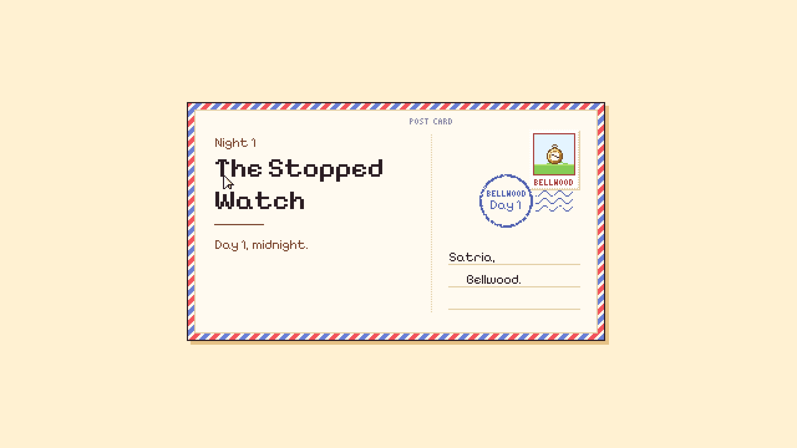
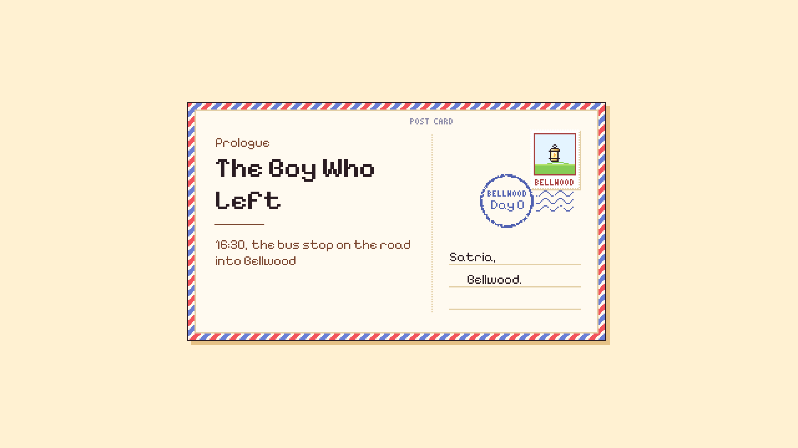
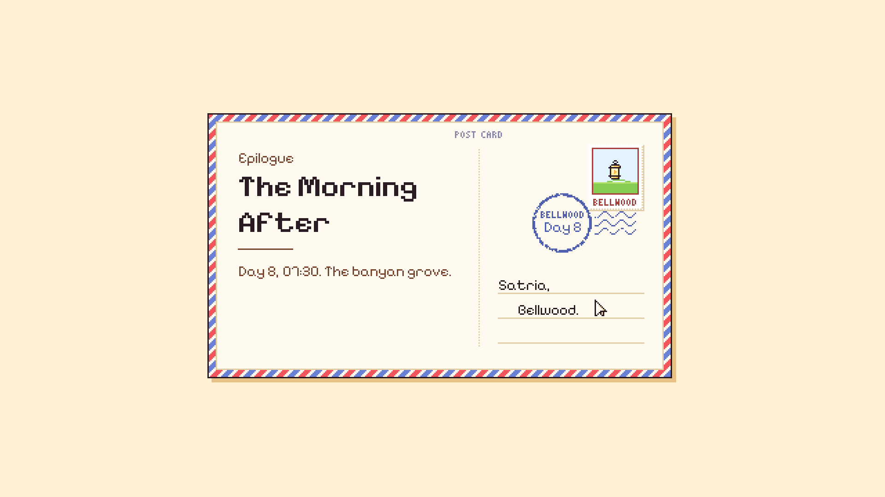
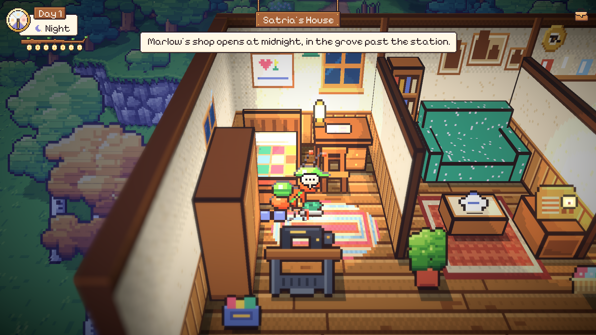
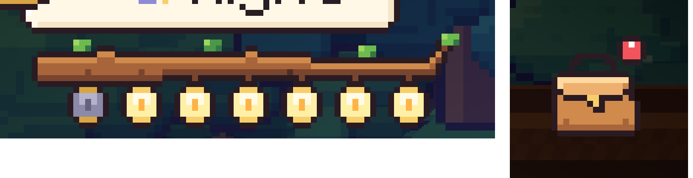

# 53. UI yang Lebih Kaya: Kartu Pos, Papan Nama, dan Lentera Marlow

**Tanggal:** 2026-10-21

## Tujuan

Pengguna merasa UI terlalu polos. Saat menjelajah, layar hanya berisi dial waktu di kiri atas dan tas di kanan atas,
dan kartu bab hanya berupa krem polos dengan satu lentera dan dua baris teks.

Ke-12 elemen HUD di tabel GDD 11.2 sudah dibangun semua, dan "tanpa minimap, timer, atau penanda misi" adalah pilar
game. Karena itu HUD tidak diberi widget tetap. Yang ditambahkan adalah *momen*: hal kecil yang muncul saat sesuatu
terjadi lalu pergi. Ada satu tambahan tetap, yaitu ide di luar GDD yang dipilih pengguna sendiri: tujuh lentera Marlow.

## Yang dikerjakan

### Kartu bab menjadi kartu pos kurir (`UI/Card.cs`)

Satria adalah kurir, jadi setiap kartu bab (Prologue, Night 1 sampai 7, Epilogue) sekarang berbentuk kartu pos:

- bingkai airmail bergaris merah dan biru, tulisan POST CARD, garis putus-putus di tengah, dan tiga baris alamat yang
  ditujukan kepada "Satria, Bellwood.";
- judul bab berukuran 22 px, tepat dua kali grid font, jadi tetap tajam;
- prangko berlubang-lubang berisi keepsake malam itu (jam saku, kelinci perca, kamera, kunci, sepatu, buku besar,
  kotak musik). Prologue dan Epilogue memakai lentera Marlow;
- cap pos BELLWOOD bertinta biru dengan hari, misalnya "Day 1".

Gerakannya: kartu meluncur naik dari bawah layar, lalu cap pos dihentakkan ke prangko dengan bunyi *stamp*, dan kartu
ikut tersentak satu piksel. Klik saat animasi berjalan akan mempercepatnya, dan klik berikutnya melanjutkan cerita.
Kartu pergantian waktu ("09:00. The square, before the hall.", "The night passes.") cukup memakai cap pos di atas
baris-barisnya.

Kartu malam sekarang juga punya baris kedua, "Day N, midnight.", seperti Night 7 yang sudah punya "Day 7, morning.".
Dengan begitu sisi pesan kartu pos tidak kosong.

### Papan nama tempat (`UI/Hud.cs`)

Setiap kali kurir masuk ke sebuah tempat, namanya turun dari atas layar di papan kayu yang digantung dua tali. Papan
itu sedikit memantul saat berhenti, tergantung tiga detik, lalu naik lagi. Jika ada adegan, papan berhenti sejenak dan
lanjut setelah adegan selesai. Nama area mengikuti zona di bible:

- Bellwood Station, The Market Square, The East Gardens, The East Road, The South Coast, The Banyan Grove;
- setiap interior, misalnya Satria's House, Marlow's Curios, dan The Village Hall.

Nama itu disimpan di `PlaceDef.Name`. Petunjuk (toast) yang muncul bersamaan otomatis turun ke bawah papan.

### Tas yang bereaksi

Saat ada barang atau catatan baru masuk, ikon tas melompat kecil dan memakai titik merah sampai tas dibuka.
Sebelumnya hanya toast yang memberi tahu, dan toast hilang setelah empat detik. Barang yang sudah dibawa sejak awal
tidak dihitung sebagai baru.

### Tujuh lentera Marlow (`UI/Dial.cs`)

Ide di luar GDD yang dipilih pengguna. Selama Night 1 sampai 7, tujuh lentera kecil tergantung di dahan beringin di
bawah dial, seperti lentera yang tergantung di atas toko Marlow. Lentera yang masih menunggu keepsake-nya menyala dan
berkedip.

Setiap kali sebuah keepsake pulang ke pemiliknya, lentera itu padam: kaca jadi abu-abu dingin dan asap tipis naik dari
tutupnya. Lentera ini membaca `Game.LanternsOut`, angka yang sama dengan lentera di toko. Padamnya terjadi saat kontrol
kembali ke pemain sesudah cutscene, supaya pemain melihatnya. Mengarahkan kursor ke lentera menampilkan berapa yang masih
menyala.

Lentera tidak tampil di Prologue, karena toko belum dikenal, dan tidak tampil di Epilogue, karena toko sudah hilang.
Lentera ini menunjukkan seberapa jauh cerita sudah berjalan, tanpa menunjukkan ke mana harus pergi. Pilar tanpa penanda
misi tetap terjaga.

### Gambar baru

Semua digambar dengan kode di `ArtSource/export-cast.js`:

- `postcard`, `stamp`, dan `postmark`;
- `branch`, `hud_lantern` (menyala, berkedip, padam), dan `hud_smoke`;
- `sign` dan `sign_rope`;
- `badge`.

Ekspor ulang tidak mengubah satu pun gambar lama.

## Masalah dan solusinya

- **Huruf B di cap pos terpotong.** Kata BELLWOOD tidak muat di dalam cincin ganda. Cincin bagian dalam dihapus,
  sehingga kata itu muat di dalam satu cincin tebal.
- **Gelombang cap menimpa tulisan prangko.** Cap pos diturunkan, supaya gelombangnya melintas di bawah tulisan
  BELLWOOD milik prangko.
- **Asap tidak terlihat.** Asap pertama berwarna abu-abu pucat dan naik tepat di atas dahan cokelat, sehingga tenggelam.
  Asap digambar ulang lebih tinggi dan lebih putih, melengkung naik dari tutup lentera dalam empat frame.
- **Dahan seperti papan.** Dahan pertama berupa batang lurus. Dahan digambar ulang lebih tebal di pangkal, berbonggol,
  mengecil ke ujung, dan diakhiri ranting yang naik.

## Cara dicek

- Semua 17 tes PlayMode lulus.
- Dicoba di editor pada 1080p:
  - kartu pos Prologue dan Night 1;
  - kartu pergantian waktu;
  - papan nama Satria's House saat Night 1 dimulai, dengan petunjuk di bawahnya;
  - tujuh lentera menyala, lalu satu padam dengan asap setelah `LanternsOut` bertambah;
  - tas melompat dan memakai titik setelah catatan baru.
- Build macOS dan Windows dibuat ulang.

## Commit

- `9020fd2` feat(ui): postcard chapter cards, place signs and Marlow's lanterns
